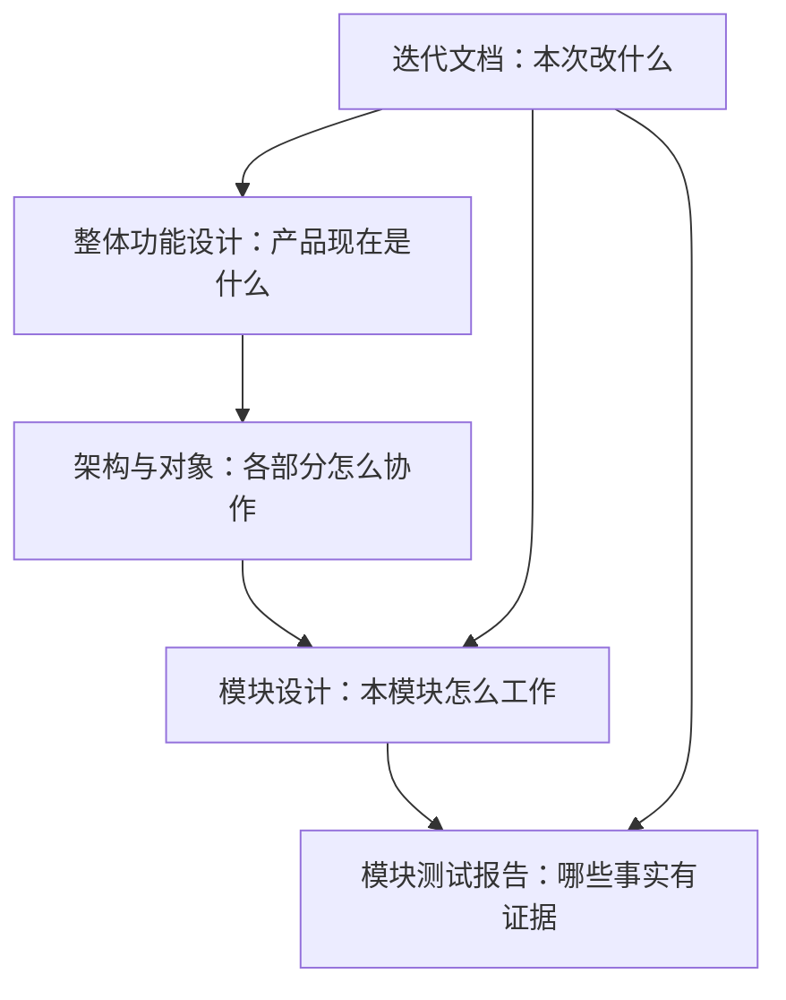

# AgentBridge 项目资料

更新：2026-10-14。这里维护项目的完整现状与已确认设计。阅读和开发不需要先复盘历次对话或迭代。

当前已发布 Windows 程序是 **0.5.0**；当前源码候选为 **0.6.0-alpha.18 / Windows 运行缓存与原提交恢复**，节点图、授权/布局事务、状态分层与原父权限主要范围在 alpha.6 已验收；alpha.7 主角色/方向/避让与中键证据保留；alpha.8 修复旧后台下拖动锁定、支持整组背景拖动和主居左，当前证据见 [拖动修复](iterations/I06/graph-drag-fix.md)。独立双向原生链保留 alpha.6 实测结果。alpha.2 的主要验收与 alpha.3–alpha.5 修复证据保持原版本；本次实际工程、界面、独立双向链及最终包状态见 [I06B 实施](iterations/I06/graph-implementation.md)。I06C 与正式 0.6.0 准出未完成。

网页阅读：在仓库根执行 `npm run docs:dev`，打开 `http://localhost:4188`。使用方法见 [网页说明](web-reading.md)。

远端源码、私有运行状态及本地验收材料的范围见 [远端源码范围](repository-sync.md)。

## 从哪里开始

| 你要做的事 | 阅读顺序 |
| --- | --- |
| 理解产品、确认功能边界 | [整体功能设计](product-design.md) → [模块目录](module-plan.md) |
| 理解系统如何运行、如何通信 | [整体架构](architecture.md) → [对象与数据](data-model.md) → [接口与协议](protocol.md) |
| 开发或修改某个功能 | 对应模块的 `design.md` 和 `test-report.md` → [开发与文档维护](development-guide.md) |
| 判断哪些功能可验收 | [整体验证报告](testing.md) → 对应模块测试报告 → 报告引用的原始证据 |
| 排下一轮工作 | [迭代路线与当前交付](project-plan.md) → [迭代目录](iterations/README.md) |
| 启动、构建或排障 | [仓库说明](../README.md)、[桌面使用说明](../desktop/README.md)、[打包模块](modules/10-packaging/design.md) |

## 模块设计与测试报告

| 模块 | 设计 | 测试报告 |
| --- | --- | --- |
| M01 桌面界面与交互 | [设计](modules/01-desktop/design.md) | [报告](modules/01-desktop/test-report.md) |
| M02 中央 Coordinator | [设计](modules/02-coordinator/design.md) | [报告](modules/02-coordinator/test-report.md) |
| M03 机器与 Agent 节点 | [设计](modules/03-machine-network/design.md) | [报告](modules/03-machine-network/test-report.md) |
| M04 SSH 接入、信任与安装 | [设计](modules/04-ssh-access/design.md) | [报告](modules/04-ssh-access/test-report.md) |
| M05 Linux daemon 与 relay | [设计](modules/05-linux-daemon/design.md) | [报告](modules/05-linux-daemon/test-report.md) |
| M06 原生 Agent 适配 | [设计](modules/06-native-adapters/design.md) | [报告](modules/06-native-adapters/test-report.md) |
| └ OpenCode | [设计](modules/06-native-adapters/opencode/design.md) | [报告](modules/06-native-adapters/opencode/test-report.md) |
| └ Claude Code | [设计](modules/06-native-adapters/claude/design.md) | [报告](modules/06-native-adapters/claude/test-report.md) |
| └ Codex | [设计](modules/06-native-adapters/codex/design.md) | [报告](modules/06-native-adapters/codex/test-report.md) |
| M07 任务、会话与恢复 | [设计](modules/07-task-session/design.md) | [报告](modules/07-task-session/test-report.md) |
| M08 主从关系与协作 | [设计](modules/08-collaboration/design.md) | [报告](modules/08-collaboration/test-report.md) |
| M09 CLI 与 Hub/Edge 兼容入口 | [设计](modules/09-cli-hub-edge/design.md) | [报告](modules/09-cli-hub-edge/test-report.md) |
| M10 打包与交付 | [设计](modules/10-packaging/design.md) | [报告](modules/10-packaging/test-report.md) |

| M11 文档网页入口 | [设计](modules/11-documentation-portal/design.md) | [报告](modules/11-documentation-portal/test-report.md) |

## 如何读状态

- **已发布**：已包含在注明版本的程序中，不代表每个原生工具或账号都可执行。
- **源码已实现**：代码存在，测试范围见报告；尚未发布的能力不能用旧 EXE 验证。
- **已确认设计**：决定怎么做，还没有功能实现或交付证据。
- **候选**：原始设想或后续建议，还没有纳入当前开发范围。

测试报告使用“通过、部分验证、未测试、失败/环境限制”描述事实。每条都注明受控测试、界面模拟、真实 Agent 或发布包实测，计划中的用例不计入通过数。

## 文档的职责

整体设计是持续维护的当前说明；迭代材料记录一次变更的范围、实现和验收。历史报告保留原日期、版本与限制，不能用新结果改写旧结论。

原始 [doc.md](../doc.md) 是项目初稿，原来的综合计划保存在 [历史资料](archive/README.md)。当前行为以本目录的整体设计、模块设计和测试证据为准。旧 `docs/` 只保留迁移入口。

历史 6A 候选见 [验收与程序](iterations/I06/acceptance.md)，6B alpha.6 的主要验收与限制见 [实施报告](iterations/I06/graph-implementation.md)，alpha.7 图优化见 [专项](iterations/I06/graph-usability.md)，alpha.8 拖动修复见 [验收](iterations/I06/graph-drag-fix.md)，最新 alpha.9 节点管理见 [交付](iterations/I06/node-management.md)；6C 尚未完成。

alpha.9 历史交付：[alpha.9 节点管理](iterations/I06/node-management.md)，保留机器图单页，支持按机器接入/断开/移除节点，原生安装与历史保持；未知结果按原 ID 核对。

## 当前 I06C 首批机器管理

2026-10-13 / alpha.10：机器 SSH 连接编辑、确认断开/移除、原身份恢复、已观察历史持久化/阅读及事件游标缺口分页补偿已实现；桌面 136/136、真实本机 TCP SSH/生产 daemon 隔离恢复和 Windows 界面分别通过。完整 I06C、升级回滚和正式 0.6.0 未准出。 本次完整交付与限制见 [I06C 首批](iterations/I06/machine-management.md)，不覆盖历史原生证据。

当前上传修复候选：[alpha.14](iterations/I06/ssh-upload-recovery.md)；冻结 alpha.13 后台维护与实机验收见 [I06C 收尾](iterations/I06/final-delivery.md)。

## GitHub 预发布下载

2026-10-13：alpha.9 Windows x64 EXE 已作为 GitHub 预发布附件提供，[下载程序](https://github.com/wsjq5477/MA-Relay/releases/download/v0.6.0-alpha.9/AgentBridge-0.6.0-alpha.9-Windows-x64.exe)、[发布页](https://github.com/wsjq5477/MA-Relay/releases/tag/v0.6.0-alpha.9)。用户无需自行编译或安装 WSL/Node.js 来运行 AgentBridge。稳定历史版本仍为 0.5.0；这次发布不代表完整 I06C 或正式 0.6.0 准出，也没有将本地 alpha.10 源码/程序同步到该标签。

上传与核验范围见 [GitHub EXE 发布记录](iterations/I06/github-release.md)。

## 当前 alpha.13 收尾状态

alpha.13 已实现后台可信升级/回滚/停止/卸载、原维护恢复、控制收据校验与敏感表单脱敏。桌面 150/150、维护 7 项与源码/包一致性通过；独立 Linux 原生链和最终准出仍按 [I06C 收尾](iterations/I06/final-delivery.md) 的实际证据更新。 历史发布和各次原生证据保留原日期，候选包构建不等于正式发布。

## 2026-10-14：SSH 上传失败诊断与安装入口恢复

AB-F06/F17，M01/M04/M10：alpha.14 区分安全的 SFTP 失败类别、按实际 ACK 字节计进度并等待关闭确认；明确上传失败后可重新检测和批准原安装，unknown 不显示重装入口。桌面 155/155、上传专项 5/5（含本机真实 TCP SSH/SFTP）和 Windows 受控响应界面 2 组通过。用户另一台机器到原服务器未重测；本次不自动改变 GitHub alpha.9 附件或完整 I06C 准出。包与 EXE 的分层实际结果见 [alpha.14 上传诊断与恢复](iterations/I06/ssh-upload-recovery.md)。

## 当前 alpha.16 维护恢复

当前源码候选 alpha.16；维护未发送后认证失败、磁盘恢复占位与忙碌提示已修复。桌面 163/163、SSH 7/7（受控真实 TCP，模型 0）通过；历史 alpha.15 发布保持原源码和 EXE 对应，完整 I06C 未准出。见 [当次交付](iterations/I06/maintenance-launch-recovery.md)。

## 当前 alpha.18 运行缓存修复

Windows OpenCode 后台资源清单自引用及原未派发提交恢复已修复，查询提供具体反馈；当前工程、Windows、EXE 与未测项见 [专项交付](iterations/I06/runtime-recovery.md)。旧后台须在设置中停止后重开新 EXE，原请求与历史保留。

当前 alpha.18 已以 GitHub prerelease 分发：[Windows EXE](https://github.com/wsjq5477/MA-Relay/releases/download/v0.6.0-alpha.18/AgentBridge-0.6.0-alpha.18-Windows-x64.exe)、[校验文件](https://github.com/wsjq5477/MA-Relay/releases/download/v0.6.0-alpha.18/SHA256SUMS.txt)、[源码 PR #1](https://github.com/wsjq5477/MA-Relay/pull/1)。源码标签绑定 `1f0d9ef`，独立分支未合入 master；分发只证明对应附件核验，不扩大为完整 I06C 准出。详见 [发布记录](iterations/I06/github-release.md)。
