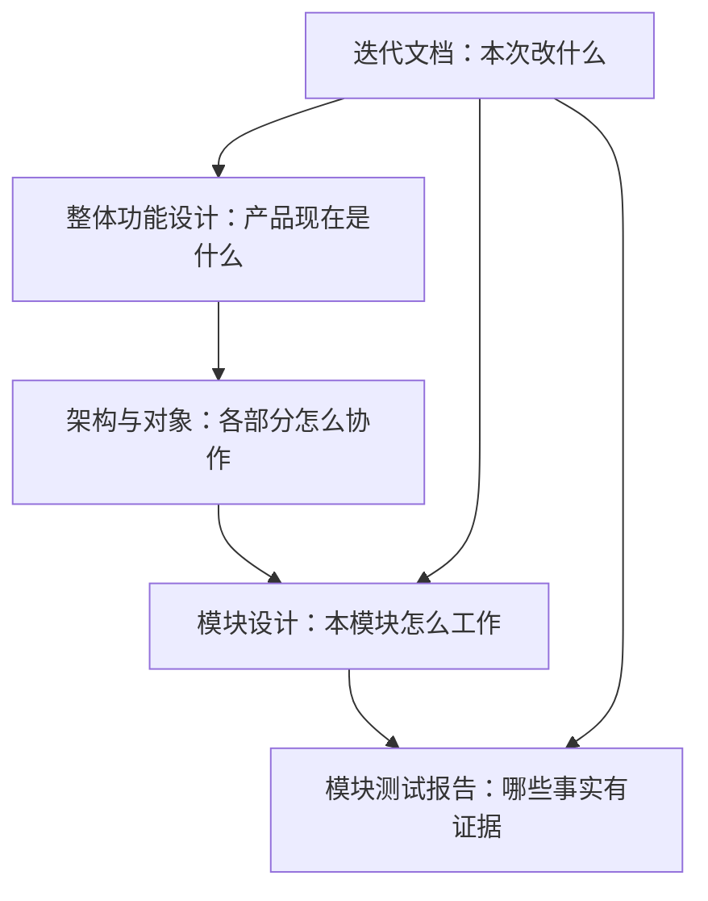

# AgentBridge 项目资料

2026-10-20 issue #12：当前隔离源码修复同机独立节点被管理 unknown 误锁、原操作查询无反馈及设置台账漏项。管理写入仍按机器保护，执行按原节点/同安装/共享目录保护；机器维护、授权和来源缺失继续保守保护。本地 **0.6.0-alpha.35** EXE、包核验和普通无调试 EXE 五组验证已完成，修复位于 PR #13；尚未合并/公开发布，公开仍 alpha.34，未把用户现场或完整 I06C/I07C 改为通过。[需求、开发、验收与交付](iterations/I07/scoped-execution-recovery.md)。

2026-10-20 **0.6.0-alpha.34已预发布**：当前整合源码和新Tag已推送，标签冻结`1af4dab`，EXE与SHA-256附件已上传并通过匿名完整下载核验。包含OpenCode1.x/2.x、独立MCP、CT-04/CT-05及既有alpha.30–33修复；Windows旧后台门禁、包/普通EXE与未测边界分别见[交付记录](iterations/I07/alpha34-release.md)。完整I06C/I07C仍未准出。

2026-10-20发布前准备记录 **0.6.0-alpha.34**：用户授权提交当前完整源码并发布Windows EXE，含OpenCode1.x/2.x、独立MCP、CT-04/CT-05与既有alpha.30–33整合，补alpha.33精确daemon清单。固定源码构建、普通EXE及公开完整下载结果完成后在[本轮交付](iterations/I07/alpha34-release.md)登记；当时仍在发布准备阶段，旧包/标签范围不变。

2026-10-20 **0.6.0-alpha.33已预发布**：PR #11已合并，标签冻结`ecc47d5679dcc7a1de0a5d746c018f68e169cf4e`，EXE与校验附件已公开并完成匿名完整下载核验。本次为公开alpha.32上的issue #10独立补丁，不含主工作区CT-04/独立MCP/CT-05或后续OpenCode1.x未发布驱动。维护上传的进度错误不再中断SFTP，最终台账保存失败仍不发送原维护输入。 [交付、校验与升级边界](iterations/I07/maintenance-persistence.md)。

## 2026-10-20：OpenCode 1.x / 2.x 兼容修复

OpenCode 当前源码已新增官方 1.x 协议接入，支持生命周期与 MCP 双格式。旧公开 alpha.32 和本地 integrated.3 EXE 不含此修复；源码、官方 CLI 受控传输、Windows/SSH 未测范围按专项分别记录。 [需求、实现、验证与未测边界](iterations/I07/opencode-v1-compatibility.md)。

## 2026-10-20：维护上传进度与持久化修复（issue #10）

维护上传进度只更新内存并合并通知；本地诊断失败不中止SFTP，最终机器/维护台账必须保存才发送。公开alpha.33候选与主工作区CT-04/CT-05源码范围分开。 [完整设计、实测与边界](iterations/I07/maintenance-persistence.md)。

2026-10-20后续源码完成[CT-05桌面选材与导出](iterations/I07/context-packet-ui.md)：明确目标成员及文档/任务/消息/历史产物版本，核对后文字预览、复制、MD/JSON本机下载。观察到任务修订/成员变化或切工作时旧包失效，不发送/授权/执行。桌面581/581、Windows生产前端9组通过，模型0；未打新包，公开alpha.32与本地integrated.3旧冻结范围不变。

2026-10-20当前源码新增[CT-05明确选择的材料包](iterations/I07/context-packet.md)：同一工作有效成员、明确文档修订/任务轮次/消息/产物版本，只读JSON/Markdown；每类8项、总响应256 KiB，不派发/授权/已读/搬原生Session。WSL桌面576/576、Windows定向14/14，真实Claude2.1.303一个Task读取旧版并重开不重放。公开仍alpha.32，本地integrated.3冻结EXE不含本片，未打新包；以下按原日期保留历史范围。

2026-10-19：[已发布修复与MCP/公共材料整合](iterations/I07/integrated-source.md)完成，核心51/51、最终桌面570/570和Windows生产前端26组通过，模型0；独立冻结integrated.3候选已构建，包资源42 CJS/78核心/1446 Linux条目核对通过。当前公开仍alpha.32，Git HEAD未移动；最终普通Windows EXE五组通过，原任务/MCP/SQLite与后台重启不重放，完整I06C/I07C未准出。

## 2026-10-19：OpenCode 2.x与按机器管理（alpha.32已预发布）

issues #8/#9：严格OpenCode 2.x准入与旧配置快速拒绝；未知节点操作按机器阻断，另一空闲SSH可打开维护并确认。Windows EXE、校验附件已公开，匿名完整下载核验一致。 [需求、实现、验证与边界](iterations/I07/version-management-recovery.md)。

alpha.32已完成普通EXE及公开完整下载核验，标签冻结`fcdad72fba454bf731cf66df54bc1caf2a06e0a2`，EXE与SHA-256附件公开可取；后续文档补录不移动标签。[发布与升级边界](iterations/I07/version-management-recovery.md)。

## 2026-10-19：协作兼容修复（alpha.31已预发布）

本轮issue #7修复与alpha.31已预发布：OpenCode接入兼容、委派rejected、原任务读控及后台升级门禁。 [需求、实现、实测与边界](iterations/I07/collaboration-compatibility.md)。

## alpha.30已预发布：历史详情读取恢复

alpha.30已发布源码修复处理issue #6，基于alpha.29独立工作树；原CT-04未提交开发保持，不混入本包。GitHub已预发布alpha.30。 [需求、实现、逐项证据与边界](iterations/I07/history-detail-recovery.md)。

2026-10-19：当前完整源码已发布为 **alpha.29 GitHub预发布**，新Tag、EXE与SHA-256校验附件均已上传；版本、包资源与实际发布状态统一见[alpha.29 交付](iterations/I07/alpha29-release.md)。历史专项保留原日期/冻结范围，完整 I06C/I07C 未准出。

2026-10-19：[CT-04桌面材料入口](iterations/I07/public-materials-ui.md)已完成按需索引/分页、指定修订核对、复制和MD下载；桌面541/541及Windows生产前端八组通过，模型0。公开当前为独立分支alpha.31，本地仍alpha.29派生且本片未发布；原源码/MCP修改保留，发布前先整合两边修复。

## 独立 MCP 文件与原生配置管理（2026-10-19）

I07-MCP01 / AB-F02/F12/F13：独立Bridge MCP配置文件、三种Agent原生用户配置增删、长期接入撤权与外部委派归属已实现。桌面537/537、核心45/45、类型/构建/lint通过；真实Claude2.1.303/Codex0.162.1/OpenCode2.0.24列表增删通过，Windows生产前端4组通过。均使用隔离配置，模型调用0；真实新EXE/独立SSH仍未验，公开alpha.29冻结范围不变。[需求、开发、验收和首次失败](iterations/I07/mcp-installation.md)。

2026-10-19：[CT-04公共材料首片](iterations/I07/public-materials.md)已在alpha.29之后源码实现：只读工作索引/Markdown与指定文档修订。桌面525/525；真实WSL Claude2.1.303读取当前索引及旧第1版通过，一个Task，重开未重放。尚未打新包，不在alpha.29 EXE内；桌面阅读/导出与CT-05继续待开发。下方历史记录按各自日期/冻结范围阅读。

2026-10-19较早：冻结源码23d256e已发布为 **alpha.29 GitHub预发布**，新Tag、EXE与SHA-256校验附件均已上传；版本、包资源与实际发布状态统一见[alpha.29 交付](iterations/I07/alpha29-release.md)。历史专项保留原日期/冻结范围，完整 I06C/I07C 未准出。

2026-10-19：[CT-02真实MCP委派](iterations/I07/connection-delegation.md)完成三种已安装工具互相发现、普通委派、读取结果与主节点汇总，覆盖Claude/Codex/OpenCode之间全部六个有向组合。9个真实成功Task、9个原生Session，重开各链Task数3→3；新增验收保护7项，桌面517/517通过。无产品运行改动，公开alpha.28不变；新三工具、新EXE与独立SSH仍另验。

2026-10-19完成[Claude Projects / Dots / Grok Bot最新研究](iterations/I07/projects-dots-bots-research.md)：核对共享记忆索引、Library、选定上下文、具名Agent和可见交接。相关建议细化CT-04/05；Grok Build官方ACP入口列为CT-03候选，三个云产品不冒充已接入。本轮仅资料/方案，无产品代码或发布变化。

2026-10-19：[CT-02首批真实验证](iterations/I07/connection-native.md)已完成Claude2.1.302、OpenCode2.0.24、Codex0.163.0-alpha.10.2的真实直接回答、原Session续聊、取消及重开不重放。共9个原任务（6成功回答/3取消），观察后每工具任务仍3个。新三工具仍未实测；本轮不含新真实委派/SSH/EXE。新增可恢复验收工具及7项保护测试，全桌面510/510，未改变产品运行行为或公开alpha.28。

2026-10-19连接增量：CT-01已在未发布源码中完成执行/被委派/MCP调用方的能力一致化，以及原关系拒绝恢复。桌面503/503、核心45/45、Windows生产前端5组/5图通过；三种新工具普通委派为受控生产链证据，真实工具/新EXE/独立SSH未验。[CT-01实际交付](iterations/I07/connection-capabilities.md)；公开alpha.28与旧本地候选保持各自冻结范围。

2026-10-18本轮范围校准：核心目标是给Agent提供发现、调用和控制其他Agent的通路，自动续接、多用户不作为后续开发目标。[逐Agent接入矩阵与目标](agent-integration-matrix.md)区分CLI/HTTP执行、MCP调用方、被调用方及SDK/ACP；[ACP、Multica、公共MD与上下文研究](iterations/I07/connectivity-research.md)记录一手资料、固定源码与建议。本轮仅文档/研究，未新增产品或发布能力。

2026-10-18完成[真实原生执行成员公共文档链](iterations/I07/native-members.md)：同WSL三个独立Claude宿主，五次自动原生回合、原会话协调、成员终态后逐项/总验收及恢复不重放通过。独立SSH、代码编译返修及完整I07C/I06C继续未准出。

2026-10-18继续开发：[原生接入准入与核对收据](iterations/I07/native-integration-guards.md)补齐仅直接会话工具的小队准入，以及 Codex/Hermes/Pi/DSH 原 operationId 核对收据恢复。本片为未发布源码，不在先前 poll.4/公开 alpha.28 中。

最终本地候选poll.4已生成并核验；普通Windows EXE90秒进程归属采样中新候选黑窗0、旧alpha.28黑窗3，模型0。[EXE、摘要及完整边界](iterations/I07/desktop-polling.md)。

2026-10-18新增[桌面空闲黑窗与刷新优化](iterations/I07/desktop-polling.md)：实时轮询与安装扫描分开，稳定机器/Agent展示；本地候选与实际Windows验证按专项记录，公开alpha.28不变。

当前源码修复升级后同一 Agent 多版本节点：按目标用户当前命令报告版本，旧安装保留历史及unknown占用。 [需求、开发与实际验证](iterations/I07/current-agent-discovery.md)。

## 2026-10-18：Hermes / Pi / DSH 与自定义适配接口

当前未发布源码新增三种原生 Agent 直接会话、六种工具本地图标及受校验的源码注册接口。[需求、开发与实际验证](iterations/I07/native-agent-expansion.md)、[自定义 Agent 开发指南](custom-agent-development.md)、[官方图标来源](../desktop/assets/agents/README.md)。新增适配器不声明 Bridge 权限表单/MCP 小队协作；真实模型、新 EXE 和独立 SSH 分别保留未测边界。下述 ui.2 与 GitHub alpha.28 的冻结范围不因此改变。

## 2026-10-18：桌面 UI 重构与本地候选

当前本地 UI 候选为 **0.6.0-alpha.28.ui.2**，主工作区 package/lock 和 GitHub 公开包仍为原 **alpha.28**；没有发布新 GitHub 附件。候选包含 UI 重构与原生会话/业务验收保护增量。入口：[CC Switch 研究](iterations/I07/cc-switch-ui-research.md) → [需求、设计与交付](iterations/I07/ui-redesign.md) → [Windows 逐图与交互验收](iterations/I07/ui-visual-acceptance.md)。

UI冻结源码桌面381/381（含59项React SSR）；Windows Edge主界面5组12图、独立状态10组8图、小队3组3图与关系图10组分别通过。独立快照包资源匹配，普通无debug Windows EXE4项真实IPC/SQLite、关闭/重开及后台重启通过，模型0、原请求无新增重放；10条只读历史保留为观察基线。各层计数不相加，不替代用户profile、独立SSH或真实模型验收，完整I06C/I07C未准出。

这些结果与候选绑定北京时间08:50的UI冻结源码。11:18后其他线程在共享目录加入的Agent适配、工具发现和图标增量未进入ui.2；不宣称当前共享目录全部最新代码已通过本轮验证。

[本地候选 EXE](../artifacts/ui-redesign/2026-10-18/AgentBridge-0.6.0-alpha.28.ui.2-Windows-x64.exe)为129899528字节，SHA-256 `20a84ce98380457e5520d6bb9fc941c666c299a67b216e862d8568b7b3d015a6`；[包核验](../artifacts/ui-redesign/2026-10-18/package-ui2.json)、[普通EXE证据](../artifacts/ui-redesign/2026-10-18/portable-ui2.json)。本地文件不表示已公开分发；旧alpha.28 EXE保持原字节。

## 2026-10-17：alpha.28已预发布，SSH持久拒绝恢复

alpha.28公开包修复issue #5；以下旧版本说明保留原日期/交付范围。 [设计、需求、开发、验收与边界](iterations/I06/daemon-rejection-recovery.md)。

2026-10-17 alpha.27历史交付：修复issue #3/#4的Windows Codex未派发任务与本地台账替换恢复；[下载EXE](https://github.com/wsjq5477/MA-Relay/releases/download/v0.6.0-alpha.27/AgentBridge-0.6.0-alpha.27-Windows-x64.exe)、[校验文件](https://github.com/wsjq5477/MA-Relay/releases/download/v0.6.0-alpha.27/SHA256SUMS.txt)。桌面288/288、Windows契约86/86、普通EXE受控恢复5组通过，用户故障机/真实模型未复验。[完整交付](iterations/I06/windows-start-persistence.md)。以下保留各历史交付时点。
2026-10-17新增 **alpha.26 GitHub预发布**：恢复对原 Linux alpha.24 的可信连接，随后可从原机器维护升级；同时补收 alpha.25 冻结清单。当前 GitHub 已分发 alpha.26；候选包未包含另有的 I07 续接源码增量。实际程序、升级步骤与验证边界见[Linux旧后台升级专项](iterations/I06/ssh-alpha24-upgrade.md)。

2026-10-17较早alpha.25发布记录（历史时点），修复Windows未完成上下文遮挡原请求查询，并纳入先前不完整任务回应保护；[下载Windows EXE](https://github.com/wsjq5477/MA-Relay/releases/download/v0.6.0-alpha.25/AgentBridge-0.6.0-alpha.25-Windows-x64.exe)。验收、升级、摘要及未测边界见[原请求恢复专项](iterations/I06/windows-context-recovery.md)。以下alpha.24/alpha.23段落保留其交付时点。

更新：2026-10-18。这里维护项目的完整现状与已确认设计。阅读和开发不需要先复盘历次对话或迭代。

历史交付说明（2026-10-16发布前）：稳定历史 Windows 程序是 **0.5.0**；当时源码/本地候选为 **alpha.24 / 小队停止与原生终态核对**（[当片交付](iterations/I07/native-stop.md)）；GitHub预发布为 **0.6.0-alpha.23 / 小队协作与I07C首批持续协调**（[EXE与发布记录](iterations/I07/github-release.md)），节点图、授权/布局事务、状态分层与原父权限主要范围在 alpha.6 已验收；alpha.7 主角色/方向/避让与中键证据保留；alpha.8 修复旧后台下拖动锁定、支持整组背景拖动和主居左，当前证据见 [拖动修复](iterations/I06/graph-drag-fix.md)。独立双向原生链保留 alpha.6 实测结果。alpha.2 的主要验收与 alpha.3–alpha.5 修复证据保持原版本；本次实际工程、界面、独立双向链及最终包状态见 [I06B 实施](iterations/I06/graph-implementation.md)。I06C 与正式 0.6.0 准出未完成。

网页阅读：在仓库根执行 `npm run docs:dev`，打开 `http://localhost:4188`。使用方法见 [网页说明](web-reading.md)。

远端源码、私有运行状态及本地验收材料的范围见 [远端源码范围](repository-sync.md)。

## 从哪里开始

下一迭代I07：[目标](iterations/I07/goals.md)、[需求](iterations/I07/requirements.md)、[小队公共空间细化设计](iterations/I07/design.md)、[开发切片](iterations/I07/development.md)、[验收计划](iterations/I07/testing.md)。I07A/B已实现，接入基础见[I07A交付](iterations/I07/delivery.md)，任务板/版本返修/授权交接见[I07B任务交接交付](iterations/I07/task-handoff.md)；I07C首批Claude事件激活及原会话持续协调见[I07C首批交付](iterations/I07/automation.md)，完整范围仍未准出。本机手动Claude权限等待/允许/拒绝及观察后台重启的最新补验见[权限专项](iterations/I07/native-permission.md)。自动主角色首次激活的真实权限补验见[自动权限专项](iterations/I07/auto-native-permission.md)，后续原会话两阶段权限已于2026-10-17[补验](iterations/I07/resume-native-permission.md)，执行成员交接仍待验。

| 你要做的事 | 阅读顺序 |
| --- | --- |
| 理解产品、确认功能边界 | [整体功能设计](product-design.md) → [模块目录](module-plan.md) |
| 理解系统如何运行、如何通信 | [整体架构](architecture.md) → [对象与数据](data-model.md) → [接口与协议](protocol.md) |
| 开发或修改某个功能 | 对应模块的 `design.md` 和 `test-report.md` → [开发与文档维护](development-guide.md) |
| 判断哪些功能可验收 | [整体验证报告](testing.md) → 对应模块测试报告 → 报告引用的原始证据 |
| 排下一轮工作 | [迭代路线与当前交付](project-plan.md) → [迭代目录](iterations/README.md) |
| 启动、构建或排障 | [仓库说明](../README.md)、[桌面使用说明](../desktop/README.md)、[打包模块](modules/10-packaging/design.md) |

## 模块设计与测试报告

| 模块 | 设计 | 测试报告 |
| --- | --- | --- |
| M01 桌面界面与交互 | [设计](modules/01-desktop/design.md) | [报告](modules/01-desktop/test-report.md) |
| M02 中央 Coordinator | [设计](modules/02-coordinator/design.md) | [报告](modules/02-coordinator/test-report.md) |
| M03 机器与 Agent 节点 | [设计](modules/03-machine-network/design.md) | [报告](modules/03-machine-network/test-report.md) |
| M04 SSH 接入、信任与安装 | [设计](modules/04-ssh-access/design.md) | [报告](modules/04-ssh-access/test-report.md) |
| M05 Linux daemon 与 relay | [设计](modules/05-linux-daemon/design.md) | [报告](modules/05-linux-daemon/test-report.md) |
| M06 原生 Agent 适配 | [设计](modules/06-native-adapters/design.md) | [报告](modules/06-native-adapters/test-report.md) |
| └ OpenCode | [设计](modules/06-native-adapters/opencode/design.md) | [报告](modules/06-native-adapters/opencode/test-report.md) |
| └ Claude Code | [设计](modules/06-native-adapters/claude/design.md) | [报告](modules/06-native-adapters/claude/test-report.md) |
| └ Codex | [设计](modules/06-native-adapters/codex/design.md) | [报告](modules/06-native-adapters/codex/test-report.md) |
| M07 任务、会话与恢复 | [设计](modules/07-task-session/design.md) | [报告](modules/07-task-session/test-report.md) |
| M08 主从关系与协作 | [设计](modules/08-collaboration/design.md) | [报告](modules/08-collaboration/test-report.md) |
| M09 CLI 与 Hub/Edge 兼容入口 | [设计](modules/09-cli-hub-edge/design.md) | [报告](modules/09-cli-hub-edge/test-report.md) |
| M10 打包与交付 | [设计](modules/10-packaging/design.md) | [报告](modules/10-packaging/test-report.md) |

| M11 文档网页入口 | [设计](modules/11-documentation-portal/design.md) | [报告](modules/11-documentation-portal/test-report.md) |

## 如何读状态

- **已发布**：已包含在注明版本的程序中，不代表每个原生工具或账号都可执行。
- **源码已实现**：代码存在，测试范围见报告；尚未发布的能力不能用旧 EXE 验证。
- **已确认设计**：决定怎么做，还没有功能实现或交付证据。
- **候选**：原始设想或后续建议，还没有纳入当前开发范围。

测试报告使用“通过、部分验证、未测试、失败/环境限制”描述事实。每条都注明受控测试、界面模拟、真实 Agent 或发布包实测，计划中的用例不计入通过数。

## 文档的职责

整体设计是持续维护的当前说明；迭代材料记录一次变更的范围、实现和验收。历史报告保留原日期、版本与限制，不能用新结果改写旧结论。

原始 [doc.md](../doc.md) 是项目初稿，原来的综合计划保存在 [历史资料](archive/README.md)。当前行为以本目录的整体设计、模块设计和测试证据为准。旧 `docs/` 只保留迁移入口。

历史 6A 候选见 [验收与程序](iterations/I06/acceptance.md)，6B alpha.6 的主要验收与限制见 [实施报告](iterations/I06/graph-implementation.md)，alpha.7 图优化见 [专项](iterations/I06/graph-usability.md)，alpha.8 拖动修复见 [验收](iterations/I06/graph-drag-fix.md)，最新 alpha.9 节点管理见 [交付](iterations/I06/node-management.md)；6C 尚未完成。

alpha.9 历史交付：[alpha.9 节点管理](iterations/I06/node-management.md)，保留机器图单页，支持按机器接入/断开/移除节点，原生安装与历史保持；未知结果按原 ID 核对。

## 当前 I06C 首批机器管理

2026-10-13 / alpha.10：机器 SSH 连接编辑、确认断开/移除、原身份恢复、已观察历史持久化/阅读及事件游标缺口分页补偿已实现；桌面 136/136、真实本机 TCP SSH/生产 daemon 隔离恢复和 Windows 界面分别通过。完整 I06C、升级回滚和正式 0.6.0 未准出。 本次完整交付与限制见 [I06C 首批](iterations/I06/machine-management.md)，不覆盖历史原生证据。

当前上传修复候选：[alpha.14](iterations/I06/ssh-upload-recovery.md)；冻结 alpha.13 后台维护与实机验收见 [I06C 收尾](iterations/I06/final-delivery.md)。

## GitHub 预发布下载

2026-10-13：alpha.9 Windows x64 EXE 已作为 GitHub 预发布附件提供，[下载程序](https://github.com/wsjq5477/MA-Relay/releases/download/v0.6.0-alpha.9/AgentBridge-0.6.0-alpha.9-Windows-x64.exe)、[发布页](https://github.com/wsjq5477/MA-Relay/releases/tag/v0.6.0-alpha.9)。用户无需自行编译或安装 WSL/Node.js 来运行 AgentBridge。稳定历史版本仍为 0.5.0；这次发布不代表完整 I06C 或正式 0.6.0 准出，也没有将本地 alpha.10 源码/程序同步到该标签。

上传与核验范围见 [GitHub EXE 发布记录](iterations/I06/github-release.md)。

## 当前 alpha.13 收尾状态

alpha.13 已实现后台可信升级/回滚/停止/卸载、原维护恢复、控制收据校验与敏感表单脱敏。桌面 150/150、维护 7 项与源码/包一致性通过；独立 Linux 原生链和最终准出仍按 [I06C 收尾](iterations/I06/final-delivery.md) 的实际证据更新。 历史发布和各次原生证据保留原日期，候选包构建不等于正式发布。

## 2026-10-14：SSH 上传失败诊断与安装入口恢复

AB-F06/F17，M01/M04/M10：alpha.14 区分安全的 SFTP 失败类别、按实际 ACK 字节计进度并等待关闭确认；明确上传失败后可重新检测和批准原安装，unknown 不显示重装入口。桌面 155/155、上传专项 5/5（含本机真实 TCP SSH/SFTP）和 Windows 受控响应界面 2 组通过。用户另一台机器到原服务器未重测；本次不自动改变 GitHub alpha.9 附件或完整 I06C 准出。包与 EXE 的分层实际结果见 [alpha.14 上传诊断与恢复](iterations/I06/ssh-upload-recovery.md)。

## 当前 alpha.16 维护恢复

当前源码候选 alpha.16；维护未发送后认证失败、磁盘恢复占位与忙碌提示已修复。桌面 163/163、SSH 7/7（受控真实 TCP，模型 0）通过；历史 alpha.15 发布保持原源码和 EXE 对应，完整 I06C 未准出。见 [当次交付](iterations/I06/maintenance-launch-recovery.md)。

## 当前 alpha.18 运行缓存修复

Windows OpenCode 后台资源清单自引用及原未派发提交恢复已修复，查询提供具体反馈；当前工程、Windows、EXE 与未测项见 [专项交付](iterations/I06/runtime-recovery.md)。旧后台须在设置中停止后重开新 EXE，原请求与历史保留。

当前 alpha.18 已以 GitHub prerelease 分发：[Windows EXE](https://github.com/wsjq5477/MA-Relay/releases/download/v0.6.0-alpha.18/AgentBridge-0.6.0-alpha.18-Windows-x64.exe)、[校验文件](https://github.com/wsjq5477/MA-Relay/releases/download/v0.6.0-alpha.18/SHA256SUMS.txt)、[源码 PR #1](https://github.com/wsjq5477/MA-Relay/pull/1)。源码标签绑定 `1f0d9ef`，独立分支未合入 master；分发只证明对应附件核验，不扩大为完整 I06C 准出。详见 [发布记录](iterations/I06/github-release.md)。

## 当前 alpha.19 Linux CLI 发现

补齐 SSH/WSL 非交互环境下的 fnm/nvm 等安装目录扫描。SSH 用户须升级原 Ubuntu 后台，再重扫；仅更新 Windows EXE 不改变旧 daemon。真实 CLI、受控 SSH 与最终包范围见 [专项](iterations/I06/linux-cli-discovery.md)。

## alpha.19 合并 OpenCode 二次发现修复

Windows OpenCode 创建上下文不再被另一套扫描误判缺失，Core 配置刷新同时适配 Windows。原程序删除/损坏仍拒绝，原请求/历史保留；真实 Windows PE/配置/受控退出与模型验收分别标明。[专项](iterations/I06/opencode-discovery.md)。最终EXE与LinuxCLI发现修复合并交付，下载以统一核验结果为准。

2026-10-15 alpha.19 合并包复验：核心45/45、桌面181/181、lint/类型/构建通过；发布资源真实 Linux Codex0.162.1发现、Windows受控扫描/配置6组、普通EXE4组通过。最终包摘要和未测边界统一见 [Linux/合并包专项](iterations/I06/linux-cli-discovery.md)；未实测用户服务器或真实模型任务。

当前 alpha.19 已以 GitHub prerelease 分发：[Windows EXE](https://github.com/wsjq5477/MA-Relay/releases/download/v0.6.0-alpha.19/AgentBridge-0.6.0-alpha.19-Windows-x64.exe)、[校验文件](https://github.com/wsjq5477/MA-Relay/releases/download/v0.6.0-alpha.19/SHA256SUMS.txt)、[源码PR #1](https://github.com/wsjq5477/MA-Relay/pull/1)。包含 Linux Codex 发现与 OpenCode 二次检查/Windows配置保存修复；源码标签绑定 `fce41be`，尚未合入master。远端需“后台维护→升级后台”后重扫。核心45/45、桌面181/181，包内Linux真实版本探测、Windows受控6组/普通EXE4组通过；未实测用户服务器/Windows原生推理，完整I06C未准出。

2026-10-15 alpha.20预发布：[未确认操作恢复与资源范围](iterations/I06/pending-isolation.md)，同机器独立节点可继续工作，配置准备失败有明确未派发证据；GitHub alpha.19 EXE 保持原附件。

## 2026-10-15 alpha.20 预发布分发

[Windows EXE](https://github.com/wsjq5477/MA-Relay/releases/download/v0.6.0-alpha.20/AgentBridge-0.6.0-alpha.20-Windows-x64.exe)、[SHA256SUMS.txt](https://github.com/wsjq5477/MA-Relay/releases/download/v0.6.0-alpha.20/SHA256SUMS.txt)、[预发布页](https://github.com/wsjq5477/MA-Relay/releases/tag/v0.6.0-alpha.20)。标签绑定已验证修复源码 `9b2d5ea792fee431abfc056a385489407c86f152`，源码更新至[PR #1](https://github.com/wsjq5477/MA-Relay/pull/1)的独立修复分支，尚未合入master；本次未包含工作区另有的I07草案。

修复配置准备/NOT_CONFIGURED拒绝后残留占位和节点假忙碌；同机器独立节点可继续工作，同节点和共享目录保留unknown保护，原请求不重发。EXE **129,856,325**字节，SHA-256 `3219d8ae59aea83a2d208e4bb71eb7fdc080a2a812504aa6f506d2cce40e1e41`。GitHub两附件均uploaded，远端大小/digest匹配；公开下载HTTP200，完整EXE下载后SHA-256及校验文本一致。

核心45/45、桌面串行188/188、lint/类型/构建和包内源码一致性通过；Windows普通EXE/隔离合成配置拒绝恢复4组、Edge生产前端/受控API4组通过，模型0。首次并行维护用例ENOENT及后续专项8/8/串行全量复验保留。未复测用户故障机器、独立服务器或真实模型任务；完整I06C仍未准出。

升级先在旧窗口“设置 → 后台运行 → 停止后台并退出”，再打开新EXE；普通关闭窗口会保留旧后台。原机器、节点、请求和历史保留。
