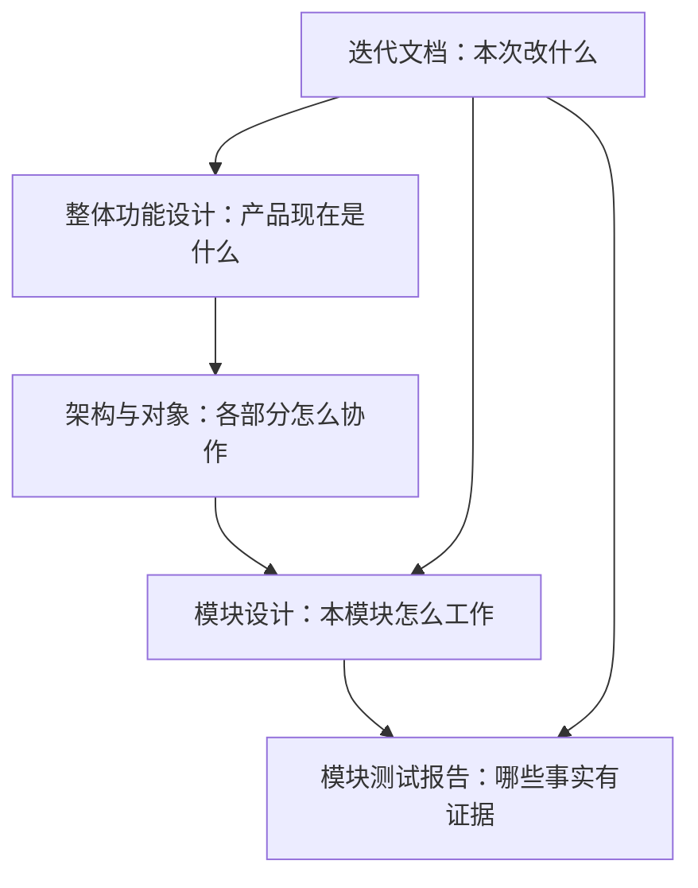

# AgentBridge 项目资料

alpha.67候选修复本机WSL冻结入口实际47秒超过原30秒就绪预算：仅启动握手等待改为120秒，业务计时在握手后开始，原请求/unknown不重发；补实际Linux Hermes执行/原Session续聊验收。受控握手与发现22/22，真实候选及新包验收进行中；当前公开仍alpha.66。[本轮需求、实测与边界](iterations/I08/alpha67-hermes-linux-live.md)。

当前公开预发布alpha.66：Linux Hermes安装发现支持独立HERMES_INSTALL_DIR、原生数据Home/Profile根、后缀与路径展开，专用运行时目录不再提供其他Agent。Windows原生发现、stream-json、精确Session续聊、模型/账号配置和unknown恢复契约保持。Windows受控39/39，独立Ubuntu适配100/100及Core71/71，本机WSL和独立Ubuntu正式Hermes0.22.5原生MCP五组/十工具分别通过，模型0。普通EXE七组通过。网关取消、真实Linux模型/自主父模型、完整矩阵、图100ms与冷启动继续未准出；未切换日常后台或部署SSH。[本轮交付与分层证据](iterations/I08/alpha66-hermes-linux.md)。

AgentBridge呈现用户已安装的原生Agent及其连接、协作、执行和结果，模型、账号与配置由原工具管理。用户入口是[使用文档](user/index.md)；本页及内部设计/原始证据不进入用户网站。逐轮历史统一在[迭代目录](iterations/README.md)。

## 当前状态

| 项目 | 状态 |
| --- | --- |
| 稳定历史版本 | 0.5.0（I05：机器节点与主从协作） |
| 当前公开预发布 | **0.6.0-alpha.66**（冻结 `13e6c49`，EXE132220720字节，匿名完整下载核验通过） |
| 当前发布包 | [Windows EXE](https://github.com/wsjq5477/MA-Relay/releases/download/v0.6.0-alpha.66/AgentBridge-0.6.0-alpha.66-Windows-x64.exe) · [SHA-256](https://github.com/wsjq5477/MA-Relay/releases/download/v0.6.0-alpha.66/SHA256SUMS.txt)；未签名；[交付与边界](iterations/I08/alpha66-hermes-linux.md) |
| 当前公开源码范围 | 完整源码标签 `v0.6.0-alpha.66`（13e6c49），master含后续发布说明 |
| 当前已发布实现与验收边界 | Windows原生执行/续聊保持；Linux原安装发现、WSL/独立Ubuntu原生MCP十工具及普通EXE已验，真实Linux模型/父模型、网关取消与完整矩阵待验；[分层证据](iterations/I08/alpha66-hermes-linux.md) |
| 未准出 | 完整I06C/I07C/MCP02；Hermes网关取消/父模型自主MCP及完整生命周期、Pi/DSH未完成入口、真实多主、图100ms、冷启动/WSL与独立SSH |

逐轮历史与发布记录统一在 [迭代目录](iterations/README.md)，主文档只维护当前状态。

## 从哪里开始

| 你要做的事 | 阅读顺序 |
| --- | --- |
| 理解产品、确认功能边界 | [整体功能设计](product-design.md) → [模块目录](module-plan.md) |
| 理解系统如何运行、如何通信 | [整体架构](architecture.md) → [对象与数据](data-model.md) → [接口与协议](protocol.md) |
| 开发或修改某个功能 | 对应模块的 `design.md` 和 `test-report.md` → [开发与文档维护](development-guide.md) |
| 判断哪些功能可验收 | [整体验证报告](testing.md) → 对应模块测试报告 → 报告引用的原始证据 |
| 接入或新增一个 Agent | [接入矩阵](agent-integration-matrix.md) → [选型指南](agent-integration-guide.md) → [开发指南](custom-agent-development.md) |
| 排下一轮工作 | [迭代路线](project-plan.md) → [迭代目录](iterations/README.md) |
| 启动、构建或排障 | [仓库说明](../README.md)、[桌面使用说明](../desktop/README.md)、[打包模块](modules/10-packaging/design.md) |

## 模块设计与测试报告

| 模块 | 设计 | 测试报告 |
| --- | --- | --- |
| M01 桌面界面与交互 | [设计](modules/01-desktop/design.md) | [报告](modules/01-desktop/test-report.md) |
| M02 中央 Coordinator | [设计](modules/02-coordinator/design.md) | [报告](modules/02-coordinator/test-report.md) |
| M03 机器与 Agent 节点 | [设计](modules/03-machine-network/design.md) | [报告](modules/03-machine-network/test-report.md) |
| M04 SSH 接入、信任与安装 | [设计](modules/04-ssh-access/design.md) | [报告](modules/04-ssh-access/test-report.md) |
| M05 Linux daemon 与 relay | [设计](modules/05-linux-daemon/design.md) | [报告](modules/05-linux-daemon/test-report.md) |
| M06 原生 Agent 适配 | [设计](modules/06-native-adapters/design.md) | [报告](modules/06-native-adapters/test-report.md) |
| └ OpenCode | [设计](modules/06-native-adapters/opencode/design.md) | [报告](modules/06-native-adapters/opencode/test-report.md) |
| └ Claude Code | [设计](modules/06-native-adapters/claude/design.md) | [报告](modules/06-native-adapters/claude/test-report.md) |
| └ Codex | [设计](modules/06-native-adapters/codex/design.md) | [报告](modules/06-native-adapters/codex/test-report.md) |
| M07 任务、会话与恢复 | [设计](modules/07-task-session/design.md) | [报告](modules/07-task-session/test-report.md) |
| M08 主从关系与协作 | [设计](modules/08-collaboration/design.md) | [报告](modules/08-collaboration/test-report.md) |
| M09 CLI 与 Hub/Edge 兼容入口 | [设计](modules/09-cli-hub-edge/design.md) | [报告](modules/09-cli-hub-edge/test-report.md) |
| M10 打包与交付 | [设计](modules/10-packaging/design.md) | [报告](modules/10-packaging/test-report.md) |
| M11 文档网页入口 | [设计](modules/11-documentation-portal/design.md) | [报告](modules/11-documentation-portal/test-report.md) |

## Agent 接入导航

[接入矩阵](agent-integration-matrix.md)按原生CLI、API、MCP、ACP、插件、SDK登记每个 Agent 的已实现路径与证据边界；[选型指南](agent-integration-guide.md)说明六种方式的优缺点、逐Agent后续建议和快速接入；[开发指南](custom-agent-development.md)给出源码适配步骤与检查命令。

## 如何读状态

- **已发布**：已包含在注明版本的程序中，不代表每个原生工具或账号都可执行。
- **源码已实现**：代码存在，测试范围见报告；尚未发布的能力不能用旧 EXE 验证。
- **已确认设计**：决定怎么做，还没有功能实现或交付证据。
- **候选**：原始设想或后续建议，还没有纳入当前开发范围。

测试报告使用“通过、部分验证、未测试、失败/环境限制”描述事实。每条都注明受控测试、界面模拟、真实 Agent 或发布包实测，计划中的用例不计入通过数。

## 文档的职责

整体设计是持续维护的当前说明；迭代材料记录一次变更的范围、实现和验收，统一在[迭代目录](iterations/README.md)索引。历史报告保留原日期、版本与限制，不能用新结果改写旧结论。

原始 [doc.md](../doc.md) 是项目初稿，原综合计划保存在 [历史资料](archive/README.md)。当前行为以本目录的整体设计、模块设计和测试证据为准。旧 `docs/` 只保留迁移入口。

## 网页阅读与材料范围

在仓库根执行 `npm run docs:dev` 打开 `http://localhost:4188`；构建静态站点用 `npm run docs:build`。网页只发布 `doc/user/` 的当前用户说明；内部设计/报告/问题/迭代不进入导航、搜索、路由或下载。使用方法见 [网页说明](web-reading.md)。

远端源码、私有运行状态及本地验收材料的范围见 [远端源码范围](repository-sync.md)；逐版本的标签、EXE 与 SHA-256 对照见 [历史发布登记](iterations/release-ledger.md)。
