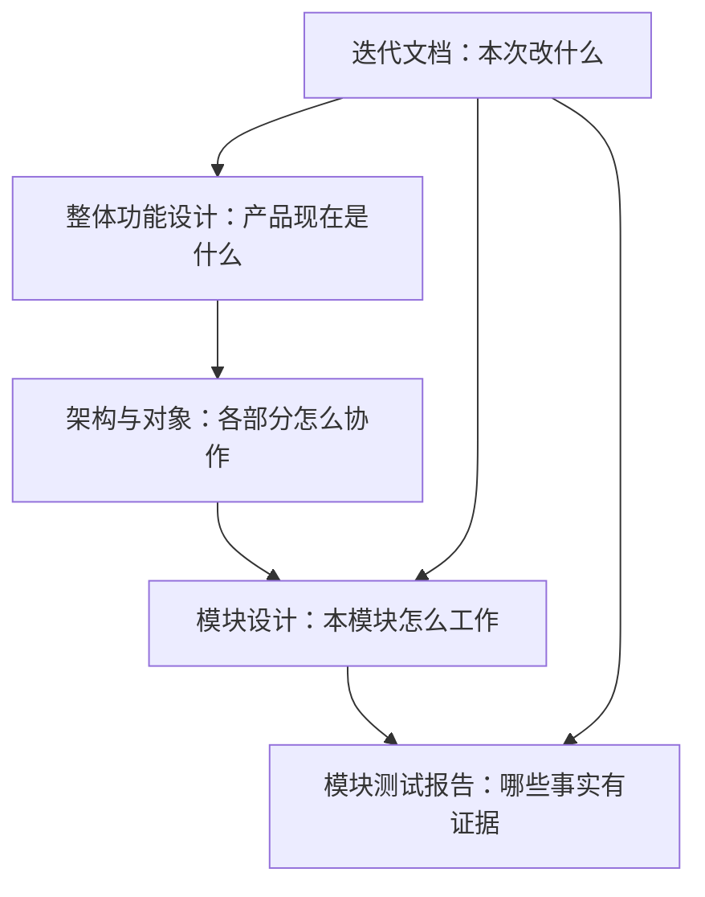

# AgentBridge 项目资料

alpha.63 [原生MCP生命周期补验](iterations/I08/native-mcp-lifecycle.md)：普通无调试EXE与原版Pi客户端七组通过，三个实际解包目录关闭后删除，原传输/原身份/完整接收收据保持；最后原窗/客户端/Coordinator均确认退出。实际WSL十五分钟180/180及删除/重开/撤权/轮换六组也已通过，两个客户端/原宿主退出且残留0。模型0，其他入口/跨版本升级/托管父模型、WSL冷启动/历史故障与整体MCP02继续未准出。

公开alpha.63已交付CT-05原包传递、目标接入收据和桌面只读审计：源码944/944、Core71/71；冻结Windows传递14/14、原收据4/4、关系37/37、兼容26/26，生产页面新5组/控制台6组、普通EXE6组通过，模型0。Pi→固定源码Hermes实际原生MCP组件7组通过；接收声明不代表模型理解、业务验收或文件可达，完整准出不变。[完整证据与边界](iterations/I07/context-delivery.md)。

alpha.62普通窗口生命周期五组与真实驱动退出码0已补验：旧脚本后续误选同进程无标题辅助窗，现绑定原主窗口并在关闭前核对归属/标题；三次正常关闭均原进程退出、包装码0，产品和EXE字节未改。未切换日常后台，模型0。[定位、修复与当前边界](iterations/I08/window-lifecycle-verifier.md)。

2026-10-25冻结alpha.62已完成原实际SSH只读复验：保存凭据/主机指纹认证、alpha.37原清单1459项逐文件核对、两次非接管inspect三组通过，原PID/current.json/本地配置保持，模型0；未部署、hello或任务。完整故障/升级矩阵与普通EXE联合流程仍未准出。[当前证据](iterations/I08/alpha62-ssh-readonly.md)。

本地alpha.62保留已失败管理操作清理，将实际桌面入口收敛为接入/小队设置、执行/会话审计和原操作恢复；日常提交、续聊、分工、报告、正文编辑与验收从原生Agent的MCP入口完成。小队收据补原operationId和完整内容指纹，丢回应、损坏或并发变化的本机意图只读核对，不换ID重发。普通EXE正常关闭/重开与完整中央重启五组已补验，原收据保持；公开alpha.60不变，模型0；[实现、分层验证与交付](iterations/I07/configuration-console.md)。

WSL当前补验（2026-10-25）：公开alpha.60冻结HostConnection独立启动20/20，60条只读请求均在握手后发送、原进程退出已确认，模型0；但原始80次WSL探针仍有1次首条Linux入口标记前失败。没有产品修复可解释差异，发行版冷启动/持续连接/故障恢复与整体稳定性仍未准出；普通EXE图观察因窗口运行时拒绝WSL工作目录未执行。[本轮定位、全部样本与边界](iterations/I08/wsl-launch-origin.md)。

公开alpha.60的十工具已完成原生客户端组件复验：Pi1.4.0在Linux/Windows、固定源码Hermes在Linux各7组通过，包含实际连接/断开、用户允许/拒绝、原ID/历史确认和缓存撤权，模型0。真实父模型、日常多主、托管scope和跨真实机器仍未准出。[当前证据与完整边界](iterations/I08/native-policy-components.md)。

公开**alpha.60**实现CT-08-A3连接管理：各主在用户预授权内自行连接/断开，范围外请求须用户明确确认；原ID/unknown和原父读控保持。源码900/900、Windows包内37/37与实际中央管道/重启、兼容26/26、生产页面4组、普通EXE4组及Downloads SHA通过，模型0；[本片证据](iterations/I07/connection-policy.md)、[发布核验](iterations/I08/alpha60-release.md)。旧图仍编辑selected，完整真实原生多主/图100ms/WSL及SSH仍未准出；未切换日常后台/未部署SSH。

上一公开 alpha.53 修复 OpenCode 早期 1.x 首探挂起及状态矛盾，保留原安装与 unknown。[需求、实现与分层验证](iterations/I08/opencode-bounded-probe.md)、[发布核验](iterations/I08/alpha53-release.md)。

当前公开预发布 **0.6.0-alpha.63**，标签冻结 `da60054`；EXE 130203473字节、SHA-256 `2ba100ea01ceee057bed3a03763b92a442c75bd4b094ed70873608f49157b40a`。180个产品/依赖文件与构建时冻结摘要逐项一致，源码、EXE和校验文件已公开，匿名HTTP200完整下载字节/摘要匹配。未签名、未切换日常后台、未部署SSH；图100ms、父模型、冷启动和完整I06C/I07C/MCP02继续未准出。 [完整发布证据](iterations/I08/alpha63-release.md)。

当前连接配置与节点准入修复见[issue #15/#16 的实现、验证与交付](iterations/I08/connection-identity-node-scope.md)；保存的 DSH 地址具有明确节点选择，独立节点接入不再被同机其他安装的 unknown 误锁。已随0.6.0-alpha.51.recovery.2公开。

原生现场历史证据（alpha.46）：已安装OpenDesk/DSH原生MCP组件正式授权、撤权和恢复通过；两条生产协作链各完成1个真实Claude子任务，原观察器重开保持原Session与请求，不重放。OpenDesk 日常原生父模型只读发现已通过，实际 list_agents 返回 7 个获准节点；[原生发现证据](iterations/I08/opendesk-mcp-diagnostic-repair.md)。父模型自主委派与原生页面仍未验；[组件层级与原始证据](iterations/I08/mcp-native-acceptance.md)。

历史图指标（alpha.53）：自动保存画布位移0px通过，本地状态同步p95 1504ms通过；完整20次PNG帧观测p95 388.932ms仍未准出。指定Windows OpenCode父模型子任务已获授权，日常现场缺少该节点，模型0。[本轮证据与边界](iterations/I06/alpha53-current-metrics.md)。

AgentBridge 把用户已安装的 Agent 工具（Claude Code、OpenCode、Codex、Hermes、Pi、DSH、OpenDesk 等）呈现为可观察的节点：从原生Agent发起协作，在客户端配置连接、看进度、读结果，并让主 Agent 通过受限接口发现和委派获准的其他 Agent。模型、账号与原生配置仍由各工具自己管理。

用户阅读入口：[使用文档首页](user/index.md)、[原生Agent总览](user/agents/index.md)、[DSH](user/agents/dsh.md)、[接入方式比较](user/integration-methods.md)。本页是仓库维护资料入口，不发布到用户网页。

## 当前状态

| 项目 | 状态 |
| --- | --- |
| 稳定历史版本 | 0.5.0（I05：机器节点与主从协作） |
| 当前 GitHub 预发布 | **0.6.0-alpha.60**，冻结 `a0f313c`；源码/附件与匿名完整下载核验通过；[发布与边界](iterations/I08/alpha60-release.md) |
| 当前发布包 | **0.6.0-alpha.60**：CT-08-A3连接工具/预授权/确认、alpha.54–59图尺寸/daemon清单/维护输入/关系迁移，此前#21、#19/#20、#15/#16、Pi/Hermes/DSH原生MCP及WSL/图修复保留；未签名、未切换日常后台/部署SSH；[发布证据](iterations/I08/alpha60-release.md) |
| 当前公开源码范围 | 完整源码标签 `v0.6.0-alpha.63`（da60054），master含后续发布说明 |
| 当前已发布实现与验收边界 | [I08-MCP02](iterations/I08/mcp-open-integration.md)与[恢复修复](iterations/I08/mcp-open-recovery.md)：三维能力、六项事实、双向增删/撤权、DSH显式profile、非GUI接入；桌面758/758、根68/68。DSH Desktop/Hermes/Pi配置已有分层证据；OpenDesk CLI0.3.8无MCP管理面、逐入口真实主调用仍为缺口 |
| 未准出 | 完整 I06C/I07C；Hermes/Pi/DSH 真实工具执行验收；DSH 原实例推理；独立SSH |

逐轮历史与发布记录统一在 [迭代目录](iterations/README.md)，主文档只维护当前状态。

## 从哪里开始

| 你要做的事 | 阅读顺序 |
| --- | --- |
| 理解产品、确认功能边界 | [整体功能设计](product-design.md) → [模块目录](module-plan.md) |
| 理解系统如何运行、如何通信 | [整体架构](architecture.md) → [对象与数据](data-model.md) → [接口与协议](protocol.md) |
| 开发或修改某个功能 | 对应模块的 `design.md` 和 `test-report.md` → [开发与文档维护](development-guide.md) |
| 判断哪些功能可验收 | [整体验证报告](testing.md) → 对应模块测试报告 → 报告引用的原始证据 |
| 接入或新增一个 Agent | [接入矩阵](agent-integration-matrix.md) → [选型指南](agent-integration-guide.md) → [开发指南](custom-agent-development.md) |
| 排下一轮工作 | [迭代路线](project-plan.md) → [迭代目录](iterations/README.md) |
| 启动、构建或排障 | [仓库说明](../README.md)、[桌面使用说明](../desktop/README.md)、[打包模块](modules/10-packaging/design.md) |

## 模块设计与测试报告

| 模块 | 设计 | 测试报告 |
| --- | --- | --- |
| M01 桌面界面与交互 | [设计](modules/01-desktop/design.md) | [报告](modules/01-desktop/test-report.md) |
| M02 中央 Coordinator | [设计](modules/02-coordinator/design.md) | [报告](modules/02-coordinator/test-report.md) |
| M03 机器与 Agent 节点 | [设计](modules/03-machine-network/design.md) | [报告](modules/03-machine-network/test-report.md) |
| M04 SSH 接入、信任与安装 | [设计](modules/04-ssh-access/design.md) | [报告](modules/04-ssh-access/test-report.md) |
| M05 Linux daemon 与 relay | [设计](modules/05-linux-daemon/design.md) | [报告](modules/05-linux-daemon/test-report.md) |
| M06 原生 Agent 适配 | [设计](modules/06-native-adapters/design.md) | [报告](modules/06-native-adapters/test-report.md) |
| └ OpenCode | [设计](modules/06-native-adapters/opencode/design.md) | [报告](modules/06-native-adapters/opencode/test-report.md) |
| └ Claude Code | [设计](modules/06-native-adapters/claude/design.md) | [报告](modules/06-native-adapters/claude/test-report.md) |
| └ Codex | [设计](modules/06-native-adapters/codex/design.md) | [报告](modules/06-native-adapters/codex/test-report.md) |
| M07 任务、会话与恢复 | [设计](modules/07-task-session/design.md) | [报告](modules/07-task-session/test-report.md) |
| M08 主从关系与协作 | [设计](modules/08-collaboration/design.md) | [报告](modules/08-collaboration/test-report.md) |
| M09 CLI 与 Hub/Edge 兼容入口 | [设计](modules/09-cli-hub-edge/design.md) | [报告](modules/09-cli-hub-edge/test-report.md) |
| M10 打包与交付 | [设计](modules/10-packaging/design.md) | [报告](modules/10-packaging/test-report.md) |
| M11 文档网页入口 | [设计](modules/11-documentation-portal/design.md) | [报告](modules/11-documentation-portal/test-report.md) |

## Agent 接入导航

[接入矩阵](agent-integration-matrix.md)按原生CLI、API、MCP、ACP、插件、SDK登记每个 Agent 的已实现路径与证据边界；[选型指南](agent-integration-guide.md)说明六种方式的优缺点、逐Agent后续建议和快速接入；[开发指南](custom-agent-development.md)给出源码适配步骤与检查命令。

## 如何读状态

- **已发布**：已包含在注明版本的程序中，不代表每个原生工具或账号都可执行。
- **源码已实现**：代码存在，测试范围见报告；尚未发布的能力不能用旧 EXE 验证。
- **已确认设计**：决定怎么做，还没有功能实现或交付证据。
- **候选**：原始设想或后续建议，还没有纳入当前开发范围。

测试报告使用“通过、部分验证、未测试、失败/环境限制”描述事实。每条都注明受控测试、界面模拟、真实 Agent 或发布包实测，计划中的用例不计入通过数。

## 文档的职责

整体设计是持续维护的当前说明；迭代材料记录一次变更的范围、实现和验收，统一在[迭代目录](iterations/README.md)索引。历史报告保留原日期、版本与限制，不能用新结果改写旧结论。

原始 [doc.md](../doc.md) 是项目初稿，原综合计划保存在 [历史资料](archive/README.md)。当前行为以本目录的整体设计、模块设计和测试证据为准。旧 `docs/` 只保留迁移入口。

## 网页阅读与材料范围

在仓库根执行 `npm run docs:dev` 打开 `http://localhost:4188`；构建静态站点用 `npm run docs:build`。网页只发布 `doc/user/` 的当前用户说明；内部设计/报告/问题/迭代不进入导航、搜索、路由或下载。使用方法见 [网页说明](web-reading.md)。

远端源码、私有运行状态及本地验收材料的范围见 [远端源码范围](repository-sync.md)；逐版本的标签、EXE 与 SHA-256 对照见 [历史发布登记](iterations/release-ledger.md)。
