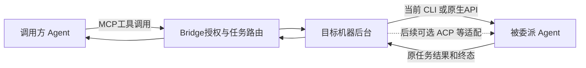

# Agent 接入方式、选型与快速接入

WSL配置按原nodeId路由至原发行版MachineHost，原有六项MCP管理方法在源码已存在；alpha.49增加就绪握手，最终包真实Windows→WSL MCP组件5组已通过（配置、原生Codex列表、Linux stdio调用、重开、撤权/轮换/清理），仍保留启动失败和原生父模型未测，不以工具组件代替模型自主调用。[当前范围与失败证据](iterations/I08/wsl-host-readiness.md)。

最新验收：alpha.46的已安装OpenDesk/DSH原生MCP组件正式授权、撤权和恢复通过；两条生产协作链各完成1个真实Claude子任务，原观察器重开保持原Session与请求，不重放。OpenDesk 日常原生父模型只读发现已通过，实际 list_agents 返回 7 个获准节点；[原生发现证据](iterations/I08/opendesk-mcp-diagnostic-repair.md)。父模型自主委派与原生页面仍未验；[组件层级与原始证据](iterations/I08/mcp-native-acceptance.md)。

本地alpha.46已支持非GUI首次接入及原操作查询；MCP探测按配置绑定和60秒有效期核对。[实际交付范围](iterations/I08/mcp-open-recovery.md)。

[I08-MCP02开放MCP与双向配置](iterations/I08/mcp-open-integration.md)已完成Bridge源码第一片：用户只管理一个AgentBridge MCP，可从Bridge或原生Agent增删；能力拆为MCP调用、原生配置管理、托管scope注入三问，状态拆为配置/原生加载/连接/工具/授权/归属六项事实。当前可管理原生MCP条目的入口是Claude、Codex、OpenCode（两代）、DSH Web 与 DSH CLI（CLI 需显式指定启动 profile；DSH Web 已在隔离 profile 的真实启动中完成原生握手并取到工具目录）；OpenDesk 两个入口不同：CLI 0.3.8 完全没有 MCP 管理面（插件清单与工具列表都无 MCP 入口、启动重写 `setting.json` 丢弃未识别 `applications` 段），只能导出片段；Desktop 的原生 MCP 条目已可用（写入后必须完全重开 OpenDesk，且条目要用 PATH 中的真实 Node 启动器，Electron 运行时它在 mcpmgr 里启动不了），用户真实 Desktop 0.3.9 上已观察到“已连接 + 7 工具可见”，已完成原生组件正式授权调用（真实自主父模型委派仍未验）；DSH Desktop在alpha.48本地候选新增原生选择定位、绑定和精确清理（公开alpha.46仍只导出）；Hermes/Pi原生管理已在alpha.50本地候选补齐并验证原生组件；公开alpha.46仍只导出。逐入口真实原生可见性与主调用链仍待验收，因此不能用设计目标替代[接入矩阵](agent-integration-matrix.md)中的实际能力状态。

关联 AB-F02/F07/F08/F10/F11/F12/F13、M03/M06/M07/M08/M10。本文是接入说明与后续开发建议，不修改运行代码、协议、存储或发布版本，也不调用模型。各 Agent **实际接入了哪些方式**，只以[当前接入矩阵](agent-integration-matrix.md#2-每个-agent-已接入的方式)为准；不能把本文的协议能力或推荐方案算作已交付功能。

## 1. 先明确连接方向

AgentBridge要解决两件事：一是让外部Agent调用Bridge，发现获准的其他Agent、委派并读取结果；二是由目标机器后台实际驱动那个Agent。前者当前使用MCP，后者当前使用原生CLI或原生API。一次委派可能同时经过两种方式。

六种方式也不是互斥的六个插头：CLI可以启动HTTP服务或ACP进程，SDK可以封装CLI/API，原生插件可以注册MCP工具或暴露控制接口。选型要说明“通过什么接口调用、谁启动、在哪里执行、谁持有原会话”，不能只按是否有某个名称判断能力。

本文中的“原生API”是Agent程序自己的会话/执行/控制接口；“SDK”是调用完整Agent运行时的库。直接调用模型提供商的聊天API，不构成对用户已有Agent的接入，也不能替代它的登录、Skill、工具与Session。

## 2. 六种方式的优缺点与适用场景

以下是工程选型判断，具体能力仍由目标产品、选定版本和实际适配决定。不承诺哪种方式一定更快、更稳定或功能最多。

| 方式 | 优点 | 主要代价或限制 | 能实现的功能与条件 | 对当前Bridge的适用场景 |
| --- | --- | --- | --- | --- |
| **原生CLI** | 通常可直接使用用户已有程序和原生配置；无须常驻网络端口；结构化事件成熟时，首个适配改动较小 | 各工具参数/事件不同；进程树、stdin/stdout、Windows启动器和非交互PATH需处理；仅有交互TUI或纯文本输出时难以可靠映射控制 | 有相应原生命令/事件时可提交需求、读输出、续用Session、取消、处理权限；持久恢复还需保存派发边界和原生身份 | 已有可用CLI协议的Claude/Codex/Hermes/Pi/DSH CLI；复用宿主和发现框架，分别实现协议 |
| **原生API** | 直接操作已有服务中的Session、任务和状态；适合Desktop/Web/daemon；可沿用该服务的运行配置 | 需服务可达、认证有效；处理启动/就绪、版本、超时和连接变化；GUI内部API未必有稳定兼容承诺；HTTP成功不等于任务完成 | 由API实际提供的create/prompt/query/cancel等实现控制；可靠恢复需有原请求/轮次/持久事件可核对 | OpenCode托管serve，或DSH Desktop/Web的已运行服务；继承目标服务而非另建模型层 |
| **MCP** | 工具schema与调用方式标准化；Agent原生支持MCP时，开放Bridge发现/委派/材料工具的成本低；可复用现有broker与授权 | 主要描述工具交互，不自动成为Agent完整生命周期协议；客户端可用工具、输入能力和认证方式仍有差别；新增工具不等于具备执行权限 | 当前实现是Agent调用Bridge工具。某Agent若另暴露执行MCP工具，Bridge作为客户端的控制适配需单独开发；会话/取消/任务恢复不能凭“MCP”三字推定 | 希望Agent能主动使用Bridge时优先；当前Claude/Codex/OpenCode/DSH Web/DSH CLI（需profile）与OpenDesk Desktop可声明调用并有Bridge可管理的原生配置（OpenDesk 需 Node 启动器且要重开）；DSH Desktop在alpha.48候选可管理当前原生Profile；OpenDesk CLI只到片段导出；Pi用户目录/Hermes原生Profile管理已在alpha.50本地候选交付；托管scope注入仍只有原三种工具 |
| **ACP** | 面向客户端与Agent的会话交互，标准化初始化、Prompt、会话更新、工具进度、权限询问和取消，可降低多Agent专用解析重复 | 需要通用Client、能力协商及Bridge状态映射；厂商或生态包装器可能改变配置/Session/权限行为；会话恢复为可选能力；协议标准不等于跨进程持久幂等 | 合适实现可新建会话、收增量输出、应答权限、请求取消；load/resume须协商并验证。Bridge的原请求台账、授权和unknown保护仍要保留 | 后续以支持原生ACP的目标做可选试点；当前尚未实现通用ACP驱动，不批量替换已可用CLI/API |
| **原生插件** | 若宿主提供所需扩展API，可贴近原生日志、工具、生命周期或界面；能补外部CLI/API无法观察或操作的能力 | 每个宿主单独维护安装/更新/卸载、权限和兼容；插件往往与Agent同进程，出错可能影响原生运行；有插件机制不代表能控制Session | 可以在宿主允许范围内提供hook、注册工具、暴露受限控制接口或安装MCP连接；具体能力取决于宿主扩展点，并非天然拥有所有内部控制。若以插件承载调用方接入，只作为薄传输层复用同一协作服务端点、身份与工具契约，不另行实现协作逻辑 | 外部接口存在明确缺口、且官方扩展点能解决时再增加；当前未安装Bridge专用原生插件。Bridge静态adapter不计作原生插件 |
| **Agent SDK** | 类型、事件、错误和资源生命周期封装可能减少胶水代码；官方维护的适配层可降低底层协议解析负担 | 增加语言/运行时/依赖与打包成本；SDK可能新建自己的Agent或要求独立模型凭据，未必能复用用户已有登录、GUI配置和Session；SDK更新也需验收 | 取决于SDK暴露的完整Agent能力；可能覆盖会话、工具、权限、取消、恢复。库的名字或类型声明不能证明能控制用户原进程 | SDK确实调用完整原生Agent且保留原配置语义时可评估；只有模型API封装的SDK不满足本项目接入目标 |

## 3. 功能并非由协议名称自动决定

| 所需功能 | CLI | 原生API | MCP | ACP | 插件 | SDK |
| --- | --- | --- | --- | --- | --- | --- |
| 提交需求、读取回答 | 需非交互调用及可解析输出 | 需执行/查询接口 | 当前是调用Bridge工具；控制目标Agent需另有执行工具及客户端适配 | 协议有会话与Prompt交互；Bridge Client待开发 | 需宿主执行/输出扩展点 | 需完整Agent执行接口 |
| 同一原生Session续聊 | 需明确resume参数和原绑定 | 需原Session寻址/提交 | 工具schema若未定义Session则无从推定 | 同一活会话可再Prompt；重连load/resume另行协商 | 需宿主允许访问/续用原Session | 需明确原Session生命周期 |
| 输出与工具进度 | JSONL等结构化事件；纯文本只能有限观察 | 事件流或轮询，粒度由API决定 | 工具结果/进度不等于完整Agent事件 | session/update等会话更新 | 需相应hook；不可根据“有插件”假定 | 需可订阅的运行事件 |
| 原生权限/问题回复 | 需双向控制协议及等待ID | 需列出等待与回应接口 | MCP工具批准不等于目标Agent原生权限批准 | 有权限询问；任意原生表单不一定有标准映射 | 需宿主允许受控回应 | 需SDK暴露所需等待类型 |
| 取消及确认结果 | 需控制原进程/任务并观察终态 | 需原任务控制及终态查询 | 取消MCP请求不自动证明被委派Agent停止 | 有取消通知，仍须观察原Prompt结果 | 需受控中止入口和实际结果 | 需中止与状态观察接口 |
| 重启/断线恢复与去重 | 由原生持久记录和Bridge台账共同完成 | 需持久查询证据，不能仅依赖在线状态 | 工具任务或取消机制不自动等于Bridge持久业务去重 | load/resume为可选；JSON-RPC id不等于业务去重键 | 仍需持久存储/身份及重连设计 | 仍需核对恢复语义，不能靠自动重试重放输入 |
| 授权发现其他Agent并委派 | Bridge当前通过MCP开放；CLI本身不建立授权关系 | API本身不建立Bridge授权关系 | 当前已提供此方向的获准工具 | 可在会话配置中传递MCP连接，但需真实可用与撤权验证 | 可承载MCP/受限工具，仍受Bridge授权 | 可挂载MCP/工具时需保留相同授权规则 |

“支持协议”“支持功能”“经过真实验收”是三件事。例如当前DSH API已实现取消，却没有Bridge权限表单回复；当前Claude可通过MCP委派DSH，DSH独立MCP调用仍需其原生客户端与正式授权；托管scope尚未适配。

## 4. 结合当前矩阵的后续推荐

以下是基于当前实现和用户目标的建议，不构成新增开发或已完成承诺。

| Agent或入口 | 推荐继续使用的方式 | 适合下一步补什么 | 暂不推荐的做法 |
| --- | --- | --- | --- |
| Claude Code | 保留CLI执行＋MCP调用方 | 按当前原生版本验证需要的权限/输入类型、取消与恢复；有确切缺口再比较原生控制接口或SDK | 为了列数齐全改成SDK/插件；把生态ACP包装器算成当前官方原生接入 |
| Codex | 保留exec/resume JSON＋MCP调用方 | 先验当前原生Session/取消/原请求恢复；若需要更强交互，比较原生交互API和ACP生态包装器的实际行为 | 用模型SDK重建用户Agent；用新Thread替代失败的原Session续聊 |
| OpenCode | 保留CLI启动serve＋原生HTTP＋MCP | 作为CT-03的ACP候选，比较相同需求的输出、权限、取消、恢复，再用第二种Agent证明通用Client复用 | 先移除当前HTTP路径，或把ACP试点写成已实现 |
| Hermes | 保留已有结构化CLI，先补真实执行与被委派验收 | 原生支持MCP时，独立核对配置格式、会话注入与撤权；需要多工具复用时再评估ACP | 图标/版本通过就开放未经实现的MCP、小队或权限能力 |
| Pi | 保留JSON/print及原Session文件绑定 | 先补真实生命周期；需要双向交互时比较目标版本的原生RPC，按缺口决定是否开发 | 仅增加标志就假定RPC/ACP可用；原文件缺失时新建空Session冒充续聊 |
| DSH CLI | 继续用于需要headless执行的场景 | 核对该profile自己的登录/配置、真实会话和取消；单独适配后才开放MCP调用方 | 把CLI已接入等同GUI/Web已接入，或复制GUI凭据来掩盖profile差异 |
| DSH Desktop / Web | 保留原生认证API，与CLI分别归属 | 先连接当前用户原服务，补真实模型/原Session/取消/原请求恢复；需要MCP时另验原生支持与配置入口 | 为了统一界面切换成headless；将服务连接token当成模型密钥；把原生业务插件算作Bridge插件 |
| OpenDesk CLI / Windows Desktop | CLI用原生HTTP，Desktop用原实例WebSocket；独立原生MCP配置 | Bridge保存去重与派发围栏；CLI原会话、Desktop原连接分别绑定，缺少终态证据保留unknown；不改原生程序，托管scope/小队不开放 | 注册成OpenCode、抓取TUI文本、用WSL服务冒充Windows桌面实例 |
| 新增第三方Agent | 按下节决策，复用现有宿主/协议中适配的部分 | 优先一个可运行的最小执行链；满足证据后再增加调用方/高级能力 | 同时开发六种方式，或填任意命令/URL就按任意Agent协议执行 |

### 新Agent如何选第一条路径

1. **只需要它调用Bridge**：目标原生支持MCP时，先走MCP。复用现有Bridge工具和授权；没有执行宿主就不能把它列为可由Bridge启动/取消的目标。当前Bridge能直接管理原生MCP条目的是Claude/Codex/OpenCode/DSH Web/DSH CLI（DSH CLI 需用 `--profile` 或弹窗指定启动 profile）；OpenDesk CLI 无可用管理面只能导出片段，OpenDesk Desktop 的原生条目已可用（需 Node 启动器并重开 OpenDesk）；DSH Desktop在alpha.48候选可按原生选择记录管理并绑定当前数据目录/Profile（公开alpha.46仅导出），切换后先清理原绑定再添加；Hermes/Pi在alpha.50本地候选可管理原生配置；公开alpha.46仍需导出片段，需要用户按各自原生文档添加，Bridge只读识别、不按名称猜测归属。也可以用 `agentbridge mcp export --node NODE_ID` 在不开窗口的情况下取得片段与身份引用。
2. **需要由Bridge驱动它**：先确认有没有已注册的同产品适配，能复用则不再建另一套身份。新目标有经过维护的官方ACP且符合配置/权限/Session需求时，可考虑可选ACP试点；当前先要开发Client，不能承诺这是今天最快的即插即用路径。
3. **目标主要是已运行的Desktop/Web/daemon**：有可用、受认证、可核对原执行的原生API时优先该API；接入已运行服务与Bridge托管启动服务分别设计。
4. **目标主要是CLI且有结构化协议**：通常先做CLI适配。只有TUI或纯文本时，先寻找原生非交互API/ACP；不要用屏幕文字推断可靠的Session/权限/终态。
5. **前述路径有具体缺口**：SDK保留原生运行时语义时可作为实现工具；原生插件有明确可用扩展点时可补该缺口。两者都不是必须“集齐”的额外路线，也不能为了接入绕过原账号/权限。

不同条件的成本会不同：MCP配置可能是最短的调用方接入；当前仓库中，新的结构化CLI通常比从零做通用ACP Client改动少；已有服务API通常更贴近Desktop/Web。上述是代码复用与部署条件判断，没有宣称做过所有方案的耗时/性能对照实验。

## 5. 如何快速接入

### 用户：复用已有入口

| 目标 | 当前可走的操作 | 需核对的条件 |
| --- | --- | --- |
| Bridge执行已支持的原生CLI | 在目标机器安装/登录原工具，机器页重新扫描并接入，再新建会话 | 扫描只证明原安装可启动；账号和模型回复仍需实际任务；目录在会话阶段指定 |
| Bridge连接DSH Desktop/Web | 按[DSH当前流程](iterations/I07/dsh-desktop-web.md#用户操作)选择目标机器，保存根地址/连接token后重扫 | 服务先运行，认证有效；HTTP地址按目标机器解释；当前专属设置卡尚未统一到节点接入流程 |
| 外部Agent在日常会话调用Bridge | 已适配的三工具使用设置页MCP管理；其他原生MCP客户端按[独立MCP契约](iterations/I07/mcp-installation.md)核对客户端格式与获准工具范围 | 不能拿当前三格式配置直接宣称适配所有Agent；长期普通委派与外部TeamSpace配置的工具集合/身份分开 |
| Agent调用另一个已接入Agent | 执行目标已接入后，保存相应关系授权，由具备MCP调用方能力的原生Agent发起委派 | 关系授权本身不启动工作；目标无需因此成为MCP调用方，源Agent仍必须能调用Bridge |

原生支持但Bridge尚未实现的ACP、插件或SDK没有用户可点选的快速入口。新增工具需要源码级适配与验证，不支持动态加载用户给定模块。

### 开发者：先做一个可审核的最小适配

完整参数、源文件清单、可运行骨架和验收命令统一放在[自定义Agent开发指南](custom-agent-development.md)。快速路线分三段：

| 阶段 | 交付内容 | 能开放什么 | 进入下一段的证据 |
| --- | --- | --- | --- |
| 识别与只读验证 | 固定真实CLI/API/协议版本；核对安装/连接、原生默认配置、认证和Session归属；建立独立稳定adapter ID | 只展示真实安装/服务与健康状态；尚未实现执行则execution不能为true | 不调用模型的发现/身份/认证检查；未知版本、错误命令、损坏配置明确失败 |
| 最小执行成员 | 用现有Host契约实现submit、原请求读、task/conversation、实际终态；仅在有原Session与控制证据时实现continue/cancel/reconcile | 完成执行与方向门禁验收后可直接会话和普通被委派；缺少高级能力明确false/unknown | 真实首轮回答；同ID重复不新增原生提交；丢回应/重开不重放；至少对续聊/取消能力实际验证或明确禁用 |
| MCP调用方与完整交付 | 增加原生MCP配置/会话scope、授权与撤权；补权限/表单等需要的能力；冻结包并核对部署 | 只有执行、Bridge MCP与scope均满足当前门禁时才开放主Agent/对应小队入口 | 原生实际调用获准工具、拒绝越权/撤权、按原父归属读取子结果；Windows/WSL/SSH/包分别验收 |

不要复制某适配器后只改名字就宣布可用。可复用的是发现/任务归一化/台账/worker框架；原生协议、凭据边界、取消和持久Session证据必须重新核对。现成骨架只验证注册与明确拒绝，执行次数为0。

### 每条路径都要保留的最低保护

- 继承原生模型、供应商、登录、目录与权限语义，不增加Bridge模型API层。
- 派发前持久保存Bridge的`requestId`/`operationId`、输入摘要和派发边界。原生Session一经返回即持久绑定；若API可先创建Session，则在后续Prompt前绑定。重启只读原请求，不能在新协议、目录或安装间静默改绑。
- 控制ACK与Task终态分开，缺证据保留unknown和占用；SDK自动重试、HTTP重连、ACP重建都不能重放原Prompt。
- 明确八项方向/控制能力；不支持的权限、表单、MCP和小队模式在派发前拒绝，不自动批准原生权限来换取流程通过。
- Windows EXE、WSL、SSH daemon分别部署/升级，worker依赖随包收录。版本扫描、受控测试、真实Agent、真实EXE和公开下载证据分开登记。

## 6. 后续实施顺序与验收

建议先补已有六工具的真实覆盖和DSH两个服务入口的原实例验证；再按明确缺口增加MCP调用方或双向交互；CT-03保持可选ACP试点，至少第二种Agent能复用同一Client后，再决定是否扩大。SDK或插件应解决已定位的能力/兼容问题，不单独作为接入数量指标。调用方通用化、Agent侧连接操作面与多主关系连接管理统一按[Agent侧自主操作规划](iterations/I07/agent-centric-operations.md)的CT-06/CT-07/CT-08推进；CT-07已补[只读委派列表](iterations/I07/delegation-list.md)、[当前调用方连接视图](iterations/I07/agent-connections.md)与[子会话最小上下文](iterations/I07/delegation-context.md)，CT-06新调用方的前置仍是六工具真实覆盖与DSH原实例验证。

| 后续工作 | 做完后如何更新矩阵 | 验收要点 |
| --- | --- | --- |
| 现有CLI/API真实验收 | 更新该行证据，不新增协议“已接入”标记 | 首轮、原Session、取消与重开原请求；不支持的能力按原情况保留 |
| 新MCP调用方（CT-06） | 该Agent的MCP列变为已接入，同时写清长期/会话scope范围 | 原生实际发现/委派/读结果、授权撤销、身份归属；配置导出成功不是工具调用成功 |
| ACP试点 | 只有实际完成Client适配且验收的目标行更新ACP列 | 初始化与能力协商、Prompt/会话更新、权限/取消、可选恢复，以及原请求不重发 |
| 原生插件或SDK | 只更新确实使用该实现的目标行；若同时包裹CLI/API，对应列仍可同时存在 | 固定宿主/库版本，证明沿用原生配置和Session，覆盖安装/卸载、依赖、失败与包边界 |

本文仅补比较、推荐和操作文档；运行功能、已有能力门禁、数据模型/协议和公开alpha.34范围均未变化。文档检查不证明未来协议路径、真实模型或新包验收通过。

## 7. 核对来源

项目事实以[静态注册表](../desktop/electron/builtin-adapters.cjs)、[宿主契约](../desktop/electron/agent-adapter-contract.cjs)、[CLI解析](../desktop/electron/native-cli-protocols.cjs)、[DSH连接](../desktop/electron/dsh-connection.cjs)、[原生轮次核对](../desktop/electron/dsh-worker.cjs)、[MachineHost](../desktop/electron/machine-host.cjs)和[开发骨架](../examples/custom-agent/adapter.cjs)为依据。各工具/版本的测试层级以[接入矩阵](agent-integration-matrix.md)与[M06报告](modules/06-native-adapters/test-report.md)链接的专项为准。

以下官方规范为只读核对。MCP使用明确的2025-11-25版本；ACP使用官网当前v1路径，不将同时列出的v2 Draft算作已实现要求。具体开发仍需冻结实际采用的版本。

- [MCP架构](https://modelcontextprotocol.io/specification/2025-11-25/architecture)：Host/Client/Server关系及能力协商，为表中MCP方向说明提供依据。
- [MCP工具](https://modelcontextprotocol.io/specification/2025-11-25/server/tools)：工具发现、调用、结果与可选任务扩展；不自动定义目标Agent的原生会话生命周期。
- [MCP取消](https://modelcontextprotocol.io/specification/2025-11-25/basic/utilities/cancellation)：普通请求取消通知及其限制，不能直接映射被委派Agent的业务终态；任务扩展有自身取消机制，当前Bridge是否使用须按源码另核对。
- [ACP v1总览](https://agentclientprotocol.com/protocol/v1/overview)与[初始化](https://agentclientprotocol.com/protocol/v1/initialization)：客户端与Agent的控制方向、版本及能力协商。
- [ACP v1会话建立](https://agentclientprotocol.com/protocol/v1/session-setup)：可选的loadSession/session/load用于回放历史，sessionCapabilities.resume/session/resume用于不回放历史地重连；均不能代替Bridge的持久业务去重。
- [ACP v1 Prompt轮次](https://agentclientprotocol.com/protocol/v1/prompt-turn)：会话更新、权限请求和session/cancel；取消后仍需核对原Prompt的实际结果，本轮结束也不等于业务验收完成。

CLI/API、插件/SDK的成本与后续推荐是结合本项目归属规则的工程判断，不能作为厂商支持承诺。具体产品接口以矩阵所链的固定源码、当前宿主实现与专项证据为准。
