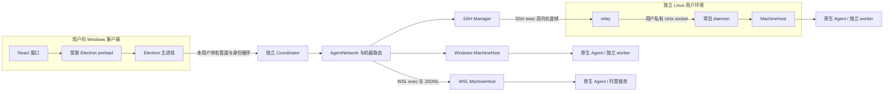
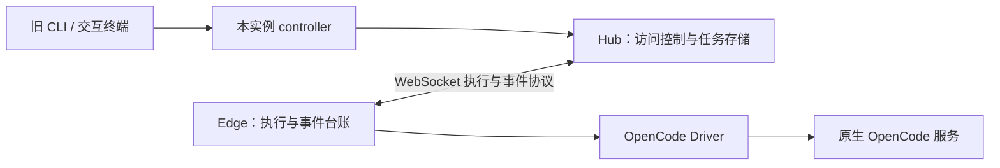
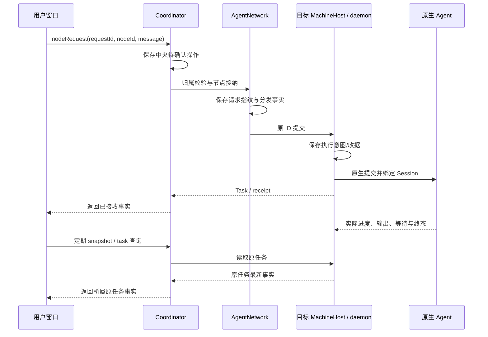
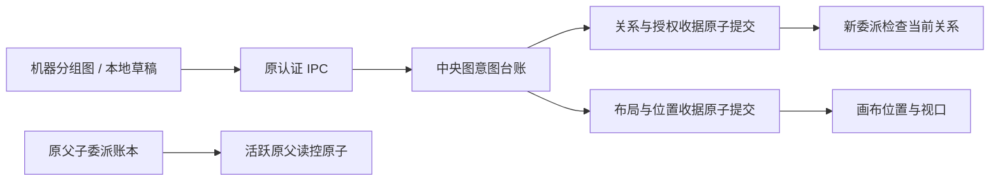
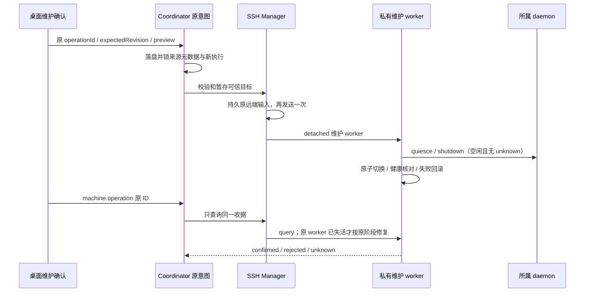

# AgentBridge 整体架构

Core Edge的事件补传按当前socket绑定运输；ACK超时/断开先退役当前原运输，再异步关闭，只在当前OPEN且就绪时继续补传。close回调驱动既有退避重连，旧运输失败不影响新运输；持久事件沿原execution/seq补传，不再调用驱动。此为未发布可靠性修复，数据/帧格式保持。[恢复时序与证据](iterations/I08/edge-outbox-reconnect.md)。

共用原生CLI worker以实际ChildProcess的spawn/error事件区分“所选进程未启动”与“已启动后结果不明”；前者结束原Task并向原控制收据提供nativeExited=false，后者沿适配器原unknown规则。该证明只来自当次worker，不在恢复时根据文件/PID缺失推断，也不新增传输、模型层或取消能力。[启动边界与证据](iterations/I08/native-start-boundary.md)。

Pi续聊的原生文件选择由共用解析器核对Session ID与cwd/原上下文真实目录；NativeCliHost在会话投影、续聊意图前及worker启动前复用检查，原生session事件也采用同一目录规则。Claude宿主/worker用Node启动共享发现已选中的JS入口，保留原安装身份与继承环境。不会修复/迁移原文件，也不新建模型层、传输或Session；最终检查与原生打开间没有跨进程锁。[派发前边界](iterations/I08/pi-session-workspace.md)、[未发布事件/启动修复](iterations/I08/pi-workspace-events-and-windows-validation.md)。

Hermes原生等待输入时，有限CLI查看器退出3/130与网关任务终止是两个事实；NativeCliHost继续保存原unknown、Session与资源占用。该判断在共用原生解析器完成，本机/WSL/SSH不新增传输、模型层或网关控制；只读重开不重发Prompt。此为未发布源码修复，[完整流程与证据](iterations/I08/hermes-detached-input.md)。

Windows→WSL HostConnection仅就绪握手预算扩至120秒，以容纳Windows挂载盘上的冻结Core加载；收到原就绪帧后才发业务请求并启动独立65秒回应计时。共享并发启动、代次关闭、未派发/unknown与原请求恢复不改变；Linux原生与SSH通道不改。[启动实测与验证](iterations/I08/alpha67-hermes-linux-live.md)。

Linux Hermes区分原生数据Home/Profile与源码安装目录，非交互daemon/WSL/SSH共用MachineHost发现和CLI宿主；不读取交互shell初始化、不引入模型API、不部署SSH。原生安装路径补齐与专用目录隔离见[本轮设计](iterations/I08/alpha66-hermes-linux.md)。

Hermes沿用已安装CLI和原生网关、模型与账号，无新增模型API层。扫描补Windows原生安装目录；执行只消费stream-json及原Session，网关客户端退出/丢失结果不能证明后台任务终止。共享原生worker使用已有atomicWrite的Windows替换重试，心跳写入失败不崩溃重派；[当前实现与分层证据](iterations/I08/alpha65-hermes-windows.md)。

关系写入以AgentNetwork当前行和请求集合比较准入目标；GraphJournal对node/machine沿用可信资源回调，纯撤权不查询无关管理未知。前端的全局关系锁、目标阻断与布局状态各自独立，不从IPC接收放行标志。[关系撤权与目标作用域](iterations/I08/relation-revocation-scope.md)。

## CT-05原选材包传递

CT-05原包传递由中央TeamSpace持有同工作不可变包；四个显式RPC/MCP分别保存、列出、读取和目标确认，桌面仅按需读元数据。传递和原操作收据同SQLite事务，传递事务不运行自动事件同步；不新增模型API/远端部署/自动推送。中央可选team-context-transfer-v1仅定向门禁新RPC，daemon不声明。[完整接口、身份、原ID恢复与错误](iterations/I07/context-delivery.md)。

## 配置与审计控制台

本地alpha.62的实际前端入口仍为NetworkApp，负责配置、用户授权、只读审计和原操作恢复；原生Agent经独立MCP或获准工作MCP发起日常协作。桌面不再提供submit/continue、任务分配/业务验收、消息/文档正文编辑或手动执行表单。小队建立工作作用域仅保存目标与访问边界，不启动执行；成员、文档编辑者、预算、交接授权及停止/归档仍由用户配置。旧后台与CLI/原生接口保留，不以隐藏按钮替代后台授权。TaskDetail默认只读，显式进入“处理这条原执行”后按原Task来源处理等待/取消，切任务重置恢复态。

小队配置写前保留原本机意图；team.operation从原SQLite收据返回原ID与持久指纹，前端核对完整方法/参数、当前原字节后才清理。异步摘要核对期间记录变化也保留并锁定。SQLite格式、原Task/Session与现有授权不变。[完整流程](iterations/I07/configuration-console.md)。

## 失败管理操作的核对边界

设置清理复用现有原ID查询和recoverPending，不新增RPC/协议版本或存储字段。GraphOperationJournal只对完整原启动拒绝（NATIVE_START_TIMEOUT及源码固定原文）的manageNode/attach，核验非空machineId/nodeId、原operationId和params摘要后，接受同ID的not_found作为补充核对，将本地管理意图记为rejected；该组合证明接入授权提交前已失败，not_found本身不构成证明。真实匹配终态收据优先。原参数、ID、时间、错误及指纹保留；不触碰网络节点/原生进程/Task/Session/执行unknown，查询失败或其他unknown继续占位。[设计与证据](iterations/I08/failed-operation-cleanup.md)。

## CT-08连接策略与确认

原scope/独立接入身份 → 自己启用出站关系 → ConnectionPolicy核对用户envelope与原GraphJournal/节点机器锁 → 范围内连接或持久待用户确认；用户认证中央RPC明确决定后同文件atomicWrite授权/收据。Agent无用户审批接口；用户缩范围、节点/机器撤权同时清理重连权限。前端先保存原意图，丢回应只查询原收据，原ID/unknown与Task读控交集保持。经典10/小队22，中央扩展不冒充daemon能力。 [完整契约与证据](iterations/I07/connection-policy.md)。

## OpenCode 就绪检查边界

OpenCode 协议协商位于 Core 的 OpenCodeClient/OpenCodeV1，只使用认证 GET，候选入口各 700ms、全套元数据总计 4000ms，并受托管启动剩余预算限制。有效 1.x 健康入口直接选 V1，其他候选按 2.x 契约核验；确定协议或认证错误从 native-server 快速返回，纯连接不可达才重试。节点层将该能力和原安装/观察版本共同投影到接入状态，不修改原操作台账。[需求与验证](iterations/I08/opencode-bounded-probe.md).

OpenDesk 原生配置管理在来源 MachineHost 通过独立生命周期检查后才原子写入；进程不可核验默认拒绝，Bridge 不退出用户程序。关系写入通过中央可信新增成员/新主资源核对；纯撤权不重新准入旧角色，原关系未知与来源不明继续保护，再持久原操作意图；前端仅消费可信范围并保持保守退路。仅 OpenDesk 安装允许已断开的原节点；执行仍需既有接入。[完整时序与边界](iterations/I08/opendesk-lifecycle-relation-scope.md)。

## 连接身份与节点管理准入

DSH 弹窗携带原 machineId/nodeId，中央校验节点归属后向原 MachineHost 保存连接；脱敏回应给出明确 connectionId，中央原子保存节点选择。扫描前表单保留新连接并提示尚未加载，扫描后按同一选择匹配；不改绑旧 Session。GraphOperationJournal 注入中央可信资源冲突判断，与执行保护共用 managementBlocks；可确认独立的 node/node 与 relation/node 写入按资源放行，恢复也只查询冲突行。前端概览、关系图、run 和按钮理由使用同一 blockedNodeIds 投影，旧后台要求 scoped-node-management-v1 后再开放管理。[完整流程](iterations/I08/connection-identity-node-scope.md)。

当前公开alpha.68冻结38cd637；关系恢复在中央业务网络构造前处理，原生适配、任务会话和MCP仍沿原机器/身份边界工作，不添加模型API。[当前交付与包验证](iterations/I08/alpha68-release.md)。

非GUI首次接入复用Coordinator的manageNode/nodeOperation，显式操作ID持久化；nodes只读发现，attach确认后才能配置MCP。CLI和窗口共用同一profile。Linux本机MCP主机启动时先恢复私有端点，保持原生文件不变。 [本轮实现与验证](iterations/I08/mcp-open-recovery.md)。

当前OpenDesk接入只在Bridge侧适配现有CLI HTTP和桌面设备网关，不修改或构建OpenDesk。Bridge保存去重、派发围栏和原回应；断线证据不足保留unknown，Desktop原连接丢失后不可续聊。独立MCP支持增删与撤权，托管scope/小队及Bridge权限表单未开放。[实现与证据边界](iterations/I08/opendesk-existing-interfaces.md)。

OpenDesk的连接持有进程属于Bridge后台：CLI侧持有自己启动的现有serve服务，桌面侧持有原网关WebSocket。它与窗口/Host观察器分离，因此关闭窗口或重开Host不重发输入；Desktop会话仍受原连接寿命限制，断线后旧会话仅可读。空闲30分钟退出，仅清理自己启动的CLI服务，不关闭用户桌面。模型推理始终在OpenDesk原生运行时。

## alpha.36整合基线

公开alpha.35的managementBlocks与前端executionRecoveryReason按原节点/安装/共享目录限制执行，节点管理写入按可信节点/安装/共享目录保护；机器管理仍按同机保护；graphPending只读投影可选blockedNodeIds。原收据须匹配已提供来源与内容指纹，原ADAPTER_HOST严格持久拒绝恢复保留。scoped-management-execution-v1与dsh-web-desktop-v1共同要求中央升级；Task/Session身份、未知不重放及线协议版本不变。[整合与实际验证](iterations/I07/alpha36-delivery.md)。

## 普通委派的子任务上下文

获准delegate → 原ID/内容去重 → 中央按版本渲染/检查message → 派发前持久contextVersion与原需求 → 原nodeRequest/目标宿主。只是普通输入说明，不复制父私有上下文或注入新MCP/TeamScope；模型/账号/工具授权仍属原生配置。准备拒绝证明按相同渲染输入核对，未知版本不结算；无新服务或daemon协议。[完整流程](iterations/I07/delegation-context.md)。

## Agent 配置呈现边界

机器行/关系图配置按钮 → 保持原目标的AgentConfigurationDialog → MCP(nodeId)或DSH(machineId/nodeId/adapter) → 既有Coordinator/MachineHost准入。全局设置不持有接入表单；每次打开按机器/节点key新建本机表单状态，关闭或切换不复用token与旧响应。没有新增后台路由或模型层，既有权限、unknown占位与配置所有权继续由后台强制执行。[当前实现](iterations/I07/agent-row-configuration.md)。

## 调用方连接视图

原MCP/broker身份 → 原来源机器/父scope或独立enabled连接检查 → 空参数校验 → 各主原snapshot → await后按原nodeId的当前启用关系纯投影。原父查询返回后为新委派读取当前关系；快照中节点状态和当前授权分别表达；撤权期间不沿旧关系返回目标。既有快照可能保存观察字段，新的投影不写数据、不触发执行。当前经典10工具/小队22项、关系模型与daemon协议不变。[完整契约](iterations/I07/agent-connections.md)。

## 扫描与原操作核对边界

桌面把只读发现/查看入口与管理变更分开准入：扫描不通过节点管理写入lane，待核对操作仍限制实际接入/变更与对应资源执行。设置读取执行pending、中央graphPending及本机管理意图，沿所属原查询方法核对；本机管理缓存不能替代原后台终态收据。ADAPTER_HOST持久准入拒绝仅结算原attach管理意图，不能解除执行unknown。DSH服务配置提示使用独立节点状态。见[完整流程](iterations/I07/agent-management-recovery.md)。

## Agent侧原委派发现

alpha.46源码链路：既有MCP/broker → 原来源机器与父scope或独立enabled连接校验 → AgentNetwork作用域分支 → delegation-list纯投影。新list_delegations不调用snapshot、子Agent或台账恢复/保存，仅找回原ID；实时结果继续task_result。当前经典10工具，小队22工具；Claude/Codex仅补该只读允许项，reply_task和原生账号/文件权限不变。关系模型、daemon协议2、JSON/SQLite版本不变。[实现、字段与冻结验证](iterations/I07/delegation-list.md)。

## OpenCode 后台门面

MachineHost 的 WSL/Linux stdio 与生产 daemon 工厂直接同步创建 DesktopHost，由统一 call/close 门面满足适配器契约。该门面无自有后台进程；close 不停止独立 Controller 或取消原生任务。Windows 的 HostConnection 继续负责自身通道，原 contextId/Session 和线协议不变。该修复仅源码，[验证与发布边界](iterations/I07/opencode-host-lifecycle.md)。

## DSH Desktop / Web 服务边界

HTTP客户端在目标机器兑换302/303认证Cookie，并按Typert命名参数调用Session接口；中央/daemon不接触原生模型配置。真实Desktop两轮明确RATE_LIMIT不改变连接健康，也不自动换ID重发；WSL只读认证验证与本地EXE边界见[交付](iterations/I07/dsh-exe-delivery.md)。

发现层识别同名Distributed Shell并排除，Desktop安装与Linux Web profile仅产生未配置提示；安装提示不创建服务客户端、不启动服务或读取原生凭据。有效服务身份仍由目标MachineHost的显式连接配置建立，已有停用配置不回退为安装提示。[发现边界与验证](iterations/I07/dsh-desktop-web.md#同名程序与服务发现修复)。

新增dsh-desktop/dsh-web静态适配器，经目标机器MachineHost读取私有连接配置，独立持久worker连接原生认证HTTP Session API。Agent配置弹窗按原节点所属机器转发且不进入执行台账；token不跨中央历史/快照，模型与原生登录仍由DSH拥有。请求的原生绑定与派发前游标持久后仅Prompt一次，unknown仅按原轮次只读核对；取消必须观察原轮终态。[DSH Desktop/Web 接入](iterations/I07/dsh-desktop-web.md)含分层图与兼容部署规则。

alpha.34发布门禁：中央hello增加`opencode-dual-api-v1`与`team-context-mcp-v1`语义能力，新前台遇到仍运行的alpha.33后台时要求显式停止并重开，设置/停止入口保留。避免新EXE复用旧2.x独占后台后仍拒绝1.x或缺MCP/材料方法；原任务、收据和unknown不改。

## OpenCode 1.x / 2.x 兼容修复

机器仍仅连接已有原生 Agent。OpenCodeClient 在原服务只读握手后选择 V1/V2；V1 由服务端生成 Session，invocation 先持久化，返回后在 Prompt 前持久绑定。新增 snapshot.nativeProtocol，历史缺省 v2，不跨协议续接或重放。Controller/Hub/Edge 仍使用同一原请求台账，不新增模型 API 层。 [需求、实现、验证与未测边界](iterations/I07/opencode-v1-compatibility.md)。

## 维护上传进度与持久化修复（issue #10）

SSH进度通知携progressOnly，中央合并内存快照但不因每ACK写目录；正确性通知仍同步持久且失败回滚机器投影。维护最终双台账硬边界位于远端输入前。 [完整设计、实测与边界](iterations/I07/maintenance-persistence.md)。

## CT-05桌面消费者

M01新增TeamContextPacket，在原工作上下文上明确选择目标/四类版本，仅点击生成时调用既有team.contextPacket；显式分页历史消息仍走team.messages。客户端核对身份、原引用/本地history、报告来源及规范摘要，再从验证后结构化字段生成本机Markdown/JSON；不复制未经核对的后台Markdown。工作/成员/所选任务变化或选择变化使预览与在途代次失效；无新Coordinator/daemon/存储层、模型调用、派发或发送动作。[当前完整流程与证据](iterations/I07/context-packet-ui.md)。

## CT-05选定材料的只读路径

原成员MCP → team_context_packet → 原scope/工作授权 → 同一次TeamSpace状态读取 → team-context-packet纯投影；本机用户经Coordinator白名单team.contextPacket并指定runId。四类材料仅取明确引用，目标必须原工作当前有效成员；JSON/Markdown返回调用者，无投递/调度/授权/文件或网络读取。目标职责与外部正文不成为系统指令，原生Session不参与包。数据库格式3、IPC/daemon帧2不变；经典MCP工具和长期MCP归属保持。[完整流程、数据与验证](iterations/I07/context-packet.md)。

当前工作架构：原对象归属/旧中央与daemon能力/按机器管理锁沿已发布alpha.32实现，长期MCP和TeamSpace材料接口保留在同一中央/MachineHost。没有新模型层或身份迁移，配置信息与原生Session仍由各工具/原上下文拥有。[完整最终边界](iterations/I07/integrated-source.md)。

## OpenCode 2.x与按机器管理

共享发现器决定版本准入，MachineHost与Core在serve/上下文创建前复验。前端管理范围与中央GraphOperationJournal一致；中央能力新增scoped-management-v1/opencode-v2-admission-v1防止复用旧语义，SSH原路由门禁保持。 [需求、实现、验证与边界](iterations/I07/version-management-recovery.md)。

## 协作兼容修复

中央与daemon握手将wire协议兼容和安全对象路由语义分开；已验证旧版本可连接维护，但缺owned-object-controls-v1不能执行/读控。MachineHost按backend自己的原对象快照定位来源，M08按原意图持久拒绝结算委派。 [需求、实现、实测与边界](iterations/I07/collaboration-compatibility.md)。

## 历史详情读取恢复

只读task/conversation由MachineHost向各已绑定backend自身快照确认来源；唯一来源返回详情、冲突拒绝、真正未找到才由中央按原machine/ID投影历史。前端详情生命周期与机器/pending同步分开；无Agent或Session重绑。 [需求、实现、逐项证据与边界](iterations/I07/history-detail-recovery.md)。

CT-04桌面路径：M01按需调用既有team.materials/team.document.revision，在原工作组件内核对身份/修订/正文摘要，再以文字、clipboard或用户发起的Blob下载呈现。没有新后端层/写入者/文件RPC或模型调用；只生成本机静态阅读副本，授权与执行仍由原中央/宿主管理。[读取、失效与验证](iterations/I07/public-materials-ui.md)。

## 独立 MCP 与任务 scope 两条接入

设置页与非GUI `agentbridge mcp` 均经Coordinator→AgentNetwork从nodeId派生原机器/adapter，再交目标机器的MCP宿主在目标用户环境读写原生配置。独立stdio子进程仍经本机回环broker→原认证RPC→中央检查关系；长期connectionId与临时原Task scope分开。后台恢复只重写原描述文件动态地址、不写原生配置，移除先持久撤权；新增“只撤权”与“只读探测”两条独立路径。Bridge启动的原生协作任务仍使用其原任务scope，不继承长期入口授权。配置写入与daemon维护互斥；安装与探测都不执行模型。[文件、错误与边界](iterations/I07/mcp-installation.md)、[本轮实现与证据](iterations/I08/mcp-open-integration.md)。

能力判定与执行路径分层：静态适配器注册表分别声明 `mcpClient`（产品有MCP客户端）、`nativeMcpConfig`（Bridge可管理其原生条目）、`hostManagedTask`（可注入单次托管scope），旧投影名 `bridgeMcp`/`teamCollaboration` 保留；主角色准入只看调用能力，托管scope注入是独立准入，二者都不再依赖旧的三种产品白名单。状态侧把“配置存在/原生加载/连接/工具/授权/归属”作为独立事实，任何一项都不能代替其他项。

宿主归属按机器类型：Windows本机与SSH机器使用 `MachineHost`+`McpIntegration`；**Linux本机**的协调器进程与原生产品同机，因此在协调器内增加本地MCP宿主只处理六个 `mcp.*` 方法，执行仍走原核心宿主，MCP失败不回落到执行；WSL的配置文件属于原发行版，经HostConnection与Core stdio入口的完整MachineHost处理上述六项方法；不会写Windows配置。alpha.49在stdin读取器安装后返回就绪帧，Windows在此之前不发送请求，并发启动共享同一Promise；close使本代启动失效，迟到枚举不再启动宿主，旧finally不清理新代Promise，发送前核对原子进程引用。尚未写入本次请求时明确未派发，已经写入后失联仍查询原请求。真实验收边界见[WSL专项](iterations/I08/wsl-host-readiness.md)。DSH Web的原生适配写入 `$DSH_HOME/profiles/web/cordis.patch.yml` 的一行 `insert:` 补丁（保留用户注释与其他行），安装后只报“需重新加载”，不宣称已加载或已连接。

## CT-04公共材料只读路径

已授权Agent → 原stdioMCP/team scope → broker → Coordinator.team.materials → TeamSpace授权view → team-materials纯投影 → JSON/Markdown。用户调用仍走本地已握手IPC并指定runId。授权发生在投影之前，文档指定revision从同一工作已有不可变history读取；没有新执行层、写入者、跨工作身份或模型API。材料引用/摘要不授予访问权，不触发消息确认或任务状态推进。

投影不访问文件/网络，不验证产物可达性，不输出接入密钥/原请求/原生Session。存储继续TeamSpace SQLite格式3；Classic主从MCP工具和daemon协议2保持。桌面阅读/导出和通用选定上下文包仍待开发。[当前接口、限额及验证](iterations/I07/public-materials.md)。

连接研究：当前仍为Agent→Bridge的MCP入口、Coordinator路由和目标机器原生CLI/HTTP驱动，没有采用ACP。拟议可选ACP Client位于目标MachineHost，公共材料/MD视图和可移植上下文不改变当前进程/权限边界。[当前矩阵](agent-integration-matrix.md)、[研究与后续目标](iterations/I07/connectivity-research.md)。该研究不改变当前产品或部署。

接入边界补齐：静态适配能力由 Coordinator/TeamSpace 在创建小队新执行意图前核对，界面仅呈现可用节点；旧原操作继续从原幂等分支读取。Codex/NativeCliHost 在原私有上下文持久核对收据，中央不代造终态。没有新增层、模型接口或远程执行面。[设计与验证](iterations/I07/native-integration-guards.md)。

安装目录发现与实时状态读取分开：后台首次使用及显式 discover 才枚举环境/探测工具版本；snapshot 继续读取原机器与任务，不按时间重跑外部安装探测。前端对相同JSON分支复用对象，并保持所有真实状态字段。原身份、进程分层及收据语义不变。[桌面空闲专项](iterations/I07/desktop-polling.md)。

alpha.46源码：发现器负责目标用户当前命令入口；MachineRouter 区分当前发现与旧连接，AgentNetwork 汇总为每机器/adapter一个当前展示节点，历史安装保留原身份及共享占用。MachineHost 在当前安装变化后为新工作创建独立上下文；原任务查询/续聊仍回原上下文。层级、daemon协议与原生配置归属不变。[设计与证据](iterations/I07/current-agent-discovery.md)。

## 原生适配扩展（alpha.46）

各机器的发现器与 MachineHost 共享受校验静态注册表，接入六种原生工具。新增 Hermes/Pi/DSH 使用同机 NativeCliHost、独立持久 worker 和分别实现的原生协议解析；Coordinator、SSH 线格式及旧 Core AgentDriver 不变。新增三种仅声明直接会话能力；无 MCP 注入时在 scope 配置前拒绝协作，不能静默丢弃授权。自定义宿主通过源码注册和构建部署，不加载 RPC 指定代码。[完整范围](iterations/I07/native-agent-expansion.md)、[开发接口](custom-agent-development.md)。

## SSH持久拒绝恢复

SSH层从同认证代次的daemon.receiptRead建立进程内可信证明；AgentNetwork核对原意图并先持久化，中央恢复CAS后结算。只读远端，释放中央原占位，不迁移原任务或Session。 [设计、需求、开发、验收与边界](iterations/I06/daemon-rejection-recovery.md)。

## 停止协调边界

TeamSpace原子撤销本工作scope并禁新调度，TeamStop只连接原生取消与原操作查询，Coordinator沿原节点/机器维护取消台账；定时器在无自动授权时仍核对停止中工作。原生任务保留原状态机，工作stopping仅为协作容器状态，全部原生尝试真实终态后closed；外部MCP只撤销协作访问，不接管其进程。后台重启只恢复原停止操作，没有新规划模型或外部执行器。[数据/流程及证据](iterations/I07/native-stop.md)。以下分层与旧模式继续适用。

本页描述当前源码的运行方式。0.5.0 发布包仍将 AgentNetwork 放在窗口主进程；独立 Coordinator 与 SSH 双向链路已实现并完成主要验收，节点图与独立保存事务也已实现；正式 0.6.0 与 I06C 范围未完成。相关验收与实施记录见 [6A 验收](iterations/I06/acceptance.md)、[6B 实施](iterations/I06/graph-implementation.md)。

## 当前 Windows 运行缓存与未派发恢复

共享 workerRuntime 从 Coordinator 缓存再次创建 Windows 子后台资源时排除清单自身；新缓存带逐文件摘要，旧缓存只忽略自引用元数据，损坏则旁路重建完整副本而不覆盖活动目录。原任务恢复由 Coordinator 和 AgentNetwork 核对同一未派发意图，不依赖创建新 Task。原生推理、配置继承和远端边界不变。[运行缓存与未派发恢复](iterations/I06/runtime-recovery.md)。

## Linux CLI 发现边界

Linux CLI 发现由各环境的 MachineHost/实际 SSH daemon 执行；共享扫描器增加用户态安装目录，不启动交互 Shell，也不把 Windows 安装跨机投影。客户端新版本不自动替换兼容旧 daemon，新发现行为须在原机器显式升级后生效。 见 [专项](iterations/I06/linux-cli-discovery.md)。

## 1. 系统分层

I07A/B与I07C首批当前分层：TeamSpace保存公共材料、任务、收据和格式3事件；TeamAutomation按用户授权/能力/累计预算对账与激活，不增加规划模型。就绪任务和重要报告形成持久事件，原生在途只查询、运行中事件排队；首批Claude沿原MachineHost上下文/Conversation续接并注入新scope。后台公共入口及激活器等待原MCP端点恢复就绪；未知、未绑定或失败不暗换会话。原生总验收提议等最后真实成功终态和修订/新事件核验才生效。外部MCP仍自启动，Codex/OpenCode自动小队能力未开放，完整停止和独立SSH自动链未验收。[实际范围与证据](iterations/I07/automation.md)。下图保持原机器执行结构。

Coordinator 部署在桌面所在机器，使用持久运行资源，不依赖便携程序临时解压目录。它是连接与协作的中央，不运行推理模型。SSH 服务器不需要另开 Bridge 网络端口，只要客户端能直接连接其 sshd。

Windows 主动发起 SSH。远端 relay 把 SSH 通道转换为 daemon 私有 socket 的消息流；daemon 接收任务后拥有本地执行。SSH 或窗口生命周期不拥有远端任务生命周期。

## 2. 兼容的 CLI 路径

这一层仍承担 OpenCode 的实际任务协议与 SQLite 存储。MachineHost 为执行上下文创建或复用它，而不是把所有原生行为重写到中央。Claude/Codex 的宿主和 worker 使用自己的原生进程协议与持久文件。

旧 Hub/Edge 可用显式配置运行当前本机回环 HTTP/WS 服务；配置限制为环回地址，当前代码没有可直接部署公网 WSS Hub 的完整能力。它不是桌面 SSH 接入所要求用户手动启动的一组远端服务。旧 HTTP/WS 的凭据和 SSH 用户凭据是不同协议的身份边界。

## 3. 模块职责

| 模块 | 负责 | 主要依赖 | 不负责 |
| --- | --- | --- | --- |
| M01 桌面 | 导航、展示、输入、原任务控制入口 | M02 与呈现类型 | 保存 SSH 秘密、推理、认定原生完成 |
| M02 Coordinator | 本用户 IPC、后台寿命、中央请求台账、统一调用入口 | M03、M04、M08 | 模型选择、任意远程命令 |
| M03 机器网络 | 机器/节点身份、扫描聚合、来源路由、执行上下文与目录占位 | MachineHost、M06 | 节点级模型/项目绑定 |
| M04 SSH | 认证、主机密钥、凭据保护、环境检测、安装与重连 | ssh2、M05 发布包 | 原生账户登录与项目同步 |
| M05 daemon | 用户态常驻执行入口、私有 socket、收据、事件、回调 | MachineHost、M06 | 以 relay 退出为取消信号 |
| M06 适配 | 原生会话、执行事件、工具权限与取消的能力映射 | 原生 CLI/API、M07 | 改变全局原生模型配置 |
| M07 任务与会话 | 状态、操作收据、持久化、占位、只读恢复 | 原生能力与存储 | 把 missing/unknown 当重跑许可 |
| M08 协作 | 关系修订、作用域、父子任务与 MCP 受限委派 | M03、M07、M06 | 扩大原生权限、把图布局当授权 |
| M09 CLI/Hub/Edge | 旧自动化与交互入口、任务协议与兼容存储 | M06、M07 | 覆盖桌面完整机器网络管理 |
| M10 发布 | 完整持久资源、离线包、摘要、候选包与验收 | 所有产品模块 | 用“构建成功”替代 EXE 真运行 |

每个模块的设计、文件与测试映射在 [模块目录](module-plan.md)。

## 4. 一次请求经过哪些边界

提交返回的 Task ID 不等于任务完成。SSH、Coordinator 或原生接口丢回应时，保存 requestId/operationId 和来源；恢复只查询原记录。不同层的收据解决各自边界的未知，不能只依靠一个内存 Promise 保证跨进程去重。

## 5. 通信方式

| 边界 | 当前实现 | 身份 |
| --- | --- | --- |
| React → Electron 主进程 | contextBridge + IPC；固定方法，验证 sender/frame | 本窗口 |
| 主进程 → Coordinator | Windows 命名管道 / Linux 私有 Unix socket，JSONL | 本用户私有目录中的内部身份，协议 2 |
| Windows → WSL MachineHost | `wsl.exe --exec`，JSONL | 指定发行版与来源机器 |
| Coordinator → Linux relay | SSH exec，4 字节大端长度 + UTF-8 JSON | SSH 主机公钥 + 已认证用户 |
| relay → daemon | 用户私有 Unix socket，同样的长度帧 | Coordinator/profile/daemon/代次握手 |
| 原生 Agent → 中央协作 | 原生 stdio MCP → 本机受限 broker → host 回调 | context/父请求/源机器绑定 |
| 旧 Hub ↔ Edge | 协议 1 WebSocket envelope | 旧配置凭据与 allowlist |

这些协议并存，版本数字相同也不表示它们是同一种消息格式。具体合约、参数与限制见 [协议](protocol.md)。

## 6. 身份与权限的责任边界

### 连接能力的方向与来源

当前已发布CT-01：静态适配器注册提供执行、普通委派接收、Bridge MCP调用及五项控制能力上限；节点元数据只能收窄。Coordinator/AgentNetwork在原请求查询之后、新关系/执行/委派意图之前检查对应方向；UI展示同一口径，远端scope仍做实际确认。新三工具可接普通委派但不能注入MCP，小队准入继续独立检查。

本进程WeakSet只标记本机确定的能力拒绝；GraphOperationJournal仅对关系保存持久化该拒绝，网络同码错误不可信任。恢复收据必须匹配原ID；不重发原动作，不扩大原身份/Session/资源权限。驱动仍是CLI或CLI+HTTP，无ACP/厂家SDK新增。[完整契约与证据](iterations/I07/connection-capabilities.md)。

第一层是当前操作系统用户：保护中央 IPC、私有目录与凭据文件。第二层是 SSH 主机公钥与用户认证：知道登录密码并不意味着可以跳过服务器身份核验。第三层是 Bridge 的 daemon 身份与 profile：防止地址变更、复制目录或不同用户被接管。第四层是节点关系与父任务作用域：限制 Agent 可委派的目标与可查询的子任务。

Codex 的协作回合由 worker 在本轮 stdin 需求前加入 Bridge 工具指引；普通任务保持原输入。该适配不改变关系授权、机器路由或持久消息身份，详见 [Codex 设计](modules/06-native-adapters/codex/design.md)。

模型账号权限仍由原生工具判断。任务控制没有权限升级入口，协作 MCP 只放行 Bridge 自己的受限操作，不能自动批准原生文件或工具访问。

当前是一套桌面 profile 的协作网络，不能把旧 Hub 的静态用户 ACL 直接理解为桌面多租户平台已完成。

## 7. 数据与唯一写入者

| 数据 | 写入责任 |
| --- | --- |
| 机器目录、节点关系、中央待确认操作 | 所属 profile 的 Coordinator |
| Linux daemon 身份、收据、事件游标 | 所属用户/profile 的单个 daemon |
| OpenCode 任务/会话、Edge 执行记录 | 所属执行上下文的 controller/Hub/Edge |
| Claude/Codex 原任务与原生会话 | 对应宿主、worker 的持久记录 |
| 原生账号、模型偏好与原生全局历史 | 原生工具 |

重复后台通过 socket/锁和归属确认拒绝并存。PID 单独不能证明所属进程。Windows/WSL 同一物理目录共享占位；SSH 远端文件系统独立。unknown 任务不能通过改名称、节点别名或设置默认目标释放占位。

对象、数据文件与版本关系见 [数据模型](data-model.md)。

## 8. 当前局限与设计演进

当前没有中央公网 API、云端高可用、项目同步或无人值守设备注册。Linux 使用 detached 用户进程，未实现完整 systemd 用户服务和注销清理策略探测。大响应仍受单帧限制，不能把已有事件/收据分页接口说成全量 snapshot 分页已完成。

协作操作使用节点图，旧父任务授权边界已补齐；可信维护与原操作恢复已实现。完整故障、指标与版本切换/回滚、最终发布范围尚未完成，由当前分层证据决定；节点图与授权边界见 [图操作实施](iterations/I06/graph-implementation.md)，维护与发布范围见 [I06C 收尾](iterations/I06/final-delivery.md)。

原 I01 架构文本保存在 [历史快照](archive/legacy/architecture.md)，原产品初稿见 [doc.md](../doc.md)。本页为持续更新的架构基线。

## 当前窗口与中央分离验收结果

6A 候选已实际验证窗口与中央分离：普通关闭不停止 Coordinator；设置页确认停止后中央退出，远端已接收任务和原生 Session 保留，新窗口重连回读。后台版本自动切换与完整故障/注销策略仍归 6C。

## 完整维护目录与查询控制面

本地候选alpha.56在原stageMaintenance暂存的当前控制器中按64MiB字节边界一次解析完整维护JSON；所有可信原版本描述保留。原控制器上的只读查询不携带未消费的版本目录，持久原意图与身份/operationId不变，继续只读核对。Daemon帧、原后台和任务执行控制面不扩大。[输入实测、状态与实际CLI证据](iterations/I08/maintenance-input-capacity.md)。

## 已安装 daemon 的客户端兼容

本地候选alpha.55将可信索引上限与打包校验统一为128，实际37份来自已核验冻结包，按原字节入包。原安装校验通过才复用；失败以短诊断返回，原后台与unknown不改，不在复用中部署新代码。[完整流程与证据](iterations/I08/daemon-compatibility-refresh.md)。

SSH 安装器可以选择本地可信 manifest 明确收录的旧发布，按旧清单验证已有文件后复用同一 daemon。桌面包版本、可用于新安装的 Linux 包版本与远端实际运行版本分别记录；握手仍核对实际所选版本和原身份。兼容复用不部署新代码，不改变状态归属或执行账本；详情见 [M04](modules/04-ssh-access/design.md)、[兼容复用交付](iterations/I06/ssh-compatible-reuse.md)。

SSH 恢复状态由 Coordinator 更新并持久化到机器目录，恢复成功删除旧连接错误；MachineRouter 成功快照清理旧目录错误，失败快照保留实际 RPC 错误。合并不能以 transport online 覆盖业务快照失败；不改变任务台账、远端运行实例或协作权限。[SSH 错误恢复](iterations/I06/ssh-error-recovery.md)。

## 图编辑与中央权威

图组件将React Flow的实际尺寸测量保留于当前挂载视图，坐标变化保留端点和授权边；角色及真实尺寸改变仍走原DOM重测。此界面状态不传中央、不落布局或草稿缓存。[实现与实际证据](iterations/I08/graph-measured-dimensions.md)。

图组件只编辑本机草稿，通过原认证 IPC 提交。当前协作关系与其收据由 AgentNetwork 原子提交；布局由中央独立 GraphLayoutStore 保存，位置不参与执行路由。GraphOperationJournal 先写图意图并按 lane 查询原收据，任务 pending journal 保持独立。浏览器缓存用于保留草稿/原 ID，不能作为授权来源。后台布局读取失败时允许本机视图编辑，显示未同步；授权编辑独立检查关系收据/管理台账，不依赖布局接口；不发送旧式写入，不清除任何原 pending ID。后台可用后以原布局协议/修订同步，本机缓存不证明服务端已提交。

换主后新委派与旧父读控采用不同门槛；旧父身份不转交。无需调整远端协议版本，layout RPC 不下发 daemon。[图操作实施](iterations/I06/graph-implementation.md)。

执行上下文先只读等待 OpenCode 就绪，再发需求；执行前拒绝由原 daemon 收据保存，中央按原请求读回核对。确定拒绝与网络未知分开，未出现收据不能视为没有执行，原生配置仍由工具负责。

## 节点管理事务

AgentNode 新增可选 managed/removed，缺省兼容旧目录；显式管理后 connected 不被扫描或原生上下文报告覆盖。移除为可恢复标记，快照保留历史身份，UI 隐藏卡片，新需求受中央接入状态约束。agent-network.json 新增 nodeOperations，原子提交节点、授权和收据；版本仍为 1。GraphOperationJournal 新增 node lane，与 relation 未确认意图互锁，布局独立。旧版本不会理解显式移除语义，含此状态的配置不支持直接回退旧中央；保留数据/备份，不靠清空节点或原请求恢复。

`manageNode` 参数 `{operationId,nodeId,machineId?,action}`，action 为 attach/disconnect/remove；返回 `{operationId,state:"confirmed",fingerprint,data:{node,collaboration}}`。`nodeOperation` 以原 operationId 返回 confirmed、确定拒绝的 rejected 或 not_found；not_found 不证明未执行。断开/移除撤销相关权限，有变更才增关系修订。来源校验、离线/忙碌/原生 pending、节点/授权 pending 拦截，接入锁避免并发新任务。snapshot.nodeManagement=true 声明中央能力；新界面在旧中央禁写，原本机布局模式保留。完整语义、错误与验证见 [节点管理](iterations/I06/node-management.md)。

## 机器维护与恢复归属

SSH Manager 持有配置、修订和原 lifecycleOperations 收据；AgentNetwork 持有 removedMachines、当前授权撤销和原 machineOperations 收据。两个文件不构成跨文件原子提交，中央 machine lane 先保存原意图，SSH 收据存在后只读查询原 ID 可幂等完成本地网络提交；没有原收据保持 unknown，不能重发/换 ID。machine/node/relation 的未知共享元数据屏障，layout 独立。

MachineRouter 在中央私有 machine-history.json 合并已观察任务/会话，来源离线/移除/重开可呈现明确 historical 快照，原 request/operation 收据仍到原来源查询。恢复观察按 daemon cursorGap 与分页推进，先补完整 snapshot；无任务或控制补发。机器变更时执行准入锁和全量占用检查覆盖旧 IPC。完整接口与分层证据见 [6C 首批](iterations/I06/machine-management.md)。

## 维护执行与恢复边界

维护 worker 不依赖 SSH 会话；控制器保存在状态目录，卸载安装目录后仍能核对原操作。只允许已验证 owner/profile/UID/版本目录，卸载先完整校验所有版本后原子隔离安装目录，再移除所属文件；历史状态保留。旧 daemon 使用已校验 pidfd 停机 helper，新 daemon 使用认证 RPC。无法证明归属或空闲则保留 unknown/拒绝，不强杀、不重发原生任务。中央台账表单答案脱敏且损坏时拒绝新执行。系统注销/重启自启动仍无 systemd 保证。完整行为和证据见 [I06C 收尾](iterations/I06/final-delivery.md)。

SSH 上传失败的诊断和重新检测由 M04/M01 完成：明确归档传输失败发生在解包/激活前，安装 rejected 与原生任务 unknown 分开。原 ID、用户批准、私有 profile 及后台/relay 分层不变，未新增业务协议或模型调用。见 [增量设计与验收](iterations/I06/ssh-upload-recovery.md)。

## 中央维护证明边界

M04 在 SSH 输入明确未发出时先持久化证明再进行新认证；M02 读取原维护收据时同步对应机器占位。远端 worker/daemon 分层、身份与未知原生任务保持，不新增重放路径。接口和磁盘结构不变，见 [增量](iterations/I06/maintenance-launch-recovery.md)。

## OpenCode 共享发现与平台配置持久化

MachineHost 和 OpenCode Core DesktopHost 共用 tool-discovery；Core 入口按原 executable 核验，不再采用另一套无扩展名扫描。Core SettingsStore 以可写文件 flush、原子rename与修订锁保存；Linux 另flush目录，Windows不执行不支持的目录flush。协议、原生身份及跨机器路由未调整。[专项](iterations/I06/opencode-discovery.md)。

## 未确认操作的资源准入

Coordinator 负责原台账对账与准入，AgentNetwork 按持久请求/实例解析原节点与目录。准入分为调用前初查和真实上下文目录就绪后的派发前复查；不同节点的独立目录可以工作，同节点和共享目录保留占位，缺来源保守限制。MachineHost 不增加模型/API 层。准备失败证明写入原意图后才允许对账为 rejected；远端查询故障本身不解除原执行。远端协议版本不变。[专项](iterations/I06/pending-isolation.md)。

## 用户文档发布边界

文档站的源目录固定为 `doc/user/`，与内部实现设计和追踪材料分开。页面清单、链接/正文检查、独立构建审计共同约束导航、页面、全文搜索与静态资源；只复制明确许可的品牌图。接入表读取当前矩阵，能力表读取静态注册元数据，不执行Agent或模型。详见[M11设计](modules/11-documentation-portal/design.md)。该内容分层不改变业务协议、任务身份或存储格式。

关系冲突恢复入口位于中央服务的 AgentNetwork 构造之前；检查不建立可变业务状态。恢复模块串行校验原收据与源摘要、备份并原子提交，再由正常加载器严格重读。当前启动器对 v3 数据前置检查后台版本与关系索引同步能力，不能隔离用户手动启动的旧 EXE。[流程与边界](iterations/I08/relation-conflict-diagnostic.md)。

当前源码的原关系恢复先核对变更与观察的因果关系，图未知只查询原持久收据。SSH 当前投影由中央合并阶段/错误并派生节点显示；probe失败即撤销。新增中央能力防止新窗口静默复用旧逻辑，不改变远端daemon准入或业务执行边界。[流程与验证](iterations/I08/issues27-28-current-state.md)。

## 不受支持后台的明确确认替换

正常连接与维护预览分开：未登记版本不能直接进入业务连接，但维护可只读核对原归属并提供replace提案。只有用户明确确认后才暂存当前可信控制器；控制器验证目标文件、原身份/进程及空闲条件，再切换current。失败不执行未登记源代码回滚；原ID恢复只完成已校验配套目标，旧目录与状态保留。[状态机与限制](iterations/I08/issue29-explicit-daemon-replacement.md)。
