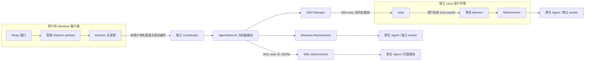
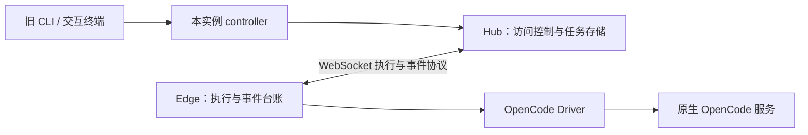
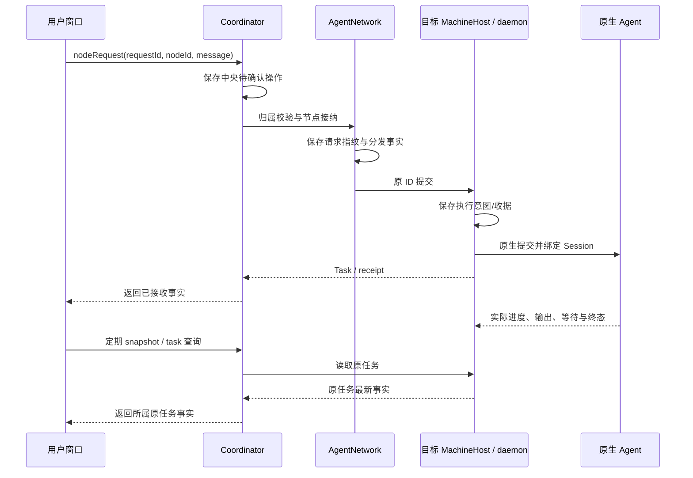
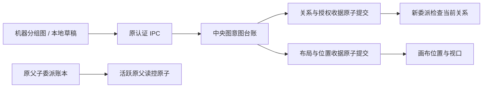
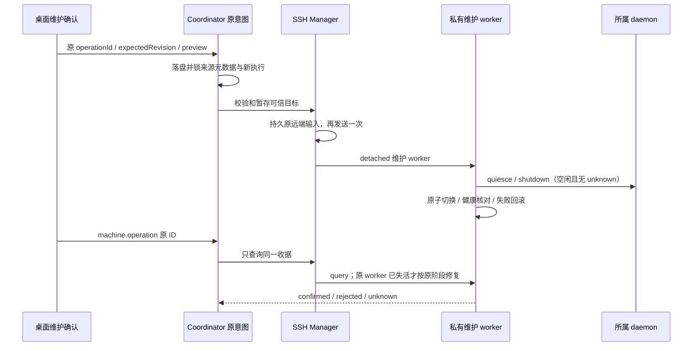

# AgentBridge 整体架构

更新：2026-10-13。本页描述当前源码的运行方式。0.5.0 发布包仍将 AgentNetwork 放在窗口主进程；以下独立 Coordinator 与 SSH 部分已随 I06A 候选完成主要验收，I06B alpha.6 新增节点图和独立保存事务、完成独立 SSH 双向核心链；正式 0.6.0 与 I06C 未完成。

## 当前 Windows 运行缓存与未派发恢复

共享 workerRuntime 从 Coordinator 缓存再次创建 Windows 子后台资源时排除清单自身；新缓存带逐文件摘要，旧缓存只忽略自引用元数据，损坏则旁路重建完整副本而不覆盖活动目录。原任务恢复由 Coordinator 和 AgentNetwork 核对同一未派发意图，不依赖创建新 Task。原生推理、配置继承和远端边界不变。[alpha.18](iterations/I06/runtime-recovery.md)。

## alpha.19 Linux CLI 发现边界

Linux CLI 发现由各环境的 MachineHost/实际 SSH daemon 执行；共享扫描器增加用户态安装目录，不启动交互 Shell，也不把 Windows 安装跨机投影。客户端新版本不自动替换兼容旧 daemon，新发现行为须在原机器显式升级后生效。 见 [专项](iterations/I06/linux-cli-discovery.md)。

## 1. 系统分层

Coordinator 部署在桌面所在机器，使用持久运行资源，不依赖便携程序临时解压目录。它是连接与协作的中央，不运行推理模型。SSH 服务器不需要另开 Bridge 网络端口，只要客户端能直接连接其 sshd。

Windows 主动发起 SSH。远端 relay 把 SSH 通道转换为 daemon 私有 socket 的消息流；daemon 接收任务后拥有本地执行。SSH 或窗口生命周期不拥有远端任务生命周期。

## 2. 兼容的 CLI 路径

这一层仍承担 OpenCode 的实际任务协议与 SQLite 存储。MachineHost 为执行上下文创建或复用它，而不是把所有原生行为重写到中央。Claude/Codex 的宿主和 worker 使用自己的原生进程协议与持久文件。

旧 Hub/Edge 可用显式配置运行当前本机回环 HTTP/WS 服务；配置限制为环回地址，当前代码没有可直接部署公网 WSS Hub 的完整能力。它不是桌面 SSH 接入所要求用户手动启动的一组远端服务。旧 HTTP/WS 的凭据和 SSH 用户凭据是不同协议的身份边界。

## 3. 模块职责

| 模块 | 负责 | 主要依赖 | 不负责 |
| --- | --- | --- | --- |
| M01 桌面 | 导航、展示、输入、原任务控制入口 | M02 与呈现类型 | 保存 SSH 秘密、推理、认定原生完成 |
| M02 Coordinator | 本用户 IPC、后台寿命、中央请求台账、统一调用入口 | M03、M04、M08 | 模型选择、任意远程命令 |
| M03 机器网络 | 机器/节点身份、扫描聚合、来源路由、执行上下文与目录占位 | MachineHost、M06 | 节点级模型/项目绑定 |
| M04 SSH | 认证、主机密钥、凭据保护、环境检测、安装与重连 | ssh2、M05 发布包 | 原生账户登录与项目同步 |
| M05 daemon | 用户态常驻执行入口、私有 socket、收据、事件、回调 | MachineHost、M06 | 以 relay 退出为取消信号 |
| M06 适配 | 原生会话、执行事件、工具权限与取消的能力映射 | 原生 CLI/API、M07 | 改变全局原生模型配置 |
| M07 任务与会话 | 状态、操作收据、持久化、占位、只读恢复 | 原生能力与存储 | 把 missing/unknown 当重跑许可 |
| M08 协作 | 关系修订、作用域、父子任务与 MCP 受限委派 | M03、M07、M06 | 扩大原生权限、把图布局当授权 |
| M09 CLI/Hub/Edge | 旧自动化与交互入口、任务协议与兼容存储 | M06、M07 | 覆盖桌面完整机器网络管理 |
| M10 发布 | 完整持久资源、离线包、摘要、候选包与验收 | 所有产品模块 | 用“构建成功”替代 EXE 真运行 |

每个模块的设计、文件与测试映射在 [模块目录](module-plan.md)。

## 4. 一次请求经过哪些边界

提交返回的 Task ID 不等于任务完成。SSH、Coordinator 或原生接口丢回应时，保存 requestId/operationId 和来源；恢复只查询原记录。不同层的收据解决各自边界的未知，不能只依靠一个内存 Promise 保证跨进程去重。

## 5. 通信方式

| 边界 | 当前实现 | 身份 |
| --- | --- | --- |
| React → Electron 主进程 | contextBridge + IPC；固定方法，验证 sender/frame | 本窗口 |
| 主进程 → Coordinator | Windows 命名管道 / Linux 私有 Unix socket，JSONL | 本用户私有目录中的内部身份，协议 2 |
| Windows → WSL MachineHost | `wsl.exe --exec`，JSONL | 指定发行版与来源机器 |
| Coordinator → Linux relay | SSH exec，4 字节大端长度 + UTF-8 JSON | SSH 主机公钥 + 已认证用户 |
| relay → daemon | 用户私有 Unix socket，同样的长度帧 | Coordinator/profile/daemon/代次握手 |
| 原生 Agent → 中央协作 | 原生 stdio MCP → 本机受限 broker → host 回调 | context/父请求/源机器绑定 |
| 旧 Hub ↔ Edge | 协议 1 WebSocket envelope | 旧配置凭据与 allowlist |

这些协议并存，版本数字相同也不表示它们是同一种消息格式。具体合约、参数与限制见 [协议](protocol.md)。

## 6. 身份与权限的责任边界

第一层是当前操作系统用户：保护中央 IPC、私有目录与凭据文件。第二层是 SSH 主机公钥与用户认证：知道登录密码并不意味着可以跳过服务器身份核验。第三层是 Bridge 的 daemon 身份与 profile：防止地址变更、复制目录或不同用户被接管。第四层是节点关系与父任务作用域：限制 Agent 可委派的目标与可查询的子任务。

Codex 的协作回合由 worker 在本轮 stdin 需求前加入 Bridge 工具指引；普通任务保持原输入。该适配不改变关系授权、机器路由或持久消息身份，详见 [Codex 设计](modules/06-native-adapters/codex/design.md)。

模型账号权限仍由原生工具判断。任务控制没有权限升级入口，协作 MCP 只放行 Bridge 自己的受限操作，不能自动批准原生文件或工具访问。

当前是一套桌面 profile 的协作网络，不能把旧 Hub 的静态用户 ACL 直接理解为桌面多租户平台已完成。

## 7. 数据与唯一写入者

| 数据 | 写入责任 |
| --- | --- |
| 机器目录、节点关系、中央待确认操作 | 所属 profile 的 Coordinator |
| Linux daemon 身份、收据、事件游标 | 所属用户/profile 的单个 daemon |
| OpenCode 任务/会话、Edge 执行记录 | 所属执行上下文的 controller/Hub/Edge |
| Claude/Codex 原任务与原生会话 | 对应宿主、worker 的持久记录 |
| 原生账号、模型偏好与原生全局历史 | 原生工具 |

重复后台通过 socket/锁和归属确认拒绝并存。PID 单独不能证明所属进程。Windows/WSL 同一物理目录共享占位；SSH 远端文件系统独立。unknown 任务不能通过改名称、节点别名或设置默认目标释放占位。

对象、数据文件与版本关系见 [数据模型](data-model.md)。

## 8. 当前局限与设计演进

I06A 没有中央公网 API、云端高可用、项目同步或无人值守设备注册。Linux 使用 detached 用户进程，未实现完整 systemd 用户服务和注销清理策略探测。大响应仍受单帧限制，不能把已有事件/收据分页接口说成全量 snapshot 分页已完成。

I06B 将卡片/下拉协作操作替换为节点图，并补齐旧父任务授权边界。alpha.11 已实现可信维护与原操作恢复；完整故障、指标与最终发布是否通过由当前分层证据决定，见 I06C 收尾。

原 I01 架构文本保存在 [历史快照](archive/legacy/architecture.md)，原产品初稿见 [doc.md](../doc.md)。本页为持续更新的架构基线。

## 当前 6A 候选验收结果

6A 候选已实际验证窗口与中央分离：普通关闭不停止 Coordinator；设置页确认停止后中央退出，远端已接收任务和原生 Session 保留，新窗口重连回读。后台版本自动切换与完整故障/注销策略仍归 6C。

## 已安装 daemon 的客户端兼容

alpha.4 的 SSH 安装器可以选择本地可信 manifest 明确收录的旧发布，按旧清单验证已有文件后复用同一 daemon。桌面包版本、可用于新安装的 Linux 包版本与远端实际运行版本分别记录；握手仍核对实际所选版本和原身份。兼容复用不部署新代码，不改变状态归属或执行账本；详情见 [M04](modules/04-ssh-access/design.md)、[本次交付](iterations/I06/ssh-compatible-reuse.md)。

SSH 恢复状态由 Coordinator 更新并持久化到机器目录，恢复成功删除旧连接错误；MachineRouter 成功快照清理旧目录错误，失败快照保留实际 RPC 错误。合并不能以 transport online 覆盖业务快照失败；不改变任务台账、远端运行实例或协作权限。[alpha.5 修复](iterations/I06/ssh-error-recovery.md)。

## I06B 图编辑与中央权威

图组件只编辑本机草稿，通过原认证 IPC 提交。当前协作关系与其收据由 AgentNetwork 原子提交；布局由中央独立 GraphLayoutStore 保存，位置不参与执行路由。GraphOperationJournal 先写图意图并按 lane 查询原收据，任务 pending journal 保持独立。浏览器缓存用于保留草稿/原 ID，不能作为授权来源。alpha.8 在后台布局读取失败时允许本机视图编辑，显示未同步并禁用需要图事务的新授权编辑；不发送旧式写入，不清除任何原 pending ID。后台可用后以原布局协议/修订同步，本机缓存不证明服务端已提交。

换主后新委派与旧父读控采用不同门槛；旧父身份不转交。无需调整远端协议版本，layout RPC 不下发 daemon。[本次实施](iterations/I06/graph-implementation.md)。

执行上下文先只读等待 OpenCode 就绪，再发需求；执行前拒绝由原 daemon 收据保存，中央按原请求读回核对。确定拒绝与网络未知分开，未出现收据不能视为没有执行，原生配置仍由工具负责。

## alpha.9 节点管理事务

AgentNode 新增可选 managed/removed，缺省兼容旧目录；显式管理后 connected 不被扫描或原生上下文报告覆盖。移除为可恢复标记，快照保留历史身份，UI 隐藏卡片，新需求受中央接入状态约束。agent-network.json 新增 nodeOperations，原子提交节点、授权和收据；版本仍为 1。GraphOperationJournal 新增 node lane，与 relation 未确认意图互锁，布局独立。旧版本不会理解显式移除语义，含此状态的配置不支持直接回退旧中央；保留数据/备份，不靠清空节点或原请求恢复。

`manageNode` 参数 `{operationId,nodeId,machineId?,action}`，action 为 attach/disconnect/remove；返回 `{operationId,state:"confirmed",fingerprint,data:{node,collaboration}}`。`nodeOperation` 以原 operationId 返回 confirmed、确定拒绝的 rejected 或 not_found；not_found 不证明未执行。断开/移除撤销相关权限，有变更才增关系修订。来源校验、离线/忙碌/原生 pending、节点/授权 pending 拦截，接入锁避免并发新任务。snapshot.nodeManagement=true 声明中央能力；新界面在旧中央禁写，原本机布局模式保留。完整语义、错误与验证见 [alpha.9 节点管理](iterations/I06/node-management.md)。

## I06C 机器维护与恢复归属

SSH Manager 持有配置、修订和原 lifecycleOperations 收据；AgentNetwork 持有 removedMachines、当前授权撤销和原 machineOperations 收据。两个文件不构成跨文件原子提交，中央 machine lane 先保存原意图，SSH 收据存在后只读查询原 ID 可幂等完成本地网络提交；没有原收据保持 unknown，不能重发/换 ID。machine/node/relation 的未知共享元数据屏障，layout 独立。

MachineRouter 在中央私有 machine-history.json 合并已观察任务/会话，来源离线/移除/重开可呈现明确 historical 快照，原 request/operation 收据仍到原来源查询。恢复观察按 daemon cursorGap 与分页推进，先补完整 snapshot；无任务或控制补发。机器变更时执行准入锁和全量占用检查覆盖旧 IPC。完整接口与分层证据见 [6C 首批](iterations/I06/machine-management.md)。

## alpha.11 维护执行与恢复边界

维护 worker 不依赖 SSH 会话；控制器保存在状态目录，卸载安装目录后仍能核对原操作。只允许已验证 owner/profile/UID/版本目录，卸载先完整校验所有版本后原子隔离安装目录，再移除所属文件；历史状态保留。旧 daemon 使用已校验 pidfd 停机 helper，新 daemon 使用认证 RPC。无法证明归属或空闲则保留 unknown/拒绝，不强杀、不重发原生任务。中央台账表单答案脱敏且损坏时拒绝新执行。系统注销/重启自启动仍无 systemd 保证。完整行为和证据见 [I06C 收尾](iterations/I06/final-delivery.md)。

alpha.14 SSH 上传失败的诊断和重新检测由 M04/M01 完成：明确归档传输失败发生在解包/激活前，安装 rejected 与原生任务 unknown 分开。原 ID、用户批准、私有 profile 及后台/relay 分层不变，未新增业务协议或模型调用。见 [增量设计与验收](iterations/I06/ssh-upload-recovery.md)。

## alpha.16 中央维护证明边界

M04 在 SSH 输入明确未发出时先持久化证明再进行新认证；M02 读取原维护收据时同步对应机器占位。远端 worker/daemon 分层、身份与未知原生任务保持，不新增重放路径。接口和磁盘结构不变，见 [增量](iterations/I06/maintenance-launch-recovery.md)。

## OpenCode 共享发现与平台配置持久化

MachineHost 和 OpenCode Core DesktopHost 共用 tool-discovery；Core 入口按原 executable 核验，不再采用另一套无扩展名扫描。Core SettingsStore 以可写文件 flush、原子rename与修订锁保存；Linux 另flush目录，Windows不执行不支持的目录flush。协议、原生身份及跨机器路由未调整。[专项](iterations/I06/opencode-discovery.md)。

## 未确认操作的资源准入（alpha.20 已预发布）

Coordinator 负责原台账对账与准入，AgentNetwork 按持久请求/实例解析原节点与目录。准入分为调用前初查和真实上下文目录就绪后的派发前复查；不同节点的独立目录可以工作，同节点和共享目录保留占位，缺来源保守限制。MachineHost 不增加模型/API 层。准备失败证明写入原意图后才允许对账为 rejected；远端查询故障本身不解除原执行。远端协议版本不变。[专项](iterations/I06/pending-isolation.md)。
