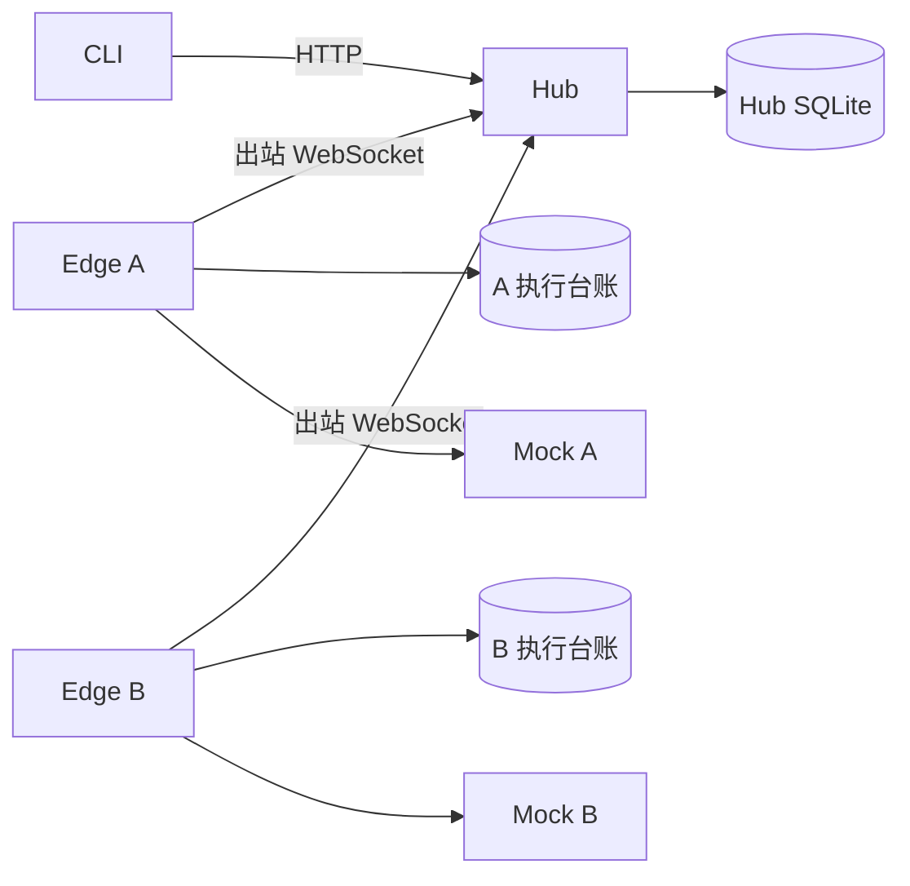

# AgentBridge 架构入口与 I01 历史说明

2026-10-10：当前交付为 [I05 / Windows 0.5.0](../../iterations/I05/acceptance.md)，中央 AgentNetwork 仍由桌面主进程创建，支持本机 Windows 与 WSL。下一迭代 [I06](../../iterations/I06/proposal.md)将中央逻辑拆为独立 Windows Coordinator，通过 SSH 认证和双向 RPC 连接用户态 Linux daemon；不额外配置机器接入码、不开放中央公网 API，远端执行与 SSH relay 生命周期分离。完整组件、协议、身份与恢复合约见 [I06 SSH / 后台设计](../../iterations/I06/ssh-design.md)，用户授权节点图见 [I06 图设计](../../iterations/I06/graph-design.md)。这部分是计划，尚未实现。

下文为 I01 的历史架构，保留给旧 Hub/Edge/CLI 和 Mock 验收参考；其中“后续完善”的时点和静态 Token/WebSocket 示例不覆盖 I05 实现或 I06 SSH 决策。

## I01 架构

需求与实现安排见 [I01 设计](../../iterations/I01/design.md)。一套 TypeScript/npm 项目，三个服务进程与 CLI 客户端；不引入工作流或资源调度。

## 模块边界

| 模块 | 分析与设计 | 文件 |
| --- | --- | --- |
| Core | 纯状态机；拒绝非法事件与终态覆盖；unknown 不能作为重跑授权 | src/core.ts |
| 配置/安全 | 配置目录锚定路径；身份凭据文件；静态 allowlist；摘要比较与脱敏 | src/config.ts、src/security.ts |
| 协议 | 严格 Schema 与版本，任务/执行关联；ACK 不代表完成 | src/protocol.ts |
| 存储 | 独占锁库、WAL/FULL；任务与事件事务；唯一索引保护提交幂等及 Agent 串行 | src/storage/* |
| Hub | 注册、发现、权限、提交/查询、状态权威；没有 Driver 依赖 | src/hub.ts |
| Edge | 主动连接、持久执行台账、Driver 调用与事实回传；无入站执行入口 | src/edge.ts |
| Driver | 异步事件；Mock 可信配置与调用入口计数；能力明确为不支持取消/原生会话 | src/drivers/* |
| CLI | 输入、提交与查询；轮询观察；分页合并；退出观察无业务修改 | src/cli.ts、src/client.ts |

## 故障边界

Hub 在发送前保存 attempted；创建、幂等键、Conversation 和名额在一次事务落库。Edge 在发送接单事件前保存执行台账；Mock 在执行入口记录 invocation；事件先落库再发送，Hub 先保存事件和状态再 ACK。

不确定任务转 unknown 并保留占位。I01/I02 无完整重传/重连/对账，网络中断后的未回传结果只保存在 Edge 台账；I03 完善恢复。终态到达后 Hub 与 Edge 各自保留记录；双方保存点之间故障可产生 unknown，不能假装业务失败。

静态用户只查看自己的任务；Agent 当前任务属于别人时只显示占用，不泄漏私有 Task ID/摘要。events 完整诊断按 diagnostics 配置；常规状态/结果可供所有者查询。

## 运行与备份

数据路径相对配置文件。每份数据库由独立 SQLite 锁数据库的长事务保护，禁止多个服务同时打开；进程退出后 OS 自动释放。停机后备份整个数据目录和受保护配置/凭据；不要只复制活动的 .sqlite 文件并忽略 WAL。活动数据目录不应位于网络共享盘。

node:sqlite 在本次 Node 22 环境可用，但有实验性警告。I02 的真实 OpenCode 接入与验收见 docs/iterations/I02；Windows 原生、物理跨设备和正式 TLS 部署仍在 I06。
