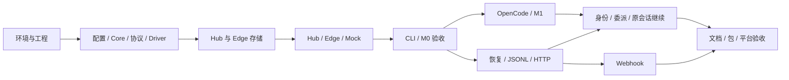

# AgentBridge 开发工作项与验收清单

当前执行入口（2026-10-10）：I05 / Windows 0.5.0 已有交付，结果见 [I05 验收](../../iterations/I05/acceptance.md)。下一迭代是 [I06：SSH 跨设备与节点图](../../iterations/I06/proposal.md)，开发工作项 `DEV-A01…A06 / DEV-B01…B05 / DEV-C01…C06` 及逐项退出条件见 [I06 开发安排](../../iterations/I06/development.md)，测试见 [I06 验收计划](../../iterations/I06/testing.md)。**I06A 产品代码已实现（0.6.0-alpha.1）并在真实物理 Linux 上通过 SSH 接入核心闭环验证（安装/daemon/真实任务/断线生存/重启恢复），缺陷修复与证据见 [开发记录第 9 节](../../iterations/I06/development.md)；Windows EXE/UI 验收、I06B 节点图与 I06C 恢复/打包尚未完成。**

以下是 2026-10-08 初稿的全量历史工作项参考，不表示已交付 I01–I05 全部仍待实现，也不作为当前迭代范围。原 Webhook/通用外部入口移入 I06 之后的候选范围。历史模块设计见 [module-plan.md](../../module-plan.md)，计划文件不表示源码已存在。

## 1. 使用方式与阶段门槛

工作项按 ID 跟踪，依赖完成后再实施；每项包括源码/配置、行为验证和必要文档。表中的测试说明是验收目标，实际实现时避免只镜像实现的无效测试。

| 阶段 | 工作项组 | 可展示的交付 |
| --- | --- | --- |
| P0 | ENV / ENG / CFG-01 / STO-01 | 可复用开发环境、可构建工程与 SQLite 验证 |
| M0-A | CORE / PRO / DRV / MCK / STO-02~03 | 合约、状态机、可靠存储和 Mock |
| M0-B | CFG-02~03 / HUB / EDGE / CLI-01~03 / TST-01~02 | Hub + Edge + CLI 可运行任务闭环 |
| M1 | OC / CLI-04 / TST-03 | OpenCode 合约实现与真实集成验证 |
| M2-A | REL / JSONL / HTTP / DEL / CLI-05 / TST-04 | 可靠重连、跨设备委派及第三方接入示例 |
| M2-B | WH / DOC / PKG / TST-05~06 | Webhook、完整文档、可安装包与平台证据 |

M0、M1、M2 每个阶段均运行 lint/typecheck/test/build。阶段验收以通过的行为和真实记录为依据；“编写了测试”或“提供了验证脚本”不等于已经通过验收。

## 2. P0：环境与工程基础

| ID | 模块/计划文件 | 实现内容 | 依赖 | 验收 |
| --- | --- | --- | --- | --- |
| ENV-01 | 开发环境 | 复用 fnm Node v22.23.1/npm 10.9.8；确定非交互命令加载方式；记录版本 | 无 | 新工具终端可重复执行 Node/npm；不把 PATH 缺失当未安装 |
| ENG-01 | package.json、tsconfig、ESLint、.gitignore | 单 package、ESM/构建输出/bin、lint/typecheck/test/build；初始化 Git | ENV-01 | 最小编译产物可由 Node 启动；保留 doc.md 原稿 |
| CFG-01 | MOD-01：config/schema.ts、load.ts | Hub/Edge/Client 配置；路径基准、凭据引用、参数限制 | ENG-01 | 非法字段/缺密钥/相对路径有可定位错误；不泄漏秘密 |
| STO-01 | MOD-04：storage/database.ts | node:sqlite 事务/文件持久化/锁/WAL/版本兼容探测；确定实现 | ENV-01、ENG-01 | 写入后独立进程读取一致；失败可诊断；记录 Windows 验证条件 |

## 3. M0-A：核心合约与存储

| ID | 模块/计划文件 | 实现内容 | 依赖 | 验收 |
| --- | --- | --- | --- | --- |
| CORE-01 | MOD-02：task/conversation/agent/events.ts | 领域实体、UUID、Execution 与 Task 区分、能力与观测范围 | ENG-01 | 类型来源单一；不同 Agent/Conversation 的原生映射键不同 |
| CORE-02 | MOD-02：state-machine.ts、errors.ts | 状态表、取消意图、终态保护、unknown 恢复、结构化错误 | CORE-01 | 非法转换拒绝；完成/取消竞态不篡改已确认结果 |
| PRO-01 | MOD-03：protocol/ | Envelope、Zod、业务/控制消息、版本、payloadHash | CORE-01 | 合法样例通过；未知版本/非法 frame/同 ID 不同内容拒绝 |
| PRO-02 | MOD-03：transport/ws-peer.ts | 有界 WS 收发、Header 认证入口、断开/错误通知、ACK 分发 | PRO-01、CFG-01 | 真实 WS 双向收发；发送成功不会冒充任务完成 |
| DRV-01 | MOD-07：adapters/driver.ts 等 | Driver factory、异步事件、能力约束、确定性错误、可选方法 | CORE-01 | 缺必需方法/虚报能力拒绝加载；不支持操作明确拒绝 |
| MCK-01 | MOD-08.1：adapters/mock/ | 进度/结果/失败/输入/取消/健康的可控 Mock | DRV-01、CORE-02 | 可观察中间事件与终态；结果明确标记 Mock |
| STO-02 | MOD-04：hub-repository.ts、migrations.ts | Hub 基础表、索引、幂等键、inbox/outbox、事件游标、事务 API | STO-01、CORE-01、PRO-01 | 原子建任务+outbox；重复键不创建第二个 Task；同键不同内容报错 |
| STO-03 | MOD-04：edge-journal.ts | 执行阶段、会话映射、事件 outbox、取消/回复控制操作边界 | STO-01、DRV-01、PRO-01 | 执行前持久化；终态重传可恢复；未知的输入提交不盲重放 |

## 4. M0-B：最小真实连接闭环

| ID | 模块/计划文件 | 实现内容 | 依赖 | 验收 |
| --- | --- | --- | --- | --- |
| CFG-02 | MOD-01：security/principal.ts、policy.ts | 用户/Connector/Agent/Channel 静态身份；绑定、allowlist、owner/log 权限 | CFG-01、CORE-01 | 伪造 source 无效；越权注册/提交/查看日志拒绝 |
| CFG-03 | MOD-01：security/tls.ts、redact.ts | TLS/私有 CA、显式回环明文模式、Token/日志脱敏 | CFG-01、CFG-02 | 错证书拒绝连接；日志不含测试密钥；跨主机明文不默认放行 |
| HUB-01 | MOD-05：server.ts、connection-manager.ts | HTTP/WS 服务、握手、Connector 注册、正文限制、关闭流程 | PRO-02、STO-02、CFG-02、CFG-03 | 独立进程可启动、认证和拒绝未知 Connector |
| HUB-02 | MOD-05：registry.ts | 稳定 Agent ID、设备元数据、健康/在线/忙碌分离、基础心跳下线 | HUB-01 | 注册可查询；冲突 ID 拒绝；连接活跃但原生不健康时不显示可用 |
| HUB-03 | MOD-05：task-service.ts、routes.ts | 任务创建/查询/分页/取消/输入 API，Conversation 权限与幂等提交 | HUB-02、CORE-02、STO-02 | HTTP 202 对应已落库 Task；非法寻址与不支持能力拒绝 |
| HUB-04 | MOD-05：dispatcher.ts | pending/attempted/acked，按并发和会话投递；接收事件事务更新 | HUB-03、PRO-01 | 默认串行；先持久化后发送；重复事件/ACK 无重复执行状态 |
| EDGE-01 | MOD-06：driver-loader.ts、execution-host.ts | 内置/本地 Driver 加载、健康、准备会话、本地并发/目录限制 | DRV-01、MCK-01、STO-03、CFG-01 | 多 Driver 独立；同目录保守串行；坏 Driver 不拖垮全部 Agent |
| EDGE-02 | MOD-06：connector.ts、connection.ts | 主动连 Hub、认证/注册、接任务、事件持久化上报、取消/输入 | HUB-04、EDGE-01、CFG-03 | Hub 与 Edge 两个进程完成 Mock 任务、进度和结果 |
| HUB-05 | MOD-05：recovery.ts | Hub 重启后连接离线；在途任务保守 unknown；保留位与记录恢复 | HUB-04、EDGE-02 | 重启仍有任务记录；不把曾尝试投递的任务直接重新执行 |
| CLI-01 | MOD-10：main.ts、input.ts、client.ts | 命令框架、init/hub start/connect、认证配置、stdin/file | HUB-01、EDGE-02 | bin 可用；已有配置不覆盖；错误输入可诊断 |
| CLI-02 | MOD-10：commands、format.ts | agents/run/tasks/task/cancel；表格/JSON、明确退出码 | CLI-01、HUB-03 | 完成注册→运行→结果查询；机器 stdout 无日志混入 |
| CLI-03 | MOD-03/10：transport/sse.ts、watch | 全局/任务 SSE、SQLite 游标、--watch/--wait、超时/观察退出 | CLI-02、STO-02、HUB-04 | 观察断开不取消任务；Last-Event-ID 补发；慢客户端可恢复 |
| TST-01 | MOD-12：tests/unit、integration | 基础 schema、状态、权限、存储、去重与取消验证 | CORE-02、STO-03、CFG-03、HUB-04、EDGE-02 | 验证完整 M0 行为，不仅验证 HTTP 200 |
| TST-02 | MOD-12：tests/e2e、scripts/demo-m0.ts | Hub/Edge 独立进程、SQLite 重启、投递 ACK 故障 | HUB-05、CLI-03、TST-01 | 可运行演示；故障后原生 fixture 执行计数不增加 |

**M0 完成后可验收：** 一条 CLI 命令提交 Mock 任务，观察真实跨进程事件，查询结果；无权限被拒绝；Hub 重启可查询历史；执行状态不明时保守保留。M0 不声称已经接入真实 OpenCode/Harmes 或跨物理设备。

## 5. M1：OpenCode

| ID | 模块/计划文件 | 实现内容 | 依赖 | 验收 |
| --- | --- | --- | --- | --- |
| OC-01 | MOD-08.2：opencode/client.ts | 锁定 SDK、核对 Server 版本/OpenAPI、认证健康；已有/显式启动 Server | TST-02、DRV-01 | 原生方法有类型证据；只关闭自己启动的 Server |
| OC-02 | MOD-08.2：opencode/session.ts | 新建/继续会话、工作目录、Edge Session Store、观测范围 | OC-01、STO-03 | 两个 Conversation 不串用 Session；不允许任意会话越权续接 |
| OC-03 | MOD-08.2：driver.ts、event-mapper.ts | 先订阅后异步 Prompt、本次消息关联、工具/输出/最终结果 | OC-02 | 204/idle 不直接判成功；只归入本任务的原生事件 |
| OC-04 | MOD-08.2：cancel/reply/inspect | 真实中断、输入能力核对、SSE 断开后查询与结果恢复 | OC-03、HUB-03 | 请求与确认分离；不支持输入回复时如实声明 |
| CLI-04 | MOD-10：conversation/reply | --conversation、reply/requestId、结果/日志观测范围提示 | OC-04、CLI-03 | 同原生会话继续；回复旧请求/错误任务拒绝 |
| TST-03 | MOD-12：verify-opencode.ts、tests/adapters | 合约测试 + 明确可运行的真实验证脚本和记录模板 | OC-04、CLI-04 | 正常/失败/取消/等待/隔离有证据；缺环境时真实项标未验证 |

**M1 的外部条件：** 真实 OpenCode Server、可用原生模型配置、可用于测试的工作目录。没有这些条件可继续 M2 的通用连接部分，但 M1 真实验收不标记完成。

## 6. M2-A：恢复与跨设备协作

| ID | 模块/计划文件 | 实现内容 | 依赖 | 验收 |
| --- | --- | --- | --- | --- |
| REL-01 | MOD-05/06：connection/recovery | 带抖动退避、心跳超时、连接代次、ready 前对账 | TST-02、PRO-02 | 断线恢复；旧连接不能写回；未同步 Agent 不接新任务 |
| REL-02 | MOD-04/05/06：inbox/outbox/reconcile | ACK 丢失重传、Journal 阶段对账、原生 inspect、unknown 保留位 | REL-01、STO-03、HUB-05 | 提交边界退出不重复执行；终态安全重传；重复 ACK 幂等 |
| REL-03 | MOD-05/06：timeouts/limits | 排队/执行超时区分、输出合并/裁剪、缓存和存储故障处理 | REL-02 | 超时不假报已停止；大输出不撑爆内存；无落库不 ACK |
| JSONL-01 | MOD-08.3：process.ts、parser.ts | 安全 spawn/stdin、固定 args、UTF-8/分段/超长行、示例协议 | DRV-01、EDGE-01、REL-03 | 注入字符只是输入；非法 JSON/退出码/截断可定位 |
| JSONL-02 | MOD-08.3：driver.ts、examples/jsonl-agent | 结果确认、取消范围、可选续接/输入、Harmes 待适配说明 | JSONL-01、STO-03 | 退出与终态一致；不把测试程序声称为 Harmes |
| HTTP-01 | MOD-08.4：http/driver.ts、examples/http-agent | 自定义 HTTP 合约、游标轮询、原生 operation ID/幂等能力 | DRV-01、REL-03 | 网络提交超时先查证；只在原生支持时重试 |
| HTTP-02 | MOD-07/08.4：custom-adapter、adapters.md 草稿 | 最小插件 factory、接口/能力测试模板、可用接入示例 | HTTP-01、JSONL-02 | 第三方仅写 Driver 即可接入，不改 Core |
| DEL-01 | MOD-11：delegation-service.ts | Agent 身份、父任务关系、继承权限、子任务幂等/深度/循环校验 | REL-02、CFG-02、HUB-03 | 伪造父任务与越权委派拒绝；循环等待被阻止 |
| CLI-05 | MOD-10/11：delegate/reconcile | 同步 --wait、等待超时、子结果/退出码、unknown 查证入口 | DEL-01、CLI-03、REL-02 | 等待超时保留子 Task ID；reconcile 不重新执行 |
| DEL-02 | MOD-11：OpenCode Skill、Agent CLI profile | 受限静态 Agent 配置、非秘密任务上下文、发现/委派/继续说明 | CLI-05、OC-03、JSONL-02 | 现有 Server 环境缺配置时明确报告；不把秘密放 Prompt |
| TST-04 | MOD-12：demo-delegation、故障矩阵 | Hub+双 Edge、原生 fixture 调 delegate、原 Agent 继续；故障/循环验证 | REL-03、JSONL-02、HTTP-02、DEL-02 | 子结果由实际 CLI 交回原进程；物理设备与 OpenCode 验证单列 |

真实 Harmes 或公司 Agent 的专用 Driver 是有条件工作项：拿到版本和接口样例后，按 MOD-08 的合约新增映射及合约/真实测试。不虚构没有资料的接口，也不因此阻塞通用适配器。

## 7. M2-B：Webhook、文档与包

| ID | 模块/计划文件 | 实现内容 | 依赖 | 验收 |
| --- | --- | --- | --- | --- |
| WH-01 | MOD-09：channel.ts、webhook/auth.ts | Channel 合约、固定 Principal、HMAC 编码规则、时窗/nonce | CFG-03、HUB-03、STO-02 | 错签名/重放/越权拒绝；用户名标签不能提升权限 |
| WH-02 | MOD-04/09：Webhook 迁移、routes.ts | nonce/幂等任务原子处理、submit/query 接口、正文限制 | WH-01 | 新 nonce 同幂等键返回原 Task；恶意 callbackUrl 无效 |
| WH-03 | MOD-09：callbacks.ts、callback_outbox | 固定回调、签名、deliveryId、进度合并、有限重试、失败状态 | WH-02、REL-03 | 重启后继续投递；重定向拒绝；回调失败不改变 Task 结果 |
| TST-05 | MOD-12：Webhook 集成测试 | 本地签名发送器/接收器，重放、回调失败与恢复 | WH-03 | 无真实 IM 账号完成通用验收，保留实际投递证据 |
| DOC-01 | MOD-12：README、architecture/protocol/adapters.md | 最终实际接口/取舍/恢复/权限/unknown 处置/观测范围 | TST-04、TST-05 | 文档与源码一致；未验证的能力明确列出 |
| DOC-02 | MOD-12：examples、.env.example、LICENSE | 本机/跨设备/Windows/TLS/OpenCode/JSONL/HTTP/Skill 配置与 MIT | DOC-01 | 示例无真实密钥；五分钟 Mock 上手可复现 |
| PKG-01 | MOD-12：package/bin/pack | 编译产物、模板、类型声明、临时目录安装验证 | DOC-02、CLI-05 | npm pack 实际包含所需文件；安装后 agentbridge 可启动 |
| PKG-02 | MOD-12：CI 配置 | Ubuntu/Windows × Node 22/24；跨平台 Node 演示脚本 | PKG-01 | 记录实际运行结果；未运行的平台不能报通过 |
| TST-06 | MOD-12：最终验收记录 | 全检查、真实 Agent、双设备、平台与包安装证据汇总 | PKG-02、TST-05、TST-04、TST-03 | 自动化/Mock/真实/未验证分别报告；不遗漏失败项 |

## 8. 关键路径与可独立推进的工作

接口稳定后可独立推进模块代码，但本计划不要求多 Agent 开发，也不增加新的协调服务。缺真实 OpenCode 环境时可以完成通用恢复/适配器/Webhook，使用 Mock/JSONL 做委派验证；完整 OpenCode 委派验收仍待真实条件。

## 9. 验收证据清单

| 场景 | 检查内容 | 证据 |
| --- | --- | --- |
| 正常提交 | 注册、accepted/started/进度/终态、结果与 owner | CLI JSON、事件和 SQLite 记录 |
| 重复提交/ACK | 同键同内容复用任务，重复消息只生效一次 | Task 数量、eventId 唯一、fixture 执行计数 |
| Hub/Edge 重启 | 历史保留、原生查证、unknown 不重跑 | 重启前后执行计数、Journal 阶段、Task 状态 |
| 取消竞态 | 请求已登记与实际取消区分、自然完成不被覆盖 | 原生事件顺序与最终结果 |
| 会话/目录隔离 | 不同 Agent/Conversation、同目录保守并发 | nativeSessionId 映射与并发时间线 |
| Agent 委派 | 身份、父子权限、结果交回、原进程继续 | 父子 Task 树、delegate 输出、后续原生事件 |
| Webhook | 验签、防重放、固定回调、重试/重复 | 接收器 deliveryId、状态和签名验证结果 |
| 平台/真实集成 | 启动/安装/取消/进程回收及真实 Agent 状态 | 设备/OS/Node/Agent 版本与执行记录 |

每阶段输出已完成工作项 ID、四项工程检查结果、验收证据、未验证/失败项和下一增量。保留测试失败的事实，修复后记录复验结果。

## 10. 确认后首先执行的增量

第一个增量为 ENV-01 → ENG-01 → CFG-01/STO-01 → CORE-01/02、PRO-01、DRV-01/MCK-01。交付可构建工程、核心协议/状态机/Driver 合约和持久化验证，再进入 Hub/Edge/CLI 联调。

本轮不会因为初稿内的“立即开发”文字而开始源码实施；遵循当前会话中“计划确认后开发”的要求。
