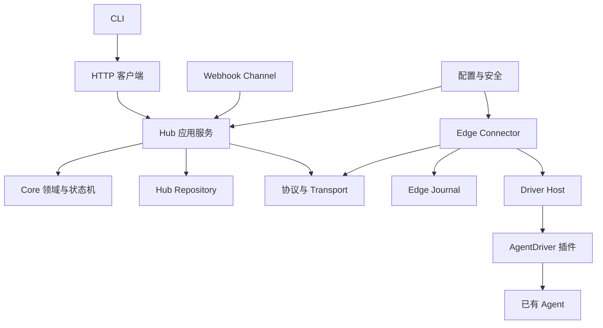
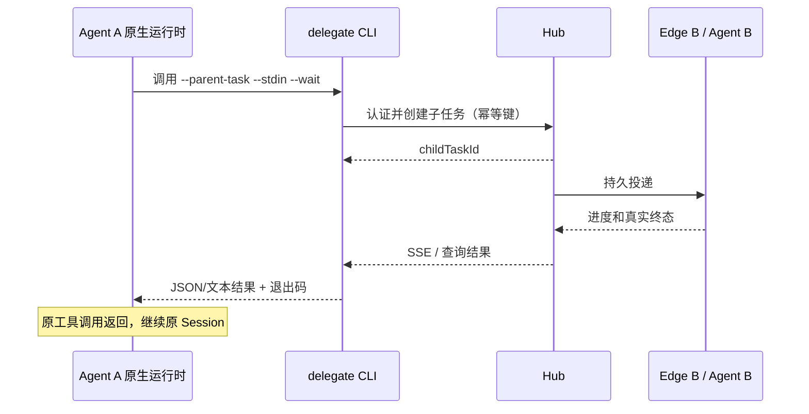

# AgentBridge 模块设计与实现计划

当前模块基线（2026-10-10）：机器工具节点和协作已按 [I05 节点设计](../../iterations/I05/node-design.md)、[协作设计](../../iterations/I05/collaboration-design.md)交付。下一迭代的中央后台、SSH、Linux daemon、身份/恢复和节点图分别见 [I06 SSH / 后台设计](../../iterations/I06/ssh-design.md)、[图交互设计](../../iterations/I06/graph-design.md)、[需求](../../iterations/I06/requirements.md)与[开发安排](../../iterations/I06/development.md)。I06 尚未实现。

以下保留 2026-10-08 的 M0 → M1 → M2 原始模块提案；其中固定项目 Agent、Token/WebSocket 接入及不拆独立后台等描述，不覆盖 I05/I06 的最新对象和部署决定。历史开发工作项见 [development-backlog.md](../../development-backlog.md)，当前迭代范围见 [project-plan.md](../../project-plan.md)。

## 1. 模块边界与依赖

| 编号 | 模块 | 主要输出 | 实施阶段 |
| --- | --- | --- | --- |
| MOD-01 | 配置与安全 | 配置 Schema、Principal、权限检查、TLS、脱敏 | M0 基础；M2 完善 |
| MOD-02 | Core 领域 | Task/Conversation/Agent 类型、状态转换、错误码 | M0 |
| MOD-03 | 协议与 Transport | Envelope、ACK、WebSocket/SSE 编解码、版本处理 | M0 基础；M2 恢复 |
| MOD-04 | Storage | Hub Repository、Edge Journal、迁移与事务 | M0 基础；M2 回调 |
| MOD-05 | Hub | 注册表、任务服务、投递队列、HTTP API | M0；M2 对账与委派 |
| MOD-06 | Edge | 出站连接、本地执行记录、Driver Host、恢复 | M0；M2 完善 |
| MOD-07 | Adapter 插件合约 | AgentDriver、能力声明、本地模块加载 | M0 |
| MOD-08 | 内置与示例 Adapter | Mock、OpenCode、command-jsonl、HTTP 示例 | M0/M1/M2 |
| MOD-09 | Channels | Channel 合约、CLI 映射、Webhook 验签与回调 | M0/M2 |
| MOD-10 | CLI | init/start/connect/query/run/cancel/reply/delegate | M0/M1/M2 |
| MOD-11 | Agent 委派 | 父子关系、Agent 身份、同步等待、OpenCode Skill | M2 |
| MOD-12 | 验证与发布 | 故障测试、跨进程演示、文档、包与 CI | 各阶段 |



依赖约束：Core 只含领域规则；Transport 不直接修改任务；Storage 不做网络请求；Hub 不导入 Driver、Agent SDK 或启动 Agent 进程；Driver 不写 Hub 数据库。模块是同一 npm package 中的代码目录，不拆为独立服务或多个发布包。

## 2. MOD-01：配置与安全

**职责与文件。** `src/config/schema.ts` 校验 Hub/Edge/Client/Channel 配置，`load.ts` 解析路径与凭据引用；`src/security/principal.ts` 定义身份，`policy.ts` 检查权限，`redact.ts` 处理诊断输出，`tls.ts` 处理证书配置。仅管理员配置可指定插件路径、可执行程序、工作目录和回调地址。

**配置结构。**

| 配置 | 关键字段 | 约束 |
| --- | --- | --- |
| Hub | listen、databasePath、tls、principals、connectorBindings、limits | 默认回环监听；跨主机使用 TLS；数据库放本机磁盘 |
| Edge | hubUrl、connectorId、credentialRef、deviceName、journalPath、agents | 一台 Edge 一个稳定 connectorId；多个 Agent 独立 agentId |
| Agent | agentId、displayName、adapter、adapterOptions、workspaceKey、maxConcurrency | 全局 agentId 唯一；默认并发 1；目录由配置决定 |
| Client | hubUrl、principalId、credentialRef、caFile | Agent CLI 与用户 CLI 可使用不同配置文件 |
| Webhook | channelId、secretRef、principalId、callbackUrl、callbackSecretRef | URL 静态配置；请求不能覆盖身份或回调地址 |

凭据引用支持环境变量或受保护文件；启动失败只显示配置字段路径。配置相对路径以配置文件所在目录为基准，不依赖终端当前目录。首版启动时加载配置，修改后重启；不实现热更新系统。

**身份与权限。** Principal 分为 `user`、`connector`、`agent`、`channel`；固定配置维护 `principalId → credential → allowedActions/allowedAgents`。Token 使用高熵随机值，比较时使用恒定时间比较或固定长度摘要比较；同一 Connector 仅能注册其绑定的 Agent。`source` 和任务 owner 从已认证身份生成，不相信客户端自报。

用户默认只看自己提交的任务；Agent 只查询自己被授权处理的任务及相关子任务；Connector 仅回写自己持有的 executionId。任务摘要、详细事件分别检查 `tasks:read`、`tasks:logs`。管理员读取范围必须显式配置。Webhook 的外部用户名只是来源标签，不自动取得用户身份权限。

**建议默认参数（可调）。** 心跳 10 秒、下线阈值 35 秒、握手超时 5 秒；消息正文 64 KiB、单帧最大 1 MiB、任务结果文本 1 MiB、详细诊断每任务 5 MiB；重连上限 30 秒；单 Agent 默认串行。这些是产品默认值提案，实施时根据测试调整并文档化。

**实现与验收。** 先实现配置校验与 Principal，接入 HTTP/WS 授权，再实现脱敏和 TLS；M2 扩展 Webhook 验签。验证非法配置、缺失凭据、越权注册、伪造 source、私有日志访问、错误证书、正文超限。测试使用临时凭据和证书，不依赖真实公司账号。

## 3. MOD-02：Core 领域与状态机

**职责与文件。** `src/core/task.ts`、`conversation.ts`、`agent.ts`、`events.ts` 定义数据；`state-machine.ts` 提供纯状态转换；`errors.ts` 定义可供 CLI/HTTP/协议共享的错误码。Core 不依赖 SQLite、HTTP、ws 或厂商 SDK。

| 实体 | 最小字段 | 归属 |
| --- | --- | --- |
| AgentDescriptor | agentId、adapterType、connectorId、deviceName、capabilities、workspaceKey | Edge 声明，Hub 验证身份并保存 |
| Task | taskId、conversationId、parentTaskId、sourcePrincipalId、sourceAgent/sourceUser、targetAgent、status、message、nativeSessionId、createdAt/updatedAt | Hub 为 Bridge 状态权威 |
| Task 扩展字段 | executionId、version、deadline、cancelRequestedAt、lastSummary、result/error、artifactReferences、uncertaintyReason | 避免仅凭 status 推断投递或中断结果 |
| Conversation | conversationId、ownerPrincipalId、createdAt、updatedAt、metadata | 与 Task 独立；子任务继承可见性约束 |
| NativeSessionBinding | agentId、conversationId、workspaceKey、nativeSessionId | Edge 权威，Hub 可保存观测副本 |
| DriverEvent | eventId、taskId、executionId、seq、kind、timestamp、payload | Edge 归一化；Hub 持久化 |

Task、Conversation、Execution、Message 均使用随机 UUID。`executionId` 标识一次授权执行意图，不随 WebSocket 重连改变。MVP 无自动执行重试；人工决定重新执行时创建新 Task 并记录关联，保留旧任务事实。

**状态转换表。**

| 当前状态 | 正常可转入 | 触发与条件 |
| --- | --- | --- |
| queued | accepted、cancelled、failed、unknown | 接单；明确尚未投递时取消/排队超时；已尝试投递但接收不明 |
| accepted | running、cancel_requested、failed、unknown | 原生执行开始；取消意图；确定未执行的失败；执行边界不明 |
| running | waiting_input、succeeded、failed、cancel_requested、unknown | 原生事件或断线/执行超时 |
| waiting_input | running、succeeded、failed、cancel_requested、unknown | 原生确认输入后继续，或其他真实事件 |
| cancel_requested | cancelled、succeeded、failed、unknown | 取消确认；自然执行先完成；不能确认中断 |
| unknown | accepted、running、waiting_input、cancel_requested、succeeded、failed、cancelled | 对账获得可信证据；不直接回 queued 重跑 |
| succeeded / failed / cancelled | 保持自身 | 终态不可被迟到的普通事件覆盖 |

ACK 不驱动任务执行状态。收到经过关联校验的原生终态证据时，即使 started 事件丢失，也允许由 accepted 直接确认终态；此路径必须记录恢复原因，不放宽普通状态机。

**取消规则。** queued 且 outbox 明确未尝试发送，可以事务内直接取消并移除投递项；其他情况写入 cancel_requested 并可靠发送取消消息。不支持取消时返回 `CAPABILITY_UNSUPPORTED`，保留任务真实状态。unknown 任务存在有效执行记录且 Driver 可取消时，可登记取消意图；只有对账确认才结束任务。

**接口与验收。** 计划提供 `applyTaskEvent(task, event)`、`requestCancellation(task, dispatchEvidence)` 和 `validateConversationAccess(principal, conversation)`；返回状态补丁或领域错误，调用方负责事务与发送。覆盖全部非法转换、取消/完成竞态、重复事件、终态保护、未知状态恢复及所有权校验。

## 4. MOD-03：协议与 Transport

**文件。** `src/protocol/envelope.ts`、`schemas.ts`、`messages.ts` 定义线协议；`src/transport/ws-peer.ts` 管 WS 编解码与大小限制，`sse.ts` 管查询事件流。业务处理通过回调交给 Hub/Edge。

Envelope 包含 protocolVersion、messageId、type、timestamp、correlationId、taskId、source、target、payload；任务事件增加 executionId、eventId、seq。首版 protocolVersion 为 `1`，不兼容版本在握手拒绝；capabilities 显式协商，保留扩展字段命名空间。

| 消息 | 方向 | payload 重点 | 持久可靠投递 |
| --- | --- | --- | --- |
| connector.hello / hub.hello | 双向 | connectorId、connectionGeneration、版本、恢复摘要 | 否 |
| agent.register | Edge → Hub | AgentDescriptor 列表 | 是 |
| agent.heartbeat | Edge → Hub | 健康与活跃 executionId 摘要 | 否 |
| task.submit | Hub → Edge | Task、executionId、会话上下文、期限 | 是 |
| task.accepted / task.started | Edge → Hub | 接单记录、原生关联 ID | 是 |
| task.progress / output / tool_activity | Edge → Hub | 有上限的事件与摘要 | 是；允许在生成可靠消息前合并 progress |
| task.waiting_input | Edge → Hub | requestId、输入类型、可回复标志 | 是 |
| task.completed / failed / cancelled | Edge → Hub | 结果、错误或取消确认及原生证据 | 是 |
| task.cancel / task.reply | Hub → Edge | cancellationId 或 requestId、回复数据 | 是 |
| connector.sync / task.reconcile | 双向 | 已知任务、执行边界、原生查询结果 | 是 |
| task.delegate | Agent/授权入口 → Hub | parentTaskId、targetAgent、message、幂等键 | 是；CLI 使用对应 HTTP API |
| message.ack / protocol.error | 双向 | ackedMessageId、接收结果或错误码 | 否 |

心跳、握手与 ACK 是瞬态控制消息，避免 ACK 循环与持久队列膨胀；“先持久化再发送”适用于任务和业务消息。接收方在落库后 ACK；重复消息核对 payloadHash 后复用接收结果，同 ID 不同内容拒绝。

每任务的 seq 表示 Edge 事件顺序，恢复时同 eventId 不重复生效。可靠事件已入 outbox 后不随意删除；高频 progress 在形成可靠消息前合并，序号缺口不能自动解释为任务失败。终态保存完整最终状态；必须具备传输重连后的查询能力。

**错误处理。** 无效 schema 拒绝且记录脱敏原因；未知 Agent、越权 execution、错误 correlation 返回明确错误码。传输发送成功仅更新投递记录；业务错误不能伪装成 ACK 成功。

**实现与验收。** 先实现 Schema 和 WS 基础收发，再加入 durable inbox/outbox 协调；M2 完成 fencing 和对账。验证重复 ACK、乱序/重复事件、版本冲突、大帧、断线、心跳丢失、ACK 后业务失败及同 ID 不同 payload。

## 5. MOD-04：Storage

**职责与文件。** `src/storage/database.ts` 创建 SQLite 连接，`migrations.ts` 处理版本；`hub-repository.ts`、`edge-journal.ts` 暴露事务操作。首版优先复用已验证可加载的 node:sqlite，跨平台/持久化验证后确定；对外不泄露具体数据库句柄。

**Hub 表设计。**

| 表 | 主要键与字段 | 索引/约束 |
| --- | --- | --- |
| schema_migrations | version、appliedAt | version 唯一 |
| connectors | connectorId、deviceName、lastSeenAt、generation、status | connectorId 主键；凭据不入库 |
| agents | agentId、connectorId、descriptorJson、health、lastSeenAt | agentId 唯一，绑定 Connector 不可被注册消息篡改 |
| conversations | conversationId、ownerPrincipalId、metadataJson | ownerPrincipalId 索引 |
| tasks | 领域字段、executionId、version、resultJson、dispatchEvidence | targetAgent/status、conversationId/createdAt、parentTaskId 索引 |
| task_events | globalCursor、eventId、taskId、executionId、seq、kind、summary、detailsJson | eventId 唯一；taskId/globalCursor 索引 |
| idempotency_keys | principalId、operationScope、key、payloadHash、taskId、createdAt | principalId/operationScope/key 唯一；委派 scope 包含父任务 ID |
| inbox | peerId、messageId、payloadHash、receiptJson | peerId/messageId 唯一 |
| outbox | messageId、peerId、taskId、bodyJson、deliveryStatus、attemptedAt、ackedAt | messageId 唯一；peerId/deliveryStatus 索引 |
| webhook_nonces | channelId、nonce、expiresAt | channelId/nonce 唯一 |
| callback_outbox | deliveryId、channelId、eventId、bodyJson、attempts、nextAttemptAt、status | channelId/eventId 唯一；待投递索引 |

**Edge 表设计。**

| 表 | 用途 | 关键约束 |
| --- | --- | --- |
| executions | taskId、executionId、phase、nativeSessionId、nativeOperationId、lastSeq | executionId 唯一；phase 区分 received/prepared/execution_intent/active/terminal |
| session_bindings | agentId、conversationId、workspaceKey、nativeSessionId | 三元组合唯一，避免会话串用 |
| control_actions | executionId、operationId、requestId、kind、phase、resultJson | 操作 ID 唯一；取消/输入回复的提交边界也须记录 |
| inbox / outbox | Hub 消息接收记录、待上报事件 | 同 Hub 去重与可靠投递约束 |
| schema_migrations | Edge 迁移版本 | 独立于 Hub 数据库 |

**需要原子化的操作。** `createTaskWithOutbox()` 同时写 Conversation/Task/幂等键/待投递记录；`acceptConnectorEvent()` 同时写 inbox、事件、任务补丁及必要回调；`acceptExecution()` 先写 Edge inbox/execution 再 ACK；`recordExecutionIntent()` 在原生调用前提交；`recordDriverEvent()` 同时写执行阶段与 outbox。状态修改按 version 比较更新，禁止“读完后无条件覆盖”。

投递状态单独存储为 pending/attempted/acked，Task 不增加 delivered 等传输状态。调用 WS send 前先提交 attempted；重启后 attempted 且未 ACK 的任务先对账。数据库事务不能跨网络或原生 Agent 调用。

**迁移、清理与故障。** 开启外键、配置 WAL/忙等待并保持短事务；单进程持有数据目录锁，禁止两个 Hub/Edge 进程使用同一数据文件。迁移以事务执行，不兼容版本停止启动；提供停机备份说明。按有上限的批次清理已 ACK 消息和过期 nonce；活动/unknown 执行及未 ACK 终态不清理。高频详细日志可按保留策略裁剪，保留任务最终状态和裁剪标记。

磁盘满或落库失败时停止接收新任务且不发送虚假 ACK；预留终态事件空间、限制待发送缓存，不能无限堆积内存。已经执行的任务保留不确定性并报告存储故障。

**验收。** 建库/升级/回滚失败恢复、唯一约束、原子创建、重复提交、并发写入、进程强制退出、Hub/Edge 分别重启、ACK 丢失、输出裁剪与存储故障；使用真实临时 SQLite 文件。

## 6. MOD-05：Hub

**内部职责。**

| 组件 / 计划文件 | 负责 | 不负责 |
| --- | --- | --- |
| server.ts / routes.ts | HTTP/HTTPS、WS upgrade、正文限制、请求关联 ID | 厂商业务执行 |
| registry.ts | Agent 注册/寻址、在线/健康/忙碌摘要、下线 | 管理设备或目录资源 |
| task-service.ts | submit/get/list/cancel/reply/reconcile、权限、事务 | 运行 Driver |
| dispatcher.ts | 为已注册 Agent 按声明并发投递 Task | 通用工作流或计算资源调度 |
| connection-manager.ts | Connector 连接代次、心跳、路由、业务收发 | 仅凭 WS 活跃断言 Agent 健康 |
| recovery.ts | 重启及重连对账、unknown 保留位、结果恢复 | 自动重试不明副作用 |

**HTTP API 提案。** 所有业务路由均为 AgentBridge 自己定义的接口。

| 方法与路径 | 输入/输出要点 | 权限与行为 |
| --- | --- | --- |
| GET /healthz | 最小服务健康信息 | 可公开，不含 Agent/任务/版本细节 |
| GET /v1/agents | 描述、在线、健康、busy、当前摘要、observability | 只返回允许发现的 Agent |
| POST /v1/tasks | targetAgent、message、conversationId?、deadline? | 认证 + Idempotency-Key；202 返回已持久化 Task |
| GET /v1/tasks | 状态/Agent/Conversation/父任务过滤、游标分页 | 按身份过滤；默认仅 Bridge 任务 |
| GET /v1/tasks/:id | Task、摘要、结果、子任务引用 | 私有任务越权返回不可发现的 404 |
| POST /v1/tasks/:id/cancel | 可选 cascade、幂等键 | 返回当前状态与取消是否已确认 |
| POST /v1/tasks/:id/reply | requestId、response、幂等键 | 校验能力、输入请求与任务状态 |
| POST /v1/tasks/:id/reconcile | 请求 Edge/Driver 查证执行状态 | 只查证与恢复，不允许直接伪造 succeeded |
| GET /v1/tasks/:id/events | cursor、是否包含诊断 | SSE；详情权限单独验证 |
| GET /v1/events | Agent/任务过滤、cursor | SSE；用于 tasks --watch |
| GET /v1/agents/:id/native-sessions | 游标、观测范围 | 可选能力；与 Bridge Task 列表分开 |
| POST /v1/delegations | parentTaskId、targetAgent、message | Agent 身份 + 继承权限 + Idempotency-Key |
| POST /v1/channels/:channelId/messages | action、外部消息 ID、消息/查询条件 | HMAC 验签，见 MOD-09 |
| WS /v1/connectors/ws | Connector Token、版本、恢复摘要 | Header 认证；凭据不放 URL |

统一错误输出为 `{error: {code, message, requestId, retryable}}`，不含堆栈。400 输入非法、401 身份失败、403 操作未授权、404 不存在/不可见、409 幂等内容冲突或状态冲突、413 超限、422 能力不支持、429/503 过载或暂不可用。SSE 游标过期返回 410，并提示重新读取任务快照。

**提交与投递流程。** 验证身份/目标/能力/会话 → 事务创建 Task 与 outbox → HTTP 202 → Dispatcher 检查在线、健康和保留位 → 写 attempted → 发送 → Edge 持久化并 ACK → 接单/执行事件驱动状态。目标 Agent 必须曾合法注册或预配置；拼写错误拒绝，已知离线 Agent 可按期限排队。

按创建顺序投递，maxConcurrency 默认 1；同一会话独占。Hub 与 Edge 都校验并发，避免重连竞态。多个 Agent 指向同一 workspaceKey 时，默认 Edge 将其并发合并限制为 1；管理员显式声明目录隔离后才放开。unknown 保留位释放需要执行终止证据或有记录的管理员处置。

人工处置记录检查证据与是否释放保留位，保留未能确认的 unknown，不伪造成功结果。首版文档提供管理员检查和停机处置步骤；reconcile 只触发原生查证，不提供任意改状态接口。

**事件查询。** 以 SQLite globalCursor 作为 SSE event ID；先建立有界实时缓存并取得历史高水位，补发至该游标，再发送大于高水位的实时事件，避免历史查询和实时订阅之间漏事件。Last-Event-ID 恢复且每个事件重新按权限过滤。慢客户端缓存超限则断开，由游标恢复；用户断开观察不取消任务。

**生命周期与验收。** 启动先迁移、载入权限、将连接状态恢复为离线、标记需对账执行，再监听；退出先停止接收和新投递，持久化已有记录并关闭连接。验证重复注册、ID 冲突、错误路由、离线排队、串行/并发、SSE 恢复、重启与越权写回。

## 7. MOD-06：Edge Connector

**文件。** `src/edge/connector.ts` 编排生命周期，`connection.ts` 管连接，`execution-host.ts` 管本地执行，`recovery.ts` 做 Journal/Driver 对账，`agent-health.ts` 汇总原生健康。一个 Edge 进程可加载多个 Driver。

**连接状态。** disconnected → connecting → authenticating → syncing → ready；传输故障回 disconnected。只有完成身份验证、注册及恢复对账的 Agent 可接新任务。退避从 1 秒增至最多 30 秒并加入随机抖动；身份错误停止快速重试并提示修正配置，网络错误继续重连。

**执行流程。**

1. 校验 task.submit 的目标、executionId、schema、并发和身份；事务写 inbox 与 received，再发送 ACK/accepted。
2. Driver Host 获得会话/目录保留位，调用 prepareSession，持久化 nativeSessionId 与 prepared。
3. 事务写 execution_intent 后调用 Driver.submit；此提交边界不能与外部 Agent 原子化。
4. 将真实异步事件归一化，写 Journal/outbox 后发送；Driver 不能跳过持久化直接发网络事件。
5. 记录可靠终态后释放本地保留位，待 Hub ACK 后按策略清理事件；未知执行继续保留必要位置。

**恢复决策。**

| Journal 阶段 | 可证明的事实 | 恢复动作 |
| --- | --- | --- |
| 无本地记录 | 未能证明接收/执行情况 | 结合 Hub attempted 与新连接对账；不凭无记录重跑 |
| received / prepared | 此执行意图尚未进入原生提交边界 | 对账确认仍授权后继续同 executionId，不能建立第二个执行 |
| execution_intent | 原生提交可能已经发生 | 查原生 operation/session/message；查不到则 unknown |
| active | 曾观察到执行开始 | 查询/重新观察；无法确认则 unknown |
| terminal | 有已记录的终态证据 | 重传终态，不重新提交 Agent |

连接代次仅防止旧连接写回，不改变已执行任务的 executionId。新连接经同步确认后重新接管同一执行的事件上报。Edge 离线期间允许已经运行的 Agent 继续，但不接新任务；输出缓存有上限，原生健康与 Hub 网络状态分别显示。

**取消/回复。** Hub 消息先持久化，再根据 executionId 和 requestId 调用 Driver；control_actions 记录 received/intent/confirmed，未知的回复提交不能盲目再次调用原生接口。重试须由原生幂等能力或查询证据支持。请求方法成功只表示已提交，原生确认事件才驱动状态。旧 requestId、错误会话和已完成任务拒绝回复。

**退出与验收。** 收到退出信号先停止接单、刷写 Journal 并释放自身网络资源；如何停止本地启动的进程按 Driver 能力处理，外部 Server 的持续执行需要记录并在下次启动对账。验证执行前/提交边界/执行中退出、Edge 重启、旧连接事件、目录冲突、离线结果缓存及取消竞态。

## 8. MOD-07：AgentDriver 与插件加载

**文件。** `src/adapters/driver.ts`、`capabilities.ts`、`driver-event.ts` 定义合约；`src/edge/driver-loader.ts` 加载内置或受信任本地模块。插件 factory 接收配置与受限的日志/会话上下文，不取得 Hub 数据库或管理员 Token。

下面是拟定合约轮廓，类型将在 CORE-01/DRV-01 落定；方法属于 AgentBridge，不是厂商 SDK 方法：

```ts
interface AgentDriver {
  readonly descriptor: AgentDescriptor;
  connect(): Promise<void>;
  healthCheck(): Promise<AgentHealth>;
  prepareSession(context: ConversationContext): Promise<NativeSessionRef>;
  submit(request: DriverTask, context: DriverContext): Promise<DriverExecution>;
  cancel?(execution: ExecutionRef): Promise<CancelRequestResult>;
  reply?(execution: ExecutionRef, input: DriverInput): Promise<InputRequestResult>;
  inspect?(execution: ExecutionRef): Promise<ExecutionObservation>;
  listNativeSessions?(query: NativeSessionQuery): Promise<NativeSessionPage>;
  close(): Promise<void>;
}

interface DriverExecution {
  nativeSessionId?: string;
  nativeOperationId?: string;
  events: AsyncIterable<DriverEvent>;
}
```

**能力字段。** cancellation、conversationContinuation、inputReply、toolActivity、executionInspection、sessionEnumeration、maxConcurrency。取消另外声明确认范围：原生执行、仅本地进程或仅能请求；无法确认完整执行停止时不得发出虚假的 cancelled。配置可收紧能力，不得把 Driver 未实现的能力打开。

prepareSession 不执行用户任务；无需原生会话的 Driver 返回无原生 ID 的引用，并声明不支持续接。会话绑定由 Edge 的 Session Store 管理，Driver 处理原生创建/验证，避免多个 Driver 各自维护不一致缓存。

**事件合约。** 统一 started/progress/output/tool_activity/waiting_input/completed/failed/cancelled；需带 taskId/executionId，Driver Host 分配稳定 eventId/seq。输出包含 stream 和截断标记；tool_activity 只报告活动，不执行工具；waiting_input 包含 requestId 与输入类型；终态最多确认一次。

Driver 异常标明执行确定性 `not_started`、`finished` 或 `unknown`。submit 网络超时不能默认按未执行失败重试；事件流结束但没有终态证据，Host 调用 inspect 或标记 unknown。健康检查只探测接口，不运行实际模型任务。

**插件机制与验收。** 本地模块路径显式配置，export factory，校验接口版本和能力与方法一致性；内置名称由 Edge 注册表映射。启动时加载失败使该 Agent 不可用并输出原因，其他 Agent 可继续。验证不支持能力、错误模块、双终态、异常事件、空事件流、关闭资源及最简自定义 Driver 合约。

## 9. MOD-08：各 Adapter 的独立实现计划

### 9.1 Mock Driver（M0）

`src/adapters/mock/driver.ts` 提供明确标记的测试 Agent。固定配置控制进度数量、延迟、失败、等待输入与取消；输出说明自身是 Mock。支持会话隔离和确定性故障注入，不把示例结果标成真实 Agent 工作。

实现顺序：健康与能力 → 异步事件 → 取消/输入 → 可查询执行状态 → 跨进程 fixture。验收测试不仅检查最后一行，还检查事件顺序、终态、真实跨进程通信及 SQLite 恢复。

### 9.2 OpenCode Driver（M1）

**文件。** `src/adapters/opencode/client.ts`、`driver.ts`、`event-mapper.ts`、`session.ts`；真实验收入口 `scripts/verify-opencode.ts`。Edge 按配置连接现有 Server，或显式启动本地 Server；只关闭自己启动的 Server。

**配置。** baseUrl 或 managedServer 二选一；认证引用、工作目录、可选原生 Agent 名称、请求超时；模型和工具权限由用户已有 OpenCode 配置决定。敏感配置不写入 Prompt。

**接口核对与映射。** 官方资料已提供下列能力，实际方法名/参数及事件类型以锁定 SDK 类型和目标 Server OpenAPI 为准：

| Bridge 操作 | 原生接口资料 | 需要实现的处理 |
| --- | --- | --- |
| 健康 | global.health / GET /global/health | 保存版本与可用性，不触发模型 |
| 新建/继续会话 | session.create/get | 按绑定和工作目录校验；不凭会话 ID 跳过权限 |
| 异步执行 | POST /session/:id/prompt_async | 204 只说明请求接收；关联本次原生消息 |
| 事件观察 | event.subscribe，SSE | 订阅先于提交；只处理目标会话/消息 |
| 查证结果 | 会话状态、消息查询 | 最终消息 + 错误 + 本次执行关联，避免 idle 误判 |
| 中断 | session.abort | 区分中断请求与确认，等待原生证据 |
| 会话枚举 | session.list | 过滤授权观测范围，不声称是全部任务 |
| 输入/权限回复 | 原生接口依版本核对 | 能力查明后实现，未支持时保留 waiting_input |

以上是官方能力资料的整理，尚未安装或实际调用。[SDK 文档](https://opencode.ai/docs/sdk/)、[Server 文档](https://opencode.ai/docs/server/)。

**实现步骤。** 锁定版本并记录类型快照 → 健康/认证/连接 → 原生会话绑定 → 先订阅后提交 → 事件归一化与最终结果确认 → 中断/输入 → SSE 断线后查询持久消息与状态。SDK 的生成方法名未经确认不写死到设计示例。

**关键限制。** Bridge 只能保守协调自己投递的任务。现有 OpenCode Server 被外部客户端同时使用时，可能有额外原生任务；默认对已绑定会话检查忙碌状态，原生共享访问限制写入文档。原生流断开不等于任务取消。

**验收。** 新会话、继续会话、不同 Conversation 隔离、真实 tool_activity、正常/失败终态、中断竞态、权限等待、流断开查证、Server 不可用。无真实 Server/可用模型配置时仅完成合约测试及验证脚本，真实验收保持未完成。

### 9.3 command-jsonl Driver（M2）

**文件与配置。** `src/adapters/command-jsonl/driver.ts`、`parser.ts`、`process.ts`；配置 executable、固定 args、cwd、允许环境变量、事件解析模式、超时。使用 spawn 的参数数组和标准输入，`shell: false`，用户消息不进入命令字符串或决定可执行文件。

**Bridge 示例协议。** 每任务一个进程，stdin 首行携带 `{type: "task", taskId, conversationId, message, nativeSessionId?}`；stdout 每行是带 type 与 taskId 的事件 JSON，stderr 为受限诊断。可交互程序可在 stdin 后续接收 cancel/reply 控制行，但只有程序实际支持时才声明相应能力。该协议是示例接入合约，不是 Harmes 已有协议。

解析 UTF-8 分段、跨 chunk 换行、末尾未换行与超长行；支持 strict-jsonl 和明确配置的文本输出模式。示例默认 strict-jsonl，非法行报告协议错误；文本模式只生成 output，须单独定义可验证的结果规则。

completed 暂存至子进程正常退出再确认；非零退出、终态冲突或退出缺少必要结果报告明确错误。仅杀掉本地进程而无法证明其派生/远端操作结束时，不承诺任务已经取消。退出、超时、信号及子进程回收均提供 Windows/Linux 分支。

**验收。** stdin 注入字符原样传递、固定 args 不变、分段/大行/非法 JSON、退出码、超时、取消范围、诊断脱敏、遗留执行处理。Harmes 专用适配的命令和解析规则必须由实际版本及样例确认。

### 9.4 HTTP Driver 示例与自定义插件（M2）

`src/adapters/http/driver.ts` 配合 `examples/http-agent/server.ts` 演示 Bridge 自定义合约：`GET /health`、`POST /tasks`、`GET /tasks/:id`、`GET /tasks/:id/events?after=`，可选 cancel/reply。提交返回 nativeOperationId，查询返回稳定事件游标和真实状态；按游标轮询无需新增 SSE 解析库。

该示例不是公司私有 API。已有接口通过自定义 Driver/薄包装映射；提交超时后查证，只有原生明确支持幂等提交时才能用同一键重试。baseUrl/认证/允许路由均由可信配置固定；不允许消息选择任意 URL。

提供 `examples/custom-adapter/` 的最小 factory、能力声明、事件实现与合约测试；`docs/adapters.md` 解释接入步骤和未知状态处理。验收慢请求、重复响应、游标恢复、部分能力及敏感认证信息脱敏。

## 10. MOD-09：Channel 与 Webhook

**合约与位置。** `src/channels/channel.ts` 定义 `normalizeMessage()`、`renderTaskEvent()`、`deliver()`；CLI Channel 只做标准 API 请求/输出映射，不启动额外后台服务。Webhook 在 Hub 进程中作为路由插件加载，调用 TaskService，不绕过权限层。

**Webhook 请求。** action 为 submit/list_agents/list_tasks/get_task，外部 requestId 只用于关联；消息包含 targetAgent、message、conversationId?。认证身份由 channelId 的固定配置决定，body 的 userLabel 仅为来源标签。请求严禁 callbackUrl 覆盖。

采用 HMAC-SHA256 对 `METHOD + rawPathAndQuery + timestamp + nonce + rawBody` 的有明确换行分隔的字节序列签名，Header 为 X-AgentBridge-Timestamp/Nonce/Signature；协议文档给出唯一编码规则。时间窗口默认 5 分钟，nonce 在有效窗口内持久化；验签和输入校验通过后，在任务/查询处理事务中登记 nonce。

相同 nonce 返回重放拒绝；合法重试改用新 nonce，并保留相同业务幂等键，返回原 Task，不创建新任务。不得在日志中写原始签名或密钥。

**结果回调。** channelId 固定到 callbackUrl；回调载荷包含 deliveryId、taskId、conversationId、parentTaskId、status、summary/result、timestamp，不默认发送详细工具日志。加入回调签名，禁止重定向。提交、显著进度和终态入 callback_outbox；进度先合并，终态不可丢弃。

建议退避 1/5/30/120/600 秒，2xx 为确认；网络故障、429、5xx 有限重试，其他 4xx 标记失败。失败回调不改变 Task 执行结果，记录最终投递状态供查询。接收方按 deliveryId 去重，不能承诺回调恰好一次。

**验收。** 正确/错误签名、超时、同 nonce 重放、不同 nonce 同幂等键、恶意 callbackUrl、重定向、回调失败/重试/重复、摘要大小限制及未授权 Agent 调用。使用本地测试接收器，不需要企业 IM SDK 或内部账号。

## 11. MOD-10：CLI

**文件与分层。** `src/cli/main.ts` 处理命令路由，`client.ts` 封装认证 HTTP/SSE，`input.ts` 读取参数/stdin/file，`format.ts` 显示表格/JSON；命令文件调用客户端，不能各自直接读 SQLite。Hub/Edge 启动命令是同 package 的进程入口。

| 命令 | 关键选项/输入 | 输出与语义 | 阶段 |
| --- | --- | --- | --- |
| init | --dir、开发模式 | 生成占位配置；已有文件拒绝覆盖并说明 | M0 |
| hub start | --config | 前台运行，显示监听地址和存储位置 | M0 |
| connect | --config | 前台运行 Edge，显示注册与连接变化 | M0 |
| agents | --json | 名称/类型/设备/在线/健康/busy/当前摘要 | M0 |
| run | Agent、消息；--stdin/--file/--conversation/--wait | 默认返回 Task；等待模式观察终态 | M0；会话续接 M1 |
| tasks | 过滤、--watch、--json | 分页任务与摘要，注明 Bridge 观测范围 | M0 |
| task | taskId、--watch、--json | 任务状态/结果/父子引用 | M0 |
| cancel | taskId、--wait、--cascade | 显示请求登记或实际取消；cascade 显式选择 | M0 基础；M2 子任务 |
| reply | taskId、--request、stdin/file | 回复原生输入请求，不新增无关会话 | M1/M2 |
| reconcile | taskId | 请求原生查证 unknown，不执行重试 | M2 |
| delegate | --to/--parent-task、消息、--wait/--timeout | Agent 身份提交子任务、等待或返回 ID | M2 |

消息来源选项互斥；默认不允许空消息；读取和输出均有上限。POST 操作生成幂等键，网络重试保持键和 payload；结果不明确时打印该键和查证提示，不换键重新执行。

退出码提案：0 命令成功或等待成功；1 已确认执行失败；2 参数/权限/能力错误；3 等待超时或需要处理的 unknown；4 已确认取消；5 网络/服务故障。普通查询成功即 0，不因查到 failed Task 自动失败。Ctrl+C 结束观察，不隐式取消远端任务。

**验收。** 参数错误、stdin/file/Unicode、大消息拒绝、JSON 无日志混入、分页/游标、SSE 重连、各退出码、幂等提交及跨平台入口。日志写 stderr，机器结果写 stdout。

## 12. MOD-11：Agent 主动委派

**位置。** `src/hub/delegation-service.ts` 复用 TaskService，`src/cli/commands/delegate.ts` 复用 Client；`examples/opencode-skill/agentbridge/SKILL.md` 提供操作说明。首版不增加工具执行服务或工作流引擎。

**身份方案落实。** 单用户/单管理员 MVP 使用专用、受限的 Agent Principal。OpenCode 原生进程通过管理员设置的环境变量或受保护 CLI 配置取得此身份；新启动 Server 可显式配置，连接现有 Server 需要其启动环境已具备配置。默认建议一个 Bridge Agent 身份对应一个独立 OpenCode Server/工作目录，先不依赖 SDK 为每个 Prompt 注入环境变量。

任务范围凭据不作为第一版硬前提；未来可在原生执行环境明确支持时提供。静态 Agent 身份不是多租户隔离机制；共享 Server/多用户隔离留作后续能力，当前文档明确限制。

**上下文。** Edge 提交的上下文只带非秘密的 taskId/conversationId/允许委派目标提示。CLI 使用凭据验证身份；Hub 验证 parent.targetAgent 与 agentId 一致、父任务处于活动状态、parent owner 的委派权限和 Agent allowlist 均允许目标。

子任务的会话权限继承父任务，原生会话按目标 Agent 独立绑定。幂等键作用域包含 Agent Principal 与父任务；不因重连创建第二个子任务。默认每链深度上限 4、每父任务子任务数量上限 16，可配置。

**同步继续流程。**



检测祖先任务目标重复和目录保留位冲突，拒绝同步循环/自等待路径，避免串行 Agent A 等待本身；目录冲突按同一 Connector 的 workspaceKey 判断，不把不同设备上的同名目录视为同一个目录。父任务取消默认只取消父任务；使用 --cascade 时逐个确认子任务取消，不能将树一次性标记 cancelled。

OpenCode Skill 包括发现 Agent、stdin/file 安全传参、父任务上下文、等待与后续查询、结果解读、失败处理和原 Session 继续。安装路径按照官方 Skill 发现规则说明，示例不覆盖用户已有 Skill。[OpenCode Skills 文档](https://opencode.ai/docs/skills/)。

**验收。** A → B 成功/失败、无权限委派、伪造父任务、重复提交、循环/深度超限、等待超时但子任务继续、父任务取消、结果归回正确父任务。Mock 协作 fixture 与真实 OpenCode 协作分别报告；后台主动注入 Prompt 不进入 MVP。

## 13. MOD-12：验证、文档与发布

**测试组织。** `tests/unit/` 覆盖纯规则；`tests/integration/` 覆盖 Hub/Edge/SQLite/Driver；`tests/e2e/` 用 Node 子进程启动 Hub + 两个 Edge。fixtures 生成临时配置/Token/数据库，记录可定位的端口和进程 ID，退出清理只针对自身启动的进程。

故障矩阵至少包含：提交前/后 Hub 退出、Edge 接单前/执行意图后退出、完成事件 ACK 丢失、重复 ACK、网络断开、原生 Agent 不可达、取消同时完成、会话冲突、满缓存/存储错误。需要证明副作用次数的测试用 fixture 的持久计数器检查执行次数，不能只断言最后 status。

**每阶段完成定义。** 行为验收通过，lint/typecheck/test/build 均通过，文档与配置同步；未验证条件和外部依赖明确列出。M1 未完成真实 OpenCode 验收时标记“合约实现完成、真实验收待环境”，不把完整 MVP 标记完成。

**文档/示例。** README 五分钟 Mock 上手；docs/architecture.md 描述最终模块取舍；protocol.md 描述确切消息/ACK/恢复；adapters.md 描述扩展；另含权限/TLS、unknown 处理、JSONL/HTTP 合约及测试说明。examples 提供本机、跨设备、Windows、OpenCode、JSONL、HTTP、自定义 Adapter、Webhook 接收器和 Skill。

**发布。** npm bin 统一为 agentbridge，发布编译产物/必要模板/声明文件；验证 npm pack 的实际内容和在临时目录安装后的命令。测试与演示脚本使用 Node 启动子进程，减少 Bash 依赖；提供 Ubuntu/Windows × Node 22/24 的 CI 配置。配置 CI 不等于已经获得 CI 通过证据。

默认 MIT；仅引用公开 SDK/API，不复制其他项目的大段源码；依赖锁文件与许可证说明随版本保存。服务托管可提供 systemd/Windows 前台启动说明，安装系统服务不属于 MVP 自动操作。

## 14. 联调顺序与待核实项

**先锁定合约。** MOD-01/02/03/07 形成最小接口 → MOD-04 实现事务 → MOD-05/06/08.1 联调 → MOD-10 完成 M0 → MOD-08.2 完成 M1 → 完整恢复/JSONL/HTTP → MOD-11 委派 → MOD-09 Webhook → MOD-12 发布检查。按纵向可运行增量推进，避免一次写完所有模块后才联调。

| 待核实项 | 默认方案 | 验证失败后的处理 |
| --- | --- | --- |
| Node 22/24 SQLite 持久化与 Windows 支持 | node:sqlite + Repository 隔离 | 比较可移植替代库并说明原因；不以 JSON 文件替代要求的 SQLite |
| OpenCode 本次原生执行的关联方式 | 先订阅、保存消息/会话 ID、查询最终消息 | 收紧并发与观测范围；不能确认时保留 unknown |
| 原生取消/权限/输入事件及回复 | 按版本核实，能力显式声明 | 告知从原生入口处理，保持任务状态可见 |
| OpenCode delegate CLI 的受限身份环境 | 独立 Server/目录的静态 Agent Principal | 明确缺失配置，先验证 Mock/JSONL 委派，不虚报真实闭环 |
| Harmes 与公司 Agent 接口 | 通用 JSONL/HTTP 示例 | 等待实际接口资料后新增 Driver/映射 |
| Windows 原生/跨设备测试条件 | CI + 现场设备验证 | 记录未验证项，区分跨进程与跨设备证据 |

上述未核实项不影响 M0 规划与实现，但会影响真实 Agent 和跨平台验收，须作为工作项保持可追踪。
