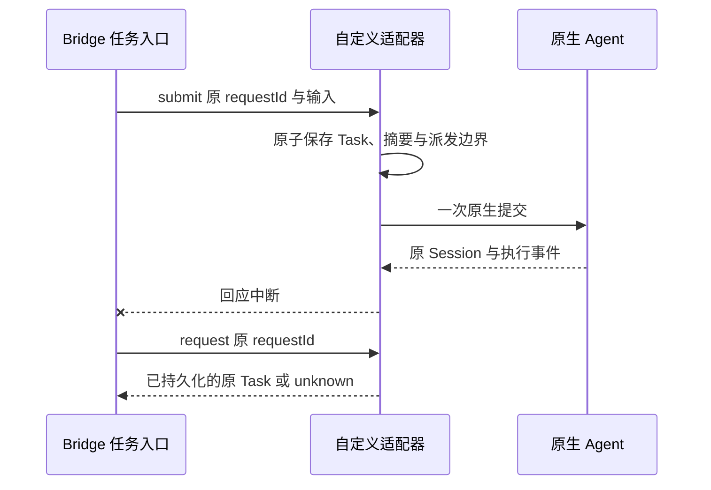

# 自定义原生 Agent 适配开发指南

日期：2026-10-18。关联 AB-F02/F07/F08/F10/F11/F17、M03/M06/M07/M10。本文说明源码级扩展接口；自定义适配器随 Bridge 源码审核、构建和部署。已发布 alpha.28 不包含本接口；2026-10-19增加方向能力契约，详见[CT-01](iterations/I07/connection-capabilities.md)。当前具体工具的实现与验收状态见 [M06 设计](modules/06-native-adapters/design.md)和[测试报告](modules/06-native-adapters/test-report.md)。

用户先在目标机器安装、登录并配置自己的 Agent。Bridge 适配器负责发现程序、调用既有任务接口、读取输出和核对原请求。模型、供应商、账号、Skill 与工具业务由原 Agent 管理。MCP 服务本身不是这个原生任务接口；如需协作，还要将 Bridge 的受限 MCP 连接注入原生会话。

## 1. 注册边界与现成入口

[agent-adapter-contract.cjs](../desktop/electron/agent-adapter-contract.cjs)提供 `defineAdapter`、`createAdapterRegistry`、`assertAdapterHost` 及 JSDoc 类型。注册内容来自代码里的静态定义，不接受 RPC、配置表单或网络提供的适配器模块路径，不动态 `require` 用户指定文件。发现到一个可执行文件，也不会自动给予它另一种 Agent 的执行协议。

| 入口 | 作用 |
| --- | --- |
| `defineAdapter(definition)` | 校验身份、发现信息、能力声明和同步宿主工厂；复制并冻结元数据 |
| `createAdapterRegistry(definitions)` | 组成静态注册表；拒绝重复 ID、命令别名和 npm 入口冲突 |
| `registry.list()` / `registry.get(id)` | 读取不可变的发现描述；结果不含工厂函数 |
| `registry.createHost(id, options)` | 仅调用已注册工厂，并验证返回实例具有 `call`、`close`；未知 ID 返回 `ADAPTER_UNSUPPORTED` |
| `assertAdapterHost(host, id)` | 验证宿主生命周期边界；不代替原生协议与恢复测试 |

[builtin-adapters.cjs](../desktop/electron/builtin-adapters.cjs)导出内置 `adapters` 注册表，六个稳定 ID 为 `codex`、`claude`、`opencode`、`hermes`、`pi`、`dsh`。名字、版本或图标变化不能更改已有 ID；新增自己的工具使用独立 ID，例如 `example-agent`。禁止复用旧 ID 将原任务路由到不同实现。

```js
const { defineAdapter, createAdapterRegistry } = require(
  './desktop/electron/agent-adapter-contract.cjs',
);
const { ExampleHost } = require('./examples/custom-agent/adapter.cjs');

const definition = defineAdapter({
  id: 'example-agent',
  name: 'Example Agent',
  commands: ['example-agent'],
  npmEntrypoints: ['@example/agent/bin/cli.js'],
  capabilities: {
    resume: false, cancellation: false, permissions: false,
    forms: false, verification: false, teamCollaboration: false,
  },
  createHost: options => new ExampleHost(options),
});
const registry = createAdapterRegistry([definition]);
const host = registry.createHost('example-agent', { directory: '/tmp/example-context' });
// 这个 ExampleHost 仅演示合约：snapshot 可读，所有实际执行均明确拒绝。
host.close();
```

`id` 使用不超过 48 字符的小写字母、数字和连字符；`commands` 是非空、无扩展名的小写命令名数组。`npmEntrypoints` 是相对 `node_modules` 的路径数组，可省略；仅用于解析已安装 CLI 的 `.js`、`.cjs`、`.mjs` 或 `.exe` 入口。绝对路径、路径回退和命令脚本均拒绝。Windows 的 `.cmd` 只作为发现线索，实际启动应解析到已知原生二进制或 Node 入口；用户消息不能进入 shell 命令拼接。

能力字段可省略，省略表示未知，不能开放能力。新增 `execution`（执行）、`delegation`（接收普通委派）、`bridgeMcp`（调用Bridge）；与resume/cancellation/permissions/forms/verification分别声明。`teamCollaboration`继续约束原生scope注入。可选 `driver`仅接受native-cli或cli-http，不接受任意协议/模块路径。当前示例不声明新执行能力，仍为零执行骨架。每个已声明能力必须为布尔值；`true` 需要适配器实际实现并有相应测试。工厂同步返回宿主对象；`host.call` 可异步执行，`host.close` 负责释放宿主观察器和其拥有的资源。`close` 的调用不构成取消或任务结束证据。

## 2. 宿主需要实现的操作

MachineHost 调用 `host.call(method, params)`。原生适配器应沿用当前 [任务与恢复设计](modules/07-task-session/design.md)和[协议](protocol.md)中的对象字段；不要额外引入一套与桌面身份不相通的任务状态。

| method / params.op | 输入与返回 | 必须保持的行为 |
| --- | --- | --- |
| `connect` | 输入已发现的 `executable`、规范化 `workspace`、显示名；返回非空 `agentId` | 验证原安装与真实目录；继承原生配置；不发送用户需求，不覆盖模型/供应商 |
| `snapshot` | `{agents:{items, ...}, tasks, conversations}` | Agent 声明实际健康、占用和能力；Task 保留来源、ID、状态、输出及事件；Conversation 只在真实可续聊时给出 `canContinue` |
| `ipc / submit` | `agentId`、稳定 `requestId`、`message` | 先持久保存请求、输入摘要和执行身份，再派发一次；返回原 Task，不把进程启动当成功 |
| `ipc / continue` | 原 `conversationId`、新一轮稳定 `requestId`、`message` | 验证原 owner、目录、原生 Session、上一轮终态和配置；复用原 Session，不能静默改为新会话 |
| `ipc / request` | 原 `requestId` | 只读原任务收据；没有收据返回缺失，禁止重新调用 submit |
| `ipc / task`、`conversation` | 原 `taskId` 或 `conversationId` | 查询原来源与绑定；Conversation 返回本会话的 Task 列表 |
| `ipc / pending` | 原 `taskId` | 返回真实待授权与待填表单；不支持时能力为 false、返回空列表或明确不支持 |
| `ipc / reply` | 原 `taskId`、等待请求 `requestId`、稳定 `operationId`、回复内容 | 绑定原执行和原等待项；同 ID 同输入只读原收据，不同输入拒绝；敏感表单值不写恢复日志 |
| `ipc / cancel` | 原 `taskId`、稳定 `operationId` | 持久保存取消意图再发送一次；继续观察原任务，不凭控制 ACK 伪造 `cancelled` |
| `ipc / operation` | 原 `operationId`、原 `taskId` | 只读原控制收据；缺失或未知时不重发 reply/cancel |
| `ipc / reconcile` | 原 `taskId`，可带原 `operationId` | 读取已有原生事件/任务/进程证据；无充分证据保留 unknown 与占位 |

Task 的核心字段包括 `taskId`、`executionId`、`requestId`、`conversationId`、`targetAgent`、`status`、时间和有序事件；只在观察到有效绑定后写 `native.sessionId`。Conversation 绑定同一 `targetAgent` 与实际原生 Session。详细字段以当前运行适配器、[M07 数据规则](modules/07-task-session/design.md)与[数据模型](data-model.md)为准；合约验证器只验证注册与宿主形状，不验证这些运行结果。

状态按事实推进：`accepted` 表示 Bridge 已记录，`running` 表示原生执行已观察，权限/输入等待反映真实原生请求，`succeeded`/`failed`/`cancelled` 需要对应原生终态。进程退出码、完整输出、完成/错误事件要一起判断；含失败事件的回合不能因出现完成事件误判成功。缺少原生完成证据时保留 `unknown`。已有终态不能被晚到事件覆盖。

## 3. 原请求与未知结果



请求去重按完整输入摘要判断。同 `requestId`、同原输入返回旧 Task；同 ID 改输入返回冲突。`operationId` 对权限回复与取消做同样处理。重启后只恢复原观察与原 ID 查询，不能从“没有收到回应”推导“没有派发”。

裸 `NOT_FOUND`、`NOT_CONFIGURED`、缺少心跳或进程不可见，均不能单独证明原动作未执行。没有原请求的严格匹配执行前拒绝证明，或没有原生终态，就保留 `unknown` 及资源占位。更换节点、目录别名或新 ID 不能绕过旧占位；两个空白身份也不能互相匹配。

控制收据 `confirmed` 只说明原控制操作被确认。权限允许确认后任务仍可能失败；取消确认后任务可能自然成功。结果始终回到原 Task 查询。原生接口没有持久 request lookup 时，适配器必须在调用前保存派发围栏；断点后证据不足时宁可 unknown，不自动重新执行。

## 4. 加入正式发现与执行

1. 复制[可执行骨架](../examples/custom-agent/adapter.cjs)，实现一个独立宿主模块；对照 [ClaudeHost](../desktop/electron/claude-host.cjs)、[CodexHost](../desktop/electron/codex-host.cjs) 与 [MachineHost](../desktop/electron/machine-host.cjs)检查实际接口。先读官方 CLI/RPC 规范，记录支持版本与接口边界，避免只匹配一个同名程序。
2. 在内置静态注册表加入 `defineAdapter` 定义及受控 `createHost` 工厂；发现和宿主派发共同使用同一份描述。自定义安装路径是原生可执行文件路径，不是可加载适配器代码的路径。
3. 发现时只探测候选原安装的版本/能力，不运行模型；选中后再检查同一个规范化路径。禁止原安装失败后自动切换另一套安装。新命令需要额外安装目录时显式加到扫描器，并补 Windows/WSL/SSH 非交互测试。
4. 在前端 Agent 品牌映射加入来源可追踪的本地图标、文字和未知工具回退；核对 `adapter` 类型、机器目录、上下文路由及能力呈现。图标本地随包提供，客户端不在运行时向第三方拉取。
5. 如果开放 `teamCollaboration`，把当前作用域的 MCP、工具名单和指引注入真实原生会话；尊重授权和撤权。不支持时明确拒绝该模式，不能接收协作上下文后悄悄丢掉。
6. 同步 [开发维护规则](development-guide.md)要求的迭代、整体设计、模块设计/报告和协议资料。接口或包边界改变时同步架构、数据、协议与 M10。

## 5. 可执行示例与验收

从仓库根执行：

```bash
node examples/custom-agent/check.cjs
node --test desktop/tests/agent-adapter-contract.test.cjs
node scripts/check-docs.mjs
```

示例的 [ExampleHost](../examples/custom-agent/adapter.cjs)只返回空快照和缺失收据；submit、continue、reply、cancel 与 reconcile 均返回 `ADAPTER_UNSUPPORTED`。它不会运行 CLI、调用模型、登记生产节点或宣称真实任务完成。`check.cjs` 验证注册/创建/读取/明确拒绝及关闭，输出原生执行次数为 0。合约测试覆盖元数据不可变、危险路径/无效能力拒绝、身份与别名冲突、宿主方法边界和骨架零执行。

正式适配器的验收至少覆盖下列独立事实，原始记录标清日期、版本、环境和证据级别：

| 范围 | 应保留的证据 |
| --- | --- |
| 受控原生协议 | 成功/失败/异常输出；原 Session 续聊；重复 ID、改输入冲突；丢 ACK 与宿主重启查询原记录且执行次数不变 |
| 等待与控制 | 真实权限/输入请求的映射；重复操作、外来身份拒绝；取消与自然完成竞态；控制 confirmed 与 Task 终态分别断言 |
| 进程与存储 | 准备失败、派发后断线、半写入、状态损坏；unknown 不释放资源、不新建 Session、不重发原消息 |
| 真实原生 Agent | 用户原生默认账号/配置下首轮、同 Session 后续轮、取消及支持的等待能力；记录未支持的能力 |
| 独立环境与包 | Windows 原生启动、Linux 非交互发现、独立 SSH 上原 daemon 升级、任务恢复；安装包文件与冻结源码一致 |

合约通过只证明开发接口可用。发现 `--version` 通过、原生执行成功、独立 SSH 成功和 Windows EXE 通过分别报告；没有执行的项目保持未测试。

2026-10-18 本次源码验证：WSL / Node 22.23.1，注册合约 5/5、骨架检查通过，原生执行与模型调用均为 0。[合约 TAP](../artifacts/native-adapters/2026-10-18/extension-contract.tap)、[骨架输出](../artifacts/native-adapters/2026-10-18/extension-example.txt)。未由本骨架验证任何真实自研 Agent 或 Windows/SSH 生命周期。

## 6. 打包与升级

生产适配器和注册模块放到 `desktop/electron/*.cjs`，由现有 Electron `electron/**/*` 文件规则、[后台资源暂存](../desktop/scripts/stage-bridge.cjs)及 [Linux 打包](../desktop/scripts/stage-linux-package.cjs)收录。[包校验](../desktop/scripts/verify-package.cjs)逐个核对这些顶层 CJS 与 Windows app.asar、bridge 资源、Linux 离线包；新文件进入包仍需实际构建和校验确认。此处示例留在 `examples/`，不自动成为生产适配器。

若宿主复制自己为独立 worker，要一并复制该 worker 所需的合约/注册/解析模块，或将 worker 依赖保持自包含；不能只在开发目录可运行。新增 npm 运行依赖要加入正确的根依赖与锁文件，确认离线包收录；不要在用户启动时临时联网安装开发适配器。

更新 Windows EXE 不会更新已运行的 Linux daemon。远端需通过原机器维护通道升级对应后台，再重扫安装；旧上下文、原请求/任务 ID 与原 Session 保留。发布应绑定源码、包清单和校验摘要，独立说明已执行与未执行的实机范围。
