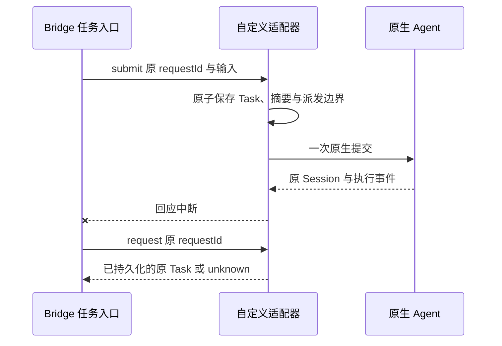

# 自定义原生 Agent 适配开发指南

关联 AB-F02/F07/F08/F10/F11/F17、M03/M06/M07/M10。本文说明源码级扩展接口；自定义适配器随 Bridge 源码审核、构建和部署。当前公开 alpha.34 与其后未发布 DSH Desktop/Web 源码的范围分别见[发布交付记录](iterations/I07/alpha34-release.md)和[DSH交付](iterations/I07/dsh-desktop-web.md)。方向能力契约见[CT-01](iterations/I07/connection-capabilities.md)；具体工具的实现与验收状态见[接入矩阵](agent-integration-matrix.md)、[M06设计](modules/06-native-adapters/design.md)和[测试报告](modules/06-native-adapters/test-report.md)。

用户先在目标机器安装、登录并配置自己的 Agent。Bridge 适配器负责发现程序或已配置服务、调用既有任务接口、读取输出和核对原请求。模型、供应商、账号、Skill 与工具业务由原 Agent 管理。原生 CLI、API、MCP、ACP、插件、SDK 的功能与优缺点见[接入方式与选型指南](agent-integration-guide.md)。本文给出如何把选定路径接到现有源码的具体步骤。

本文仅补文档，不修改运行代码、不新增接入能力、不重做模型或EXE验收。下文“建议”和“开发步骤”不表示通用ACP客户端、原生Bridge插件、SDK驱动或任意URL接入已经实现。

## 1. 先选择执行路径，再增加协作能力

先确定两个方向：Bridge如何把需求交给原生Agent并观察原任务；原生Agent如何反过来调用Bridge。前者需要任务生命周期适配，后者当前通过受限MCP连接实现。一个Agent即使已经是MCP客户端，也不能据此认定Bridge能够驱动它执行任务。

| 原生Agent现有条件 | 推荐第一步 | 当前可参考的实现 | 后续需要补什么 |
| --- | --- | --- | --- |
| 有可靠的非交互CLI、结构化事件、Session身份 | 先做原生CLI执行适配；通常最接近现有开发路径 | [ClaudeHost](../desktop/electron/claude-host.cjs)、[CodexHost](../desktop/electron/codex-host.cjs)、[NativeCliHost](../desktop/electron/native-cli-host.cjs) | 新协议的参数、事件、终态、取消及原请求恢复，不能套用其他工具的命令行参数 |
| 用户主要使用已运行的Desktop/Web服务，服务提供认证、Session与结果接口 | 优先验证原生API能否沿用该实例的运行配置，再实现服务适配 | [DSH私有连接与发现](../desktop/electron/dsh-connection.cjs)、[DSH轮次观察](../desktop/electron/dsh-worker.cjs)；需由CLI启动服务的形态另参考OpenCode | 该Agent专用的认证、身份、只读探测、轮次绑定与断线恢复；不是填写任意URL后自动可用 |
| 只有MCP客户端能力 | 先确认是否另有CLI/API执行路径；MCP用来增加调用Bridge的方向 | [MCP接入设计](modules/06-native-adapters/design.md)、[机器作用域注入](../desktop/electron/machine-host.cjs) | 如要被Bridge执行，仍需实现任务入口；如仅做独立MCP调用方，要实现该客户端的安全配置与授权绑定 |
| 只有ACP服务，或准备把ACP作为多个新Agent的共同执行协议 | 作为新驱动开发任务评估，先完成一个有原Session/控制/恢复证据的适配器 | 复用本文Host与Task契约；当前无通用ACP客户端 | ACP传输、版本协商、会话与权限映射、持久恢复以及协议测试，不能仅新增注册项 |
| 只有原生插件或厂家SDK，或它们独有必要能力 | 比较官方接口稳定性、独有能力与分发成本，再决定是否开发专用实现 | 复用静态注册、能力门禁与打包框架 | 当前无Bridge原生插件或SDK执行驱动；需开发安装/升级、依赖隔离、事件与恢复映射，SDK不得变成Bridge新的模型API层 |

交付按能力分阶段：先完成可靠的直接执行，再验证普通被委派；这两个方向对应`execution`与`delegation`。原Session续聊、取消、权限、表单等逐项实现和验证后再声明。需要Agent充当主角色或主动协调时，再开发`bridgeMcp`与`teamCollaboration`：必须让真实原生会话获得当前作用域的MCP连接，并验证工具白名单、授权撤回和任务结果读取。已有CLI/API执行能力不会自动完成这一步。小队执行成员也不能由普通被委派成功推导。

## 2. 注册边界与现成入口

[agent-adapter-contract.cjs](../desktop/electron/agent-adapter-contract.cjs)提供 `defineAdapter`、`createAdapterRegistry`、`assertAdapterHost` 及 JSDoc 类型。注册内容来自代码里的静态定义，不接受 RPC、配置表单或网络提供的适配器模块路径，不动态 `require` 用户指定文件。发现到一个可执行文件，也不会自动给予它另一种 Agent 的执行协议。

| 入口 | 作用 |
| --- | --- |
| `defineAdapter(definition)` | 校验身份、发现信息、能力声明和同步宿主工厂；复制并冻结元数据 |
| `createAdapterRegistry(definitions)` | 组成静态注册表；拒绝重复 ID、命令别名和 npm 入口冲突 |
| `registry.list()` / `registry.get(id)` | 读取不可变的发现描述；结果不含工厂函数 |
| `registry.createHost(id, options)` | 仅调用已注册工厂，并验证返回实例具有 `call`、`close`；未知 ID 返回 `ADAPTER_UNSUPPORTED` |
| `assertAdapterHost(host, id)` | 验证宿主生命周期边界；不代替原生协议与恢复测试 |

[builtin-adapters.cjs](../desktop/electron/builtin-adapters.cjs)导出内置 `adapters` 注册表，当前源码八个稳定入口 ID 为 `codex`、`claude`、`opencode`、`hermes`、`pi`、`dsh`、`dsh-desktop`、`dsh-web`。后三个同属DSH品牌但连接不同执行入口，不能互相替换已有Session。名字、版本或图标变化不能更改已有 ID；新增自己的工具使用独立 ID，例如 `example-agent`。禁止复用旧 ID 将原任务路由到不同实现。

```js
const { defineAdapter, createAdapterRegistry } = require(
  './desktop/electron/agent-adapter-contract.cjs',
);
const { ExampleHost } = require('./examples/custom-agent/adapter.cjs');

const definition = defineAdapter({
  id: 'example-agent',
  name: 'Example Agent',
  commands: ['example-agent'],
  npmEntrypoints: ['@example/agent/bin/cli.js'],
  capabilities: {
    resume: false, cancellation: false, permissions: false,
    forms: false, verification: false, teamCollaboration: false,
  },
  createHost: options => new ExampleHost(options),
});
const registry = createAdapterRegistry([definition]);
const host = registry.createHost('example-agent', { directory: '/tmp/example-context' });
// 这个 ExampleHost 仅演示合约：snapshot 可读，所有实际执行均明确拒绝。
host.close();
```

`id` 使用不超过 48 字符的小写字母、数字和连字符；`commands` 是非空、无扩展名的小写命令名数组。`npmEntrypoints` 是相对 `node_modules` 的路径数组，可省略；仅用于解析已安装 CLI 的 `.js`、`.cjs`、`.mjs` 或 `.exe` 入口。绝对路径、路径回退和命令脚本均拒绝。Windows 的 `.cmd` 只作为发现线索，实际启动应解析到已知原生二进制或 Node 入口；用户消息不能进入 shell 命令拼接。

能力字段可省略，省略表示未知，不能开放能力。`execution`（执行）、`delegation`（接收普通委派）、`bridgeMcp`（调用Bridge）与resume/cancellation/permissions/forms/verification分别声明。`teamCollaboration`继续约束原生scope注入。可选 `driver`目前仅接受`native-cli`或`cli-http`，它是代码实现路由标记，不是任意协议/模块路径；DSH服务当前也使用`cli-http`，不能据此推断它启动CLI。若实现ACP或SDK等新驱动，需要同时修改受控契约与相关处理，不能直接填写新枚举。当前示例不声明执行能力，仍为零执行骨架。每个已声明能力必须为布尔值；`true`需要适配器实际实现并有相应测试。静态声明只是上限，远端旧后台、当前连接的false/unknown及实际上下文检查仍可收紧准入，未经可信实现声明的元数据不能扩大能力。

工厂同步返回宿主对象；`host.call`可异步执行，`host.close`负责释放宿主观察器和其拥有的资源。`close`的调用不构成取消或任务结束证据。

## 3. 宿主需要实现的操作

MachineHost 调用 `host.call(method, params)`。原生适配器应沿用当前 [任务与恢复设计](modules/07-task-session/design.md)和[协议](protocol.md)中的对象字段；不要额外引入一套与桌面身份不相通的任务状态。

| method / params.op | 输入与返回 | 必须保持的行为 |
| --- | --- | --- |
| `connect` | 输入已发现的 `executable`、规范化 `workspace`、显示名；返回非空 `agentId` | 验证原安装或服务连接身份与真实目录；继承原生配置；不发送用户需求，不覆盖模型/供应商 |
| `snapshot` | `{agents:{items, ...}, tasks, conversations}` | Agent 声明实际健康、占用和能力；Task 保留来源、ID、状态、输出及事件；Conversation 只在真实可续聊时给出 `canContinue` |
| `ipc / submit` | `agentId`、稳定 `requestId`、`message` | 先持久保存请求、输入摘要和执行身份，再派发一次；返回原 Task，不把进程启动当成功 |
| `ipc / continue` | 原 `conversationId`、新一轮稳定 `requestId`、`message` | 验证原 owner、目录、原生 Session、上一轮终态和配置；复用原 Session，不能静默改为新会话 |
| `ipc / request` | 原 `requestId` | 只读原任务收据；没有收据返回缺失，禁止重新调用 submit |
| `ipc / task`、`conversation` | 原 `taskId` 或 `conversationId` | 查询原来源与绑定；Conversation 返回本会话的 Task 列表 |
| `ipc / pending` | 原 `taskId` | 返回真实待授权与待填表单；不支持时能力为 false、返回空列表或明确不支持 |
| `ipc / reply` | 原 `taskId`、等待请求 `requestId`、稳定 `operationId`、回复内容 | 绑定原执行和原等待项；同 ID 同输入只读原收据，不同输入拒绝；敏感表单值不写恢复日志 |
| `ipc / cancel` | 原 `taskId`、稳定 `operationId` | 持久保存取消意图再发送一次；继续观察原任务，不凭控制 ACK 伪造 `cancelled` |
| `ipc / operation` | 原 `operationId`、原 `taskId` | 只读原控制收据；缺失或未知时不重发 reply/cancel |
| `ipc / reconcile` | 原 `taskId`，可带原 `operationId` | 读取已有原生事件/任务/进程证据；无充分证据保留 unknown 与占位 |

Task 的核心字段包括 `taskId`、`executionId`、`requestId`、`conversationId`、`targetAgent`、`status`、时间和有序事件；只在观察到有效绑定后写 `native.sessionId`。Conversation 绑定同一 `targetAgent` 与实际原生 Session。详细字段以当前运行适配器、[M07 数据规则](modules/07-task-session/design.md)与[数据模型](data-model.md)为准；合约验证器只验证注册与宿主形状，不验证这些运行结果。

状态按事实推进：`accepted` 表示 Bridge 已记录，`running` 表示原生执行已观察，权限/输入等待反映真实原生请求，`succeeded`/`failed`/`cancelled` 需要对应原生终态。进程退出码、完整输出、完成/错误事件要一起判断；含失败事件的回合不能因出现完成事件误判成功。缺少原生完成证据时保留 `unknown`。已有终态不能被晚到事件覆盖。

## 4. 原请求与未知结果



请求去重按完整输入摘要判断。同 `requestId`、同原输入返回旧 Task；同 ID 改输入返回冲突。`operationId` 对权限回复与取消做同样处理。重启后只恢复原观察与原 ID 查询，不能从“没有收到回应”推导“没有派发”。

裸 `NOT_FOUND`、`NOT_CONFIGURED`、缺少心跳或进程不可见，均不能单独证明原动作未执行。没有原请求的严格匹配执行前拒绝证明，或没有原生终态，就保留 `unknown` 及资源占位。更换节点、目录别名或新 ID 不能绕过旧占位；两个空白身份也不能互相匹配。

控制收据 `confirmed` 只说明原控制操作被确认。权限允许确认后任务仍可能失败；取消确认后任务可能自然成功。结果始终回到原 Task 查询。原生接口没有持久 request lookup 时，适配器必须在调用前保存派发围栏；断点后证据不足时宁可 unknown，不自动重新执行。

## 5. 快速开发路径

这里的“快速”是复用已有宿主契约、路由、任务状态与验证工具；当前没有通用`add-agent`命令，也不支持填入任意CLI路径、API/MCP地址后自动生成执行适配器。

### 5.1 固定范围，先跑通骨架

在迭代记录中先写清：稳定adapter ID、支持的原生版本、Windows/Linux/WSL/SSH目标、CLI由谁启动或API服务由谁保持运行、继承哪套原生配置、首批开放的方向能力。核对该版本的官方协议或固定源码；记录创建Session、提交输入、读取事件/终态、取消和原请求核对的实际接口。只有交互终端或GUI而没有可识别生命周期时，不把终端文字抓取直接当成可恢复接口。

先运行[骨架检查](../examples/custom-agent/check.cjs)，确认扩展契约理解一致；再以[ExampleHost](../examples/custom-agent/adapter.cjs)为结构参考，在`desktop/electron/`创建受审核的宿主模块，实现上一节操作。骨架不运行任何原生任务，不能作为实际适配完成的证据。

### 5.2 实现执行与持久恢复

第一批只开放已实现的`execution`与`delegation`，其他能力维持false或未知。先验证一次提交只产生一次原生执行，返回真实Task与结果，再实现同一Session续聊、取消和所需等待项。请求日志、输入摘要和派发围栏必须先于原生提交保存；取得有效原生Session后立即持久绑定，续聊先核对原绑定；恢复仅查原ID。

对Hermes/Pi/DSH这类结构化CLI，可参考`NativeCliHost`的持久状态与独立worker，但它只接受[已注册协议profile](../desktop/electron/native-cli-protocols.cjs)。新增adapter ID不会自动获得运行能力：仍需实现对应参数、事件解析、Session定位、终态规则及worker依赖；不能把新工具映射到旧工具profile冒充兼容。协议差异较大时使用独立Host，通过同一`call`/`close`契约接入。

### 5.3 注册并实现对应发现路径

在[builtin-adapters.cjs](../desktop/electron/builtin-adapters.cjs)加入定义及受控工厂，核对[MachineHost](../desktop/electron/machine-host.cjs)是否可通过注册表创建该Host，旧对象仍按原上下文路由。

| 路径 | 开发工作 | 无模型探测与身份要求 |
| --- | --- | --- |
| CLI安装 | 维护`commands`、可选`npmEntrypoints`；[扫描器](../desktop/electron/tool-discovery.cjs)从当前PATH和受控安装目录查找并执行`--version`。新安装布局需要明确补扫描和平台测试 | 使用当前选定的规范化安装路径，首个PATH安装失败时不静默换安装；Windows包装器解析至已知二进制或Node入口，不把用户消息拼入shell |
| 已运行的服务 | 像DSH一样新增该Agent专用的私有连接保存、读取、认证、只读发现与Host/worker；显式加入扫描汇总并跳过把此入口当CLI运行 | 当前DSH认证后只读`session/list`探测，不创建Session/提交需求；其`executable`字段承载私有连接文件身份，不是可执行代码。其他API需独立适配身份和协议，不可套用这个字段就宣称通用URL接入 |

服务地址、原生安装或连接来源改变时，新工作使用新身份；旧请求和Conversation继续绑定原来源。发现成功只证明程序/接口可探测，不证明账号、模型或真实任务可用。连接secret存目标机器私有文件，不进入节点快照、中央台账或日志。设置需要的地址/认证字段应按接入类型设计，服务协议差异不要求为每个品牌新增一张独立设置卡。

### 5.4 接入桌面显示与方向门禁

更新[ToolKind](../desktop/src/types.ts)、[品牌映射](../desktop/src/agent-tools.ts)、[图标组件](../desktop/src/AgentIcon.tsx)及`desktop/assets/agents/`来源/许可说明；核对发现、接入、目录选择、会话、普通委派、历史与错误提示。图标随包本地提供，不向第三方临时拉取。

在[连接能力门禁](../desktop/electron/builtin-adapters.cjs)及相关测试中确认：未知/不支持能力在派发前明确拒绝，直接执行与被委派可用不意味着能当MCP调用方。第二阶段要开放`bridgeMcp`或`teamCollaboration`时，补真实原生MCP配置/作用域注入、工具名单、权限与撤权处理；只设置布尔值不构成实现。对需要权限/问题回复的Agent，单独适配原等待项和控制收据，未实现时维持false，并说明用户在原生界面处理。

### 5.5 验证、同步并部署

新增该适配器自己的协议与生命周期测试，参照下一节的矩阵覆盖一次派发、会话、控制和恢复，再运行相关既有门禁测试。最后按[开发维护规则](development-guide.md)同步迭代、整体设计、模块设计/报告及接入矩阵；接口或包边界改变时同步架构、数据、协议与M10。通过工程检查后再构建冻结包、升级目标机器后台、实测原生Agent；不能把复制示例或单项发现通过当成交付完成。

## 6. 可执行示例与验收

从仓库根执行：

```bash
node examples/custom-agent/check.cjs
node --test desktop/tests/agent-adapter-contract.test.cjs
node scripts/check-docs.mjs
```

新增生产适配器时，以下是现有回归入口；还必须把该Agent自身的行为加入测试，既有用例通过不会自动验证新增工具。CLI、已运行服务两条路径按实际影响选择定向用例，再运行完整桌面回归；改变核心发现或路由时补核心工程检查。

```bash
# CLI发现、路由和方向能力
node --test --test-concurrency=1 desktop/tests/tool-discovery.test.cjs desktop/tests/machine-host-routing.test.cjs desktop/tests/connection-capabilities.test.cjs
# 复用NativeCliHost时核对其生命周期；服务路径另核对DSH既有服务隔离
node --test --test-concurrency=1 desktop/tests/native-cli-host.test.cjs desktop/tests/dsh-connection.test.cjs
# 完整桌面与受影响的核心/前端工程检查
npm run test --prefix desktop
npm run typecheck
npm run lint
npm run build --prefix desktop
node scripts/check-docs.mjs
```

示例的 [ExampleHost](../examples/custom-agent/adapter.cjs)只返回空快照和缺失收据；submit、continue、reply、cancel 与 reconcile 均返回 `ADAPTER_UNSUPPORTED`。它不会运行 CLI、调用模型、登记生产节点或宣称真实任务完成。`check.cjs` 验证注册/创建/读取/明确拒绝及关闭，输出原生执行次数为 0。合约测试覆盖元数据不可变、危险路径/无效能力拒绝、身份与别名冲突、宿主方法边界和骨架零执行。

正式适配器的验收至少覆盖下列独立事实，原始记录标清日期、版本、环境和证据级别：

| 范围 | 应保留的证据 |
| --- | --- |
| 受控原生协议 | 成功/失败/异常输出；原 Session 续聊；重复 ID、改输入冲突；丢 ACK 与宿主重启查询原记录且执行次数不变 |
| 等待与控制 | 真实权限/输入请求的映射；重复操作、外来身份拒绝；取消与自然完成竞态；控制 confirmed 与 Task 终态分别断言 |
| 进程与存储 | 准备失败、派发后断线、半写入、状态损坏；unknown 不释放资源、不新建 Session、不重发原消息 |
| 真实原生 Agent | 用户原生默认账号/配置下首轮、同 Session 后续轮、取消及支持的等待能力；记录未支持的能力 |
| 独立环境与包 | Windows 原生启动、Linux 非交互发现、独立 SSH 上原 daemon 升级、任务恢复；安装包文件与冻结源码一致 |

合约通过只证明开发接口可用。发现 `--version` 通过、原生执行成功、独立 SSH 成功和 Windows EXE 通过分别报告；没有执行的项目保持未测试。

源码验证记录：WSL / Node 22.23.1，注册合约 5/5、骨架检查通过，原生执行与模型调用均为 0。[合约 TAP](../artifacts/native-adapters/2026-10-18/extension-contract.tap)、[骨架输出](../artifacts/native-adapters/2026-10-18/extension-example.txt)。未由本骨架验证任何真实自研 Agent 或 Windows/SSH 生命周期。

## 7. 打包与升级

生产适配器和注册模块放到 `desktop/electron/*.cjs`，由现有 Electron `electron/**/*` 文件规则、[后台资源暂存](../desktop/scripts/stage-bridge.cjs)及 [Linux 打包](../desktop/scripts/stage-linux-package.cjs)收录。[包校验](../desktop/scripts/verify-package.cjs)逐个核对这些顶层 CJS 与 Windows app.asar、bridge 资源、Linux 离线包；新文件进入包仍需实际构建和校验确认。此处示例留在 `examples/`，不自动成为生产适配器。

若宿主复制自己为独立 worker，要一并复制该 worker 所需的合约/注册/解析模块，或将 worker 依赖保持自包含；不能只在开发目录可运行。新增 npm 运行依赖要加入正确的根依赖与锁文件，确认离线包收录；不要在用户启动时临时联网安装开发适配器。

更新 Windows EXE 不会更新已运行的 Linux daemon。远端需通过原机器维护通道升级对应后台，再重扫安装；旧上下文、原请求/任务 ID 与原 Session 保留。发布应绑定源码、包清单和校验摘要，独立说明已执行与未执行的实机范围。

在项目支持的Windows构建环境中，仓库已有的`npm run desktop:dist`会先构建核心/前端，再暂存后台、构建便携EXE并执行`verify-package.cjs --portable`；这是构建步骤，不会自动完成真实EXE或公开下载验收。使用新源码前先停止旧本地后台再重开，WSL/SSH另升级其原daemon。实际发布按[发布交付记录](iterations/I07/alpha34-release.md)保留冻结源码、普通EXE运行、附件摘要与匿名完整下载核验；当前文档更新不生成新包，也不改变alpha.34已发布字节。
