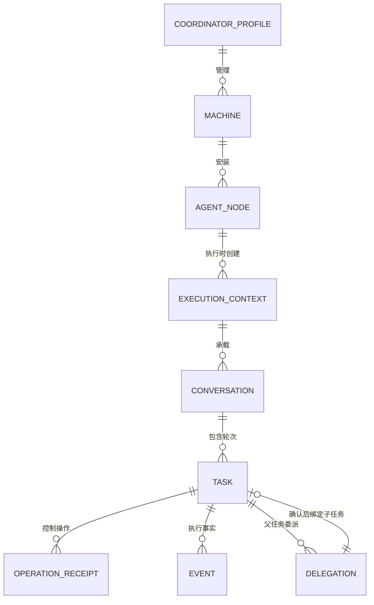

# 对象、身份与持久数据

三原生CLI明确未启动时，复用现有terminal事件status=failed/code=NATIVE_START，并写已有可选nativeExited=false。原Task与请求保留；原取消data为status=failed/nativeExited=false，原核对消息注明未派发，confirmed不改变任务为成功/取消。spawn边界为当次worker内存事实，不新增数据版本或恢复推断；历史unknown保持。[完整合约与验证](iterations/I08/native-start-boundary.md)。

Pi沿用原Agent.workspace、Conversation.sessionId与原生JSONL头cwd做派发前绑定校验。没有新增字段/版本，旧记录不迁移；缺失或变化时canContinue=false，续聊以CONVERSATION_CONFIG拒绝且不新增持久请求/Task，不更改历史/unknown。[完整规则与验证](iterations/I08/pi-session-workspace.md)。

Hermes查看器的result.exit_code或实际进程退出码3/130归入现有unknown事件，不写failed/finishedAt、不解除原请求占用、不确认原核对收据；后续原执行终态仍可沿原事件读取结算。无新增字段、版本或历史迁移，旧失败不会被本修复改写。[规则与证据](iterations/I08/hermes-detached-input.md)。

Hermes继续使用现有Task/Conversation/operationId/requestId与chat-stream-json-v1持久字段；不迁移或清除旧unknown。缺原生终态写已有unknown事件并保留占用；旧取消收据原ID仍可查询，不创建新网关取消意图。能力投影的cancellation对Hermes为false；未增加数据版本或字段。[行为与证据](iterations/I08/alpha65-hermes-windows.md)。

关系撤权修复保持collaboration、relations、revision、GraphReceipt和graph-pending格式不变。准入目标为新主（主ID改变时）与相对原行新增的成员；清主加空成员或同主缩小集合无新增目标。角色/成员无重复、自连、原ID和期望修订继续校验。原管理未知及历史不因撤权而清理。[关系撤权与目标作用域](iterations/I08/relation-revocation-scope.md)。

## CT-05原选材包传递

team-space.sqlite新增独立context_transfers表（transfer_id主键、run_id/sender_id/target_id/body），state.version仍3、原receipts结构保持。body保存schema1不可变packet、发送元数据、完整内容摘要、仅目标读取可得的随机deliveryProof和可选确认时间/原Session；列表/操作收据不含证明。最多256条/8MiB UTF-8，容量失败回滚，不淘汰待确认。pending_receipt仅无确认；acknowledged仅目标接入声明，businessAccepted恒false。[完整接口、身份、原ID恢复与错误](iterations/I07/context-delivery.md)。

## 配置台原意图与收据

alpha.62沿用team-space.sqlite现有state/receipts同事务结构，存储格式与schema不变。receipts仍以actor/operation为键，fingerprint为去掉operationId、包含实际method和全部参数的规范JSON SHA-256；params根级method被拒绝，不能替代实际调用方法。team.operation确认投影增加operationId/fingerprint，读取已有收据不重写或重做。成员仍只能读取本身份的原收据，撤权后拒绝。

本机agentbridge.team.pending.<原directory>保存原method/params/operationId，沿用旧键与原字节。缺失原ID/参数、损坏JSON、指纹不匹配、旧后台缺证明或核对期间被其他窗口更改时保留并暂停新写入。没有Task/Conversation/Session迁移、清空unknown或新增模型字段。[完整兼容行为](iterations/I07/configuration-console.md)。

## 失败管理操作的核对边界

设置清理复用现有原ID查询和recoverPending，不新增RPC/协议版本或存储字段。GraphOperationJournal只对完整原启动拒绝（NATIVE_START_TIMEOUT及源码固定原文）的manageNode/attach，核验非空machineId/nodeId、原operationId和params摘要后，接受同ID的not_found作为补充核对，将本地管理意图记为rejected；该组合证明接入授权提交前已失败，not_found本身不构成证明。真实匹配终态收据优先。原参数、ID、时间、错误及指纹保留；不触碰网络节点/原生进程/Task/Session/执行unknown，查询失败或其他unknown继续占位。[设计与证据](iterations/I08/failed-operation-cleanup.md)。

## CT-08连接策略与确认

agent-network.json外层version1、索引relationsVersion3，每行增加必需envelope={version:1,revision,allowedNodeIds}；v1/v2仅继承原成员为范围，v1非selected仍disabled。新增connectionOperations/connectionPolicyOperations各最多4096条，原身份/ID/指纹/待确认及原用户收据与网络一次原子提交，旧历史不清理。成员须在范围内，v3未知/损坏拒绝保留原文件，alpha.59拒绝v3数据。用户页面localStorage保存原方法/参数/ID/指纹，非匹配收据不释放意图。 [完整契约与证据](iterations/I07/connection-policy.md)。

## OpenCode 观察版本与接入投影

持久格式不变。OpenCode 节点的 apiCompatibility 继续按原 executable、实际观察 version、compatible/error 记录；复验更新原安装的版本，失配或失败时快照投影 connected=false 与 needs_check，存储的原接入意图及 nodeId/context/Session/历史/unknown 保留。已保留所有者的原安装不因 PATH 改变而换绑。[完整规则与验证](iterations/I08/opencode-bounded-probe.md).

McpStatus新增可选 nativeProbeSupported 与 lifecycle={phase,processState,safeToWrite,message,checkedAt?}，phase 为 exit_required/process_unknown/ready_to_write/reopen_required/running_unverified，processState 为 running/stopped/unknown；均为即时观测，不持久PID/命令行/进程明细。safeToWrite仅证明本次进程检查，文件归属/冲突另行校验；旧后台缺字段时前端禁用 OpenDesk 添加。graphPending、关系与请求持久格式不变；可信新增成员/新主资源在中央基于当前关系实时解析，不接受IPC传入的放行范围；纯撤权不新增准入目标。[合约与验证](iterations/I08/opendesk-lifecycle-relation-scope.md)。

## DSH 节点选择

agent-network.json 继续 version=1，可选 dshBindings 数组保存 {nodeId,machineId,adapter,connectionId,executable}；仅登记经过原节点归属与回应校验的目标。旧数据缺该字段仍可读。connectionId 为 adapter+origin 摘要私有文件的文件名主体，公开状态/保存回应允许此脱敏标识及 selectedConnectionId，不含 token。缺目标、重复身份和损坏状态不能回退默认连接；旧上下文、请求和凭据文件保留。图管理持久台账格式及终态证明不变，可信冲突判断不从客户端或持久字段加载。[完整数据与失败边界](iterations/I08/connection-identity-node-scope.md)。

WSL启动使用HostConnection内存中的startup Promise/timer、generation和原子进程引用，以及Core流中的就绪帧。close使原代次失效，旧启动finally不能清掉新Promise；generation不持久化、不作为业务身份。不新增持久数据、Task状态、请求ID或关系版本。`executionNotDispatched:true`只描述尚未写入该次请求的通道失败或关闭；既有unknown历史不会因此结算。[协议与验收](iterations/I08/wsl-host-readiness.md)。

当前源码已随公开 0.6.0-alpha.51.recovery.2 分发，冻结提交 `905b792`；本轮发布只同步状态，数据归属、线协议和恢复边界不变。[发布与核验](iterations/I08/alpha51-recovery2-release.md)。

MCP登记增加可选launcherPath，后台恢复保持原启动命令。probe增加binding（配置路径、原文、connectionId与configuration的SHA-256）；旧probe无binding按未知处理。status.evidence.observation={observedAt?,freshness:current|stale|unknown,reason?:unbound|configuration_changed|expired}，不落盘；连接/工具观测最长60秒，配置/profile变化立即失效。此摘要仅为一致性校验，不是授权凭据。 [本轮实现与验证](iterations/I08/mcp-open-recovery.md)。

当前OpenDesk接入只在Bridge侧适配现有CLI HTTP和桌面设备网关，不修改或构建OpenDesk。Bridge保存去重、派发围栏和原回应；断线证据不足保留unknown，Desktop原连接丢失后不可续聊。独立MCP支持增删与撤权，托管scope/小队及Bridge权限表单未开放。[实现与证据边界](iterations/I08/opendesk-existing-interfaces.md)。

OpenDesk的Bridge执行profile为`opendesk-http-v2`和`opendesk-gateway-v2`。私有控制目录保存controller锁/PID/心跳、CLI服务连接和随机密码、任务领取与派发围栏。CLI binding保存原Session、消息ID基线与原输入；Desktop binding保存原connId与sessionKey。原生完整回应另存后才能恢复终态，读取历史产生的时间戳不能替代它。密码不进入节点快照、公开文档或报告。旧执行profile记录只读保留，不自动迁移为新执行。

NodeOperations 沿既有版本1结构保存 OpenCode attach 准备失败的 rejected 收据（原operationId/fingerprint，data 含nodeId/machineId/action），与 apiCompatibility=false 原子提交，节点 connected/授权和Task/Conversation不变。历史准确健康拒绝只在原图意图、输入指纹与原收据读取匹配时收敛，不迁移原身份。详见[OpenCode OOM 恢复与接入拒绝收据](iterations/I08/opencode-oom-recovery.md)。

## alpha.38 越过收据的落盘记录

用户已批准的契约变更：维护终态 `data` 新增 `overridden:true` 与 `unresolved:[{key,op,state,updatedAt}]`，精确记录被用户显式确认跳过的未确认收据；门禁失败时错误旁挂 `details={gate,tasks,agents,receipts}`（`gate∈{tasks,receipts}`），`tasks` 门禁的 details 恒为“不可越过”。越过路径的停机只使用本地 `maintenance.json` 占位（记录本次 operationId，原格式不变）与控制器 `runtime/owned-stop`（`pid`+`pidStart`），新 daemon 接管后在 release 阶段解除。**没有新增协议字段或线协议版本变更，也没有 Task/Session/身份迁移**：`unresolved` 是既有维护收据 `data` 内可选追加，旧读取方忽略未知键；任务/Agent 门禁的持久语义不变。[契约、现场与未测边界](iterations/I08/alpha38-delivery.md)。

## alpha.36整合基线

公开alpha.35的managementBlocks与前端executionRecoveryReason按原节点/安装/共享目录限制执行，管理写入保持同机保护；graphPending只读投影可选blockedNodeIds。原收据须匹配已提供来源与内容指纹，原ADAPTER_HOST严格持久拒绝恢复保留。scoped-management-execution-v1与dsh-web-desktop-v1共同要求中央升级；Task/Session身份、未知不重放及线协议版本不变。[整合与实际验证](iterations/I07/alpha36-delivery.md)。

## 委派上下文版本

delegations新增可选contextVersion，新行固定整数1且在派发前持久；缺字段是历史原文，不迁移。delegation.message仍为调用方原需求，子Task.message及原生输入为固定v1说明+原文；fingerprint和原准备拒绝证明核对该版本完整输入。不支持的持久版本保留原ID/state/unknown，不新派发；快照无法渲染该证明时不结算。无JSON/SQLite/Task状态迁移，版本字段不作为授权或模型能力。[字段与兼容](iterations/I07/delegation-context.md)。

## 配置弹窗的临时状态

Agent行配置选择只在当前前端内存保存原nodeId/machineId及展示快照；弹窗以该二元归属挂载，缺失/离线/移除保留原目标并禁用写入，不回退到第一个可用Agent。DSH优先核对原节点持久选择的connectionId，旧数据按原adapter+executable精确匹配，token为空且不持久至浏览器；原存储结构与身份、Task/Conversation不变。[本轮边界](iterations/I07/agent-row-configuration.md)。

## 连接视图的观察字段

list_agents响应兼容保留items并增加schema=1、readOnly=true、view=authorized-connections、relationRevision及caller。caller仅含原nodeId/machineId、kind(native-parent/external-connection)、role(leader/member/unassigned)、delegationAuthorized及delegationBlock；无私有connectionId或父Task/Conversation。该响应不是持久对象或授权凭据，不新增角色/台账格式。list_agents原snapshot可能更新lastStatus观察，不结算unknown。[字段语义](iterations/I07/agent-connections.md)。

## 发现提示与原管理意图

节点可带errorCode=DSH_CONNECTION_REQUIRED，snapshot状态configuration_required表示仅发现DSH Desktop/Web安装、尚缺服务连接；healthy/available仍false。未使用且扫描后消失的纯发现提示可从当前投影隐藏，持久节点身份继续保留；managed/connected、主从角色、上下文或原请求均阻止隐藏。graph-pending沿现有字段记录原拒绝，核对只更新其state，原operationId/time/params/fingerprint/error保留；无新增Task状态或线协议版本。见[当前规则](iterations/I07/agent-management-recovery.md)。

## CT-07委派台账只读投影

新增瞬时schema1列表，不新增持久记录或数据库格式。所有权取原delegations的leaderId/parentRequestId/parentTaskId/parentConversationId；独立MCP另取匹配非空externalConnectionId和明确null父Task。原生身份必须非空，不能把两个空值当作同一父；同Conversation另一轮不自动接管旧委派。

分页按原数组追加顺序，游标仅原作用域delegationId。ledgerState是最后保存值，已知范围外只投影unknown，不回写；taskQueryable仅指已有非空taskId，不证明成功。列表排除Prompt/目录/结果/错误正文/Token/native Session，不查子任务或保存/恢复。移除关系保留原父读取，失效父/撤销独立入口仍拒绝。[当前投影与证据](iterations/I07/delegation-list.md)。

## DSH连接与原轮次绑定

未配置安装提示沿用发现项adapter/name/executable/healthy/error，Desktop路径为原生EXE，Linux Web路径为profile的package.json；`healthy:false`，不能据安装路径建立可执行会话。配置服务后仍按adapter+origin私有文件标识连接；旧记录与unknown不清除，节点选择新增可选dshBindings字段。[发现与连接身份](iterations/I07/dsh-desktop-web.md#同名程序与服务发现修复)。

新增稳定adapter ID dsh-desktop/dsh-web；目标用户私有dsh-connections目录按adapter+origin摘要保存连接配置（adapter/origin/token/enabled）。公开status不含token。配置文件路径是连接身份；不同地址不改绑旧上下文。NativeCliHost旧Task/Conversation兼容，job新增requestId/origin，binding保存sessionId/afterSeq/requestId，attempted与cancel-attempted分别标记一次派发边界。停用不删除原凭据或历史；不搬运已有原生Session。字段、权限、失败与恢复见[DSH Desktop/Web 接入](iterations/I07/dsh-desktop-web.md)。

## OpenCode 1.x / 2.x 兼容修复

NativeReference.snapshot 新增可选 nativeProtocol（v1/v2）；缺省按历史 v2 核对，原生绑定仍唯一且不可改写。V1 创建响应丢失时 invocation 已持久但没有可猜测绑定，保留 unknown。独立 MCP 连接行按需保存 nativeProtocol，配置与删除使用原布局；任务、收据和 Conversation ID 不迁移。 [需求、实现、验证与未测边界](iterations/I07/opencode-v1-compatibility.md)。

## 维护上传进度与持久化修复（issue #10）

连接新增可选progressWarning安全告警；维护/中央收据error.details增加安全stage/causeCode/completedBytes/totalBytes/extracted/remoteInputSent。原JSON格式、ID、指纹和历史不迁移，已发送unknown不据诊断失败结算。 [完整设计、实测与边界](iterations/I07/maintenance-persistence.md)。

## CT-05桌面选材状态

M01内存保存明确targetAgentId、四类精确引用数组、文档下拉修订、已显式读取的历史消息页/游标，以及核对包和读取时间。directory+runId重建组件，不写localStorage/SQLite，也不改原pending意图。作用域比较工作身份/修订/状态/成员与成员修订，以及选定任务当前revision/round；变化使预览失效，原引用保留供用户明确取消重选。

客户端类型补原已存在的report.evidenceSource，无新后端字段。packetId仍覆盖原结构化投影；MD从核对结构生成，导出JSON的markdown替换为该本地视图，其余结构化内容/摘要不变。快照/文件不是授权、已读、交接或原生Session凭据。[字段核对、生命周期与验证](iterations/I07/context-packet-ui.md)。

## CT-05瞬时材料包

新增返回投影而非持久实体：schema=1、kind=agentbridge.shared-context、readOnly=true，source工作引用、target成员职责、work目标/标准/约定，明确选择的documents/tasks/messages/artifacts，boundaries、readMore、packetId和markdown。文档含准确不可变修订/正文SHA-256；任务仅当前revision/round和报告，消息须ID+seq，产物从全部报告匹配ID+version；引用不代表可达。每类最多8项/至少1项，完整UTF-8 JSON（含Markdown）≤256 KiB，否则拒绝而非截短。

packetId是结构化投影规范摘要，不包含packetId/Markdown自身，不是持久ID、全局修订、访问令牌或收件回执。messages.acknowledged=false仅说明本次没有确认阅读。无SQLite迁移、消息/收据/原生记录变更；不复制entryKey、私有端点、请求/native Session。正文和消息为用户选定的外部内容，原样保留；包本身不产生执行授权。[字段、错误、限定验证](iterations/I07/context-packet.md)。

requestId/operationId、节点、目录或native Session不因整合更换；原管理双key兼容单对象/数组，持久JSON/SQLite版本不变。preparationError/兼容证明等沿alpha.32可选字段；长期MCP仍以connectionId独立归属、parentTaskId=null，材料仍schema1只读投影。Codex TOML解析器1.9.1生成无原型表，IPC仍为JSON数据，无原生配置格式迁移。[最终规则与证据](iterations/I07/integrated-source.md)。

## OpenCode 2.x与按机器管理

节点视图新增version_incompatible和compatibility，安装healthy不表示执行可用；connected:false仅为不兼容投影，不删除原绑定。原node/machine localStorage key接受旧单对象并写数组，多机意图追加；graph-pending.json格式/原ID不变，缺来源保守保护。 [需求、实现、验证与边界](iterations/I07/version-management-recovery.md)。

## 协作兼容修复

AgentNode新增可选apiCompatibility={executable,version,compatible,error?}，原请求新增可选preparationError={code,message}；节点视图新增needs_check/upgrade_required，SSH身份/连接视图新增objectRoutingSupported。均为旧JSON的可选增量，不迁移或重绑定原Session/任务/请求。旧unknown委派仅凭同源原意图证明结算。 [需求、实现、实测与边界](iterations/I07/collaboration-compatibility.md)。

## 历史详情读取恢复

DetailRead为仅存在于前端内存的{id,status:loading/ready/missing/error,message?}，与Task/Conversation事实分离，不新增持久字段。保留历史按machine分区且raw ID和内嵌machineId匹配；非终态只在historical投影标unknown，原数据/Session/时间不写改。 [需求、实现、逐项证据与边界](iterations/I07/history-detail-recovery.md)。

CT-04桌面：复用schema1索引与指定修订响应，无SQLite/后端格式变化。UI只在内存保存当前工作/当前页/已核对文档；切工作/目录或刷新/分页使旧读失效。索引下载仅当前页，单文档MD带revision、读取时currentRevision、公开文档版本引用与UTF-8正文摘要，正文原样保存；本机副本不回写DB，不是权限凭据或交接记录。[当前视图与传出边界](iterations/I07/public-materials-ui.md)。

## 独立 MCP 接入登记与委派归属

每机器Bridge目录新增mcp-connections/connections.json数组：connectionId（随机UUID）、nodeId、adapter、enabled、configuration（自身管理的非密启动条目）。独立文件位于`mcp-connections/<connectionId>/`，描述/Token继续由原broker私有文件保存；配置文件只引用描述路径。重新添加生成新connectionId，旧授权永不复用；删除不抹原委派台账。

I08-MCP02在行内新增/明确以下字段（旧行缺字段按“未知/外部管理”处理，不自动接管、不自动补装）：

| 字段 | 语义 |
| --- | --- |
| `enabled` | 持久授权开关；`mcp.revoke` 只改它，不触碰原生条目 |
| `nativeProtocol` | OpenCode v1/v2 布局，缺省按历史 v2 核对 |
| `configuration` | Bridge自己写入的原生条目原样快照；所有权比较与“只删自己的条目”以它为准，不按显示名；OpenDesk STDIO 的空对象 `headers:{}` 与字段缺省等价；Pi仅忽略布尔`enabled`差别用于归属，Hermes仅忽略已核对的bool-like控制值；原生禁用不能自动启用；其余字段严格比较，不迁移或改写旧快照 |
| `probe` | 最近一次只读探测（`kind`/`outcome`/`command`/`nativeLoad`/`connection`/`tools`/`toolCount`/`at`）；不参与授权，也不因探测失败改写授权 |
| `nativeTarget` | 可选；DSH Desktop为`{home,profile}`，Pi为`{kind:"pi-agent-dir",agentDir}`。首次成功原生安装/导出保存目标，后续读写/清理固定原目标；选择变更不迁移授权，显式移除后新接入才轮换身份与采用新目标。Hermes为`{kind:"hermes-profile",home,root,profile,named}`，`named`区分原生命名Profile与custom根。Pi/Hermes字段随alpha.51.recovery.2公开版交付，已随0.6.0-alpha.51.recovery.2公开 |
| `profile` | 仅 DSH CLI：本次写入/识别所用的原生 profile 名称（单段目录名，`^[a-z0-9][a-z0-9-]{0,63}$`）。`mcp.status` 回显，省略参数时使用该值；`mcp.remove` 只清理这个 profile，其他 profile 的原生文件逐字节不变。DSH Web 固定 `web`、不落该字段；其他适配器不写该字段 |

`configuration`与`probe`是观测/归属证据，不是执行凭据：`configuration`不含Token，`probe`不证明已获准委派。`mcp.status`的返回结构（`state`/`facts`/`evidence`/`nativeSupport`）为瞬时投影，不落盘；重启只重建私有endpoint描述文件，不写原生配置，也不恢复已撤销的授权。原生条目被外部删除或修改时保留原文件、不自动补回。[完整契约与证据](iterations/I08/mcp-open-integration.md)。

外部委派在原delegations中增加可选externalConnectionId；parentRequestId等于接入ID，parentTaskId=null，parentConversationId带mcp:前缀代表接入范围而非原生Session。派生requestId及结果/取消归属沿用原去重规则。同一长期接入内的外部会话共享范围，未实现外部原生Session自动隔离。无TeamSpace数据库迁移。[详细契约](iterations/I07/mcp-installation.md)。

## CT-04材料投影与文档修订

只读返回schema:1/readOnly:true/source:team-space，字段为run、members、documents、tasks、artifacts、messages、executions、readMore、snapshotId和markdown。所有数据来自同一次已授权view。snapshotId是本次返回页投影摘要，非持久全局修订、Task版本或权限凭据。没有数据库字段/格式迁移，原格式3、修订冲突与原操作收据保持。

文档分页默认20/最大50，next为原documentId游标，顺序沿创建顺序；另一工作的游标拒绝。元数据带documentId/title/revision/ownerId/updatedAt/contentSha256/reference，reference为`team-document:<id>:<revision>`；不展开正文/history。指定revision返回该历史项title/content/authorId/time、currentRevision及UTF-8正文SHA-256；无参数返回旧完整文档结构。

任务最多原50项，只列当前报告及其产物；旧报告仍在team_tasks。原生最近20项另列state、等待种类/数量与会话异常布尔值，不暴露原requestId/nativeSession/endpoint。消息只含窗口计数/末序号/是否有历史，acknowledged:false。目标/完成条件截短1200、约定800、职责/报告摘要300、输入/输出/边界200字符；截短内容只作入口。产物固定标记reference-not-checked，成员能力来源仍user_declared，不能推断验收。Markdown同一投影并转义标题/名称等。[完整白名单、分页与证据](iterations/I07/public-materials.md)。

文档核对：公共文档、消息与任务仍由TeamSpace SQLite保存；Markdown正文/阅读视图与原生私有Session不同。显式共享上下文包、MD导出仅为[后续研究](iterations/I07/connectivity-research.md)，没有新增字段、数据库迁移或跨工作自动共享。[接入现状](agent-integration-matrix.md)。

原生收据：Codex/NativeCliHost 的 operations 条目增加 kind=cancel/reconcile，与原 taskId/operationId 绑定。历史缺 kind 按 cancel 兼容，无状态文件版本迁移；新增核对收据可从 unknown 随原任务终态推进 confirmed，仍保留真实 status/message。节点快照可选 teamCollaboration，显式 false 优先、缺字段只按受校验原三种注册能力兼容；不改变节点身份或小队 SQLite 格式。[完整约束](iterations/I07/native-integration-guards.md)。

## 原生适配扩展（alpha.46）

Machine/Node/Connection 的 adapter 增加稳定值 `hermes`、`pi`、`dsh`；不迁移旧 ID 或把模型/provider 绑定到节点。注册元数据包括稳定 id、name、commands、npmEntrypoints 与逐项 capabilities，运行时不含可加载模块路径。新增 NativeCliHost 在原私有上下文保存 `<adapter>-state.json`（agents/tasks/conversations/requests/operations），run 保存 job、events、heartbeat、取消意图与 worker 日志；Pi 原生会话文件位于该上下文 native-sessions。Conversation 私有保存原 Session 与 profile，公开 canContinue 需核对原绑定/终态，不能以缺文件创建替代 Session。原 requestId/operationId 和 unknown 占用规则保持不变。[生命周期与验证](iterations/I07/native-agent-expansion.md)。

## SSH持久拒绝恢复

agent-network.json version=1请求可选daemonRejection：version=1、source=daemon.receiptRead、machineId/daemonId/profileId/requestId/op、target、规范参数fingerprint、code=NOT_CONFIGURED。只在可信实时读取与原意图双指纹/目标匹配后写入，并同步dispatched=false/preparationRejection；重开重核，不全量迁移，不含远端任意文案或秘密。 [设计、需求、开发、验收与边界](iterations/I06/daemon-rejection-recovery.md)。

## 原未派发证据及内部持久化错误

沿用现有版本/字段：Codex task.reconciliation记录最近原任务核对，准备失败为failed；job.json完整、仅accepted、无native/offset且worker.log/heartbeat/events全缺失才可证明未越过worker启动边界。有启动证据或run丢失时保持unknown。中央pending.result.error.code可为NETWORK_PERSIST，message保留原OS码/原因；只有原节点/机器/请求/双指纹匹配、dispatched严格false、无任务会话绑定/在途job才能判rejected。历史EPERM另核对本profile的精确UUID tmp→agent-network.json路径，不迁移/删除原行。派发后错误不回滚dispatched。见[专项](iterations/I06/windows-start-persistence.md)。
## 停止记录与取消控制

格式仍为3，旧记录缺stop/cancellation字段兼容。run.state新增stopping；run.stop记录requestedAt、目标attemptId列表、externalCount、完成后的completedAt。attempt.cancellation私有记录稳定operationId、匹配taskId、dispatched发送标记与独立控制state；公共attempt只给stop.state。取消confirmed/rejected不改写attempt真实状态。run.stop完成只关闭协作，不设置业务acceptedAt。停止前已保存的消息、任务、版本报告及unknown占用保留；恢复只查询原请求和原控制。[完整语义](iterations/I07/native-stop.md)。

## 小队协作当前持久数据

profile下`team-space.sqlite`，state/receipts同事务提交；使用Node自带SQLite，WAL、FULL同步，不依赖用户另装数据库。[实现](../desktop/electron/team-space.cjs)、[任务交接交付](iterations/I07/task-handoff.md)。

| 记录 | 当前身份与行为 |
| --- | --- |
| agents | native引用真实nodeId且同节点不重复登记；mcp引用独立外部实例标识。职责/输入/输出/边界为用户声明，不作执行身份或能力实测证明 |
| teams / runs | 小队保存主角色/成员/公共约定；每次工作保存成员快照、目标/完成标准、active/stopping/completed/closed和paused，completed带验收人/时间/说明；撤权变更工作revision，不自动取消原任务 |
| documents | 文档级owner/editorIds，revision与完整history；更新核验expectedRevision，冲突不覆盖 |
| messages / deliveries | 群消息按工作顺序追加；每通知接收者分别保存pending/delivered/read，分页游标不代表已接手任务 |
| sessions | 私有接入身份，connection或native；公共视图不返回。原生身份绑定真实原请求/节点/来源，原终态失效；手动外部连接受实时成员/工作状态约束 |
| attempts | 手动或自动一轮执行绑定requestId/Task/conversation与原结果；可选workItemId/workRound绑定；自动尝试还关联触发事件/原尝试/续接Conversation，实际原生Session私有保存且公共投影剔除；unknown不重放，原生终态只在有效验收提议存在时可能完成总工作 |
| workItems | 任务身份/负责人/kind/依赖/修订/轮次、waiting/ready/running/blocked/review/completed，reports追加保留；当前报告引用与不可变artifactId分开 |
| reports / artifact | 交付含唯一版本/引用/生产者，复验含精确targetArtifactId/版本/实际取得声明/证据引用；标明user_report或member_report，不伪装成宿主执行事实 |
| handoffGrants | 用户授权的fromTaskId/toTaskId/action、enabled/maxUses/used/revision；撤销不删除使用历史，队员不能扩大 |
| handoffs | 每条交接的路径、来源/目标轮次、实际发送者、授权引用与时间；和任务/消息/通知同事务，重复operationId不再次耗用 |
| activationEvents | 格式3新增事件身份/业务去重key、成员/工作/类型、pending/consumed/handled/superseded及原attempt关联；就绪/报告/终态/明确协调/无进展事件按权限消费 |
| run.automation | 用户授权的自动成员、累计used/maxActivations、startedAt/maxMinutes/idleMinutes、generation及可见限制；重新启用不清零 |
| run.acceptancePending | 原生主角色的验收提议，保存原attempt、任务/工作修订和事件位置；终态时重新核验，收据不等于验收生效 |
| receipts | 按用户或工作成员及operationId保存指纹/原结果；相同内容读原收据，修改内容拒绝；撤权后不能用旧收据读回材料 |
| 私有broker文件 | 令牌及本机endpoint，和公共材料分开；重启刷新原描述文件，不创建另一项业务工作 |

状态材料容量8MiB、收据10000条及32MiB阈值，到限拒绝新写入，原unknown/未完成记录不自动删。状态格式版本1至2新增任务/交接，版本2至3原子新增activationEvents，原记录不重编号，旧记录和收据原身份保留；旧版本不支持读取新格式，不自动覆盖降级。公共文档导出不是授权源；业务状态不混入Core Task.status，自动激活关联原尝试台账，不能作为原生Task或取消终态的替代物。原机器/节点/原生身份不变。

这里解释整个系统的对象关系；具体读写接口见 [协议](protocol.md)，状态与恢复责任见 [M07](modules/07-task-session/design.md)。

## 当前运行缓存与原意图兼容

runtime/runtime.json 新清单为 `{version:2,executable,files:[{name,size,sha256}]}`，目录仍以 Electron 版本/架构归类，损坏副本的替代发布到独立 `.repair-<随机值>` 目录；随机值仅隔离资源，不是机器/节点/请求身份。旧无 version 清单兼容 size 检查，仅忽略 runtime.json 自引用条目。原业务 JSON 版本、请求 ID 和内容不变；符合原未派发正面证据的旧 unknown 记 rejected 并保存 reconciledAt/核对原因。证据不足不迁移或释放。[完整边界](iterations/I06/runtime-recovery.md)。

## Linux CLI 发现边界

Linux 扫描目录覆盖包含用户态安装目录，不引入新的节点或配置字段，节点按原机器、适配器与规范 executable 识别。当前源码的升级身份与supersededBy规则见本文第3节。重扫保留同一安装身份；任意自定义 rc 环境仍非统一配置来源，不能靠目录或机器别名释放原 unknown。 见 [专项](iterations/I06/linux-cli-discovery.md)。

## 1. 对象关系

这是产品逻辑关系，不是声称所有对象都在一张中央数据库中。中央、daemon、Hub/Edge、原生宿主各自保存所属记录。委派在 pending/rejected/unknown 初期可能还没有可确认的子 Task ID，确认后绑定对应子任务。

## 2. 需要分开的 ID

| 字段 | 含义 | 不能替代的字段 |
| --- | --- | --- |
| coordinatorId | 当前中央 profile 的持久身份 | 不是用户手输的设备凭据 |
| profileId | 远端安装/状态所属的中央 profile | 不是服务器主机密钥 |
| connectionId | 一条 SSH 连接配置，或旧工具连接记录；命名空间不同 | 不是机器硬件编号，也不是节点 |
| machineId | Windows、WSL 或已验证远端用户环境身份 | IP、显示名称和目录 |
| daemonId | 远端所属 profile 的持久 UUID | 不提供硬件级不可复制证明 |
| nodeId | 机器中一个工具安装的网络身份 | agentId、项目目录、模型 |
| contextId | 节点在某目录/协作模式下的执行上下文 | 原生 Session ID |
| agentId / instanceId | 后端执行实例；中央聚合会加机器前缀 | 用户面对的节点 |
| requestId | 一次需求的稳定幂等 ID | RPC id、taskId |
| taskId / executionId | 一轮任务与其执行归属 | Conversation ID |
| conversationId | Bridge 的多轮会话 | 原生 Session ID |
| native.sessionId / messageId | 原生会话与本轮关联；OpenCode 是原生 Message，Claude 可能没有消息 ID，Codex 当前以 Bridge requestId 关联 | 不同适配器不保证相同原生 Message 语义 |
| operationId | 权限回复或取消等控制操作的稳定 ID | 原生权限 requestId |
| delegationId | 父子委派关联记录 | 子任务 requestId |

RPC `id` 只把一条通道响应与请求配对。重连后换 RPC id 是正常通信行为；同一需求的 requestId 不能因此改变。

## 3. 身份如何生成与路由

Windows 本机目录初始化时保存随机 `local-...` machineId。WSL 按发行版名称生成稳定 ID，并记录 Windows 宿主。SSH 完成认证、daemon 检查与协议握手后使用 `ssh-<daemonId>`；不同用户/profile 各有自己 daemon 状态。

节点首次由机器 ID、adapter 和可执行位置生成。同机器同 adapter 升级后保留原角色/接入节点 nodeId，更新当前 executable/version；旧节点可带 supersededBy 指向当前节点，保留请求指纹、instance.nodeId 和历史归属。connection 快照可选 current 标记本次发现入口，旧配置连接为 false；离线不据此推定安装已删除。contextId 的旧生成规则保留；原键绑定其他安装时，新工作按原键材料加安装路径摘要创建新上下文，旧行不改写。见[当前版本发现](iterations/I07/current-agent-discovery.md)。

后端 Task、Conversation、实例 ID 聚合到中央时用 `machineId::原ID` 定位来源。下发原机器时还原原 ID。原生 Session/Message ID 不加此前缀。请求或控制响应只能解除相同来源机器的未确认记录。

显示名称可变，不能参与任务所属判断。SSH 地址别名只有在主机密钥、daemon 身份及用户归属核实后才能归并，不能只按相同 IP 合并。

## 4. 状态是不同维度

### 节点连接能力投影

CT-01为snapshot/MCP列表增加可选 `connectionCapabilities`：`execution`、`delegation`、`bridgeMcp`、`resume`、`cancellation`、`permissions`、`forms`、`verification`，值为boolean或null。`capabilitySource`为静态适配器的kind/adapterId/driver或unknown；不保存执行路径、账号或敏感配置。能力不是availability、任务终态或真实工具验收。缺字段老节点按已审核内置适配兼容，显式未知/false只收窄，未知适配器全部未知。

既有图操作台账保持原schema：关系意图的本机确定能力拒绝持久为rejected及原错误码；原operationId/输入摘要保留。只有原ID结构化收据结算，外来ID和裸远端同码仍unknown；前端清除对应pending时保留base/草稿。无新数据库迁移，无原生Task/Conversation/Session身份改变。[完整契约](iterations/I07/connection-capabilities.md)。

| 对象 | 当前字段 / 状态 | 阅读方式 |
| --- | --- | --- |
| 机器 | online、error；SSH 另有 connectionState | 是否能联系此执行环境 |
| 节点 | discovered、connected、offline、tool_error、unsupported；busy、unconfirmed | 是否接入、工具是否可用、是否有占位 |
| 任务 | queued、accepted、running、succeeded、failed、cancelled、unknown | 这一轮执行的事实 |
| 原生等待 | Task.waiting 的 permission/input 与原 requestIds | 任务可能仍是 running，但需要用户回复 |
| 控制收据 | pending / unknown / confirmed / rejected 等所属实现状态 | 控制请求是否获得明确回应 |
| 协作关系 | leaderId、memberIds、revision | 获准委派的新任务范围 |

`waiting_input`、`cancel_requested` 出现在早期初稿，但不是当前统一 Task.status 的值。不能把取消收据 confirmed 显示为任务 cancelled；不能把机器离线显示为已完成任务失败。

SSH 状态合并时 error/connectionError 缺失表示当前无连接错误，删除 machines.json 中旧值；文件与对外 JSON 字段结构不变。快照 RPC 的本次失败独立于 SSH 通道状态；恢复不改写 Task.error、Task.status 或 pending 台账。

## 5. 持久文件与拥有者

路径以下用 `<desktop-profile>`、`<remote-profile>` 和 `<context>` 表示，避免把某个人的电脑目录当成部署默认值。

| 所属位置 | 文件 / 数据 | 负责写入者 |
| --- | --- | --- |
| desktop profile | `desktop.json` | Coordinator 的设置入口 |
| desktop profile | `coordinator-identity.json`、`coordinator-status.json` | 所属 Coordinator；身份包含内部秘密，不能复制到共享文档 |
| desktop profile | `machines.json`、`agent-network.json` | 机器目录与网络台账 |
| desktop profile | `pending.json` | 中央未确认请求与控制记录 |
| desktop profile | `graph-layout.json`、`graph-pending.json` | 中央独立布局/收据与图写入意图 |
| desktop profile | `ssh-connections.json`、`ssh-known-hosts.json` | SSH Manager 与主机信任管理 |
| desktop profile | `ssh-credentials/*.json` | Windows DPAPI 密文；连接配置只保存引用 |
| desktop profile | `coordinator/versions/*`、`coordinator/runtime/*` | 冻结的代码/依赖/运行资源 |
| remote install | `install.json`、`current.json`、`versions/<version>/*` | 所属 SSH 安装器 |
| remote state | `machine.json`、`daemon.lock`、socket 与 PID 记录 | 所属 Linux daemon |
| remote state | `daemon-receipts.json`、`daemon-events.jsonl` | daemon；事件 cursor 持久化 |
| MachineHost state | `node-contexts.json`、`node-contexts/<contextId>` | 执行上下文宿主 |
| context / CLI instance | settings、Hub SQLite、Edge journal、operations 与 native identity | 所属 controller/Hub/Edge |
| 原生工具目录 | 账号、供应商、模型偏好与原生历史 | 原生工具；Bridge 没有全局配置写入职责 |

Claude/Codex 还保存其宿主 JSON/worker 状态，具体字段和文件见各 [原生模块](modules/06-native-adapters/design.md)。数据库格式、锁和迁移规则见 [任务模块](modules/07-task-session/design.md)。

## 6. 路径与目录占位

Windows `C:\project` 与同一宿主 WSL `/mnt/c/project` 可对应同一物理目录，共享任务占位。WSL UNC 路径必须属于所选发行版。真实目录解析后的别名也不能绕过占位。

SSH 的 `/mnt/c/project` 属于远端独立文件系统，不能与本机 Windows/WSL 混同。远端路径按远端 Linux 的 realpath 校验，不自动同步文件。

运行、等待、unknown 都可能占用节点/目录。只读查询能明确原任务终态后才解除，缺少原收据不够。具体占位与锁的持久性边界以 [M03](modules/03-machine-network/design.md) 和 [M07](modules/07-task-session/design.md) 为准，不能宣称多个独立 Bridge 中央具备全局分布式锁。

## 7. 修订、迁移与备份

关系 revision 防止两个界面覆盖授权。图布局 layoutRevision 与授权 revision 分开；graph-layout.json 和 graph-pending.json 的实际格式见下方。

机器目录、网络、安装清单、协议和 SQLite 各有独立版本；不能用桌面 app 版本替代它们。读取未知格式或归属不明时停止接管，保留数据。旧模型覆盖只能作为历史实例绑定，不能迁移为新节点的模型设置。

停机备份整份所属状态与安装记录，并保护凭据；活动 SQLite 不能只复制主文件而忽略 WAL。复制 daemon 状态到另一服务器不会自动授予新机器同一身份；主机密钥/身份冲突必须核对。

## 当前会话续接字段验收结果

OpenCode/Core 会话响应额外携带 canContinue/kind，均从持久原生绑定、上一轮状态、验证标志及配置/资源归属计算，不新增持久列。Conversation/native Session 的真实两轮与重开保留见 [6A 验收](iterations/I06/acceptance.md)。

## 维护查询与完整原意图

本地候选alpha.56保留原remoteInput的完整releases和fingerprint，不做持久迁移。仅构造action=query的线端副本时将未消费的releases设为空数组，原owner/profile/daemon/UID、operationId及其他参数不改；原控制器按原身份读原收据，not_found仍不能释放unknown。维护动作发送的JSON内容保持完整。[实际验证](iterations/I08/maintenance-input-capacity.md)。

## Linux 发布兼容数据

离线 manifest 可选 `compatibleDaemons: [{version,manifestPath,manifestDigest}]`。路径仅能是清单内 `compatible-daemons/<version>.json`，其文件 SHA-256 和内容 manifestDigest 均校验，版本不能重复。旧协议 2 manifest 不要求有该字段。本地候选alpha.56解析上限128、实际收录38项，含46/51.recovery.2/52/53及本地54/55的冻结清单；原清单不改写、无持久迁移；未知或未来版本不按协议相同自动接受。

SSH probe 的 `daemonVersion` 是实际选中后台版本，`clientDaemonVersion` 是客户端新安装包版本，`reuseCompatible` 是展示信息，`installNeeded=false` 表示旧安装可复用。执行分支按实际可信清单选择结果判定，不能凭缓存展示标志绕过校验。旧 current.json、daemon 身份和任务数据无需迁移。

## 关系、布局与图操作

agent-network.json 增加 relationOperations，每项含 operationId、state=confirmed、内容 fingerprint 和 data（提交时的 collaboration）。现有 version=1、节点、请求、委派与 ID 不迁移或重建。每条启用关系的权威边来自其leaderId/memberIds；图仍使用selected兼容视图，成员顺序不改变权限。

graph-layout.json 是 version=1 容器：layout 包含独立 layoutRevision、groups[machineId] 与 nodes[nodeId] 的 x/y、viewport 的 x/y/zoom；operations 为同类稳定收据。节点坐标相对于机器组，几何 parent 不代替 parentMachineId。损坏文件先复制为 graph-layout.json.corrupt-*，恢复默认位置不重置关系。

graph-pending.json 保存 operationId、lane=relation/layout/node/machine、完整允许的 params、内容摘要、pending/unknown/confirmed/rejected 与时间。未知原 ID 不因另一个 ID 或窗口而解除；原业务收据确认后对账。浏览器本机缓存 base/draft/layout、图两个 pending 原操作和独立的节点/机器原操作意图；机器参数含地址/认证方式但没有密码/口令，秘密不存入本机缓存。

机器 lastSyncedAt 标记成功快照时间；节点 uncertain、waiting、lastError 分别投影原任务的 unknown、等待与最近失败。原 Task 七种状态与控制收据语义不变。

AGENT_UNHEALTHY 的原执行前拒绝使用现有 daemon-receipts 的 rejected/error 与中央 pending 的 rejected/result，不新增版本或字段。旧 unknown 记录只在原查询依据其保存的确定拒绝核对，其他 unknown 原样保留；Task 状态未因此改变。

图节点的measured尺寸由原DOM dimensions事件提供，只在当前挂载视图内按节点ID保留width/height，坐标重建继续带回以保留端点测量，真实尺寸改变时更新。它不属于GraphLayout/localStorage/中央数据，不保存端点、角色或权限；无需持久迁移。[实现与验收](iterations/I08/graph-measured-dimensions.md)。

布局读取可用状态是前端临时状态，不改变 GraphLayout 或收据格式。本机模式保留浏览器 State 中坐标、视口、layoutDirty 与所有原 pending ID，不创建后台确认记录。仅在图接口恢复支持且对应 lane 无 pending、修订可校验时同步。

## 节点管理事务

AgentNode 新增可选 managed/removed，缺省兼容旧目录；显式管理后 connected 不被扫描或原生上下文报告覆盖。移除为可恢复标记，快照保留历史身份，UI 隐藏卡片，新需求受中央接入状态约束。agent-network.json 新增 nodeOperations，原子提交节点、授权和收据；版本仍为 1。GraphOperationJournal 新增 node lane，与 relation 未确认意图互锁，布局独立。旧版本不会理解显式移除语义，含此状态的配置不支持直接回退旧中央；保留数据/备份，不靠清空节点或原请求恢复。

`manageNode` 参数 `{operationId,nodeId,machineId?,action}`，action 为 attach/disconnect/remove；返回 `{operationId,state:"confirmed",fingerprint,data:{node,collaboration}}`。`nodeOperation` 以原 operationId 返回 confirmed、确定拒绝的 rejected 或 not_found；not_found 不证明未执行。断开/移除撤销相关权限，有变更才增关系修订。来源校验、离线/忙碌/原生 pending、节点/授权 pending 拦截，接入锁避免并发新任务。snapshot.nodeManagement=true 声明中央能力；新界面在旧中央禁写，原本机布局模式保留。完整语义、错误与验证见 [节点管理](iterations/I06/node-management.md)。

## 当前数据增量

| 文件 / 字段 | 当前定义与边界 |
| --- | --- |
| ssh-connections.json / connection.revision,removed | 同原 connectionId/daemonId/machineId；编辑更新修订，removed 禁止自动连接；绑定主机公钥、UID 与原用户保持 |
| ssh-connections.json / lifecycleOperations | operationId、state=confirmed、fingerprint、data.action/machineId/connectionId/revision；与配置原子写入，查询不重做配置 |
| agent-network.json / removedMachines,machineOperations | 隐藏机器集合与原管理收据；移除撤权与收据同文件原子提交；恢复不重授权，nodes/requests/delegations 保留 |
| graph-pending.json / lane=machine,method,params | secret-free 原意图与指纹；machine/node/relation 未知互斥，layout 独立；原 SSH 收据可用于幂等补齐本地网络，缺收据保留 unknown |
| machine-history.json | 中央私有、按 machineId 的已观察 agents/tasks/conversations；后续分页合并旧任务/会话，排除原生配置/认证内容；不是未观察原生数据库的完整导出 |
| historical | 离线/移除读取历史标记；非终态保持 unknown，历史会话 canContinue=false；不能替代原请求或控制收据 |

协议仍为 2、网络/机器目录格式仍为 1，新增可选字段由当前代码解释；旧版本不识别 removed/removedMachines，直接回退旧 Coordinator 不支持，完整升级回滚迁移待后续。原身份、占位与原生 Session 不改变；详细事务和实际验证见 [6C 首批](iterations/I06/machine-management.md)。

## 维护状态与秘密最小化

| 文件/字段 | 归属与规则 |
| --- | --- |
| ssh-connections.json.lifecycleOperations | 原操作 ID、fingerprint、remoteLaunched、私有 remoteInput/controller；公开结果去掉控制器与输入 |
| connection.maintenance / daemonVersion | 当前原维护状态及实际版本；维护暂停自动重连，不重建机器身份 |
| maintenance.json | 远端持久维护准入租约；只原操作释放，崩溃保留直至原阶段修复 |
| maintenance-operations.json | 原 ID/内容摘要、worker PID 与启动标识、阶段、状态及安全结果；元数据锁防查询覆盖完成收据 |
| maintenance-input-*.json | 本 profile 私有原维护输入，不含 SSH 凭据或原生账号配置 |
| `maintenance-runtime/<digest>` | 可信控制器/私有 Node/helper；不随安装卸载删除 |

## 维护终态收据与重连判定

`maintenance-operations.json` 每行的 `data` 为既有 JSON 的可选增量：`action`、`stopped`、`rolledBack`、`phase`、`version`、`historyPreserved`。`stopped=true` 表示本次操作确实停过原后台；`rolledBack=true` 只在已切换版本且回滚三步全部成功（原版本已重启）时成立；成功路径同样写 `rolledBack:false`；`phase` 为最后阶段（validated/stopped/activated/healthy/uninstalling/uninstalled）。安全 `error.code` 可为 `DAEMON_ROLLBACK_UNCONFIRMED`（已停但切换/回滚未确认，行保持 `unknown`，由原 operationId 查询/恢复）、`DAEMON_NOT_STARTED`、`DAEMON_RECOVERED_ROLLBACK`（原 ID 恢复已切回并重启原版本）等；行状态仍是 confirmed/rejected/unknown/not_found，不新增状态。

client 侧 `connection.maintenance` 为 `{operationId,state,action,error?}`；`error` 记录拒绝原因（含未发送与本地持久化失败分支），经快照 `daemonMaintenance.error` 暴露给界面。桌面只在终态收据证明原后台仍在运行或已恢复（`stopped!==true`、或 `rolledBack===true`、或 `state==='confirmed'`）时恢复 `autoReconnect`；`stop`/`uninstall` 与“已停且未恢复”保持断开。

状态目录里的 `maintenance.json` 是维护准入屏障，只属于一个 operationId。维护开始时若发现它的 operationId 属另一次操作、且 `maintenance-operations.json` 中该操作已是终态，则视为遗留屏障：先按该 ID 调用 `daemon.releaseMaintenance`，仅在成功或对方返回 `DESKTOP_METHOD`（该版本无此方法）时删除文件；`unknown`/缺失收据与本次 operationId 的屏障一律保留，不会绕过未决维护。以上都是 daemon/连接本地 JSON 的可选字段，协议版本仍为 2、线格式与身份不变，无 SQLite/JSON 迁移，也不改变 Task/Conversation/收据 ID。[本轮语义与实测](iterations/I08/maintenance-offline/maintenance-offline.md)。

## 维护收据发送前失败边界

lifecycleOperations 维护行区分失败阶段：启动命令的 SSH 通道打开被拒可证明原输入未离开本机（错误对象内部 open 标记），此类失败换新连接重试一次后仍未发出时，收据记 **rejected**（DAEMON_NOT_STARTED、remoteLaunched=false），不产生远端无记录而查询永远 not_found 的 unknown；流中断/超时等可能已发出的失败保持原 unknown 收据，仅按原 ID 查询。凭据缺口在维护入口置 needs_credentials，不折算为 DAEMON_STAGE_REJECTED。见 [I06C 收尾](iterations/I06/final-delivery.md)。
| current.json / previous.json | 原子版本描述：version/digest/规范 versionPath；不迁移或删除原 Task/Session |
| pending.json | 表单 answer 值用 [redacted] 替代，原输入先计算摘要，旧记录脱敏迁移；损坏不等同空台账 |

网络目录版本仍为 1，远端协议仍为 2。Linux daemon 版本回滚只接受本地可信包；旧 Coordinator 不理解新增管理状态，直接覆盖降级仍不支持。not_found 不释放原操作占位，worker PID 存活判断还需原启动标识。历史 retained state 的清理需另行授权，维护 uninstall 只删已验证安装文件。见 [I06C 收尾](iterations/I06/final-delivery.md)。

## 安装上传失败的明确边界

`ssh-connections.json.operations[operationId]` 的安装 status 保留 pending/confirmed/unknown，并以 rejected 标记上传器明确 `SSH_UPLOAD_FAILED`：该错误只从打开/写入/关闭归档阶段产生，尚未进入解包/激活。safe error 含类别、阶段及 ACK 字节数，不含服务器原始文字或秘密；SFTP 数值状态可保留。此错误暂停自动重连。界面补录凭据、重新 testSsh、查看摘要并批准 connectSsh，未变化摘要沿原 connectionId/operationId。其他已发送步骤失败仍是 unknown，不显示新安装入口，也不从该安装状态推定原生任务或控制结果。没有新增 RPC 或 daemon 协议版本。见 [迭代证据](iterations/I06/ssh-upload-recovery.md)。

## 原维护未发送的持久化时机

首次通道在输入接受前被拒绝，保存 remoteLaunched=false 后才能获取新登录；新登录成功、准备发送时保存 true。原查询仅用既有 false 证明未发送，返回 rejected 并同步对应机器 maintenance.state 与 autoReconnect=false。字段/原操作标识不变；缺少证明的旧 unknown 不追溯解除。见 [增量](iterations/I06/maintenance-launch-recovery.md)。

## 未派发拒绝与阻塞投影

agent-network.json 版本仍为 1；requests 新增可选 inputFingerprint 与 preparationRejection。前者保存协作继承前的原输入指纹，后者保存原生派发前已结束的准备错误码；fingerprint 仍保存有效内容。无字段的旧意图不从当前配置状态补造证明。原始 NOT_CONFIGURED 或历史 Windows OpenCode 资源错误只在同源、内容一致、dispatched 严格为 false、无 Task/Conversation 绑定及在途 job 时恢复。

pending.json 的原格式和状态不变；本地 pending IPC 的每条记录可新增 blockedNodeIds，动态投影阻塞节点，不写回磁盘。不以当前 UI 选择修改原资源；共享目录通过持久实例及 workspaceKey 识别，真实目录就绪后再次核验。任务终态和控制 confirmed 的语义不变。[专项](iterations/I06/pending-isolation.md)。

小队attempt可选`waiting={kind:permission|input,requestCount}`保存安全的等待投影；私有`waitingFingerprint`对类别及去重排序的原requestIds摘要，仅用于重复通知抑制，公共attempt不返回该摘要或原生请求ID。unknown不抹掉上次等待；可信新快照/终态清除。格式仍为3，无迁移要求；旧记录缺字段即无已观察等待。见[等待专项](iterations/I07/native-waiting.md)。

自动attempt.resumeConversationId是原续接目标约束，首条观测写入conversationId之前就须匹配它；之后按既有绑定匹配。没有新增存储字段或版本，拒绝外来Conversation不改变原request/attempt/意图身份。[专项](iterations/I07/intended-conversation.md)。

小队私有nativeSessionId仅从非空白字符串观测更新，原长度上限保持；空值不建立或清除已有绑定。字段仍可缺省，缺绑定不能自动续接；不trim原生身份或新增格式/迁移。见[专项](iterations/I07/blank-native-session.md)。

关系冲突恢复仅在连续唯一原收据证明终点后更新 selected 行及 envelope；追加 relationRecoveryOperations，字段为 operationId/state/sourceDigest/backup/backupDigest，原 ID 与源摘要绑定。备份保留逐字节原文件，原收据及其他业务数据不改。[完整规则](iterations/I08/relation-conflict-diagnostic.md)。
