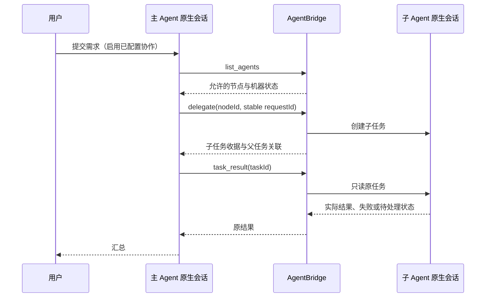

# I05B：主 Agent 与子 Agent 协作设计、开发与测试

## 需求与验收

用户在一个默认协作组中选择一个主节点和多个子节点。主 Agent 实际调用子 Agent 并读取结果；后台校验关系和父子任务归属。用户向主节点提交一次需求，人工转述子结果次数为 0。

必须有 Claude → OpenCode → Claude、OpenCode → Claude → OpenCode 两条真实链。有可用 Codex 节点时验证其作为主和子；工具安装成功不等于账户和原生会话接口可用。

指标：越权、自我委派、伪造来源、跨父会话控制成功次数均为 0；同一子任务委派 ID 重复 10 次只创建 1 个原生任务；子失败不得被标记为协作成功。

## 关系、工具与流程

关系结构：`{leaderId, memberIds, revision}`。保存使用修订号，防止旧页面覆盖新关系。允许保留离线节点的关系，离线不代表删除节点。

| 工具 | 作用与限制 |
| --- | --- |
| list_agents | 只返回当前主节点允许的子节点及机器、能力和状态。 |
| delegate | 用户许可的子节点；稳定请求 ID；原生执行；子任务不继续委派。 |
| task_result | 只读本主会话委派的任务，最多等待 45 秒，未结束继续查询，不重发。 |
| cancel_task | 取消自己的委派任务；操作收据不等于原生退出，须继续核对。 |
| task_pending | 读取原生权限请求和表单；待人处理不伪造完成。 |
| reply_task | 回复原请求；不得虚构用户批准，原生后台继续校验交互 ID。 |

委派 ID 由主节点、父会话与调用者稳定 requestId 确定。父任务、父会话、子任务、子会话、来源机器都持久化。重复查询返回原记录。撤销关系禁止新委派，但当前主会话可查询或取消已拥有的子任务。

## MCP 与执行端

`CollaborationBroker` 在来源机器监听 127.0.0.1 临时端口；私有描述文件包含随机认证令牌，MCP 命令行只传文件路径。调用者身份绑定在令牌对应的上下文，工具参数不能声明自己的主节点身份。WSL 的协作请求通过已连接后台的双向 RPC 传到桌面协调者，后台再次校验来源机器与原主任务。

`mcp-client.cjs` 提供标准 stdio MCP。描述文件在重开时更新，每次调用重新读取；保留原执行且不依赖便携程序临时解压目录。

- Claude：每次主会话调用传私有 MCP 配置，只自动许可 Bridge 的发现、委派、结果、取消和待处理查询；权限回复仍需处理。
- OpenCode：私有上下文启动前加载 MCP 和说明文件，继承原生供应商、账户、配置和 CLI 最近模型。
- Codex：原生 `exec --json` / `exec resume`，每次调用仅配置 Bridge MCP；为有限协作工具设置单独审批模式和工具注解。文件、终端、账户与其他 MCP 的原生策略不改。

用户选择主 Agent；Bridge 本身负责路由、授权和记录，不拥有推理模型。主 Agent 没有调用子工具时，不能用主模型生成的文本代替真实子任务验收。

## 原生执行与不确定性

Codex 原生 JSON 事件生成任务进度和回复，UTF-8 按流解码；原生错误单独展示，详细 stderr 保存在私有运行日志。原生进程结束后才确认取消；观察中断保留 unknown，禁止重试原 Prompt。后台依赖独立持久运行资源，窗口关闭或便携解压目录清理不重启任务。

原生工具可能因账户、模型、登录或原生 Session API 而失败。此时保留真实错误与收据，不切换模型、不新开会话冒充续聊。Windows/WSL 是同一物理宿主的执行环境；其他物理电脑的网络接入仍属于 I06。

## 测试与证据

- `agent-network.test.cjs`：实际后台委派调用、允许关系、伪造机器、自我委派、撤销和原任务控制、十次委派去重。
- `collaboration-broker.test.cjs`：真实 stdio MCP、HTTP 认证、私有身份、重连描述文件和六个工具。
- `codex-host.test.cjs`：真实子进程模拟 CLI、JSON 原生 Session、续聊、失败、确认退出的取消、仅 Bridge 工具审批适配。
- `windows-i05-real.cjs`：真实 Claude / OpenCode / Codex；检查原生子结果和父结果，二者都成功才算通过。
- `windows-i05-codex-main.cjs`：对原隔离配置复验 Codex 发现、委派 Claude 和读取结果；新测试请求，不重发旧请求。

最终结果和限制见 `acceptance.md`，原始证据在仓库 `artifacts/I05-*.json`。
