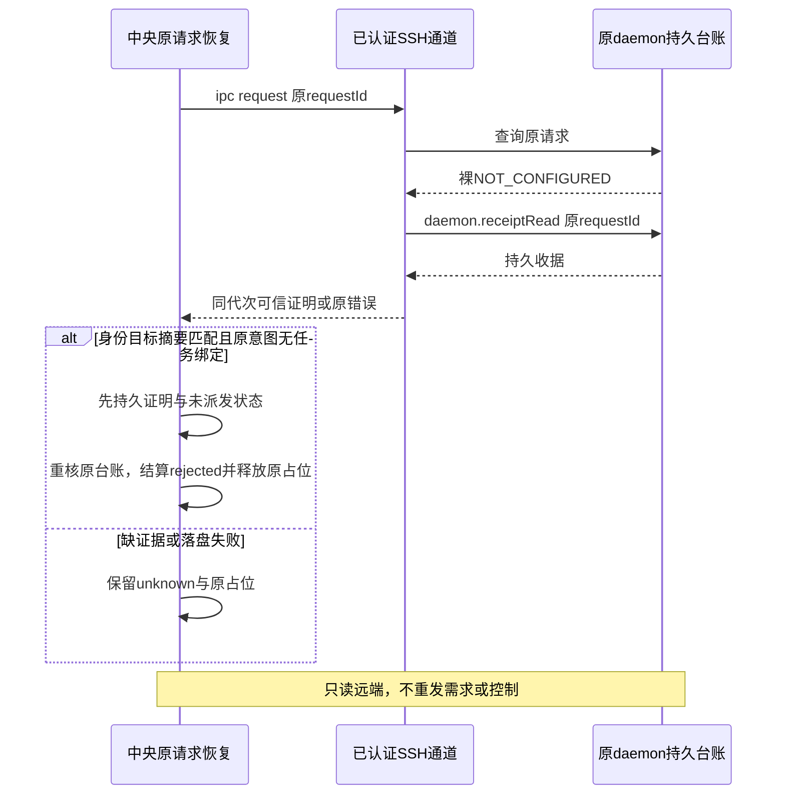

# SSH daemon 持久拒绝回执恢复（issue #5）

日期：2026-10-17。源码候选 **0.6.0-alpha.28**，GitHub当前预发布仍为alpha.27；Windows新包已构建且普通EXE验证通过，尚未分发。完整I06C/I07C及正式0.6.0未准出。

## 需求与根因

关联 [issue #5](https://github.com/wsjq5477/MA-Relay/issues/5)、AB-F08/F10/F11/F17，影响M01/M02/M03/M04/M05/M07/M10。

原请求已在daemon落盘为rejected/NOT_CONFIGURED，但首次响应丢失。原request查询再次抛裸错误；中央只能把它当成本次查询不可用。客户端原意图仍dispatched=true，节点和未确认列表因此一直占位。用户现场daemon台账尚未取得，不能据代码路径推定用户那条记录已拒绝。

| 编号 | 要求与验收 |
| --- | --- |
| R01 | 已派发但未绑定任务的原submit/continue，只在原daemon明确持久拒绝时结算rejected |
| R02 | 核对SSH认证来源、同一通道代次、machine/daemon/profile、requestId、method/op、原目标与规范参数摘要 |
| R03 | 裸NOT_CONFIGURED、缺收据、unknown/confirmed/dispatched、身份/目标/摘要不符、绑定任务或在途job保留unknown |
| R04 | recoverPending、普通request查询、同ID重试不返回伪任务、不新建上下文、不重放需求；保留原ID/参数/时间/历史 |
| R05 | 持久客户端证明后释放原节点及既有pending资源占位；其他未知请求不受影响；落盘失败回退内存并保留unknown |
| R06 | Windows新EXE包含最终源码；只使用临时合成profile，明确受控SSH、Windows契约、普通EXE与用户现场边界 |

## 实现与边界

[SSH读取](../../../desktop/electron/ssh-host.cjs)在ipc/request返回NOT_CONFIGURED后，用相同认证通道调用既有只读daemon.receiptRead。仅接受method=ipc、op=submit/continue、state=rejected、原错误NOT_CONFIGURED且无任务/执行目标和result的台账。查询期间通道代次改变不接受。远端daemon查询/去重/协议2代码没有修改，不要求为此升级旧远端。已发布alpha.27内daemon源码与当前一致，现有endpoint可用；更旧可信版本仍按其实际endpoint与字段核对，缺能力时保留unknown。

[内部证明](../../../desktop/electron/daemon-rejection.cjs)以进程内WeakMap绑定可信读取产生的错误。DAEMON_REQUEST_REJECTED只是公开诊断码，原生JSON、自称source的对象或同码错误不能造出证明。证明携带原机器/daemon/profile、requestId、op、target、参数SHA-256及原始拒绝码，不保留远端任意错误文案。

[原意图核对](../../../desktop/electron/agent-network.cjs)必须找到原node/machine/request与双参数指纹，无taskId/conversationId绑定且无在途node job；用原agentId或原续聊conversationId重建经机器路由剥离后的ipc参数，与daemon规范摘要和target严格比较。续聊的target.conversationId指既有父会话，不能把它当成本次已创建任务；submit不会接收额外会话绑定。仅处理这条NOT_CONFIGURED节点提交/续聊链，verify和原控制查询沿用既有语义。

证明成立后先保存可选daemonRejection，dispatched=false与preparationRejection=NOT_CONFIGURED；保存失败恢复原内存内容，不结算中央台账。可选字段兼容现有version=1，无全量迁移。重开后仍对缓存证明的来源、身份、指纹、target逐项核对。相同ID只读原记录或返回原拒绝，内容变化仍冲突，不重试执行。

[恢复器](../../../desktop/electron/pending-journal.cjs)在原查询失败后把可信错误交给原意图核对，结算前[中央](../../../desktop/electron/coordinator-service.cjs)再次检查原记录未变化和持久证明。普通request查询返回显式state=rejected而无taskId；同ID提交返回错误而不伪装成功。恢复和同ID拒绝保留原time/params。节点unconfirmed按dispatched=false清除，既有任务/会话终态不修改。

## 实际验证

环境：WSL Ubuntu / Node22.23.1；Windows10.0.22000.2538 / Node24.19.0。受控原生host，没有模型调用。证据目录artifacts/daemon-rejection-recovery/2026-10-17。

| 层级 | 实际结果与证据 |
| --- | --- |
| 修复前 | 同一新增客户端测试对HEAD旧源码运行，22/27通过、5失败，匹配拒绝resolved=0；独立/tmp旧源码副本的丢响应/daemon重启端到端亦0/1失败，明确remaining=1/NOT_CONFIGURED：[端到端失败](../../../artifacts/daemon-rejection-recovery/2026-10-17/before-ssh.tap)。[失败TAP](../../../artifacts/daemon-rejection-recovery/2026-10-17/before-final.tap)。首轮测试夹具close缺少stub的hook错误亦保留在before.tap/after-first.tap，修正夹具后重跑基线，不计作产品失败 |
| 修复后客户端 | 新增27/27通过；恢复、普通查询、相同ID、续聊父绑定、重开缓存、落盘失败与20种保守反例：[最终文件TAP](../../../artifacts/daemon-rejection-recovery/2026-10-17/full-daemon-rejection-recovery.test.cjs.tap) |
| 受控端到端 | 真实TCP SSH/password/主机密钥、生产帧协议和daemon磁盘；在远端rejected落盘后丢弃响应，真实daemon重启和SSH重连，再由生产AgentNetwork/Coordinator恢复。原节点unconfirmed从1到0，另一节点unknown保持；原执行host仅被调用1次并在创建任务前拒绝，无第二次需求或控制。[TAP](../../../artifacts/daemon-rejection-recovery/2026-10-17/full-daemon-rejection-ssh.test.cjs.tap) |
| 桌面全量 | 最终317/317通过（含新增27项客户端、1项TCP SSH及alpha.27兼容）；[汇总](../../../artifacts/daemon-rejection-recovery/2026-10-17/desktop-full.json)、[日志](../../../artifacts/daemon-rejection-recovery/2026-10-17/desktop-full.log) |
| 核心与工程 | 核心45/45、lint/根和桌面类型/前端构建通过；Vite既有体积提示保留。结果以[核心](../../../artifacts/daemon-rejection-recovery/2026-10-17/root-tests.log)、[lint](../../../artifacts/daemon-rejection-recovery/2026-10-17/lint.log)、[根类型](../../../artifacts/daemon-rejection-recovery/2026-10-17/typecheck.log)、[桌面类型](../../../artifacts/daemon-rejection-recovery/2026-10-17/desktop-typecheck.log)、[前端构建](../../../artifacts/daemon-rejection-recovery/2026-10-17/desktop-build.log)为准 |
| Windows契约 | 真实Windows Node、合成临时profile，93/93通过；[入口](../../../desktop/tests/windows-daemon-rejection-contract.cjs)、[结果](../../../artifacts/daemon-rejection-recovery/2026-10-17/windows-contract.tap)；不代表Windows到用户服务器实测 |
| 旧daemon复用 | 为新包保持上一版连接，加入已发布alpha.27原manifest，规范摘要e3862fdd030496218e69166fb3bb928277b41477003f68dac48a2a5db09945af；来自已核验原EXE，[来源](../../../artifacts/daemon-rejection-recovery/2026-10-17/alpha27-compatibility-source.json)。不放宽未知版本、归属、摘要/路径规则，不改旧包 |

首轮全桌面317/317通过后补强时间保留与节点占位断言，最终源码重跑；[首轮汇总](../../../artifacts/daemon-rejection-recovery/2026-10-17/first-full/desktop-full.json)保留原证据。复现入口：直接运行新增两个test.cjs；端到端需要允许本机TCP/Unix socket与子进程。Windows直接运行windows-daemon-rejection-contract.cjs，避免UNC的--test发现限制。

## Windows包与恢复步骤

新包已构建且资源核验通过，普通Windows无调试EXE共6组通过；普通EXE入口[windows-daemon-rejection-portable.cjs](../../../desktop/tests/windows-daemon-rejection-portable.cjs)只用临时合成profile，验证持久证明缓存恢复、缺收据保守状态、关闭/重开及冻结后端源码一致。[普通EXE结果](../../../artifacts/daemon-rejection-recovery/2026-10-17/portable.json)、[日志](../../../artifacts/daemon-rejection-recovery/2026-10-17/portable.log)包含原远端合成证明恢复、未知保护、原有Codex/本地台账回归、普通窗口关闭重开和完整后台重启以及5个冻结修复模块核验。它不伪装真实远端握手证明；实际读取来源单列受控TCP SSH测试。

1. 下载新版EXE后，在“设置 → 后台运行 → 停止后台并退出”，重新打开新版，确认中央后台版本。普通关窗口会保留旧后台。
2. 连接原SSH机器，在“设置 → 未确认操作 → 查询原请求”。若原daemon确有匹配持久拒绝，记录结算为rejected，原节点占位释放。修好原配置后由用户新建请求。
3. 裸NOT_CONFIGURED、无收据/能力、未知或身份/参数不符继续unknown；原任务仅查询，不换ID/节点/目录去重发。

本次没有读取或改写用户故障profile、生产daemon或服务器数据；没有真实模型任务、真实独立用户服务器及Windows到独立SSH故障矩阵实测。不能宣布用户现场已恢复；完整I06C/I07C仍未准出。

包构建结果：EXE 129884570 字节，SHA-256 `6d85f667c2e1009e26cd83f00afb09ad540b27787e71c5a2784af0e64c4602ef`。34个CJS后端、78个核心文件、1395个Linux资源及窗口/前端均与源码匹配；[包核验](../../../artifacts/daemon-rejection-recovery/2026-10-17/package.json)、[构建日志](../../../artifacts/daemon-rejection-recovery/2026-10-17/package-build.log)。尚未公开分发。
