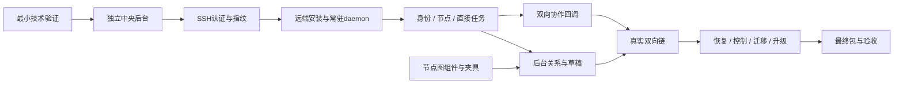

# I06 开发安排与增量交付

日期：2026-10-10；状态核对：2026-10-12。I06A 与 I06B 主要范围已开发并验收，当前候选 alpha.13 的 I06C 收尾；I06C 与正式准出未完成。下方保留初始安排与各版本实施记录。完整当前设计见 [项目资料](../../README.md)，本文件维护 I06 变更范围与记录。目标最终包 0.6.0，当前源码候选 0.6.0-alpha.13 不等于正式发布完成。

需求编号以 [requirements.md](requirements.md) 为唯一基线；组件合约见 [SSH / Daemon 设计](ssh-design.md)与[节点图设计](graph-design.md)，验收步骤见 [testing.md](testing.md)。以下新增文件名均为计划路径；实施中可以调整拆分，但需求和验收映射必须同步。

## 1. 模块与代码落点

| 模块 | 复用代码 | 计划新增/改动 | 需求 |
| --- | --- | --- | --- |
| 中央后台 | `desktop/electron/agent-network.cjs`、`machine-router.cjs`、`main.cjs`、`pending-journal.cjs` | `coordinator.cjs`、`coordinator-client.cjs`、`coordinator-runtime.cjs`；把网络和协作从窗口进程搬到独立后台；本用户 IPC/独占锁/来源校验 | NET-01、REC-01/03 |
| SSH 与凭据 | `rpc.cjs` 的 host.call/协作回调契约、现有主进程 IPC 权限 | `ssh-host.cjs`、`ssh-credentials.cjs`、`ssh-known-hosts.cjs`；ssh2 传输、指纹固定、系统秘密存储引用、输入脱敏、错误分类 | SSH-01…04 |
| 远端包与进程 | `machine-host.cjs`、`worker-runtime.cjs`、`tool-discovery.cjs`、`src/desktop-host.ts`、`controller.ts` | `src/machine-daemon.ts`、`src/machine-relay.ts`、`src/machine-protocol.ts`、`ssh-install.cjs`；Linux用户态包、目录锁/IPC、relay与daemon分离、版本能力握手 | DMN-01…05 |
| 身份与路由 | `machine-router.cjs`、`agent-network.cjs`、`types.ts` | 增加 SSH connection / remote machine 字段；稳定 daemon 用户身份映射；远端路径规则；原生目录/会话锁不变 | NET-02、DMN-04、REC-03 |
| 双向协作 | `collaboration-broker.cjs`、`mcp-client.cjs`、`agent-network.cjs`、`src/desktop-host.ts` | 远端 bridgeTool 回调经 relay/SSH 返回中央；parent scope 从来源绑定；恢复时不重复委派 | NET-03、REC-01/02 |
| 节点图 | `NetworkApp.tsx`、`network.css`、`types.ts`、`api.ts`、关系 revision 保存 | `AgentGraph.tsx`、`graph-state.ts`、布局接口与样式；点击节点选目标；关系草稿和状态更新分离 | UI-01…05 |
| 故障与控制 | 原请求/操作收据、tasks/nativeSessions、取消/权限/表单、unknown 占位 | daemon 单写者台账、游标恢复、连接代次 fencing、只读 reconcile、受控恢复测试 | REC-01…03 |
| 发布与文档 | `stage-bridge.cjs`、electron-builder、Windows普通EXE诊断、I05证据格式 | Linux版本包和可信校验清单；中央后台持久资源；I06安装/升级/操作说明、真实脚本与验收报告 | REL-01/02 |

I06 使用同一 TypeScript/Node 工程和现有原生 Driver；不重写 Python/Rust 版本，不另建模型 API 层。中央 Coordinator 复用 I05 AgentNetwork 业务记录，旧 CLI Hub/Edge 使用方式保持兼容，避免创建第二套冲突任务权威。

## 2. 开发前需完成的最小技术验证

| 验证 | 通过条件 | 失败时的处理 |
| --- | --- | --- |
| ssh2 Windows 能力 | 隐藏密码认证、加密私钥口令、Windows OpenSSH ssh-agent、严格 hostVerifier、双向 exec 数据和 stderr 分离可实测 | 调整同需求下的实现库并记录决策；不能悄悄删掉密码支持、放开主机校验或传密码到命令行 |
| 独立 Coordinator | 持久 Electron/Node 资源在普通便携窗口关闭后可用；本地IPC限定所属用户；单profile单进程 | 先解决资源和IPC拥有权，再接入远端；不要用窗口主进程寿命冒充常驻后台 |
| Linux daemon + relay | 真实SSH断开relay后daemon/原任务仍存活；原用户下重复启动复用；协议流没有日志杂音 | 先修复进程/目录锁和流协议，不用后台shell盲目nohup后直接宣称启动成功 |
| 图组件 | 拟用 `@xyflow/react`；实际鼠标端点创建边、缩放坐标、键盘替代、受控关系草稿更新可验证 | 保持公开组件契约，换图实现时不改变后台allowlist规则；不以静态SVG截图代替交互 |

依赖版本在开发时锁定并记录，不在规划阶段虚构已经安装的新库。运行环境沿用 Node ≥22.13；Linux包的运行时/发行版兼容性按实际环境证明，不自动修改用户的系统 Node。

## 3. I06A：中央、SSH、daemon 与直接使用

| 工作项 | 对应需求 | 开发内容 | 依赖 | 增量退出证据 |
| --- | --- | --- | --- | --- |
| DEV-A01 | NET-01、REC-03 | 提取独立 Coordinator，锁与IPC、窗口客户端、持久资源、关闭窗口/退出后台分开 | 最小技术验证 | 普通窗口关闭后后台仍活，重开复用原状态，无第二终端 |
| DEV-A02 | SSH-01/02/03、UI-05 | 接入Schema与最小桌面添加机器表单；地址用户端口、密码/密钥/agent、指纹确认、Windows凭据保护；不保存时认证后丢弃输入 | A01 | 一个窗口可发起SSH接入；三种认证分支、指纹变化拒绝、秘密不进日志和JSON |
| DEV-A03 | DMN-01/02、UI-05 | 检测非交互环境；Linux版本包、缺Node时私有运行时、可信摘要校验；桌面安装摘要/进度与幂等部署 | A02 | 空Bridge Linux自动安装；已有版本复用；缺Node用户态解决；坏包/磁盘/依赖失败可读 |
| DEV-A04 | SSH-04、DMN-03/04 | daemon/relay实现、用户私有socket、握手、能力、帧边界、连接代次和心跳 | A01/A03 | SSH断开不停止daemon；来源/版本拒绝；后台重复启动无重复 |
| DEV-A05 | NET-02、REC-01 | 新增远端目录、node身份、真实工具扫描、任务上下文/原生默认配置与原请求台账 | A04 | 另一台物理机出现真实工具；反复扫描节点稳定；无模型调用/覆盖 |
| DEV-A06 | NET-02、REC-02/03 | 远端直接新会话/续聊/原任务查询与原生能力说明；保留Windows/WSL回归 | A05 | 可用远端Agent真实两轮、同Session；不支持项单列，不能新开冒充续聊 |

I06A 验收包括合约和真实 SSH；在没有独立 Linux 环境时可完成受控测试，但此增量的真实接入验收保持“未测试/环境阻塞”，不替换成WSL。

## 4. I06B：节点图和双向协作

| 工作项 | 对应需求 | 开发内容 | 依赖 | 增量退出证据 |
| --- | --- | --- | --- | --- |
| DEV-B01 | UI-01/03 | 机器分组、节点、状态、拖动/视口/自动布局；独立布局存储 | A05，图组件验证 | 真实鼠标拖动、缩放和重开布局；没有改变machineId/关系 |
| DEV-B02 | UI-02/04、NET-03 | 设主、端点、创建/删除草稿边；后台revision校验与operationId收据原子保存，未知回应只读核对；I05迁移 | B01 | 跨机器实际连线与真实allowlist一致；非法连线拒绝；轮询不吞草稿；丢回执不重复写权限 |
| DEV-B03 | UI-01/05 | 替换机器filter、主从表单和会话目标下拉；复用A增量接入表单并整合图中的连接/错误状态与原任务入口 | A02/A03/B01 | 从机器接入到发需求可在一个窗口完成；关键三类dropdown不再出现 |
| DEV-B04 | NET-03、REC-01/02 | 双向MCP回调/来源绑定；拆分当前主新委派与旧父scope已有子归属核验，换主不夺旧任务核对入口 | A06/B02 | 两方向协作；越权/self/伪造拒绝；换主后旧主查自有子但不能新委派，新主不能接管旧子 |
| DEV-B05 | NET-03、REL-02 | 真实双向委派、子回复、主会话读取和总结；图/父子任务过程可查看 | B03/B04 | 两方向各1条真实闭环，人工复制子结果=0；未调用工具不能验收通过 |

图开发可先在多机器夹具上与A增量并行，但B增量退出必须使用真实SSH接入节点与后台权限，不能只通过UI Mock。

## 5. I06C：恢复、升级与最终交付

| 工作项 | 对应需求 | 开发内容 | 依赖 | 增量退出证据 |
| --- | --- | --- | --- | --- |
| DEV-C01 | REC-01/03、SSH-04 | 丢回执/断网/旧连接fencing/daemon和中央重启；去重、恢复查询、终态保护、源机器占位 | A06/B04 | 并发10次=1次执行；所有故障点自动重放=0；其他机器可用 |
| DEV-C02 | REC-02 | 取消/权限/表单原ID；丢控制回执、自然完成竞态、原生未支持能力 | C01 | 原生效果与收据分开；丢回执不重复；未支持明确且不假成功 |
| DEV-C03 | DMN-05、REC-03 | 忙时延期版本切换、暂存/校验/健康验证/失败回滚、断开/停止/卸载区别 | C01 | 不杀在途和unknown任务，不删原生配置/历史，不停止非所属进程 |
| DEV-C04 | UI-04/05、NET-01/02 | I05迁移、窗口/后台重开、秘密失效、安装错误、非交互PATH、状态与延迟口径 | B03/C03 | 旧IDs/关系/结果不丢；未确认来源限定；20样本延迟记录 |
| DEV-C05 | REL-01 | 固定依赖、Linux版本包和清单、Windows便携EXE、源码/包校验、使用升级与排障文档 | 全部必交功能 | 普通EXE启动/重开，后台资源持久；可信包摘要一致 |
| DEV-C06 | REL-02 | 全工程回归、真实SSH/模型/控制/故障、最终包复验与报告 | C05 | 完整需求映射；必交项全部通过；环境限制和工具原生限制单列 |

## 6. 实施顺序与依赖



先把独立后台和真实通信做稳，再让节点图操作真实关系。每个增量都展示可运行行为和证据，不以一轮大规模源码完成后才暴露连接问题。

## 7. 实现过程的约束

1. 保留I05状态目录、nodeId、Task/Conversation/request/nativeSession和来源映射；迁移前备份，版本化写入，重复迁移无副作用。旧实例/模型覆盖只作为历史，不迁移为节点模型配置。
2. 新Linuxprofile不接管原生工具的全局配置或其他Bridge后台；socket/进程/安装目录都验证归属。清理仅触及本profile自己创建的资源。
3. 中央不会把密码/私钥注入模型提示、子任务或日志；SSH参数和远端命令采用受控模板/完整引用，任务文本、路径和节点名称作为RPC数据。
4. 持久提交与原生调用之间的故障窗口必须专门验证；不能仅靠内存Promise串行实现跨进程去重。
5. 远端Linux是独立文件系统，不把Windows路径自动转换成 `/mnt/c`，不隐式复制代码或同步目录。需要文件工作的需求由用户明确目标远端目录。
6. 关系revision与布局revision独立；状态轮询不覆盖授权草稿；删除关系不停止在途任务；旧连接响应不得改写新连接状态。
7. Windows关机/休眠、中央全部停止或Linux关机会使协作通道不可用；记录实际状态，不能宣称当前架构具备常驻云端高可用。

## 8. 工程检查与发布门槛

现有命令继续作为检查入口：

```bash
npm run lint
npm run typecheck
npm test
npm test --prefix desktop
npm run desktop:build
```

按变更范围运行，全部功能完成后进行一次最终回归。新测试命令、Linux安装CLI和真实SSH验收脚本在实现后写入package和说明；规划阶段不提供可误运行的虚构命令。

准出：I06A/B/C各退出条件、[testing.md](testing.md)必交矩阵及最终EXE真实验收全部满足；无阻断接入/授权/原生执行/去重/历史恢复的缺陷。确认安装/扫描仅代表接入，不能替代真实工具和主从协作验收。原生Codex限制或缺真实服务器时按能力/环境列出，不替用户选择模型或账号，也不宣称未验证部分完成。

实际开发开始后维护工作项状态与证据链接；最终新增 `acceptance.md` 记录已交付版本、包摘要、通过/失败/未测项。当前不创建一份空白“已通过报告”。

## 9. 开发进展记录

### 2026-10-10（下午）：I06A 代码落地与真实服务器验证

代码状态：DEV-A01–A06 主要链路源码与受控测试已落地；用户界面、认证分支及发布准出仍有缺口（独立 Coordinator、SSH 认证/指纹/凭据、离线包安装、daemon/relay/协议、远端节点与直接任务）。本会话提供真实远端 Linux 并完成端到端验证与缺陷修复。

真实环境（操作者提供，凭据不落盘）：Alibaba Cloud Linux 3.2104 U12.3 x86_64、Node v24.13.0、glibc 2.32、OpenCode 2.0.26（DeepSeek 已登录）；链路 RTT ≈275ms、丢包 ≈20%。本机 WSL 开发环境以密钥认证接入，走完整生产路径（运行时冻结 → 独立 Coordinator 进程 → IPC 令牌握手 → SSH → 安装 → daemon → 真实任务）。

已验证（证据：`.agentbridge-dev/e2e-report.json` 及 e2e/verify/survive 脚本输出）：

| 退出条件 | 结果 |
| --- | --- |
| 空 Bridge 的独立 Linux 自动安装 | 通过；128MB 离线包安装+daemon+握手 77.8s（高延迟有损链路实测） |
| 无第二终端 | 通过；全程仅一个 Coordinator 进程 |
| 扫描推理次数为 0 | 通过；发现仅执行 `--version` |
| 远端真实新会话 | 通过；DeepSeek 真实回复（报告“当前工作目录是 /root/ab-demo”） |
| 同会话续聊 | 同一 Conversation 两轮成功，turns=2；原报告未保存两轮 native Session ID 对比，原生身份一致性须补证 |
| 关闭/断开 SSH 不杀远端执行 | 通过；断开后远端 daemon+worker 继续执行至终态，重连零重发读取原结果 |
| Coordinator 重启恢复 | 通过；新进程自动重连原机器（同 machineId/daemonId），原收据/任务/会话可读 |
| 反复连接无重复机器/节点 | 通过；重连沿用原身份，未重复安装 |

本会话修复的缺陷（均已含回归：root 43/43、desktop 87/87）：

1. `sufficientNode` 未剥离版本前导 `v`，私有运行时校验必然失败（SSH_PACKAGE_INVALID）。
2. 安装摘要 `previewId` 把磁盘可用量计入哈希，df 波动导致待确认安装永远被拒（INSTALL_PREVIEW_CHANGED）；改为磁盘量单独检查。
3. 逐文件 SFTP 上传在高延迟链路不可行（1359 文件 × 每 open/write/close 往返，实测停滞）。改为本地 ustar+gzip 单归档（128MB→46.9MB）+ 24×32KB 流水线上传 + 远端 `tar -xzf` + 逐文件校验 + 原子发布；安装总耗时降至 ~78s。执行前校验不变量保留（运行时哈希先经远端 `sha256sum` 核对，再跑完整逐文件校验）。
4. 运行时二进制 SFTP 回读校验在同类链路需 15 分钟以上（32KB 序列化读）；改为远端 `sha256sum` 固定引用命令，~1s。
5. daemon 深层 context 目录使 controller Unix socket 超过内核 100 字节限制（IPC_PATH）；`socketPath()` 增加用户私有短路径回退（`/tmp/agentbridge-<uid>/controllers/<hash>.sock`，0700 + 属主校验，服务端/客户端同函数计算）。
6. `machine.connectSsh` 客户端超时 300s 不足慢链路安装；提高至 1200s（仅此方法）。

开发环境验证亦确认：远端状态目录被删除后 daemonId 变化会触发 `DAEMON_IDENTITY_CHANGED` 拒绝接管（保护符合设计）；同版本不同摘要触发 `SSH_VERSION_CONFLICT`（开发期需清理远端或提升版本）。

I06A 尚未完成项：

- Windows 侧真实验收：`windows-i06a-ssh-ui.cjs` 及桌面 EXE 流程需在 Windows 应用中执行（密码/指纹确认 UI、DPAPI 保存分支）。
- 密码/加密私钥/ssh-agent：实现分支存在，但现有 ssh-security 用例主要覆盖函数与凭据/信任合约，不能据此声称 SshManager 三类真实登录已测。Windows 隐藏输入与真实 DPAPI 仍待验收。
- `machine.updateSsh` / `machine.remove`（设计 §9）尚未实现，属 I06A 收尾或 I06C 范围。
- 断线自动重连的完整退避时序与 20 样本状态同步 p95 指标留待 testing.md 矩阵逐项执行。

### 2026-10-12：完整项目材料整理与验收口径校正

统一资料迁入 `doc/`；当前架构、整体功能、数据/协议、10 个长期模块及三种原生子模块的设计/测试报告从 [项目入口](../../README.md) 阅读。后续 I06 修改同时更新整体设计与受影响模块资料，规则见 [维护指南](../../development-guide.md)。

本次复用同源码已通过基线：核心 43/43、桌面 87/87；[总报告](../../testing.md)记录证据层级与未测项。三种 SSH 认证/DPAPI、原生 Session ID 比较、事件游标过期补偿、换主后旧父 MCP 查询、无 Node 实环境及新 Windows 包没有因资料整理被标记为通过。源码未修改，没有重新连接服务器或发送模型任务。

后续改动定位到 [模块目录](../../module-plan.md)，迭代只记录本次差异；旧设计中逐文件上传、目录布局和能力表述的实现差异，以当前完整模块设计及明确缺口为准。

### 2026-10-12：桌面网页资料入口

用户要求参考中文 Obsidian 文档站，通过网页目录阅读现有资料，并明确不考虑手机网页。新增 M11：同源 Markdown、自动分组目录、章节导航、本地全文搜索、主题、Mermaid 和引用资源阅读。当前功能与实际网页测试维护在 [模块设计](../../modules/11-documentation-portal/design.md) / [测试报告](../../modules/11-documentation-portal/test-report.md)。未增加 Agent 控制或远端部署行为，整体功能 AB-F18、模块目录与整体验证已同步。

## 2026-10-12：6A 收尾

本次在授权的独立 Linux 和隔离 Windows profile 中收尾 6A。新增设置页普通关闭/明确停止入口、实际 Windows SSH/DPAPI 测试和最终包校验。实际运行发现并修复：Linux node_modules 被打包器过滤；daemon 版本硬编码导致握手拒绝；OpenCode 会话 API 缺少 canContinue 导致用户无法续问。修复后重建包、保留原生配置并重新验收。

machine.updateSsh / machine.remove、事件游标过期补偿、完整退避/延迟指标、系统注销策略、版本升级/回滚与卸载归 I06C；节点图和跨独立设备双向协作归 I06B。6A 先交付真实 SSH 直接会话与后台生命周期，不把后续范围写成已完成。

## 当前 6A 候选验收结果

6A 主要功能与 Windows/SSH 主要流程已完成候选验收，交付 0.6.0-alpha.2。真实窗口、同原生 Session、普通关闭/明确停止/重开、普通便携 EXE 均通过。恢复使用原 Task 查询，没有再次发送模型需求；[验收及限制](acceptance.md)。6B/6C 未被此次候选通过结论覆盖。

## 2026-10-12：Codex 发现入口修复

I06-FIX-CX-01：只读核对用户两轮任务和对应原生日志。任务已配置 MCP，但 Codex 调用的是 CLI 内部 `list_agents`，没有 Bridge 工具调用；模型列表刷新超时不是这次错误结论的终态原因。历史主 Agent 验收需求显式要求使用 MCP，缺自然语言覆盖。

`codex-host.cjs` 的 worker 对带 MCP 的新会话/续聊需求加协作指引，区分原生列表与 Bridge 节点，保留原用户消息/持久 job/指纹；MCP 进度加 `server/tool`。新增受控回归和真实 Codex → Claude 自然语言验收。数据模型、RPC 参数、授权、取消/unknown 边界不变；核对 `data-model.md` / `protocol.md` 无需迁移，架构页已同步提示注入位置。

交付版本升为 0.6.0-alpha.3，以新冻结资源承载修复；不原地修改正在运行的旧版本目录。发布校验脚本支持 `AGENTBRIDGE_PACKAGE_REPORT` 输出独立报告，避免覆盖 alpha.2 的历史验收证据。最终执行结果、包和限制见 [本次交付](codex-discovery-fix.md)。

## 2026-10-12：alpha.4 已安装后台兼容复用

I06-FIX-SSH-01：alpha.3 客户端的严格同版本预检阻断用户原 alpha.2 服务器。新增可信旧 manifest 索引、选择与只读复用分支，不停远端、不创建新 profile、不重置 daemon 身份；协议/身份继续校验实际选中后台。新增 4 项受控测试，桌面 93/93，真实 Windows 已有凭据与原服务器只读校验通过。补丁版本 alpha.4，旧包/报告保留，模块与架构/数据/协议已同步。完整证据与范围见 [本次交付](ssh-compatible-reuse.md)。

## 2026-10-12：新窗口停止旧后台说明校正

旧窗口不是停止残留后台的前提；现有 alpha.4 新窗口可在同 profile 认证后通过自身设置页停止当前 Coordinator。此处修正操作指引并补实际窗口验证，没有修改产品代码或新建发布版本。验证与限制见 [说明校正](client-background-operation.md)，不是后台自动升级功能。


## 2026-10-12：alpha.5 重连后旧错误清理

I06-FIX-SSH-02：实查原 alpha.4 SSH 记录无错误但机器目录保留旧版本拒绝。Coordinator 按完整状态撤销缓存错误并保存，MachineRouter 成功快照清理旧目录错误，失败快照不能被 SSH online 覆盖。新增 2 项受控回归、桌面 95/95，Windows 受控快照卡片渲染 2 项通过；已生成 alpha.5 并核对完整资源。收录已验证 alpha.4 manifest 延续已有远端兼容，实际远端 daemon 不改动。M01/M02/M03/M04/M10 与整体/数据/协议/架构已同步，[本次交付](ssh-error-recovery.md)。

## 2026-10-12：I06B 开发

用户已批准开发。DEV-B01–B04 源码落地：锁定图依赖、替换三个核心下拉流程、独立布局与关系草稿、中央稳定收据/图意图、原父权限分离及节点状态分层。未改变原生账户、模型、工具配置或远端协议版本。DEV-B05 与最终 EXE 按真实环境验收，不能由受控图/UI 通过推定通过；[实施及证据](graph-implementation.md)。测试驱动的启动等待、Esc 和键盘/布局检查中发现的实际问题及最终处理均保留在当次报告，旧报告不覆盖。


I06B DEV-B01–B05 主要范围本次验收通过：核心 43/43、桌面 110/110、图 10 组、20 组/60 节点实际首反馈、独立 SSH 两方向原生闭环、普通 EXE 和最终资源校验分别记录。专项发现并修复 Esc、低修订快照回退、布局收据恢复，以及首次 parent 尺寸未确定导致子节点越位问题；新增真实组拖动/键盘/缩放断言。[最终验收](graph-implementation.md)。下一阶段 I06C 不因本次候选交付自动算完成。


2026-10-13 收尾：OpenCode 原生就绪与 AGENT_UNHEALTHY 确定拒绝的原收据恢复已修复，桌面增至 110/110。最终包正向通过、反向服务退出后在同一 profile 恢复原上下文并完成原请求；模型/账号不替换，原拒绝及驱动失败均保留。M05/M06/M03 与中央/任务恢复材料、整体协议/数据/架构同步。[最终交付](graph-implementation.md)。完整故障与原生服务自动恢复仍归 I06C。

## 2026-10-13：alpha.7 图可用性优化

在 I06B 范围内优化主/子区分、方向端点与卡片避让，新增中键平移。稳定卡片数据减少拖动全量渲染，保留可信 alpha.6 daemon 清单；完整需求、实际验证与发布物见 [交付](graph-usability.md)。

## 2026-10-13：alpha.8 旧后台拖动与主居左

旧 alpha.5 后台的方法拒绝导致窗口布局不加载，所有拖动被锁。修复为本机视图模式、明确后台限制与正常恢复同步，未知 lane 不解除；组背景拖动、捕获中键出界释放、主组默认/自动整理居左。实际 alpha.7/alpha.8 打包窗口分别复现与验证，[当前交付](graph-drag-fix.md)。

## 2026-10-13 节点管理增量

I06-UI/机器节点增量：合并重复的机器/协作页，按机器添加已安装 Agent、明确断开/移除及原身份恢复。节点状态与撤权原子提交，忙碌/未知/离线拦截，回应未知只读查询原 ID；原生安装与历史保留。需求、开发、逐项实际验收和未测范围见 [alpha.9 记录](node-management.md)。不将节点移除扩大为 I06C 的机器移除/卸载。

## 2026-10-13：I06C 首批机器管理

2026-10-13 / alpha.10：机器 SSH 连接编辑、确认断开/移除、原身份恢复、已观察历史持久化/阅读及事件游标缺口分页补偿已实现；桌面 136/136、真实本机 TCP SSH/生产 daemon 隔离恢复和 Windows 界面分别通过。完整 I06C、升级回滚和正式 0.6.0 未准出。 用户已批准进入 6C；需求、实现、分层实测、失败记录与下一批范围见 [当前报告](machine-management.md)。本次未重跑 alpha.6 独立双向原生链，旧报告保留原日期/版本。

## alpha.12 当前实施与验收入口

2026-10-14：DEV-C01/C02 原操作与控制安全恢复、DEV-C03 可信维护、DEV-C04 状态/凭据与迁移、DEV-C05 最终包已形成当前实现；DEV-C06 独立服务器和最终程序验收正在进行。实际通过/失败/未测试分别见 [I06C 收尾](final-delivery.md)，原计划与 alpha.10 历史记录保持原范围。正式准出不能由源码完成推定。

## alpha.14 上传修复增量

2026-10-14，I06-DMN-02 / I06-UI-05：补充上传错误类别/阶段、准确进度、关闭确认及明确失败后的原安装恢复入口。需求、实现、155/155 工程与 5 项专项、Windows 界面、包/EXE 实际验收和未测范围见 [上传恢复](ssh-upload-recovery.md)。alpha.13 收尾及历史服务器结果保留原日期；GitHub alpha.9 尚未包含此修复，完整 I06C 未准出。

## alpha.16 开发交付

DEV-C03/C06：补齐重新登录前的未发送持久化、原收据重开同步占位及语义拒绝；桌面 163/163、SSH 7/7。隔离实机驱动分版本保存报告，发现原 unknown 维护则停止新动作。具体版本/实机/包和边界见 [交付](maintenance-launch-recovery.md)。

## alpha.17 实现优化

DEV-C03/C06：原维护构造复用单次完整资源校验，逐清单核对保持；无接口/数据/协议变更。164/164、测量与冻结实机/独立打包边界见 [交付](maintenance-launch-recovery.md)。

## alpha.18 Windows 运行缓存与原提交恢复

I06-FIX-RUNTIME-01 / AB-F07/11/17：排除共享缓存清单自引用，兼容旧清单，保留损坏副本；核对原未派发意图恢复旧 unknown，不重发需求；查询显示结果和固定原因。桌面 176/176、根 43/43 及类型/构建/lint 已通过；Windows 与最终包的实际结果、命令和未测范围以 [专项交付](runtime-recovery.md) 为准，完整 I06C 未准出。
