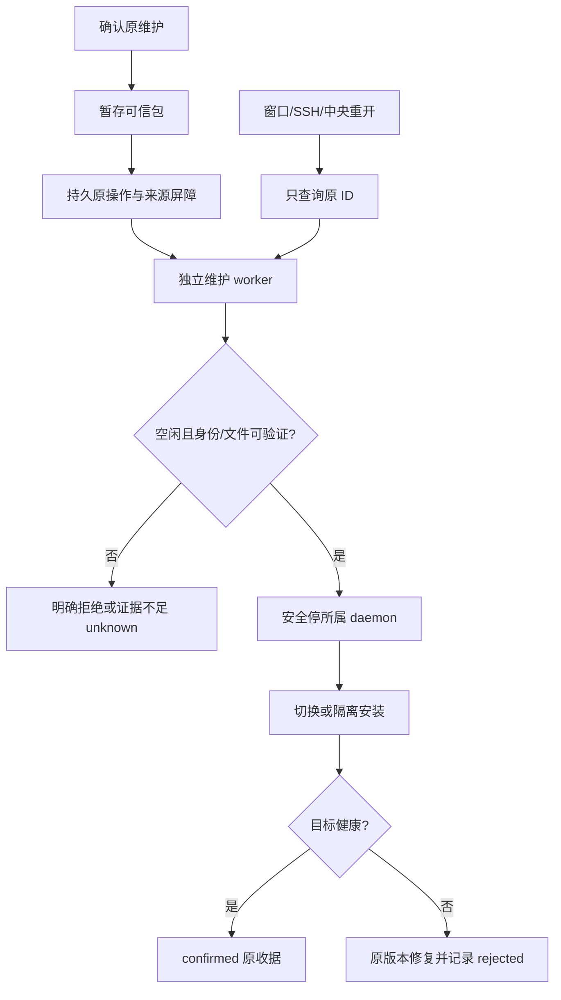

# I06C alpha.13 维护与恢复收尾

更新：2026-10-14。当前源码为 **0.6.0-alpha.16**（维护未发送边界与恢复状态修复）；候选包以当次构建报告为准；稳定历史发布为 0.5.0。当前工程及受控验证通过，独立服务器验收进行中，**完整 I06C / 正式 0.6.0 尚未准出**。本页只记录实际证据，不把开发完成推定为真实模型或完整发布验收。

## 需求与模块

| 工作项 | 本次交付 | 模块 | 当前结果 |
| --- | --- | --- | --- |
| DEV-C01 / REC-01/03 | 原请求/控制未知恢复、来源锁、损坏台账拒绝执行、旧代次与重启回归 | M02/M03/M05/M07/M08 | 工程受控通过；独立服务器故障专项待完成 |
| DEV-C02 / REC-02 | 原控制 ID/目标/状态校验、confirmed 与实际终态分离、敏感表单遮罩及台账脱敏 | M01/M02/M05/M06/M07 | 受控通过；真实权限/表单/取消分别记录，不由收据推定效果 |
| DEV-C03 / DMN-05 | 可信暂存/空闲租约/健康切换/失败回滚/停止/卸载/原维护恢复 | M01/M04/M05/M10 | 真实 daemon/process + 受控原生 host 7 项通过；独立 Linux 正在验证 |
| DEV-C04 / UI-04/05、NET-01/02 | I05 与原身份历史回归、缺凭据恢复入口、维护元数据与执行锁分离、状态样本 | M01/M02/M03/M04/M07 | 工程与窗口通过；20 个受控状态样本见下方；真实网络指标不由模拟替代 |
| DEV-C05 / REL-01 | 最终 Windows portable / Linux 包/可信旧清单/许可与重链接材料/源码一致性 | M10 | 包构建及资源校验通过；普通 EXE 实测进行中 |
| DEV-C06 / REL-02 | 当前包双向原生、同 Session、隔离文件任务、取消与故障、逐项准出 | 全部相关模块 | 进行中；未完成前不宣布准出 |

前一增量的连接编辑、机器移除恢复、历史阅读与 cursorGap 分页保留，见 [alpha.10 首批](machine-management.md)。根 CLI、原生 Driver、模型和账号继承不变；没有新增模型 API 层。完整模块设计和测试报告同步更新，架构/数据/协议也记录新的维护租约与收据边界。

## 实现与使用

1. 在机器图对应 SSH 机器的“后台维护”中读取实际后台、最新与可回退版本；明确选择升级、回滚、停止或卸载。
2. 确认后先验证 preview/修订并暂存校验目标；原远端维护输入持久化后只发送一次。回应未确认时重开也保留原操作，只用“查询原机器操作”恢复。
3. 有运行、等待、unknown、未确认控制或上下文创建时拒绝切换，不自动排队或取消任务。该来源机器的新执行被中央、MCP 准入和 daemon 租约共同拦截，其他机器仍可工作。未知维护期间仍能打开连接详情补录凭据。
4. 新 daemon 使用认证 quiesce/shutdown；旧兼容 daemon 经过空闲和精确身份核对，使用已验证 pidfd helper 取得内核进程句柄后检查 UID/启动标识并停止。Linux 内核不支持 pidfd 时拒绝旧后台停机，绝不采用仅 PID 降级。
5. 原子保存 current/previous 后核对目标身份、版本、ping 与快照；健康失败回到原可信版本。维护 worker 与 SSH 会话独立，崩溃后从原收据阶段修复，不重新执行原生任务。
6. 停止保留安装与历史并暂停自动重连；显式连接恢复观察。卸载先完整验证所属全部版本，再原子隔离安装目录，删除已验证安装文件；原 state、历史和维护控制器保留，卸载后仍能查原收据。原生 CLI、模型配置、项目和其他 profile 不删除。

维护后台清单与原任务的接收/终态是两套事实。native unknown 或外来 operationId 不会成为 confirmed；控制 confirmed 不表示任务取消。中央 pending.json 损坏或写入失败拒绝新执行；敏感表单答案先计算摘要，台账只保存脱敏值与原绑定。

## 实际工程与窗口证据

| 日期 / 环境 / 版本 | 实际结果 | 证据级别与来源 |
| --- | --- | --- |
| 2026-10-13 / WSL Ubuntu / Node 22.23.1 / alpha.11 | 根 43/43 通过 | 受控根回归：[TAP](../../../artifacts/I06C-final/2026-10-13/root-tests.tap) |
| 2026-10-14 / 同环境 / alpha.13 | 桌面 150/150 通过，无失败/跳过 | 受控完整回归：[最终 TAP](../../../artifacts/I06C-final/2026-10-14/desktop-alpha13.tap)；模块统计不重复相加 |
| 2026-10-13 / Linux 实际生产 daemon、socket、独立进程、磁盘；受控 native host | 维护 7/7、daemon 控制 18/18 通过，均属于上述完整工程范围 | [维护 TAP](../../../artifacts/I06C-final/2026-10-13/maintenance-tests.tap)、[控制 TAP](../../../artifacts/I06C-final/2026-10-13/control-tests.tap)；无真实模型 |
| 2026-10-14 / Windows 打包 Electron / alpha.11 | 维护与机器管理 7 组通过、原生提交 0 | [报告](../../../artifacts/I06C-final/2026-10-13/electron-machines.json)；真实窗口和认证中央/存储，SSH 与执行器受控 |
| 2026-10-14 / Windows Edge 实际鼠标键盘 / alpha.11 | 图交互 10 组通过、原生提交 0 | [报告](../../../artifacts/I06C-final/2026-10-13/ui.json)；生产授权/布局存储，机器受控 |
| 2026-10-13 / Windows Edge / alpha.11 | 20 个受控状态变化到 DOM，p95 1855.8ms | [机器报告](../../../artifacts/I06C-final/2026-10-13/ui-machines.json)；是受控连接状态呈现指标，不等同公网握手/模型时间或独立物理 LAN 指标 |
| 2026-10-14 / alpha.13 Windows x64 构建 | 28 CJS / 1378 Linux 文件，asar 后台、冻结资源、前端与最终源码一致 | [包报告](../../../artifacts/I06C-final/2026-10-14/package-alpha13.json)、[构建日志](../../../artifacts/I06C-final/2026-10-14/package-alpha13-build.log) |

复现（Node ≥22.13，已安装锁定依赖）：`npm test`、`npm test --prefix desktop`、`npm run lint`、`npm run typecheck`、`npm run desktop:build`、`npm run desktop:dist`。维护专项：`node --test desktop/tests/daemon-maintenance.test.cjs desktop/tests/machine-daemon.test.cjs`。后者实际启动隔离进程，不访问模型；Windows UI 测试脚本需要 Windows Edge/Electron。验收文件在有日期目录中，部分工程/窗口报告沿用 2026-10-13 目录，但报告内日期明确本次实际执行时间。

## 实机与准出记录

当前实机使用独立 Linux 服务器，新建隔离 owner/profile，读取已有已授权登录方式且不输出秘密。先部署旧 alpha.10，再由真实 alpha.11 窗口与生产维护路径升级；原用户 SSH 配置和原后台不改。真实 Session、双向协作、文件和取消、回滚/停止/卸载结果将在实际运行后填入本节。

[实机驱动](../../../desktop/tests/windows-i06c-real.cjs)会调用原生模型、在本次隔离目录写文件并维护本次安装，不是普通单元测试。响应未知时保留本次私有 profile，后续按原 ID 继续查询，不换 ID 冒充重试成功。

当前未完成：独立物理 Linux 故障矩阵、当前双向原生与文件/取消、普通 EXE 核心真实闭环、另一操作者仅按文档验收。服务器重启无人登录自动启动/systemd 不支持；Windows 注销/关机和系统 agent 服务兼容限制按原报告保留。没有代码签名，仅 SHA-256 完整性校验。旧 Coordinator 直接降级不支持，Linux 已验证发布目录回滚不代表旧中央数据可降级。

## 当前候选程序

[Windows x64 EXE](../../../desktop/release/AgentBridge-0.6.0-alpha.13-Windows-x64.exe)，129851731 字节。

SHA-256：`804e40c837e07a1024e527a7222b98b605d30c0b9f2a633f117f71f36224a1cc`。Linux manifestDigest：`2577707d02d62f2aa03b1f657fdd766f10a323e400fd89f5109ad632c3388ed5`。

清单来源为本地锁定发布材料；不能将摘要匹配等同发行者代码签名或全功能准出。本次不自动创建 GitHub release，不改变已发布稳定版/alpha.9 标签。

## 实机发现与修复：归档执行权限

2026-10-14：alpha.11 在独立 Linux 5.10.134 上升级被拒绝，原版本保留，未启动新后台/任务。[失败报告](../../../artifacts/I06C-final/2026-10-14/real-alpha11-failed.json)、[只读诊断](../../../artifacts/I06C-final/2026-10-14/maintenance-diagnostic.json)证明启动标识匹配，但归档后的 helper 无执行权限，实际错误 EACCES。不是内核不支持。alpha.12 在可信文件清单加入 helper 的 0700 mode，归档按该 mode 解包；新增实际 staging/tar 解包/执行权限测试通过。停机错误改为区分 pidfd 不支持与资源/身份核验失败，不强杀。保留旧失败记录，并使用同一个隔离 profile 和原机器继续验证；原拒绝已明确，新的修复维护不是重发 unknown。alpha.11 候选清单按已构建包 digest 核验收入兼容资源，以便完整验证和安全卸载既有安装版本。

测试驱动从 WSL 共享目录复制既有 Windows 测试包时发生 EPIPE，原服务器没有新维护发送；改用独立版本目录和普通字节读取/写入，避免 Windows CopyFile 对旧 UNC 目录覆盖的问题。这是验收驱动问题，没有降低产品包校验或绕过远端未知占位。

## 故障证据映射

下表映射本次实际工程用例；“受控通过”不是同一故障在独立服务器或真实原生工具上再次通过。完整 TAP 的用例标题可定位断言和原始输出。

| 故障 | 实际覆盖 | 证据边界 |
| --- | --- | --- |
| F01 意图落盘前 | 原 native 台账写入失败/损坏、图意图失败与原子机器提交失败均阻止派发 | 受控通过，原执行次数 0；pending 台账损坏保留占位 |
| F02 已接收后 ACK 丢失 | daemon unknown/10 同 ID 去重、中央原请求恢复，不重复 submit | 受控通过；独立服务器 ACK wire 丢包不由窗口验证替代 |
| F03 原生启动后 SSH 断开 | relay 关闭保留任务、TCP SSH 恢复、原 native Session 对账 | 受控通过；独立真实模型断线专项按实机节记录 |
| F04 输出/事件未到中央 | 过期游标先 snapshot、分页耗尽、事件失败不提前推进，较新事实不被旧快照覆盖 | 受控通过；真实原生乱序输出未单独注入 |
| F05 控制 ACK 丢失 | unknown 控制跨 daemon 重开；权限/表单/取消只查原操作、外来 task/ID 拒绝 | 受控通过，原控制接收不增加；真实取消效果另读原生退出 |
| F06 中央停止 | 身份/意图恢复、两窗口同后台、源机器占位、历史回读 | 受控通过；独立模型期间中央重启按实机节记录 |
| F07 daemon 重启 | 原 daemonId/收据保留，缺原生收据保持 unknown；维护 activation 崩溃按原阶段回原版本 | 实际隔离进程与受控 host 通过，不将原任务重启为新 Session |
| F08 旧代次 | 新 hello fencing、旧协作回调不改当前状态 | 受控通过 |
| F09 安装/切换 | 清单路径/摘要拒绝、坏目标保持旧进程、健康失败原版本回滚；归档执行权限实解包检查 | 受控通过；真实权限缺陷已保留 alpha.11 失败并在 alpha.12 修复；公网半包中断未单独再注入 |
| F10 关系/布局并发 | 原布局/权限收据去重、窗口冲突与草稿保存、旧快照不回退新关系 | 当前真实鼠标/键盘 + 生产存储受控通过 |
| F11 身份/权限 | owner/profile/UID/socket、伪造机器、原父 scope 和外来操作拒绝 | 受控通过；非所属 pidfd 句柄/启动标识拒绝通过 |
| F12 原生证据缺失 | 缺 task/session/receipt 保持 unknown 和目录占位 | 受控通过，不以“未找到”释放或新会话代替 |
| F13 授权原子提交 | 原 operationId 并发/改内容，真实隔离进程提交前后终止，恢复不重复写 | 受控通过 |
| F14 布局原子提交 | 同上布局独立 lane；窗口丢 ACK、重开查原收据 | 受控通过 |

执行来源：[alpha.12 全桌面 TAP](../../../artifacts/I06C-final/2026-10-14/desktop-alpha13.tap)、[daemon 控制测试](../../../desktop/tests/machine-daemon.test.cjs)、[维护实际进程测试](../../../desktop/tests/daemon-maintenance.test.cjs)、[SSH 隔离恢复](../../../desktop/tests/ssh-recovery-integration.test.cjs)、[图进程故障](../../../desktop/tests/graph-crash.test.cjs)。没有将上述子集计数再加入全工程 150 项。

## 实机发现与修复：停机 socket 竞态

alpha.12 helper 已安全停止旧 daemon，随后 inspect 恰逢 socket 关闭而得到 ECONNRESET，误判为维护 rejected；安装入口和历史保留。[实际失败](../../../artifacts/I06C-final/2026-10-14/real-alpha12-maintenance-failed.json)。alpha.13 将停机阶段 ECONNRESET/EPIPE 当作瞬时观察中断，等待原 PID 的启动标识消失/变化且 socket 离线后才确认停止；socket 离线但原进程仍在时保持等待，超时为 unknown。出现其他 PID 或身份错误拒绝继续切换。新增确定性竞态、活进程不得误确认和替代 PID 检查通过，完整桌面 150/150。没有扩大强杀权限，也没有重发任务。

alpha.12 Windows 实际图性能：20 组机器/60 节点/59 条授权边，20 个实际鼠标反馈样本，p95 36.6ms，无记录到长任务卡顿。[原始报告](../../../artifacts/I06C-final/2026-10-14/performance.json)。这是受控图性能，不能替代网络或原生推理时延。

## alpha.14 上传修复增量

2026-10-14，I06-DMN-02 / I06-UI-05：补充上传错误类别/阶段、准确进度、关闭确认及明确失败后的原安装恢复入口。需求、实现、155/155 工程与 5 项专项、Windows 界面、包/EXE 实际验收和未测范围见 [上传恢复](ssh-upload-recovery.md)。alpha.13 收尾及历史服务器结果保留原日期；GitHub alpha.9 尚未包含此修复，完整 I06C 未准出。

## 2026-10-14 alpha.13 独立服务器实测更新

当前工作区已有后续 [alpha.14 上传修复](ssh-upload-recovery.md)，本节是冻结 alpha.13 包的真实验收，不冒充 alpha.14 全量模型复测。

| 实际场景 | 结果与边界 | 原始证据 |
| --- | --- | --- |
| 独立 Linux alpha.10 → alpha.13 | 原维护 confirmed，实际版本/daemon 身份和历史保留 | [实机记录](../../../artifacts/I06C-final/2026-10-14/real.json) |
| Linux OpenCode 2.0.26 两轮 | 两次真实回复，严格同一原生 Session/Conversation | 同上，checks；原账号/CLI 配置继承，无模型覆盖 |
| Windows Claude → Linux OpenCode | 实际图授权、list_agents/delegate/task_result、原生主子成功、人工复制 0 | 同上，chains |
| Linux OpenCode → Windows Claude | 同样通过；启动失败时原请求明确未执行，恢复后沿原 requestId 完成，未换节点/目录 | 同上，sameOriginalReverseRequest/initialFailure |
| 独立 SSH F02/F03/F05/F07 | 精确响应帧在接收调用完成前丢弃、关闭 relay；原请求/控制只查原 ID；10 同 ID 返回同 Task，原执行/取消次数各 1；daemon 实际重启保留原 UUID/记录 | [L2 故障](../../../artifacts/I06C-final/2026-10-14/wire-faults.json)，真实 SSH/生产 daemon+relay，执行器受控、模型调用 0 |
| Windows 原生取消 | 1 次取消；confirmed 收据、Task cancelled、原 nativeExited=true 分别核对 | [真实取消](../../../artifacts/I06C-final/2026-10-14/windows-cancel.json) |
| 普通 alpha.13 EXE | 无 debug/inspect 的真实窗口，经认证 IPC 得到 Windows Claude 真实标记；原历史保留 | [普通窗口原生](../../../artifacts/I06C-final/2026-10-14/normal-native.json)；不称作该普通窗口完成 Linux 文件任务 |
| Linux 隔离文件/原生恢复 | **未通过准出**：原任务已接受，原生服务退出；原 Task/Session 与占位保留，不重发需求。只读恢复后曾回到 running，但未得到可核对终态，不计成功/已取消 | [原任务恢复](../../../artifacts/I06C-final/2026-10-14/original-file-recovery.json)、[实机阶段错误](../../../artifacts/I06C-final/2026-10-14/real.json)、[原取消诊断](../../../artifacts/I06C-final/2026-10-14/original-file-cancel3.json) |

服务器约 2GB（MemTotal 1915896 KiB）。已捕获本次原生 PID 在自有清理之前 SIGKILL、内核对同一 PID 的 OOM 记录：[退出诊断](../../../artifacts/I06C-final/2026-10-14/native-exit-diagnostic2.json)。未擅停用户原服务或改账号/模型/全局设置。验收只在自己 profile 中暂时停用已空闲的托管上下文，保留原数据，以原请求完成反向链：[调度](../../../artifacts/I06C-final/2026-10-14/native-resource-schedule.json)。文件任务仍受原生退出影响；未把原取消接收收据当作原任务已取消，也未改数据库解除未知占位。

恢复原文件任务时，使用校验 owner/profile/UID/启动标识的 kernel pidfd 暂停/恢复本次 daemon 观察进程，停下已确认无任务的自有 Controller，恢复原文件原生服务并查询原 input，原生新 Prompt=0。临时 helper 已在 finally 删除，daemon 已恢复。该诊断不构成公开维护接口，不把观察恢复为 running 当作任务成功。

当前完整 I06C 仍未准出：原生 Linux 文件/恢复终态未确认；有 unknown 的原测试 profile 禁止回滚/停止/卸载并保留现场。另一个独立无模型 profile 的部署维护专项不迁移、重做或释放这条原任务，其实际结果另列，不能代替原文件任务通过。系统服务/注销策略、其他操作者仅按文档验证及未单独注入的专项按原限制保留。

### 独立空闲维护专项的当前边界

另建零模型 profile，以同登录用户的独立 owner/profile 验证部署维护，原 unknown 任务不迁移、不释放、不重做。alpha.10 已安装；alpha.14 暂存/逐文件验证成功，但维护入口复查阶段再次遇到 SSH_EXEC_FAILED，尚未送出原维护意图，当前不能登记回滚/卸载实机通过。[专项当前结果](../../../artifacts/I06C-final/2026-10-14/lifecycle-real.json)、[暂存诊断](../../../artifacts/I06C-final/2026-10-14/lifecycle-stage-diagnostic.log)、[复查诊断](../../../artifacts/I06C-final/2026-10-14/lifecycle-debug-run.log)、[同一 SSH 连接两次预检](../../../artifacts/I06C-final/2026-10-14/lifecycle-preview-pair.log)。现场保留，维护产品的受控 daemon/process 结果仍按原证据范围。

最新源码与 alpha.14 包再次逐项比对通过：[当前包核验](../../../artifacts/I06C-final/2026-10-14/latest-package-check.json)。这不把 alpha.13 已通过的原生链或仍未通过的 Linux 文件任务提升为 alpha.14 全量验收。

## alpha.15 维护入口会话拒绝恢复

更新：2026-10-14，DEV-C03 / DEV-C06 关联，I06-DMN-05。alpha.14 独立空闲维护专项（[上文](#独立空闲维护专项的当前边界)）的实际失败是：暂存/逐文件验证成功、新连接两次预检稳定，但完整流程中 `machine.maintainDaemon` 内部的维护入口复查在 `maintenancePreview` 稳定抛 `SSH_EXEC_FAILED`，两次运行与调试运行均在同一位置失败，原维护意图未发送（DAEMON_STAGE_REJECTED）。

诊断：同一 SSH 客户端上相同只读调用先成功、数秒后失败；新 TCP 连接上的同类调用全部成功；该服务器约 2GB 内存且此前有 OOM 记录。错误只可能来自 `remoteExec` 的通道打开被拒/流中断/非零退出之一，故障形态与 sshd 会话预算（MaxSessions 类）在高载低配主机上回收缓慢一致；**无该服务器 sshd 配置/日志，此为最可信推断而非已确认根因**，需下次实机运行的原因码证据验证。

修复（[ssh-install.cjs](../../../desktop/electron/ssh-install.cjs)、[ssh-host.cjs](../../../desktop/electron/ssh-host.cjs)）：

1. `maintenancePreview` 的探测标记与 previous.json 复用同一 SFTP 会话，每次预检由 3 个会话降为 2 个，降低触发服务器会话预算的概率。
2. 只读维护入口预检（`machine.daemonPreview` 与 `maintainDaemon` 内部复查）失败为 `SSH_EXEC_FAILED` 时：先同连接延迟 750ms 重试一次，再换新 TCP 连接重试一次；语义性拒绝（版本冲突/摘要不符等）不重试。重试成功后在线机器恢复观察连接；维护流程随后本就断开 relay 并置 autoReconnect=false，该重连调度自然跳过。
3. 凭据缺口不再被 DAEMON_STAGE_REJECTED 掩盖：新连接重试需要重新登录而内存密码已单次消费时，`machine.maintainDaemon` 将 SSH_AUTH_REQUIRED/SSH_AUTH_FAILED/CREDENTIAL_STORE_UNAVAILABLE 置为 needs_credentials 并原样上抛，与查询路径既有行为一致。
4. 维护启动（原输入一次发送）区分"通道打开被拒"（可证明未发出）与"流中断/超时"（可能已发出）：前者换新连接重试一次不算二次发送；再次未发出则收据记 rejected（DAEMON_NOT_STARTED、remoteLaunched=false），不再留下远端无记录、查询永远 not_found 的 unknown 死角。其余启动失败保持原 unknown 收据、仅按原 ID 查询，不变。
5. `machine.operation` 查询自身的通道打开被拒同样换新连接重试一次（查询是 unknown 意图唯一恢复路径）；其余查询失败语义不变。
6. 诊断粒度：`SSH_EXEC_FAILED` 消息携带通道原因码（如 RESOURCE_SHORTAGE=4）或远端退出码，错误对象内部标记 open/stream/exit 阶段（open 才可证明未发出）；[实机驱动](../../../desktop/tests/windows-i06c-lifecycle-continue.cjs)记录错误消息，且每步重新提供授权凭据（内存密码单次消费，新连接重试需要）。

### 实际工程证据

| 日期 / 环境 / 版本 | 实际结果 | 证据级别与来源 |
| --- | --- | --- |
| 2026-10-14 / WSL Ubuntu / Node 22.23.1 / alpha.15 | 发布提交桌面 **159/159**，无失败/跳过；随后代码修复与四项新增测试属于 alpha.16 | [发布提交 TAP](../../../artifacts/I06C-final/2026-10-14/desktop-alpha15.tap)；当前增量见 [alpha.16 交付](maintenance-launch-recovery.md) |
| 同环境 / alpha.15 | 根 43/43、lint、typecheck 通过 | [根 TAP](../../../artifacts/I06C-final/2026-10-14/root-alpha15.tap) |
| 同环境 / alpha.15 | 真实本机 TCP SSH（ssh2 Server 模拟会话预算受限 sshd 的通道拒绝行为，RESOURCE_SHORTAGE 原因码路径）：会话预算占满时预检同连接重试→新连接恢复并在新连接暂存、收据保持可查询 unknown；瞬时拒绝同连接恢复且不新增登录；持续拒绝在两次重试后以上界错误 surfaced 且不产生维护意图；语义拒绝不重试；缺凭据呈现 needs_credentials | [恢复测试](../../../desktop/tests/ssh-recovery-integration.test.cjs)；受控服务器与执行器，无模型、无用户服务器 |
| 同环境 / alpha.15 | 安装器级：maintenancePreview 单 SFTP 会话读取探测标记与 previous.json；remoteExec 报告通道原因码与退出码 | [兼容测试](../../../desktop/tests/ssh-compatibility.test.cjs) |

边界：受控 ssh2 服务器复现的是"通道打开被拒"机制与客户端恢复行为，**不等同已在独立服务器复现根因或验证修复**；`remoteLaunched=false` 的 rejected 收据形态尚未有远端真实台账运行证据；[独立空闲维护专项](#独立空闲维护专项的当前边界)需在独立服务器用 alpha.15 重新执行，其结果另计。未新增模型调用，协议与远端数据文件不变。

## alpha.16 维护未发送状态跨重试与查询

alpha.15 后续核查发现：维护通道 open 阶段失败后，如果恢复连接所需凭据缺失，未先持久化“原输入未发送”会留下本地 unknown，而远端没有对应 operation 台账；查询会返回 not_found。另有恢复拒绝可能被 DAEMON_STAGE_REJECTED 泛化的问题。

alpha.16 在新连接认证前保存 `remoteLaunched=false`，只在认证成功并将要发送前将其改为 true；重新认证失败时形成确定 rejected 状态并映射当前机器状态。查询原 operationId 时恢复该确定结果；冲突、版本与输入语义拒绝保留原错误。stream/timeout 仍可能已发送，原 unknown 和只查询原 ID 约束保持不变。SSH 协议与远端数据文件未变化。

| 日期 / 环境 / 版本 | 实际结果 | 证据与边界 |
| --- | --- | --- |
| 2026-10-14 / WSL Ubuntu / Node 22.23.1 / alpha.16 | 根测试 43/43、桌面 163/163、SSH 恢复集成 7/7；portable 包校验通过 | 自动化/受控；含本机 TCP SSH 模拟；不是独立用户服务器验收 |
| 同环境 / alpha.16 | EXE 129,851,194 字节，SHA-256 `d1e35450e57967767fc5031ba4bdc8dfb5f5552dc374079a4a3005fc5f3223ba`；28 个后台模块、1381 个 Linux 资源，app.asar/前端匹配 | Windows 包在 WSL 重建并校验；未重跑真实 Windows 用户流程 |
| 未测项 | 独立服务器维护重验、alpha.16 Windows 交互与完整 I06C 准出 | 不以受控测试或包校验替代 |

## alpha.16 发送前失败与原占位恢复

基于 alpha.15 新增已复现修复：首次通道明确未发送后，重新登录失败不再留下 unknown；原子未发送证明重开查询时同步恢复机器维护状态；忙碌/冲突语义保留。桌面 163/163、真实本机 TCP 7/7 通过；发布 alpha.15 的原工程基线仍为 159/159，新增四项与代码修复属于 alpha.16，不能归入未改变的 alpha.15 EXE。完整需求、当前实机与包边界见 [本次交付](maintenance-launch-recovery.md)。

## alpha.17 维护等待优化与最终候选

2026-10-14：构造可信维护输入仅复用本次完整校验的当前包，逐清单摘要与远端校验保持，无协议/数据变更。164/164 桌面检查、独立最终包一致性、普通无调试 EXE 启动/关闭/重开通过。原实机维护继续冻结 alpha.16，原文件 unknown 沿原 ID 保留，完整 I06C 未准出。实际耗时、实机和包来源见 [当前完整增量](maintenance-launch-recovery.md)。

## 本次最终实机结论（2026-10-14）

冻结 alpha.16 的独立空闲生产维护全链已通过：升级→回滚→再升级→停止→明确连接→卸载；用户原配置前后摘要一致，原 daemon 身份稳定，原生需求 0。非空原生会话不由此专项证明。当前 alpha.17 工程 164/164、最终包和普通 EXE 检查通过。完整 I06C 仍受原 alpha.13 文件任务 unknown 限制；最新同 ID/Session 查询、内存保护和 finally 清理证据见 [最终增量验收](maintenance-launch-recovery.md)。

## alpha.18 Windows 运行缓存与原提交恢复

I06-FIX-RUNTIME-01 / AB-F07/11/17：排除共享缓存清单自引用，兼容旧清单，保留损坏副本；核对原未派发意图恢复旧 unknown，不重发需求；查询显示结果和固定原因。桌面 176/176、根 43/43 及类型/构建/lint 已通过；Windows 与最终包的实际结果、命令和未测范围以 [专项交付](runtime-recovery.md) 为准，完整 I06C 未准出。
