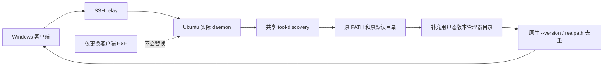

# I06 Linux 非交互后台 CLI 发现修复

日期：2026-10-14。源码候选 **0.6.0-alpha.19**，基于 alpha.18。关联 I06-FIX-DISCOVERY-01、AB-F02/07/17、M03-F02/F03、M05-F04、M06-CX-F01、M10-F02/F03/F06。正式 0.6.0 与完整 I06C 仍未准出。

## 需求、证据和根因范围

用户反馈 SSH 接入 Ubuntu 后只发现 OpenCode；相同 SSH 用户在终端可以运行 Codex CLI 0.162.1，Windows 的同版本已能接入。用户未提供安装路径，本次不把开发环境路径当成用户服务器路径。

开发 WSL 的实际复现：PATH 限制为 /usr/local/bin:/usr/bin:/bin 时，旧扫描只发现 Claude/OpenCode；显式指定同用户 fnm 管理的 Codex 安装后版本检查为 0.162.1。代码确认旧扫描仅读取后台 PATH 与少数固定目录。常见 fnm/nvm 安装目录可能只出现在交互 Shell 的 PATH 中，SSH detached daemon 使用私有 Node 也不会自动继承该目录。这确认了产品扫描覆盖缺口，但不单凭该复现断言用户服务器只存在这一种原因。

## 要求与最终实现

| 要求 | 当前行为 |
| --- | --- |
| R01 非交互安装可见 | Linux 发现增加 fnm/nvm 版本目录、Volta/asdf/mise shims 与相应 Node 安装目录，以及 Cargo/Bun/pnpm/npm prefix 的常见用户目录；支持已传入环境中的标准根目录变量和 XDG_DATA_HOME |
| R02 保留既有选择 | 已有 PATH 和既有默认目录优先，额外安装版本按名称数字降序检查；坏的早先候选继续检查其他安装；最终使用 realpath 去重并保留原安装身份 |
| R03 配置与秘密边界 | 不执行或 source .bashrc/.profile，不写 PATH/原生模型配置，不读取或复制登录秘密；只对受支持工具执行 --version，不发模型 Prompt |
| R04 平台隔离 | Windows 原有 Path/npm 启动脚本处理保留；Linux 使用 PATH，忽略大小写不同的 Windows Path 变量 |
| R05 远端落地 | SSH discovery 在 Ubuntu 的实际 daemon 中执行；仅更换 Windows EXE、重连或重扫仍会复用旧远端代码。需通过既有可信后台维护升级到 alpha.19；原机器、节点、请求和历史不重建 |

环境中仅在交互 rc 文件定义、没有传入后台且位于任意自定义目录的安装仍可能未被覆盖。工具只以别名或 Shell 函数存在也不属于已支持安装；不为发现它而执行任意启动脚本。本次不增加模型 API 或动态第三方 Agent 适配。

## 代码与接口边界

[tool-discovery.cjs](../../../desktop/electron/tool-discovery.cjs) 为 Windows/WSL/Linux daemon 共用实现；[MachineHost](../../../desktop/electron/machine-host.cjs) 和 [daemon](../../../desktop/electron/machine-daemon.cjs) 的调用契约未变。[回归测试](../../../desktop/tests/tool-discovery.test.cjs) 覆盖默认/配置根目录、PATH 优先、坏候选回退、无安装和 Windows npm 脚本。

打包检查补充核心 dist 与 Windows bridge/Linux 离线 dist 的逐文件哈希一致性，以及 Linux 后台 CJS 与源码一致性，防止仅重建窗口或 CJS 时漏掉后台核心改动。没有 RPC 参数/响应、节点格式、任务/控制收据或协议版本变化；data-model/protocol 不迁移。节点仍按原机器、适配器与规范安装路径识别，不能以发现新路径解除其他原请求 unknown。Windows EXE 内含新 Linux 离线包，alpha.18 旧清单在与原交付 digest 核对后收入兼容索引。旧后台兼容复用保持，不自动更新用户服务器。

## 实际验证

- 2026-10-14 / WSL Ubuntu / Node 22.23.1：发现回归 **6/6** 通过，包括 fnm/nvm 精简 PATH、10 种配置根目录、不读取启动脚本、PATH 优先/较新损坏安装回退、缺目录、Windows npm launcher。该计数包含在桌面全量，不另行相加。[发现 TAP](../../../artifacts/linux-cli-discovery/2026-10-14/discovery.tap)。
- Linux 真实 CLI 版本探测，经生产 daemon/协议/relay 和本机真实 TCP SSH：Codex **0.162.1**、Claude **2.1.299**、OpenCode **2.0.24** 健康可见；重复扫描规范路径一致，模型 Prompt=0。SSH 服务器/安装器为隔离受控实现，**不是用户独立服务器实测**。[原始报告](../../../artifacts/linux-cli-discovery/2026-10-14/real-cli-ssh.json)、[脚本](../../../desktop/tests/linux-cli-discovery-real.cjs)。

初轮 Linux 专项桌面 181/181、核心 43/43、lint/类型/构建已通过，保留原日期证据；最终 alpha.19 合并了同期 [OpenCode 二次扫描修复](opencode-discovery.md)，最终统计、包摘要与普通 EXE 结果以发布补验段为准。不得把初轮未含 OpenCode 改动的 43 项当作合并源码统计。

包校验器的受控故障验证：隔离包 Windows bridge/dist 核心文件改坏后被源码一致性拒绝；Linux package/dist 改坏后被清单摘要拒绝；恢复后校验通过。[检查器报告](../../../artifacts/linux-cli-discovery/2026-10-14/stale-package-checker.json)。最终构建同时核对 core dist、窗口后台和 Linux 离线模块，防止打包遗漏合并修复。

未执行用户新电脑/Ubuntu 升级或真实模型任务；Codex 原生 resume/权限等限制沿用原报告，不由发现成功推定解决。

## 用户操作路径

1. 在旧窗口的“设置 → 后台运行 → 停止后台并退出”，然后打开 alpha.19 EXE，加载新的 Coordinator。
2. 在 SSH Ubuntu 机器下点击“后台维护”，核对实际版本和本程序版本，选择“升级后台”并确认。维护使用原机器/profile；运行、等待或 unknown 会按现有准入拒绝升级，不能通过移除机器重建来规避。
3. 升级到 alpha.19 并重新连接后，点击该机器“重新扫描”，再添加 Linux Codex 节点。

该流程更新的是 Ubuntu 上的 AgentBridge 后台，不重装 Codex CLI、不修改账号/模型、不删除原任务或会话。

## 2026-10-15 alpha.19 合并源码与最终包复验

本轮最终源码同时包含 Linux 非交互发现、OpenCode 二次检查和 Windows 配置写盘兼容修复。WSL Node 22.23.1：核心 **45/45**、桌面 **181/181**，lint/类型/构建通过；[核心 TAP](../../../artifacts/linux-cli-discovery/2026-10-14/merged-root-tests.tap)、[桌面 TAP](../../../artifacts/linux-cli-discovery/2026-10-14/merged-desktop-tests.tap)。初轮 43 项和中间包摘要只作为历史调试证据，不能替代本段。

最终包校验 **28 个后台模块 / 78 个核心文件 / 1384 个 Linux 清单条目**，核心 dist 与 Windows bridge、Linux package逐文件匹配，窗口 CJS/前端和 Linux 后台匹配。EXE **129,853,209** 字节，SHA-256 `8841106e626152963f115d50a3c16c0b48c15a7a3aaf9f4be1c67cf7533e7e2a`；[最终包清单](../../../artifacts/linux-cli-discovery/2026-10-14/final-package.json)。

使用实际发布资源的 Linux 后台模块与其私有 Node，经本机隔离 TCP SSH/生产 daemon/relay，在精简 PATH 下探测真实 Codex **0.162.1**，重复安装身份一致；[最终包 Linux 报告](../../../artifacts/linux-cli-discovery/2026-10-14/final-packaged-cli-ssh.json)。Windows 实际包的受控 PE/npm扫描、原安装核验、配置完整保存/旧revision拒绝、原生serve受控失败保留和删除安装拒绝共 **6 组通过**；[Windows 报告](../../../artifacts/linux-cli-discovery/2026-10-14/final-windows-opencode.json)。普通 Windows 无调试 EXE 启动、原请求安全恢复、窗口关闭保留后台和重开共 **4 组通过**；[EXE 报告](../../../artifacts/linux-cli-discovery/2026-10-14/final-portable.json)。

模型 Prompt=0；未连接用户独立 Ubuntu 或执行远端后台升级，未验证 Windows OpenCode 完整原生推理/身份生命周期，未扩大 Codex resume/权限能力或完整 I06C 准出。用户仍需在原 SSH 机器“后台维护 → 升级后台 → 确认升级”后重新连接并扫描。

普通EXE最终验证首轮因测试驱动在Windows设置Path后又删除大小写等价的PATH，导致后台辅助程序不可见而超时；[失败记录](../../../artifacts/linux-cli-discovery/2026-10-14/final-portable-path-driver-failed.json)保留。修正驱动环境后重新使用同一SHA-256的EXE在新隔离profile完成4组通过，未更改生产代码或重发模型命令。
