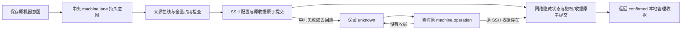

# I06C 首批：机器连接管理与观察恢复

日期：2026-10-13。版本：0.6.0-alpha.10；稳定 Windows 仍为 0.5.0。用户批准进入 6C，先交付连接维护与事件恢复，不把首批当作完整 I06C 或正式 0.6.0 准出。

## 需求与范围

关联 AB-F01/03/05/06/09/11/12/14/16/17，M01-F01/F03/F04/F06/F09、M02-F03/F04、M03-F03/F05/F06/F07、M04-F02/F03/F05/F06/F07/F08、M05-F06/F07、M07-F02/F03/F06/F07、M08-F01/F06、M10-F01/F02/F03/F06。延续 I06-SSH-02/03、REC-01/03、UI-04/05、DMN-04 及 DEV-C01/C04 的相应部分。

| 本次交付 | 成功行为 | 错误/边界 |
| --- | --- | --- |
| 编辑 SSH 连接 | 修改名称、地址、端口、认证方式/私钥路径；保留 connectionId、daemonId、machineId 和原历史，保存后测试并重连 | expectedRevision 冲突拒绝；已绑定 SSH 用户不可改为另一执行域，新增独立机器；地址别名不创建新节点或释放 unknown |
| 主动断开/重连 | 确认断开暂停自动重连，保留机器图和远端安装；重连只恢复观察 | 断开/编辑/移除要求来源在线且无在途、等待、unknown 或未确认意图；重连允许原任务未知，不重发任务 |
| 移除/恢复机器 | 移除隐藏机器组并撤销相关当前协作授权；设置页显式恢复原机器与节点，无自动重新授权 | 保留用户原生配置、远端 daemon、任务/会话和布局；本机 Windows/WSL 不提供移除，不是卸载 |
| 历史保留/阅读 | 已观察任务与会话保存到中央私有文件，后续分页快照不删除旧项；移除/离线/重开可读历史快照 | 历史读取标记 historical，非终态保持 unknown，禁止续聊/控制；收据查询仍必须访问原来源，不能以历史快照确认 pending |
| 事件恢复 | cursorGap/cursorExpired 先完整 snapshot，再 drain items/nextCursor/hasMore 全部页 | 不猜 latestCursor，不推进未处理事件，过旧通道不能覆盖当前代次；恢复不提交 Prompt |

## 实现与事务

[机器路由](../../../desktop/electron/machine-router.cjs)持久化已观察历史，接入/执行归属与原目录锁保持。[SSH Manager](../../../desktop/electron/ssh-host.cjs)将配置变化和 lifecycleOperations 原收据在 ssh-connections.json 中一起原子提交。配置改变认证来源时解除原 credentialRef 并移除其密文文件；机器移除清除保存凭据，主机信任与原生设置不删。绑定原主机公钥和 UID 继续核对；换地址不能自动接受不同主机密钥。

[中央服务](../../../desktop/electron/coordinator-service.cjs)先持久原意图，再保护来源机器执行准入；检查全部机器非终态任务、节点/实例占用、正在创建的上下文、目录锁与 pending.json。配置只接受白名单字段，秘密走 credential.provide，不进入图操作日志。旧机器断开/重连调用归同一守卫，旧 UI 关闭已有机器详情改为仅关闭。

[网络](../../../desktop/electron/agent-network.cjs)将 removedMachines、关联撤权和 machineOperations 原收据在同一文件原子提交。SSH 配置与网络是两个文件，**不是跨文件原子事务**：SSH 收据先落盘，网络随后完成；中间失败保持 machine lane unknown。查询原 machine.operation 从已有 SSH 收据补齐本地网络提交，按原 ID 去重，不重复 SSH 写入、不重新执行任务。不以新 ID/别名旁路 unknown。旧 reconnect 收据只有对应当前 connection revision 才允许恢复观察，不能撤销后续手动断开。

confirmed 管理收据不代表远端任务成功、取消或已经重新在线。重连 confirmed 仅确认恢复观察已安排，实际在线/凭据等待/身份拒绝以机器状态为准。机器、节点、授权三类元数据未知共享屏障，布局独立。前端 [machine-management.ts](../../../desktop/src/machine-management.ts)保存原 ID，重开与外来中央意图只查询原操作；[界面](../../../desktop/src/NetworkApp.tsx)提供移除确认和设置页恢复；[连接对话框](../../../desktop/src/AddMachineDialog.tsx)区分编辑、凭据重连和关闭，秘密不缓存到 localStorage。

## 本次实际验证

工程、Windows 界面、打包窗口和普通 EXE 分别记录，以原始报告的实际结果为准。无用户原 profile 修改、无用户远端安装/升级、无真实模型需求。

- [工程 TAP](../../../artifacts/I06C/2026-10-13/desktop-tests.tap)：136/136 通过，失败/跳过为零；新增 [机器管理用例](../../../desktop/tests/machine-management.test.cjs)验证修改/移除/恢复、历史重开/分页、忙碌/未知/离线/上下文、存储失败、跨文件中断补齐、十并发一次修改、原收据不撤销新断开及秘密字段拒绝。
- [真实 TCP SSH 集成](../../../artifacts/I06C/2026-10-13/ssh-integration.tap)：Linux/Node 22.23.1，本机隔离 ssh2 服务、生产 daemon 和真实 TCP/4BE 通道，安装器与原生执行器受控。原请求一次执行，断开后完成、2105 个新事件导致 cursorGap，补全快照并分多页读回 2000 个保留事件，原任务/会话/机器 ID 不变；新端口不同主机公钥在用户认证前拒绝。不是独立服务器/真实模型证据。
- [Windows 界面](../../../artifacts/I06C/2026-10-13/ui-machines.json)：实际 Edge 鼠标、生产管理/存储，SSH 探测与宿主受控；详情关闭、编辑、确认取消、断开/重连、移除丢 ACK/重开、恢复不重授权、旧后台能力和 20 状态事件延迟分别记录。[脚本](../../../desktop/tests/windows-machine-management.cjs)、[截图](../../../artifacts/I06C/2026-10-13/ui-machines.png)。
- [构建](../../../artifacts/I06C/2026-10-13/build.log)、[包验证](../../../artifacts/I06C/2026-10-13/package.json)、[打包日志](../../../artifacts/I06C/2026-10-13/package-build.log)：最终前端/后台/版本/Linux 资源比对；alpha.9 manifest 先与历史 digest `344a725b8ce2b14a8ae583fe3ca354e16565bd85a7ceb339e465ba0d3157ecea` 核对再收入可信清单，不自动升级已有 daemon。

初次 [机器测试](../../../artifacts/I06C/2026-10-13/machine-tests-before.tap)发现节点未关联的非终态任务漏检，增加按来源机器任务状态直接保护后复验。初次 [全回归](../../../artifacts/I06C/2026-10-13/desktop-tests-before.tap)中的旧用例预期重开缓存为空，已根据新私有历史行为改为保留缓存，同时保留来源离线仍阻止共享目录执行的实际断言。失败记录不覆盖为成功。

## 未完成范围与下一交付

完整 I06C 仍未准出。DEV-C01 的完整中央/daemon 重启与故障恢复、取消/权限/表单丢回应和竞态、所有原生工具控制、独立服务器延迟与自动退避矩阵、无 Node 全新独立服务器安装、DEV-C03 升级/回滚/停止/卸载、系统注销策略及最终真实模型/EXE 全功能准出继续待完成。下一批优先补齐恢复/控制故障矩阵，再实现安全升级与回滚。

machine-history.json 是已观察历史的私有副本，不是完整原生数据库导出；首次接入前已存在但从未观察的分页历史不由本次测试证明完整。不能通过该文件释放未知占位。带 removedMachines/lifecycleOperations 的配置不支持直接回退旧 Coordinator：旧版本不认识管理状态。回退需后续迁移/验证方案，保留备份，不清空原 ID。

使用新版：正常关闭旧窗口后打开 alpha.10；若仍连接旧后台，在“设置 → 后台运行 → 停止后台并退出”后重新打开。恢复移除机器在“设置 → 已移除机器”，随后按原机器输入凭据/重新连接；移除后的凭据不自动恢复。

## 最终候选结果

Windows Edge 机器界面 7 组、图交互 10 组通过；机器状态 20 个受控事件 p95 1854.6ms。不是独立服务器 LAN 指标。最终真实打包 Electron/认证生产 IPC 机器管理 6 组通过：[窗口报告](../../../artifacts/I06C/2026-10-13/electron-machines.json)、[日志](../../../artifacts/I06C/2026-10-13/electron-run.log)、[截图](../../../artifacts/I06C/2026-10-13/electron-machines.png)。宿主/SSH 探测受控，无模型 Prompt，不冒充完整真实服务器链。

普通 portable EXE 无 debug 参数的启动、正常关闭、原后台/布局重开 3 项通过：[普通程序](../../../artifacts/I06C/2026-10-13/portable.json)、[日志](../../../artifacts/I06C/2026-10-13/portable-run.log)。只操作隔离 Windows/WSL 配置，测试所有者资源已清理，用户原后台未切换。

最终程序：[AgentBridge-0.6.0-alpha.10-Windows-x64.exe](../../../desktop/release/AgentBridge-0.6.0-alpha.10-Windows-x64.exe)，129588461 字节，SHA-256 `8da6daa60c3a3e69f66703a866bbf0c81f48ccdd90306b10291be4c0819c0426`。27 CJS、1370 Linux 文件，窗口 app.asar/冻结后台/前端/版本与源码一致；Linux manifestDigest `df88329b7045cd91bb79e63c7274d5cf4a355e5227949240e27a96de572e7396`。136/136 全桌面、根 lint/typecheck 与编译/前端构建通过，完整 6C 准出依旧待后续。

[文档检查](../../../artifacts/I06C/2026-10-13/docs-check.log)和[当次摘要](../../../artifacts/I06C/2026-10-13/summary.json)记录当前版本与分层证据。
