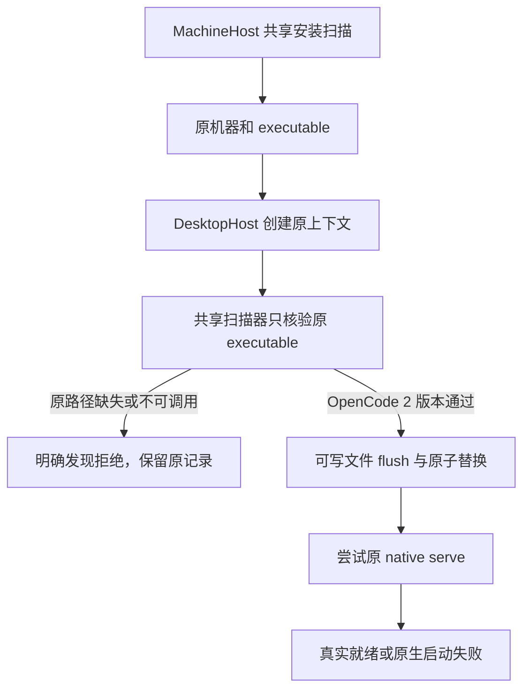

# I06 OpenCode 二次发现与 Windows 配置写入修复

基于当前 alpha.19 合并候选。关联 I06-FIX-DISCOVERY-02、AB-F02/07/17、M03-F02/F04、M06-OC-F01、M09-F01/F06、M10-F02/F06。初次复现与 Linux 工程检查在 2026-10-14；后续 Windows 原始报告使用 UTC 时间 `2026-10-14T17:35:28.789Z`。用户问题来自另一台电脑，本次没有读取该电脑的日志、生产 profile 或账号配置。完整 I06C 与正式 0.6.0 未准出。

## 需求与根因

主 Agent 派发时提示 `DISCOVERY_CHANGED` / “这个 OpenCode 已不可用，请重新扫描”。源码中这条具体文案来自 DesktopHost.connect。MachineHost 先通过共享 tool-discovery 检查安装，创建 OpenCode 上下文时 DesktopHost 又通过另一套只搜索无扩展名程序的 discovery.ts 重新发现；Windows exe/cmd/npm 安装可能在第二次检查中消失，Linux 的后台 PATH 或首选安装变化也会造成原选中安装被漏掉。

隔离 WSL 夹具及真实 Windows PE 夹具均证明：共享扫描 healthy / 2.0.24，旧 core scanner 返回空数组。[初次复现](../../../artifacts/opencode-discovery/2026-10-14/reproduction.json)、[Windows 实测](../../../artifacts/opencode-discovery/2026-10-14/windows.json)。这是确认的源码缺陷，不将受控安装路径或版本冒充用户另一台电脑的现场。

Windows 连接继续执行后，还真实复现 SettingsStore.write 的 `EPERM: fsync`：临时文件以只读句柄刷新，随后无条件刷新目录。已保存 [原失败](../../../artifacts/opencode-discovery/2026-10-14/windows-fsync-failed.json)，按平台改为可写文件句柄刷新与原子替换；Linux 继续刷新目录，Windows 跳过其不支持的目录刷新。没有忽略文件写入/刷新失败，配置版本锁、expectedRevision 和格式保持。

## 要求、实现和验收

| 要求 | 实现与实际结果 |
| --- | --- |
| R01 一致发现 | core OpenCode 发现复用共享扫描器；Windows exe/cmd/npm 解析及 Linux 用户目录覆盖来自同一实现；受控和 Windows 实际版本检查通过 |
| R02 核验原安装 | DesktopHost.connect 指定原 executable 只做版本核验，原程序损坏/删除时拒绝，不改用另一套可用安装；不重建节点或更换请求 ID |
| R03 保留协议边界 | core 仍只接受 OpenCode 2.x；通用扫描识别其他 major 不代表该 HTTP 适配器支持；回归明确拒绝 1.x |
| R04 Windows 完整配置 | 文件以 r+ 打开后 fsync、原子 rename；Linux 继续目录 fsync；Windows 实际初始化/更新、重读完整配置和旧修订拒绝通过 |
| R05 保留真实启动失败 | Windows DesktopHost 实际到达原 PE 的 serve；夹具刻意退出时 startupCode=NATIVE_EXITED、connection=failed，不宣称原生模型可用，Prompt=0 |
| R06 合并交付 | 与 alpha.19 Linux CLI 扫描修复协调，由同一候选包统一构建；最终包与发布事实见 [合并交付](linux-cli-discovery.md)，早先包不含最终 core 修复，不能沿用其摘要 |

## 实测证据

| 环境 / 场景 | 实际结果 | 原始证据 |
| --- | --- | --- |
| WSL Ubuntu / Node 22.23.1 / 受控可执行文件 | discovery 3/3：原安装不在 PATH、损坏/删除不回退、major 1 拒绝、Windows npm 解析；模型 0 | [TAP](../../../artifacts/opencode-discovery/2026-10-14/discovery.tap)、[测试](../../../tests/discovery.test.ts) |
| WSL / 核心、桌面受控回归 | 核心 45/45、桌面 181/181；lint/类型通过。3 个 discovery 用例包含于核心；桌面含并行 Linux 发现修复，不叠加模块计数 | [核心](../../../artifacts/opencode-discovery/2026-10-14/root-tests.tap)、[桌面](../../../artifacts/opencode-discovery/2026-10-14/desktop-tests.tap)、[lint](../../../artifacts/opencode-discovery/2026-10-14/lint.log)、[类型](../../../artifacts/opencode-discovery/2026-10-14/typecheck.log) |
| Windows / Electron 内置 Node 24.21.0 / .NET PE 版本与退出夹具 | 6 组通过：实际 npm cmd→PE 解析、旧二次发现失败、修复后两处一致、配置落盘与旧修订拒绝、native serve 退出保留失败、删除原 PE 拒绝；Prompt=0 | [报告](../../../artifacts/opencode-discovery/2026-10-14/windows.json)、[脚本](../../../desktop/tests/windows-opencode-discovery.cjs) |

首次 Windows 驱动缺少连接错误字段，后补诊断发现 fsync 产品失败；[初始失败](../../../artifacts/opencode-discovery/2026-10-14/windows-initial-driver-failed.json)和后续 fsync 失败均保留，不将失败改写为通过。WSL 启动 PowerShell 时需给测试子进程 Windows PATHEXT/PATH；这是验证环境补齐，不修改产品或用户系统变量。

Windows PE 是版本/启动退出夹具，不是真实 OpenCode 服务或模型回复。未验证用户另一台电脑、真实 Windows OpenCode 推理/Session 恢复、断电持久性或完整 SSH/原生矩阵。原生进程身份模块的 Windows 完整生命周期仍没有本次通过证据；本次没有放宽其归属校验来制造成功。

## 代码、协议与数据边界

[discovery.ts](../../../src/discovery.ts) 复用已有 CJS 共享扫描；[desktop-host.ts](../../../src/desktop-host.ts) 核验原安装；[settings.ts](../../../src/settings.ts) 修正平台持久化。生产包必须同时包含对应 core dist 和共享 CJS，Windows 与 Linux 资源逐文件比对由统一包检查完成。

M03/M06/M09 的完整设计和报告同步。没有新增 RPC 参数、settings.json 字段或版本、节点/会话身份、原生配置或模型 API 层；protocol/data-model 无迁移，架构记录共享依赖和平台持久化边界。M07 原请求/会话恢复和 M08 授权、父任务/委派去重逻辑未修改；unknown 仍查询原请求，不以重新扫描、另一安装或新目录解除占位。

使用合并候选时，在旧程序“设置 → 后台运行 → 停止后台并退出”，再打开最终 EXE，加载新版 core 与 Coordinator。普通关闭窗口可能保留旧后台；SSH 节点的修复要加载新版原远端 daemon，见合并交付步骤。不会自动重发旧需求、删除配置或改变原生账号。最终程序及下载链接以合并交付实际核验为准。

2026-10-15 最终合并包：核心45/45、桌面181/181、lint/类型/构建通过；[最终包清单](../../../artifacts/linux-cli-discovery/2026-10-14/final-package.json)、[包内Windows6组](../../../artifacts/linux-cli-discovery/2026-10-14/final-windows-opencode.json)、[普通EXE4组](../../../artifacts/linux-cli-discovery/2026-10-14/final-portable.json)。Windows原生serve夹具仍明确为NATIVE_EXITED受控失败，模型0；源代码/最终摘要与分发状态见[统一交付](linux-cli-discovery.md)。
