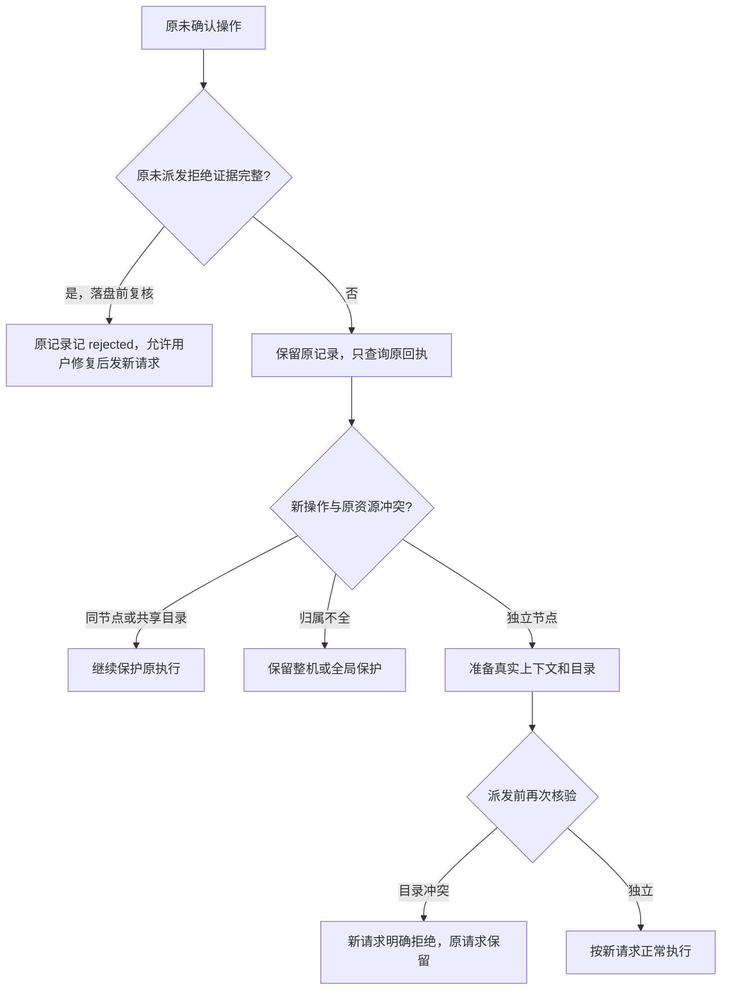

# I06 未确认请求的资源范围与准备拒绝恢复

日期：2026-10-15。关联 AB-F08/F10/F11、M01-F07、M02-F04/F06、M03-F04/F06、M07-F06/F07。版本 **0.6.0-alpha.20 预发布**，基于 alpha.19；Windows portable 已构建并在 GitHub 分发，未更改用户生产 profile。完整 I06C 和正式 0.6.0 未准出。已有 I07 草案改动保留，不把本修复计作 I07 实现。

## 需求与验收目标

用户反馈：一个会话长期提示 NOT_CONFIGURED / “原机器或后台查询未完成”，后续无法继续。实际源码有两个独立问题：桌面 pending 按来源机器阻断全部新写操作；上下文准备异常缺少统一持久拒绝证明。查询失败不能证明原任务未执行，但独立节点也不应因此无法工作。

| 要求 | 验收行为 |
| --- | --- |
| R01 明确准备拒绝 | submit/continue 在上下文、原会话读取或协作 scope 准备阶段失败，保存未派发拒绝；同 ID 重试不执行，修复配置后用户可发新请求 |
| R02 原记录恢复 | 原来源、ID、输入/有效指纹、最初错误及未派发证据匹配、无任务/会话绑定和在途 job，才把原 unknown 记 rejected；落盘前再次核验 |
| R03 保留旧证据边界 | 最初 NOT_CONFIGURED 加原未派发意图可恢复；仅本次查询 NOT_CONFIGURED、not_found、已派发或原意图缺失均保持 unknown；alpha.18 资源错误恢复继续兼容 |
| R04 独立工作可继续 | 原节点及共享目录保持阻塞，同机器独立节点可新建和续聊，原台账不删除、不换 ID |
| R05 防别名绕过 | 改 ID、同节点换目录、跨节点/Windows/WSL 共享目录都不能绕过；真实目录解析后、派发前再次核验 |
| R06 界面与兼容 | 图卡片、新建、续聊、详情控制使用后端范围投影，被禁用时明确提示可查询原请求或选择其他可用 Agent；旧后台缺字段时仍保守限制，机器/节点管理不放宽；配置错误使用固定脱敏说明 |

## 实现与模块落点

[AgentNetwork](../../../desktop/electron/agent-network.cjs) 解析原 requests、实例及节点归属；[Coordinator](../../../desktop/electron/coordinator-service.cjs) 保留原台账并在初步准入和真实目录就绪后检查冲突。[MachineRouter](../../../desktop/electron/machine-router.cjs) 在原生派发前传入原参数以识别同源同 ID。独立目录仍执行现有忙碌、接入和配置校验。

底层明确配置准入拒绝 NOT_CONFIGURED 同样回收中央提前设置的 dispatched 标记，避免无任务却显示节点未确认忙碌；已发送的传输失败仍保留该标记。准备区间的异常保存 requests.preparationRejection，原输入保存 inputFingerprint，继承协作后的 fingerprint 保持原语义。对账同时验证两者；同 ID 的原准备拒绝不因配置修好而重放。旧数据无新增字段时，仅按原错误及严格未派发意图恢复。准备创建服务或上下文不等于发送本轮 Prompt。

[恢复器](../../../desktop/electron/pending-journal.cjs) 将查询 NOT_CONFIGURED 解释为原后台配置未就绪，不能据此推断任务运行状态。[NetworkApp](../../../desktop/src/NetworkApp.tsx)、[AgentGraph](../../../desktop/src/AgentGraph.tsx) 使用 pending 响应的可选 blockedNodeIds；该投影不写入原台账，前端不自行释放任务。

## 实际验证

环境：2026-10-15，WSL Ubuntu / Node 22.23.1，源码/构建版本 alpha.20，原修复测试基于 alpha.19；Windows 界面为真实 Edge 进程、生产前端及受控 API。所有新专项模型调用为 0。

| 检查 | 实际结果 | 原始证据 |
| --- | --- | --- |
| 原意图、配置拒绝、重启、协作续聊、同节点/共享目录/旧来源与恢复回归 | 受控 40/40 通过；包含原有恢复用例，计入桌面总数 | [定向 TAP](../../../artifacts/pending-isolation/2026-10-15/targeted.tap)、[用例](../../../desktop/tests/agent-network.test.cjs)、[恢复用例](../../../desktop/tests/pending-journal.test.cjs) |
| 全桌面自动回归 | 受控/集成 188/188 通过，0 失败、0 跳过 | [桌面 TAP](../../../artifacts/pending-isolation/2026-10-15/desktop-tests.tap) |
| 桌面类型检查与生产前端构建 | 通过 | [构建日志](../../../artifacts/pending-isolation/2026-10-15/desktop-build.log) |
| Windows Edge：独立续聊/原节点保护、新建目标、旧后台兼容、配置说明与只读查询 | 4 组通过；未发新 Prompt 或控制操作 | [界面报告](../../../artifacts/pending-isolation/2026-10-15/ui.json)、[脚本](../../../desktop/tests/windows-pending-isolation-ui.cjs) |
| 文档同步 | 本次最终检查结果见日志 | [文档检查](../../../artifacts/pending-isolation/2026-10-15/docs-check.log) |

复现：使用 Node 22+ 执行 `node --test desktop/tests/agent-network.test.cjs desktop/tests/pending-journal.test.cjs`；全量 `npm test --prefix desktop`；构建 `npm run build --prefix desktop`。Windows 界面在已构建前端上执行 `node desktop/tests/windows-pending-isolation-ui.cjs`，使用 Windows Edge 和受控 API。

## 交付边界

源码与生产前端已修改并验证；alpha.20 Windows EXE 已构建并公开分发，GitHub alpha.19 附件保持原文件。未读取或改写用户故障记录，不能声称那条记录已经恢复；若只有查询配置错误而缺少原拒绝证明，原节点仍须恢复原后台后核对，独立节点可以工作。未提交真实模型任务、未连接用户服务器、未重跑完整 SSH/原生矩阵，未扩大 I06C 准出。

架构、数据及协议同步：新增字段均可选；网络目录版本 1、远端协议 2 不变。本地 pending 的投影由新客户端解释，旧后台兼容回退。无需新增模型配置/API 层，不改变原生账号、原请求身份、Task 状态或控制 confirmed 的语义。

## alpha.20 打包与发布前验证

2026-10-15：核心45/45、alpha.20桌面串行188/188、lint、根类型检查、桌面类型/构建和包校验通过。28个后台模块、78个核心文件、1385个Linux清单条目，app.asar/前端/核心/后台均匹配当前源码；alpha.19兼容后台清单与原发布digest核对后收入。

桌面首次并行运行有一项既有后台维护测试返回ENOENT；保留[初轮失败](../../../artifacts/pending-isolation/2026-10-15/alpha20-desktop-initial-parallel.tap)，原维护专项独立[8/8通过](../../../artifacts/pending-isolation/2026-10-15/maintenance-recheck.tap)，再以test-concurrency=1执行[全桌面188/188通过](../../../artifacts/pending-isolation/2026-10-15/alpha20-desktop-tests.tap)。未确认初轮偶发失败的根因，不将其静默删除。

[核心45/45](../../../artifacts/pending-isolation/2026-10-15/root-tests.tap)、[lint](../../../artifacts/pending-isolation/2026-10-15/lint.log)、[根类型](../../../artifacts/pending-isolation/2026-10-15/typecheck.log)、[打包日志](../../../artifacts/pending-isolation/2026-10-15/package-build.log)、[包报告](../../../artifacts/pending-isolation/2026-10-15/package.json)。

EXE **129,856,325** 字节，SHA-256 `3219d8ae59aea83a2d208e4bb71eb7fdc080a2a812504aa6f506d2cce40e1e41`。[本地候选程序](../../../desktop/release/AgentBridge-0.6.0-alpha.20-Windows-x64.exe)、[校验文件](../../../artifacts/pending-isolation/2026-10-15/SHA256SUMS.txt)。

Windows当前alpha.20普通无调试portable EXE / 独立profile / 合成原NOT_CONFIGURED意图：原记录自动恢复、冻结后台匹配源码、普通关闭保留后台、重开历史与请求不重放，共4组通过；[普通EXE报告](../../../artifacts/pending-isolation/2026-10-15/portable.json)、[脚本](../../../desktop/tests/windows-pending-isolation-portable.cjs)。最终alpha.20生产前端/Windows Edge受控API的4组界面用例也重跑通过，沿用[界面报告](../../../artifacts/pending-isolation/2026-10-15/ui.json)。模型Prompt=0；合成数据不冒充用户故障profile。

## 2026-10-15 alpha.20 预发布分发

[Windows EXE](https://github.com/wsjq5477/MA-Relay/releases/download/v0.6.0-alpha.20/AgentBridge-0.6.0-alpha.20-Windows-x64.exe)、[SHA256SUMS.txt](https://github.com/wsjq5477/MA-Relay/releases/download/v0.6.0-alpha.20/SHA256SUMS.txt)、[预发布页](https://github.com/wsjq5477/MA-Relay/releases/tag/v0.6.0-alpha.20)。标签绑定已验证修复源码 `9b2d5ea792fee431abfc056a385489407c86f152`，源码更新至[PR #1](https://github.com/wsjq5477/MA-Relay/pull/1)的独立修复分支，尚未合入master；本次未包含工作区另有的I07草案。

修复配置准备/NOT_CONFIGURED拒绝后残留占位和节点假忙碌；同机器独立节点可继续工作，同节点和共享目录保留unknown保护，原请求不重发。EXE **129,856,325**字节，SHA-256 `3219d8ae59aea83a2d208e4bb71eb7fdc080a2a812504aa6f506d2cce40e1e41`。GitHub两附件均uploaded，远端大小/digest匹配；公开下载HTTP200，完整EXE下载后SHA-256及校验文本一致。

核心45/45、桌面串行188/188、lint/类型/构建和包内源码一致性通过；Windows普通EXE/隔离合成配置拒绝恢复4组、Edge生产前端/受控API4组通过，模型0。首次并行维护用例ENOENT及后续专项8/8/串行全量复验保留。未复测用户故障机器、独立服务器或真实模型任务；完整I06C仍未准出。

升级先在旧窗口“设置 → 后台运行 → 停止后台并退出”，再打开新EXE；普通关闭窗口会保留旧后台。原机器、节点、请求和历史保留。

发布原始证据：[GitHub元数据](../../../artifacts/pending-isolation/2026-10-15/github-release.json)、[公开下载和完整EXE摘要](../../../artifacts/pending-isolation/2026-10-15/public-distribution.json)、[源码标签核对](../../../artifacts/pending-isolation/2026-10-15/tag-verification.json)。
