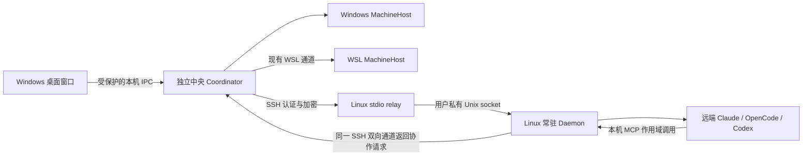

# I06：SSH 跨设备连接、常驻后台与节点图

> 当前状态（2026-10-12）：这是 I06 的提案/设计/验收目标基线，不是通过报告。I06A 主链路已经开发，Windows 准出仍未完成；完整当前说明见 [整体资料](../../README.md)和[模块目录](../../module-plan.md)，实施差异与证据见 [开发记录](development.md) / [进度核对](progress.md)。

日期：2026-10-10。状态：用户已同意 SSH 接入架构，并要求编写完整设计、安排到下一迭代开发和验收。本轮交付设计文档与开发计划；I06 产品代码、远端部署和验收尚未开始。目标版本为 Windows 0.6.0，实际发布日期以验收结果为准。

## 1. 一次迭代要交付的结果

用户打开 Windows AgentBridge，输入 Linux 服务器的地址、SSH 用户名及密码或密钥，即可检测、准备并连接远端 AgentBridge daemon，看到该机器上的实际 Agent 工具。在机器分组的节点图上指定主 Agent、拖拽端点连接子 Agent，提交一次需求，得到跨物理设备的真实子任务及主 Agent 汇总。

不要求用户配置第二套机器账号、接入码或设备 Token；不要求绑定项目目录、选择模型或供应商；日常运行不要求保持两个终端。执行任务时可以指定目标机器上的工作目录，原生登录、模型与权限仍由目标工具管理。

## 2. 基线与当前差距

基线是 [I05 / Windows 0.5.0 验收报告](../I05/acceptance.md)。它已实现机器下的工具节点、一个主节点与多个允许子节点、原生会话和真实 Windows ↔ WSL 协作。

| 当前实现 | I06 必须补齐 |
| --- | --- |
| Windows 本机和 WSL 发行版扫描；同一物理宿主 | 通过 SSH 接入另一台物理 Linux 服务器，并独立记录环境证据 |
| `AgentNetwork` 由 Electron 主进程创建 | 抽离持久中央协调后台；关闭窗口不结束协调和 SSH 连接 |
| `HostConnection` 用本机/WSL 子进程标准输入输出交换 JSON | 增加 SSH 传输、远端常驻 daemon、标准输入输出 relay 和身份/版本握手 |
| 协作后台允许不同 `machineId`，但没有远端通信实现 | 双向真实调用：Windows 主 → Linux 子、Linux 主 → Windows 子 |
| 机器筛选、主节点、会话目标使用下拉框 | 机器分组节点画布、点击节点设主/选目标、拖拽端点连线 |
| 关闭窗口不直接取消已分离的原生任务 | 进一步保证中央协调、远端 daemon 与 SSH relay 的生命周期互相独立 |

Windows Codex 的账户模型拒绝和 WSL Codex 的原生续聊限制仍按 I05 保留；不通过替换模型或另建会话伪造成功。

## 3. 已确定的架构

1. **中央部署**：I06 默认只交付 Windows 用户态独立 Coordinator。桌面自动启动或复用自己的后台，通过本机 IPC 管理，不开放中央公网端口。中央部署到常驻 Linux/云服务器是后续增量，不在本轮暗含实现。
2. **远端部署**：Linux 必须运行 AgentBridge daemon。SSH 是认证、安装与传输方式，不代替远端执行后台。首次接入自动检测，向用户展示 Bridge 安装位置和操作摘要后，由“安装并连接”这个动作完成授权；已安装兼容版本直接连接。
3. **连接方向**：Windows Coordinator 主动连 Linux SSH 服务；daemon 不主动寻找 Windows 公网地址。所需网络条件是 Windows 能访问目标 SSH 端口；VPN/跳板网络由操作者先准备。
4. **认证**：复用 SSH 密码、私钥或 ssh-agent。第一次未知服务器指纹需要确认；已信任指纹自动核对，变化时阻止连接。无新增用户可配置的机器配对码或设备 Token。本机 MCP 私有令牌继续绑定任务作用域，属于内部调用约束。
5. **执行与身份**：daemon 运行于 SSH 登录用户的权限范围；节点来自该用户真实安装的工具。机器身份是稳定执行环境身份，不能把用户态 UUID 当作不可伪造的硬件身份。同一物理服务器的不同用户属于不同执行域。
6. **协作角色**：主 Agent 可位于 Windows、WSL 或已接入 Linux；后台负责路由和授权，不拥有推理模型。远端主 Agent 的 MCP 回调必须沿 SSH 返回中央，再到它允许的子节点。
7. **故障原则**：连接中断不代表任务失败；未知执行保留占位，先查询原请求，不自动补发原生 Prompt。关闭窗口、断开机器、停止后台、取消任务是不同操作。

## 4. 模块文档与功能范围

| 模块 | 功能 | 完整文档 |
| --- | --- | --- |
| 需求基线 | 所有功能编号、业务规则、范围边界与通过条件 | [requirements.md](requirements.md) |
| SSH / Daemon / Coordinator | 地址与认证、凭据、主机身份、远端安装、持久后台、协议、恢复与代码迁移 | [ssh-design.md](ssh-design.md) |
| 节点图 / 桌面交互 | 机器分组、主从端点、选执行目标、布局、修订冲突、状态和接入表单 | [graph-design.md](graph-design.md) |
| 开发排期 | 可验收增量、模块任务、依赖、源码落点和退出条件 | [development.md](development.md) |
| 测试与人工验收 | 合约/SSH/真实 Agent/最终 EXE 四层证据、故障点、验收步骤与指标 | [testing.md](testing.md) |

本轮只覆盖 Linux SSH 执行端，基础支持目标为 Linux x64；必须记录实际验证的发行版、Node、工具与 SSH 服务版本，不能泛称所有 Linux 发行版通过。ARM64、容器、Kubernetes、Windows 远端 SSH 执行端不作为本轮必交项。

## 5. 开发增量与可验收交付

### I06A：中央后台与 Linux SSH 节点接入

交付：独立 Windows Coordinator；密码/密钥/ssh-agent 接入；主机指纹；远端环境检查、用户态安装、daemon 启动/复用；机器与节点注册；直接新会话和原生续聊；版本与来源校验。

退出条件：最终桌面开发包从空 Bridge 配置接入至少一台独立物理 Linux；不需要第二终端；扫描推理次数为 0；机器/节点反复连接后无重复；新会话和同原生 Session 的续聊实际成功；关闭窗口和断开 SSH 不杀远端执行。另以受控 CLI 夹具验证密码/密钥失败与缺依赖等分支。

### I06B：节点图与双向跨设备协作

交付：替换机器、主从和会话目标选择下拉框；机器分组画布；节点拖动、端点连线、删除边、设主与布局保存；真实后台授权保存；跨物理设备双向 MCP 委派与主会话汇总。

退出条件：实际鼠标拖拽创建/删除关系，重开后布局与权限一致；不同机器之间可连线；未授权/self/伪造来源等调用成功数为 0。Windows Claude → Linux OpenCode → Windows Claude、Linux OpenCode → Windows Claude → Linux OpenCode 各至少一条真实链，必须有子原生任务与父汇总证据。

### I06C：故障恢复、可安装交付与最终验收

交付：请求/控制去重、连接代次与对账、未知状态、凭据与安装错误、人类可读状态、忙时延期升级、迁移、Linux 包和 Windows 便携 EXE、操作与排障说明。

退出条件：十次并发同请求只触发一次原生执行；断网、丢回执、中央/daemon 重启与窗口重开无自动 Prompt 重放；单机异常不阻塞其他机器；旧历史和关系无错配/丢失；最终安装包与真实跨设备环境复验通过，测试层级明确。

I06A、B、C 是同一迭代的三个验收增量，不是三个可以分别冒充完整跨设备交付的版本。只有最终准出条件满足，才能发布“SSH 跨设备协作已交付”。

## 6. 主要指标

| 指标 | 目标与测量口径 |
| --- | --- |
| 用户操作 | 无额外机器接入码/Token；节点接入必需项目、模型、供应商字段数 = 0；日常必需额外终端数 = 0 |
| 真实设备 | 至少 Windows + 独立物理 Linux；WSL 只作为回归环境，不算第二台物理设备 |
| 身份与权限 | 重连产生重复机器/节点数 = 0；跨机器任务/会话错配 = 0；越权执行数 = 0 |
| 重复执行 | 同目标、同请求 ID、同内容并发 10 次，原生执行次数 = 1；同 ID 不同内容拒绝 |
| 恢复 | 已投递未知执行自动重放数 = 0；历史丢失数 = 0；取消/回复与原生效果分别确认 |
| 节点图 | 鼠标端点连线和删除、节点拖动和重开恢复全部通过；旧下拉主从选择不作为交付入口 |
| 图交互响应 | 20 机器组/60 节点夹具、至少20条真实输入样本，首反馈 p95 ≤100ms，连续拖动无超过500ms主线程卡顿；记录验收机硬件与窗口 |
| 状态同步 | 受控 LAN、已建立连接、无模型调用/安装/握手的 20 个状态变化样本，界面同步 p95 ≤ 2 秒 |
| 失联与重连 | 应用心跳 5 秒；连续 15 秒无有效回应标记来源失联；受控 LAN 恢复且凭据可用后 30 秒内重连并开始原 ID 对账 |
| 安装和推理 | 记录实际耗时与错误，不承诺公网下载、SSH 初次握手或模型推理的固定 SLA；等待用户输入密码不计自动重连窗口 |

性能值是 I06 的验收目标，当前没有 I06 实测数据。

## 7. 本轮不做与外部条件

不做设备配对码/账号系统、远端开放 AgentBridge HTTP 服务、公网穿透/自动防火墙修改、跳板配置向导、多主/多组/递归协作、文件同步/自动 Git 推送、模型供应商管理、Webhook/IM 接入。原计划中 Webhook、HTTP/JSONL 示例及通用外部入口移入后续迭代候选，不与 I06 混合验收。

开发和合约测试可以独立推进；真实跨设备验收需要操作者提供已授权 SSH 访问的独立 Linux 环境，并在目标用户下安装、登录至少一个可实际回复的 Agent。当前没有登记真实远端服务器，不虚构地址或凭据，不把缺环境写作功能通过。

主机指纹确认、首次 Bridge 安装摘要和原生文件权限回复均有具体对象与目的；不恢复逐项确认名称、目录、模型、供应商、是否启用等旧向导。

## 8. 参考与采用边界

Multica 的 [Daemon and runtimes](https://github.com/multica-ai/multica/blob/main/apps/docs/content/docs/daemon-runtimes.mdx) 采用每台执行机器运行 daemon 的组织方式；其 [CLI 与 Daemon 指南](https://github.com/multica-ai/multica/blob/main/CLI_AND_DAEMON.md) 说明 daemon 注册工具、领取任务、发送心跳。我们采用“中央协调 + 每机后台”的职责划分，但按本次用户选择使用 Windows 主动建立 SSH，而非复制 Multica 的云端登录/设备 Token 和 daemon 出站 WebSocket 模式。

SSH 身份、主机密钥与远端命令基础见 [OpenSSH ssh 手册](https://man.openbsd.org/ssh.1)、[ssh_config 手册](https://man.openbsd.org/ssh_config.5)。具体实现取舍和密码输入支持在 SSH 模块文档说明，不能把本轮设计图当作已有运行证据。
