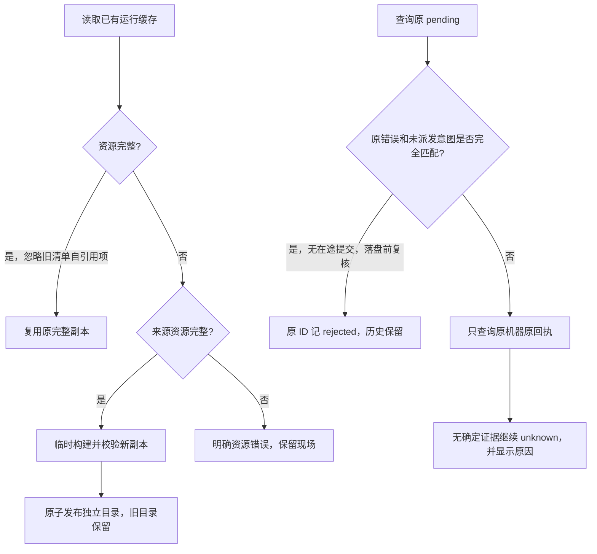

# I06 Windows 运行缓存与原提交恢复

日期：2026-10-14。源码候选 **0.6.0-alpha.18**，基于工作区已有 alpha.17 维护优化。关联 I06-FIX-RUNTIME-01、AB-F07/11/17、M01-F07、M02-F04/F06、M03-F04/F06、M06-OC-F01、M07-F06/F07、M10-F05/F06。完整 I06C 和正式 0.6.0 仍未准出；本次未发布 GitHub 附件、未修改用户生产 profile。

## 需求与实际根因

用户报告：alpha.9 / Windows / OpenCode 主 Agent，提交需求后提示一个未确认操作，任务看板没有记录，查询原请求没有反馈。原 pending 错误为 `CLAUDE_RUNTIME_INVALID`，提示已保存的后台运行资源不完整。

合成目录实际复现：Coordinator 先缓存 Electron，再由该缓存复制 Windows 子后台资源。旧 workerRuntime 将来源的 runtime.json 收入 files，随后覆盖目标 runtime.json；下一次校验时清单自身大小不一致，抛出上述历史前缀的共享资源错误。本次复现确认此机制，[修改前原始复现](../../../artifacts/runtime-recovery/2026-10-14/reproduction.json)已保留；不宣称已读取用户新电脑的全部缓存文件。

提交台账在创建上下文前写入；Windows OpenCode 在创建子后台前调用 workerRuntime，此时失败尚未派发本轮需求。alpha.9 的错误分类遗漏该边界，留下 unknown；原任务不存在时，仅查询原生任务不能解决这条记录。

## 需求与实现

| 要求 | 最终行为 |
| --- | --- |
| R01 嵌套复制稳定 | 不复制/追踪 runtime.json 和临时日志，新清单 version=2，逐文件 size+SHA-256；兼容旧清单但仅忽略清单自身 |
| R02 保留活动资源 | 其他资源损坏时验证可用来源，在临时目录完整构建并原子发布独立 repair 目录；旧目录不覆盖、不删除。后续优先复用完整缓存，来源清理后仍可运行 |
| R03 旧 unknown 精确恢复 | 仅原 Windows OpenCode submit，原错误为明确的共享资源 INVALID/MISSING，原机器/节点/ID/内容指纹完全对应，原 intent.dispatched===false、无 Task/Conversation 绑定且节点无在途提交，才返回 rejected |
| R04 防并发与防重放 | 落盘前再次检查未派发证据及原台账时间/内容；已派发、无原记录、来源/内容变化或证据不足继续 unknown，不发新 Prompt、不换 ID/节点/目录 |
| R05 新错误准确分类 | 同一正面证据确认本次准备资源失败时，直接保存 rejected；不把所有同名错误或一次 not_found 当作未执行证明 |
| R06 查询可见 | recoverPending 在原 resolved 外增加 remaining/items，原因固定且脱敏；界面显示查询中、核对数量、未确认数量和原查询原因。兼容旧后台缺少扩展字段的回复 |

## 代码与数据边界

- [worker-runtime.cjs](../../../desktop/electron/worker-runtime.cjs)：共享 Electron 资源准备，历史 CLAUDE 错误前缀兼容保留；未改变原生账号、模型或权限配置。
- [agent-network.cjs](../../../desktop/electron/agent-network.cjs)：只读 undispatchedRejection，复用原请求指纹；[coordinator-service.cjs](../../../desktop/electron/coordinator-service.cjs)在原台账上核对与落盘，不迁移原请求。
- [pending-journal.cjs](../../../desktop/electron/pending-journal.cjs)：原回执恢复及固定错误原因；[NetworkApp.tsx](../../../desktop/src/NetworkApp.tsx)呈现查询反馈，不展示 Prompt、内部身份或远端原始错误正文。
- runtime.json 新增 version=2 和 files[].sha256。旧无 version 清单仅 size 校验，兼容自引用项；这不是对旧缓存补做过密码学验证。新缓存使用强摘要，但 Coordinator 的代码缓存摘要仍未覆盖全部依赖，不能由运行缓存通过推定整包准出。
- pending.json / agent-network.json 的结构版本保持不变；原请求从 unknown 对账为 rejected 并保留 reconciledAt/原 ID/原参数。recoverPending 增量字段仅用于本地 IPC，不改变远端 daemon 协议 2。
- alpha.18 收录的 alpha.17 可信 daemon 清单先与冻结包报告规范 JSON digest 核对。已有服务器仅复用，不自动升级；工作区原 alpha.17 SSH 改动保留。

## 实际验证与边界

2026-10-14 / WSL Ubuntu / Node 22.23.1：定向回归 **55/55**，桌面全量 **176/176**，根核心 **43/43**，lint、根类型检查、桌面类型检查与构建通过。新专项均为受控文件/宿主/并发测试，不调用模型。原始证据：[定向](../../../artifacts/runtime-recovery/2026-10-14/targeted.tap)、[桌面](../../../artifacts/runtime-recovery/2026-10-14/desktop-tests.tap)、[核心](../../../artifacts/runtime-recovery/2026-10-14/root-tests.tap)、[构建](../../../artifacts/runtime-recovery/2026-10-14/build.log)、[lint](../../../artifacts/runtime-recovery/2026-10-14/lint.log)、[类型](../../../artifacts/runtime-recovery/2026-10-14/typecheck.log)。定向计数包含在全桌面内，不额外相加。

Windows 当前专项均已实际运行：

| 环境与证据层级 | 实际结果 | 原始证据 |
| --- | --- | --- |
| Windows / Electron 44.7.0 内置 Node 24.21.0 / 真实运行资源、合成旧缓存 | 嵌套复制重复启动、alpha.9 原清单不改写兼容、ICU 损坏旁路重建并实际执行、来源清理后再执行，共 4 组通过；模型 0 | [资源报告](../../../artifacts/runtime-recovery/2026-10-14/windows-runtime.json)、[脚本](../../../desktop/tests/windows-runtime-recovery.cjs) |
| Windows Edge / 生产前端、受控 API | 未解决显示数量与原因、旧后台缺字段提示、解决后清除且无 Prompt/控制重放，共 3 组通过 | [界面报告](../../../artifacts/runtime-recovery/2026-10-14/ui.json)、[脚本](../../../desktop/tests/windows-runtime-recovery-ui.cjs) |
| Windows 普通 alpha.18 portable EXE / 独立 profile、合成 alpha.9 原意图 | 实际普通无调试窗口自动核对原未派发记录为 rejected、冻结源码一致、关闭保留同 Coordinator、重开历史保留无新请求/委派，共 4 组通过 | [普通 EXE](../../../artifacts/runtime-recovery/2026-10-14/portable.json)、[脚本](../../../desktop/tests/windows-runtime-recovery-portable.cjs) |
| WSL 构建 Windows x64 portable / app.asar/后台/前端/离线资源 | 28 个后台模块、1383 个 Linux 文件、版本与当前源码匹配，portable 校验通过 | [包报告](../../../artifacts/runtime-recovery/2026-10-14/package.json)、[构建日志](../../../artifacts/runtime-recovery/2026-10-14/package-build.log) |

Windows 中的原意图、旧缓存与查询响应为隔离受控数据；Electron/ICU 执行、Edge 渲染和普通 EXE 生命周期为真实 Windows 进程，不冒充用户新电脑或真实模型回复。首次界面驱动未提供合法 graphLayout，导致受控页面失效；已保存 [驱动失败](../../../artifacts/runtime-recovery/2026-10-14/ui-initial-driver-failed.json)，补齐夹具后重验，不修改产品逻辑来绕过。

本次未在用户那台新电脑上复测，未提交真实 OpenCode 模型需求，未重跑 SSH/原生协作全矩阵。旧服务器文件任务及其他 unknown 不由本次缓存修复解除。

## 使用与升级

在旧程序“设置 → 后台运行 → 停止后台并退出”，再启动新 EXE，以加载新冻结代码；普通关闭窗口会保留旧后台。已有节点、机器、会话、原请求和历史保留。符合上述未派发证据的旧操作在查询后记为明确拒绝；资源完整后可由用户发起新的需求，不自动重发旧命令。证据不足的记录继续保持 unknown 并显示查询原因。无需用户删除缓存、编辑 pending.json、安装 Node/WSL 或重新配置模型。

## 候选程序

[AgentBridge-0.6.0-alpha.18-Windows-x64.exe](../../../desktop/release/AgentBridge-0.6.0-alpha.18-Windows-x64.exe)，129,851,140 字节，SHA-256 `2d532ca797e49094314587fcbfa286c9fb58f41374b05f8d21dce0246ee3bc33`。本地候选已生成与核验，未上传 GitHub Release。本次文档检查见 [日志](../../../artifacts/runtime-recovery/2026-10-14/docs-check.log)，整体验证仍保留 I06C 未准出边界。
