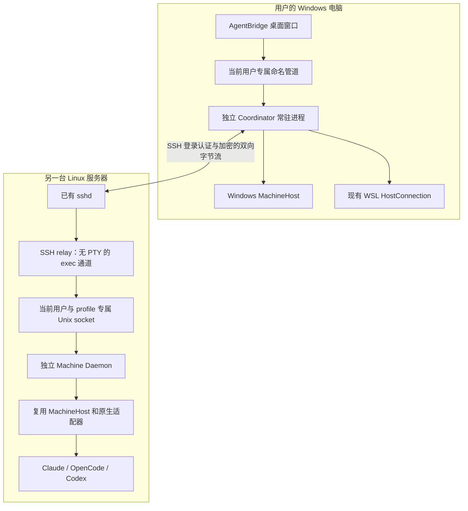
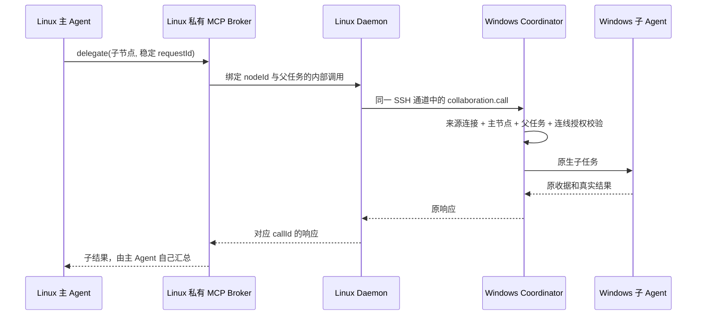

# I06：SSH 跨设备连接与机器 Daemon 设计

> 当前状态（2026-10-12）：这是 I06 的提案/设计/验收目标基线，不是通过报告。I06A 主链路已经开发，Windows 准出仍未完成；完整当前说明见 [整体资料](../../README.md)和[模块目录](../../module-plan.md)，实施差异与证据见 [开发记录](development.md) / [进度核对](progress.md)。

> 实施差异：当前采用单 ustar+gzip 归档和流水线上传，私有 Node 位于版本包的 `runtime/node`；事件游标过期补偿存在字段不一致。源码行为和未完成项分别在 M04/M05 设计与测试报告维护，不把下文计划路径与 API 当作全部已实现。


日期：2026-10-10。状态：下一迭代设计基线，尚未开发或验收。用户已确认采用 SSH 登录接入远端 Linux；没有额外接入码、设备 Token 注册流程。迭代范围、开发顺序与发布门槛由本目录的提案和验收计划统一管理。

关联文档：[迭代提案](proposal.md)、[功能需求](requirements.md)、[节点图设计](graph-design.md)、[开发计划](development.md)、[测试与验收计划](testing.md)。

## 1. 交付目标与边界

用户在 Windows AgentBridge 中添加 Linux 服务器，填写 IP/域名、用户名，以及密码或已有 SSH 密钥。默认端口 22，自定义端口放在展开的连接设置中。程序验证服务器身份，检查环境，把 AgentBridge 的后台安装到该用户目录并启动，然后展示这台机器上的 Agent 节点。用户不必手工维护一个 SSH 终端，也不需要配置模型、供应商和项目目录。

首次发现远端未安装 Bridge 时，检测结果给出安装版本、目标目录、所需运行时和权限摘要，由一个“安装并连接”动作完成后续部署。该摘要与主机指纹确认有明确对象，不恢复旧版逐项确认目录/模型/供应商的向导。已安装兼容后台直接连接；只有摘要实际变化才重新审核，自动重连不重复弹出安装确认。

SSH 完成远端用户认证和加密传输；远端仍必须安装并运行 Machine Daemon。中央协调后台运行在 Windows，负责机器目录、节点授权、任务路由、请求记录和协作回调。Daemon 负责远端本机的工具发现、私有执行上下文、原生任务及持久状态。桌面窗口是中央后台的客户端。

本模块不把知道 SSH 用户密码等同于拥有 Agent 原生账号：远端 Claude、OpenCode、Codex 必须在该 SSH 用户下安装并完成原生登录。发现工具只证明安装入口可启动，真实模型回复单独验证。Bridge 不在连接时登录原生工具、覆盖模型、写原生账户配置或替用户接受 Agent 的文件操作权限。

本迭代支持可直接到达的 Linux SSH 服务。不会为 Bridge 开放远端公网 HTTP/WebSocket 监听端口。跳板链、任意 `ProxyCommand`、远程 Windows、机器间自动文件同步、多中央集群调度另行排期。已有 `.ssh/config` 可以作为连接信息的只读来源，但仅导入可明确解析的 `HostName`、`User`、`Port`、`IdentityFile`；复杂规则必须显示尚不支持，不能忽略后直接连接错误目标。

## 2. 组件与部署



| 组件 | 持有的状态 | 生命周期与权限 |
| --- | --- | --- |
| Desktop Client | 页面草稿、布局、连接输入、临时交互答案 | 关闭窗口不停止协调后台；渲染层没有 SSH 私钥读取或远端执行能力 |
| Coordinator | `coordinatorId`、机器/节点目录、连接配置、关系修订、委派和未确认请求 | Windows 当前用户的独立后台；独占状态锁；只接受当前用户的本地 IPC |
| SSH Transport | 已验证的主机密钥、SSH 会话、relay 通道、在途 RPC | Coordinator 创建和重连；不得依赖窗口对象或便携解压目录 |
| Remote relay | 帧解析及用户 socket 转发 | 每次 SSH 通道创建；断开即退出；不拥有原生任务，不在退出时发送停止命令 |
| Machine Daemon | 安装身份、工具目录、任务和收据、事件游标、MCP 作用域描述 | 远端当前用户 × Bridge profile 常驻；仅监听所属 profile 的私有 Unix socket；不依赖 SSH 通道存活 |
| 原生执行后台 | 原生 Session、权限等待、输出、原生进程拥有权 | 复用 I05 的真实适配；受 Daemon 管理但不因观察者离线自动取消 |

中央协调后台不是主 Agent，也没有自己的推理模型。用户指定的主节点可以在 Windows、WSL 或远端 Linux。连线存的是“允许委派给哪些子节点”，通信路径始终经过 Coordinator。

Windows 本地 IPC 使用当前用户/profile 专属命名管道、独占锁和服务 hello；显式限制访问 ACL，仅当前用户和必要系统管理身份可访问。管道名和 PID 不是授权凭据。检查 DACL/服务身份失败时停止接入，不能回退到无保护的 localhost HTTP。Electron 的 sender/mainFrame 校验继续保留；页面不能绕过它直接调用 credential 或 SSH 安装接口。

### 2.1 当前代码需要明确调整的边界

0.5.0 的 `AgentNetwork` 由 Electron `main.cjs` 创建；`window-all-closed` 退出应用，`before-quit` 调用 `host.close()`。部分原生 worker 已能脱离窗口，但中央协作路由并没有独立常驻。因此“关闭窗口后远端主 Agent 仍能发现子 Agent 和获取结果”必须作为 I06 的新交付，不能把旧 worker 常驻当成已经完成。独立 Coordinator 迁移并复用 I05 的 `AgentNetwork`、目录、请求和委派记录；不另外启动旧 `src/hub.ts` 的另一套数据库充当中央，避免同一任务落到两个不兼容状态体系。

`rpc.cjs` 目前只启动本地 Node 或 `wsl.exe`，使用换行 JSON 和 65 秒响应超时，没有 SSH、协议握手、传输心跳或事件恢复。I06 新增 SSH Transport 与通用 RPC 编解码层；现有本机/WSL 路径保持兼容，迁移后由 Coordinator 统一创建。

## 3. 功能需求

| 需求 ID | 可交付功能 | 完成条件 |
| --- | --- | --- |
| I06-SSH-01 | 添加直连 Linux SSH 机器 | 地址、用户、密码/密钥/ssh-agent、端口可使用；所有失败定位到具体步骤，已有机器继续可用 |
| I06-SSH-02 | 主机密钥校验与首次信任 | 可信记录自动验证；首次明确确认指纹；密钥变化硬失败；拒绝无校验连接 |
| I06-SSH-03 | 凭据安全管理 | 密码/解密口令隐藏输入，可选择保存；配置仅保留凭据引用；不保存时重连进入待输入 |
| I06-SSH-04 | SSH 加密双向 RPC 与连接代际 | 无 PTY 通道支持请求、结果、状态事件和远端主 Agent 的协作回调；旧连接迟到消息不污染重连；没有额外网络服务端口 |
| I06-DMN-01 | 自动环境检测 | 校验 Linux/架构、Node、空间和目录拥有权；无原生 Prompt；缺依赖有可执行提示 |
| I06-DMN-02 | 用户态可校验安装 | 校验发布包并原子发布；不用 sudo；不覆盖非 Bridge 目录或原生配置 |
| I06-DMN-03 | 常驻、资源拥有权及管理边界 | SSH 断开和窗口关闭后保留已接收任务；独占用户 socket；停止/卸载检查任务和拥有权，不杀其他工具或共享服务 |
| I06-DMN-04 | 稳定远端身份与协议握手 | 用户作用域 UUID、UID、协议和版本真实上报；重复接入无重复机器/节点；身份变化不接管旧记录 |
| I06-DMN-05 | 安全升级与回滚 | 版本目录原子发布；在途任务不因升级被杀；失败可回到上一版本，历史保持可读 |
| I06-NET-01 | 独立中央后台 | 迁移 I05 的 AgentNetwork 与现有状态；桌面只通过受保护本地 IPC 连接；关窗后路由继续 |
| I06-NET-02 | 目录与来源路由 | 来源绑定连接；远端目录在远端校验；改地址不迁移任务；节点继承远端原生配置 |
| I06-NET-03 | 双向真实协作 | 本地 MCP 回调经 SSH 返回中央；远端主 Agent 能委派 Windows 子节点，后台持续校验 allowlist |
| I06-REC-01 | 执行意图和去重 | 两端执行前持久化稳定 ID；重复相同提交只返回原执行；未知请求不补发 |
| I06-REC-02 | 控制与关系保存收据 | 取消/权限回应独立 operationId 与原执行绑定；关系保存 operationId 与 revision 原子落盘；回执丢失只读核对 |
| I06-REC-03 | 断线与状态恢复 | 心跳识别断线、退避重连、原收据和事件游标补读；认证/密钥问题停止自动重试 |

详细用例、故障注入与证据要求见迭代验收计划；本表只定义本模块交付，不表示当前已有实现。

## 4. SSH 登录与服务器身份

### 4.1 客户端实现选择

采用 Node `ssh2` 作为 SSH 客户端，统一实现密码、私钥、ssh-agent、SFTP 和 `exec` 通道。密码和私钥解密口令通过结构化 API 传入，避免 `sshpass`、命令参数、环境变量密码和解析终端提示。官方客户端 API 提供上述认证输入、异步 `hostVerifier`、加密通道 keepalive；**未设置 `hostVerifier` 时会自动接受服务器密钥，因此 Bridge 必须始终显式设置校验函数**。[ssh2 官方 API](https://github.com/mscdex/ssh2#client)

这是计划新增依赖，当前项目尚未安装或验证。开发最先做最小兼容验证：固定 lockfile 版本在 Windows Electron/独立 Node 中加载、password、加密 OpenSSH 私钥、Windows OpenSSH ssh-agent 命名管道、拒绝/异步确认 hostVerifier、SFTP 和无 PTY 的双向 exec。所有协议和保护行为有合约测试；Windows agent管道或密钥格式兼容未通过时不得先把界面标记支持。不能以开发机 Linux 上能调用库代替 Windows 打包兼容验收。

仅允许库维护的安全算法集合；连接老服务器失败时显示协商错误，不静默启用弱算法。默认关闭 agent forwarding、X11、任意端口转发和 PTY。ssh-agent 仅在本机为这次 SSH 用户认证签名，不转发到 Linux。OpenSSH 文档也明确区分本机 Agent 认证与把 Agent 转发给远端。[OpenSSH ssh](https://man.openbsd.org/ssh.1)

密码认证失败后不无限重复同一密码，不自动把密码作为其他交互问题答案。I06 支持普通 password 和密钥认证；服务器强制改密、复杂 keyboard-interactive/MFA 时返回 `SSH_INTERACTIVE_REQUIRED` 并给出原生 SSH 处理指引，不能假装已支持无人值守登录。

### 4.2 主机密钥信任

校验键为规范化 `host + port`，记录服务器公钥类型、公钥内容和 SHA-256 指纹。非默认端口必须单独记录，域名连接与直接 IP 不擅自合并信任。优先读取当前用户可信的 OpenSSH `known_hosts`，支持标准公钥记录、哈希主机名和撤销记录；不能解析的 CA/复杂记录返回明确诊断，不按“未找到”自动放行。

首次无可信记录时展示地址、端口、密钥类型和指纹，用户确认后存入 Bridge 私有信任库，不修改已有全局 `known_hosts`。此确认是 SSH 的服务器身份校验，不是额外接入码。用户取消时不能继续认证、安装或执行。已有记录不再要求逐次确认。

密钥变化时返回 `SSH_HOST_KEY_CHANGED`，拒绝登录和上传，展示旧/新指纹；在用户核实服务器重装等原因并主动更新信任前不自动重连。无 `StrictHostKeyChecking=no`、自动接受变更或“忽略本次错误”入口。该行为采用 OpenSSH 的首次询问、后续拒绝变化原则。[OpenSSH 主机密钥校验](https://man.openbsd.org/ssh_config.5#StrictHostKeyChecking)

### 4.3 密码、私钥与 ssh-agent

- 密码和私钥口令在页面隐藏输入。Renderer 只用于一次提交，不在页面状态持久化、任务记录、遥测或错误文本中留存；Main 验证当前主页面后立即转给 Coordinator 的凭据专用接口。
- 默认不保存密码。未保存时仅为当前握手持有临时认证输入；握手结束后不再留作新的认证，SSH 断开需重新认证或 Coordinator 重启后进入 `needs_credentials`。窗口已关闭且需要新密码时停止重试，直到用户重新打开窗口输入。程序解除引用与可控 Buffer 清理不承诺 JavaScript 对象可被可靠抹除；检查边界是秘密不落盘、没有认证输入日志、后续连接不偷偷复用未保存密码。
- 用户主动选择保存时使用 Windows 当前用户的系统凭据保护；实现可采用 DPAPI 保护的专用私有凭据存储。不得出现明文 JSON 或回退到无加密文件。加密后也不导出到 Linux。普通连接记录只保存 `credentialRef`。
- 私钥默认只保存本机文件路径，读取后只用于 SSH 握手；不上传私钥，不修改 `authorized_keys`。加密私钥口令遵守与密码相同的保存规则。文件移动或不支持的密钥格式显示 `SSH_KEY_UNAVAILABLE`，不能转到其他账户试探。
- 发现本机 ssh-agent 时可以选用；Windows OpenSSH 命名管道和 Unix `SSH_AUTH_SOCK` 分别适配并验证。不可用时引导选择密码或密钥文件，不自动启动或改配系统 Agent。Pageant、硬件密钥等只有明确适配并验收后才标记可用。
- 删除凭据仅删除对应凭据项；保留机器及历史。凭据引用范围与 Coordinator 配置绑定，不允许任务参数、远端通知读取或指定其他凭据。

## 5. 自动检测、安装与启动

### 5.1 固定探测流程

SSH 登录后通过无 PTY 的固定探测命令读取 `uname -s`、`uname -m`、UID、用户名、真实 HOME、可用磁盘空间和 Node 候选入口；探测输出限 64 KiB、超时 15 秒。只读取环境，不触发原生 Agent Prompt。用户名、路径和版本作为数据解析，不 `eval` 输出。

SSH exec 通常由远端用户 shell 解释命令，参数数组不能自动保护远端命令；OpenSSH 的远端命令也是串接后交给远端执行。[OpenSSH 远端命令](https://man.openbsd.org/ssh.1#DESCRIPTION) 因此：

1. 地址/端口/用户名只传 SSH 连接 API，不拼接本地 shell。
2. 探测使用固定 `/bin/sh -s` 脚本或固定命令，动态配置由有长度限制的 JSON 输入传递；文件上传使用 SFTP 结构化路径。
3. 必须出现在远端命令中的受控路径采用完整 POSIX 单引号编码，拒绝 NUL、换行和无法规范化的路径；禁止直接拼接 workspace、Prompt、用户名或可执行入口。
4. Agent 执行统一在 Daemon 中使用 `spawn(executable, args, {shell:false})`；Prompt 通过 stdin/原生结构化 API，工作目录单独传 `cwd`。
5. bootstrap stdout 与正式 RPC 分开；shell 启动脚本输出污染协议时明确报 `SSH_BOOTSTRAP_OUTPUT`，不搜索任意魔法行后忽略其他字节。

### 5.2 目录和依赖

默认安装目录 `${HOME}/.local/share/agentbridge/profiles/<profileId>/`，状态目录 `${XDG_STATE_HOME:-HOME/.local/state}/agentbridge/profiles/<profileId>/`。profileId 由持久 coordinatorId 和中央 profile 派生为固定长度的安全标识，不是接入密钥，不需要用户输入。每个 SSH 用户 × Bridge profile 拥有独立 Daemon、锁、收据和上下文，日常与验收 profile 不争抢目录；同一中央 profile 的地址别名经可信身份核对后归并同一 Daemon。目录位于登录用户 HOME，权限目录 0700、敏感文件 0600；不从 Windows 同名路径推断远端目录。socket 使用该 profile 独有的短路径并检查 Unix socket 长度限制。

```text
~/.local/share/agentbridge/profiles/<profileId>/
  install.json                 # 所属产品、安装身份、版本、文件校验摘要
  runtime/<node-version-arch>/  # 缺少合适 Node 时的 Bridge 私有运行时
  versions/<daemon-version>/   # 只读发布内容与完整依赖
  current.json                 # 原子写入的活动版本指针
~/.local/state/agentbridge/profiles/<profileId>/
  machine.json                 # 用户 × profile 作用域 daemonId、ownerCoordinatorId
  daemon.sock                  # 当前用户专属；验证拥有权与服务身份
  daemon.lock / daemon.pid
  node-contexts/                # 复用 I05 的原生执行上下文
  receipts/、events/、logs/     # 原请求、事件游标与受控日志
```

I06 发布支持基线为 Linux x86_64 的 glibc 环境；具体最小 glibc 版本以所发布 Node 构建的兼容清单固定，不以探测到“Linux”就宣称支持。arm64 只有提供并单独验收对应发布包后才列为支持，不能将设计保留架构字段等同于已交付。musl/Alpine、32 位或未知架构停止自动安装并提示限制。

优先使用该用户已有 Node ≥ 22.13，检测固定系统路径及常用 fnm/nvm 安装目录，不执行任意 shell 初始化文件。工具扫描也读取常见安装位置；非交互 SSH 的 PATH 与用户终端不同，未找到时允许用户提供原生工具入口，然后在远端验证。不能因为 PATH 差异把已安装 Agent 判为不存在后自动覆盖安装。

没有合适 Node 时自动部署随正式客户端发布或由正式发布源校验取得的私有 Node 运行时；不执行远端 `curl | sh`、`npm install`、sudo，也不依赖远端可访问 npm。离线包包含 daemon 编译产物、生产依赖、版本/协议兼容清单和逐文件摘要。Windows 从自身可信资源清单取预期摘要，SFTP 上传到 staging，远端重新计算校验后发布；只从同一不可信下载地址读取包和摘要不能算来源验证。若没有目标架构包，则给出缺少包的失败，不安装错误二进制。

已有目录必须有 Bridge 标记并属于登录用户。碰到非 Bridge 文件、符号链接逃逸、其他 UID 所有权、非法父目录或已占用的非 socket 文件时停止，不覆盖/删除。安装不改 `/etc`、shell profile、原生 CLI 配置、供应商账号、项目目录和 SSH 服务配置。

### 5.3 启动与服务拥有权

安装器先连接已有 socket 查询 `kind/protocolVersion/daemonId/UID/目录/版本`，全一致才复用。不能依据 PID 文件直接接管进程或按名称 `pkill node/opencode`。不存在服务时竞争独占状态锁，再启动唯一 Daemon；启动失败保留诊断，不反复创建实例。

远端优先使用已可用的用户级 systemd 服务；无需 sudo，不自动启用 linger 或修改系统级服务。没有用户 service manager 时采用完全脱离 SSH session 的 detached 进程，stdin 为 ignore，stdout/stderr 进入受控日志，确保 relay 不是父生命周期依赖。服务器若配置 logout 时清理用户进程且没有可用用户服务，则不能宣称常驻成功，显示 `DAEMON_PERSISTENCE_UNAVAILABLE` 及管理员需处理的运行条件。

I06 要求退出 SSH 和关闭窗口后的持续执行；不承诺服务器重启后的无人值守自动启动。重新连接可以检查并启动 Daemon。需要系统启动后常驻但未登录的部署模式、Windows 系统服务、多用户托管单独扩展。

机器身份保存在远端用户 × profile 状态目录中的随机 UUID `daemonId`。同服务器不同 Unix 用户是不同执行身份；同 UID/profile 重新安装且保留状态可恢复同一身份，IP/主机名变更不应生成新机器。不同中央/验收 profile 默认为不同管理域，在页面可展示其来自同一主机但不能合并任务台账。它不读取或把 `/etc/machine-id` 当作授权凭据，也不证明物理硬件唯一性。目录被复制到另一台服务器时，主机密钥/端点与 daemonId 的冲突必须人工核对，不按 UUID 自动接管。

首版每个用户 × profile Daemon 只接受一个活动 Coordinator 的写入拥有者；`coordinatorId/profileId` 是非秘密归属标识，真实权限来自 SSH 用户认证与 socket 的 OS 权限。其他中央默认创建自己的 profile，不能自动接管此 profile；同 profile 已有不同拥有者返回 `DAEMON_OWNER_CONFLICT`。主动改绑需展示原任务/旧拥有者，保留历史，撤销旧连接作用域。拥有相同 SSH 账户的用户本来就能控制该账户文件和进程，Bridge 不声称 profile 能在同一 OS 用户内形成额外安全隔离。

## 6. 协议与通道

### 6.1 传输和握手

SSH 登录后打开无 PTY 的 `exec` relay 通道。relay 只连接当前用户的 Daemon socket并代理完整双向帧，stdout 只发送协议数据，stderr 只发送经过脱敏的 Bridge 诊断。远端原生输出不能直接写入 relay stdout。

首次帧为 `hello`：双方核对 `protocolVersion`、daemon/client 版本范围、`coordinatorId`、`profileId`、`daemonId`、UID、状态目录拥有权及能力。只有身份验证和版本兼容完成才标记机器 online。IP 相同但 daemonId 改变返回 `MACHINE_IDENTITY_CHANGED`；兼容性不成立返回 `PROTOCOL_MISMATCH`，不发送任何执行变更。

Coordinator 先发送绑定本次 SSH 通道的随机 sessionId；Daemon 的 hello 必须回显该值并返回自身实际身份与版本。sessionId 用于关联和 fencing，不替代 SSH 认证，也不作为用户配置的新 Token。监听 socket 同时验证 Linux 文件拥有者与私有目录，relay不连接其他 profile 的服务。

新增的 Coordinator ↔ remote Daemon RPC 采用 4 字节大端无符号长度 + UTF-8 JSON 的帧。读取端先检查长度，再分配和解析；支持任意 TCP/SSH 分片与粘包，UTF-8 解码跨 chunk 不切坏汉字。不能把收齐一帧当成收齐整个原生回答。现有 WSL/leaf 后台仍使用 I05 的换行 JSON，通过 HostConnection 适配层映射到通用调用与回调；不强行让旧原生 controller 或已运行的 worker 改协议。新增帧版本与旧 `desktopHostVersion:1` 分别协商，不把未升级的WSL误判为新Daemon。

```ts
type RpcFrame =
  | { type: 'hello'; protocolVersion: 2; sessionId: string; profileId: string;
      peer: { kind: 'coordinator' | 'daemon'; id: string; version: string };
      environment?: { uid: number; username: string; platform: 'linux';
        arch: string; stateDirectory: string; installDirectory: string };
      capabilities: string[]; lastEventCursor?: string }
  | { type: 'request'; id: string; method: string; params: unknown;
      operationId?: string; deadlineMs: number }
  | { type: 'response'; id: string; result?: unknown;
      error?: { code: string; message: string; retryable: boolean } }
  | { type: 'event'; cursor: string; name: string; payload: unknown }
  | { type: 'ping'; nonce: string } | { type: 'pong'; nonce: string };
```

`id` 是一次传输内关联 ID，`operationId/requestId` 是跨重连的持久操作 ID；两者不能混用。响应必须恰好包含 result/error之一。双方均可发 request，远端 MCP 回调不额外打开反向端口；相互请求的 ID 用不同命名空间，避免覆盖未完成请求。每个连接使用唯一 `sessionId` 并对应递增 generation；pending回调只能由所属generation结束，旧通道在重连后到达的response/event不得更新新的在线状态或收据，业务恢复必须走持久ID读取。

### 6.2 限制与超时

| 项目 | I06 合约 |
| --- | --- |
| 执行需求文本 | 最大 64 KiB UTF-8；避免只按 JS 字符数限制 |
| 单请求帧 | 最大 1 MiB；ID 最大 128 字符；验证方法白名单和严格 schema |
| 单响应/事件帧 | 最大 1 MiB；快照、事件和大结果分页，不能通过扩大总缓冲无限接收 |
| 在途请求 | 每连接最多 64；读写背压队列最大 8 MiB，超过返回明确 busy/limit |
| 登录、hello、元数据读取 | 分别 20 秒、10 秒、15 秒；可在测试中注入短时间值 |
| 普通提交/控制 | 65 秒等收据，不等模型完成；超时后结果未知，不等于执行失败 |
| 协作结果等待 | 最多 45 秒；未完成用原 taskId 再读，不补发执行 |
| 活性检测 | 5 秒 ping/SSH keepalive；连续 15 秒无有效回应标记离线；活跃且经过协议验证的流量可以刷新活性 |
| 自动重连 | 基准退避 1、2、4、8 秒，后续最大 8 秒；每次在基准的 80%～100% 之间作有界随机抖动；认证/密钥/身份/版本错误停止重试 |

SSH 级 keepalive 在加密连接中检查活性；协议心跳同时检查 relay/Daemon 是否响应，不能仅凭 TCP 可连接就显示后台在线。[OpenSSH 活性检测](https://man.openbsd.org/ssh_config.5#ServerAliveInterval)

在受控局域网、网络已恢复且已保存的密码/可用密钥/agent 等凭据可用、不需要人工确认的验收条件下，从链路恢复到原身份完成握手并开始按原 ID 对账不超过 30 秒；重试间隔含抖动不超过 8 秒。SSH 连接、认证、hello 各阶段的实际耗时及大量历史的完整对账耗时分别记录，配置超时不冒充实测耗时。20 个任务状态刷新样本的 p95 ≤ 2 秒，计时从 Daemon 持久状态变化到桌面可见，不含 SSH 初次握手、安装、原生模型推理或网络仍断开的时间。等待用户重新输入未保存密码不计自动恢复窗口；超出条件的实际耗时单独记录，不用排除异常样本冒充指标通过。

工具扫描、安装进度和任务事件通过分页/事件发送，不能堵住权限回应与取消命令。事件仅描述真实后台变化，界面可以批量合并小的流式片段；原始事件与最终回答保留各自语义，不让每个 token 成为一张状态卡。

## 7. 路由、作用域与远端主 Agent

Coordinator 的连接对象在验证 hello 后绑定 `machineId ↔ daemonId ↔ SSH 端点/用户/受信主机密钥`。后续请求和回调来源由连接对象提供；远端 JSON 里的 `machineId`、`leaderId`、用户名不能覆盖该绑定。重连建立新 sessionId，旧连接的迟到响应不得更新新会话。

远端任务始终在该机器验证 workspace 的存在、类型和可用性；Linux `/home/xxx` 不映射成 Windows 或 WSL 路径。同名目录在不同机器也不是共享项目。现有 Windows↔WSL 已知挂载路径锁仍保留，远端锁键至少包含稳定机器身份，不按 `C:` 或 `/mnt/c` 模式错误归并远端目录。



沿用 I05 `CollaborationBroker` 的本地 127.0.0.1 接口和随机私有 Token，绑定 nodeId、parentRequestId与上下文。Token 仅是原生 MCP 客户端到本机 Broker 的内部作用域凭据，写私有描述文件、不放命令参数或 Prompt。用户无需输入它，它不承担远程机器配对。

Coordinator 对所有 callback 先校验来源机器、调用 nodeId、已分派父请求和仍存活的原生父任务，随后按工具分别授权，不能把“当前主节点”写成所有工具的统一前置条件：

| 工具分支 | 授权依据 | 更换主节点/清空主节点/撤销连线后的行为 |
| --- | --- | --- |
| `list_agents`、`delegate` | 调用者必须是当前保存关系的主节点；子节点必须属于当前成员 allowlist；存活父 scope 必须与调用者一致 | 旧主不能继续发现允许子节点或新委派；被撤销子节点不能接收新委派；新主只获得新关系允许范围 |
| `task_result`、`task_pending`、`cancel_task`、`reply_task` | 查持久 delegation ledger；leaderId、parentConversationId、原父 scope 与调用者身份相符，目标 taskId 属于原委派；父 scope 仍存活 | 旧主可查询/控制自己已委派的子任务，即使当前图已经改主、清主或撤销关系；新主不继承旧主子任务的控制权限 |

原生父任务结束后对应 scope 失效，旧 MCP 客户端不能继续查询、取消或回复；人工仍可在桌面按原机器/节点/父子归属核对和处理历史中尚未结束的子任务。将图改回旧主也不会复活已结束 scope，更换主节点不会扩大旧 scope 的权限。所有控制仍要求原 taskId、executionId、requestId、稳定 operationId 和真实用户决定。

远端 Daemon 不能传一个 scope 就扩大授权。远端主节点调用 Windows 子节点、Windows 主节点调用远端子节点均走同一合约，子节点不能自动递归委派。权限回复的原生能力、等待项是否仍有效及执行退出仍由目标后台核对，不以 delegation 归属校验代替。

Coordinator 短暂离线时，Daemon 保留已接收原生任务，协作调用等待最多合约期限后返回 `COLLABORATION_OFFLINE/UNKNOWN`。它不本地猜测子结果，不绕过 SSH 直接访问其他机器，也不自动重启原生主任务。恢复后可以查原子任务/委派收据；原生工具如何继续由其真实 Session 能力决定。

## 8. 去重、断线与状态恢复

### 8.1 执行收据

Coordinator 在发往远端前持久保存操作意图和参数摘要；Daemon 在调用原生工具前持久保存目标节点、requestId、参数摘要和接受收据。重复相同 ID/相同内容查询原收据；相同 ID/不同内容返回 `REQUEST_CONFLICT`。提交、续聊、取消、权限回复分别有原生操作 ID，不能共享一个“重试全部”机制。

关系保存同样有稳定 operationId：`saveCollaboration({operationId,expectedRevision,leaderId,memberIds})`。Coordinator 将新关系 revision 与该 operationId 的成功/拒绝收据在同一原子提交中保存；同 ID 的查询返回原 revision，同 ID 不同内容冲突。保存回执丢失时图页面使用 `operation.read` 查询原操作，不自动重写、不把传输超时当成未保存；布局保存不改变关系 revision。凭据输入本身不进入普通操作台账。

Daemon 的接受/分派、原生任务绑定与退出确认采用原子写入或事务记录。接受后、调用原生前崩溃以及调用原生后、保存 taskId 前崩溃必须区分：无法证明未执行时保留 unknown 占位，查询原收据/原生会话，不能自动补发。I06 目标是重复/断线不造成额外执行，不能宣称对任意原生 CLI 达到分布式 exactly-once。

重连顺序：SSH 身份校验 → hello/版本/daemonId核对 → 读取原 requestId 和 operationId 的收据 → 按事件游标补读 → 更新机器状态。只有真实收据证明拒绝或未执行，才可解除占位；传输错误、请求超时、`NOT_FOUND` 单独都不是“可以重发”的证据。未知任务不能改用新 ID 绕过占用。

### 8.2 事件恢复

Daemon 为持久任务事件生成单调游标，Coordinator 保存最后应用的游标；事件重复按事件身份去重。重连从游标补读任务状态、输出和权限等待。游标超过保留窗口时返回 `CURSOR_EXPIRED` 并读取分页完整快照，然后继续增量；不猜测漏掉的任务完成，也不重放 Prompt。

最终结果与原生 Session ID属于远端持久记录，不能只存在 stdout缓冲或窗口内存。快照缓存离线时标记 stale及最后同步时间；活跃任务可以显示“机器离线，执行状态待核对”，不能立即标记失败/取消。只阻止该机器/实际受影响资源的新执行，其他机器继续工作。

### 8.3 状态

```text
draft → validating_host → awaiting_host_trust → authenticating
      → inspecting → installing（需要时）→ starting → handshaking → online
online → disconnected → reconnecting → handshaking → online
认证/凭据问题 → needs_credentials
密钥变化/机器身份变化/版本问题 → blocked（需明确修复）
用户主动断开 → disconnected_manual（不自动连接）
```

状态对象包含阶段、可读原因、错误码、最近同步、是否可重试。在线是 SSH、relay和Daemon都有效；Agent另有 discovered/connected/tool_error/unsupported/busy/unknown，不能将安装daemon成功等同于全部Agent可用。

## 9. API 与数据对象

API 名称为开发合约草案；与桌面 IPC、CLI 共用 Coordinator 校验，不允许页面直接执行 SSH 命令。

| API | 参数与结果摘要 | 语义 |
| --- | --- | --- |
| `machine.createSshDraft` | `{name?,host,port?,username,authKind,keyPath?}` → `{connectionId}` | 只保存非秘密配置，不安装、不创建在线机器 |
| `credential.provide` | `{connectionId,secret,save:false/true}` → `{available:true}` | 专用本地 IPC；不返回原秘密；secret不进入普通操作日志 |
| `machine.testSsh` | `{connectionId}` → `{stage,probe,trustChallenge?}` | 验证SSH/身份/环境；无Agent Prompt；首次信任可暂停 |
| `machine.trustHost` | `{connectionId,challengeId,fingerprint}` | 只接受当前连接探测产生且未过期的挑战，不任意修改其他机器信任 |
| `machine.connectSsh` | `{connectionId,operationId,installIfNeeded:true}` → `{machineId,status}` | 自动安装/启动/hello；安装操作也持久记录和去重 |
| `machine.reconnect` | `{machineId}` | 使用原连接信息重连；缺凭据时等待输入；不重发任务 |
| `machine.disconnect` | `{machineId}` | 断开并关闭自动重连，保留daemon和任务 |
| `machine.updateSsh` | `{machineId,expectedRevision,connectionPatch}` | 地址/认证变更先重新验证，身份不符不替换原machine |
| `machine.remove` | `{machineId,expectedRevision}` | 移除连接/凭据和可见授权，历史保留；不能隐式卸载 |
| `daemon.status/upgrade/stop/uninstall` | `{machineId,operationId,...}` | 用户明确管理动作；活动/未知任务与拥有权检查 |
| `daemon.eventRead/receiptRead` | `{cursor?,limit}` / `{requestId/operationId}` | 重连只读恢复；分页限额 |
| `saveCollaboration/operation.read` | `{operationId,expectedRevision,leaderId,memberIds}` / `{operationId}` | 中央原子保存关系与操作收据；图页面回执未知只查询原保存 |
| `collaboration.call` | `{scope,name,args,callId}` | Daemon回调；来源由SSH连接绑定，Coordinator最终授权 |

```ts
interface SshConnection {
  connectionId: string; revision: number;
  host: string; port: number; username: string;
  authKind: 'password' | 'privateKey' | 'agent';
  keyPath?: string; agentEndpoint?: string;
  credentialRef?: string; // 可选本机系统保护的引用，绝不存明文
  trustedHostKeyRef: string;
  autoReconnect: boolean; machineId?: string;
}
interface RemoteMachineIdentity {
  machineId: string; daemonId: string; profileId: string; // 用户 × profile 作用域
  name: string; kind: 'ssh'; platform: 'linux';
  username: string; uid: number; arch: 'x64' | 'arm64';
  connectionId: string; daemonVersion: string; protocolVersion: number;
  installDirectory: string; stateDirectory: string;
  parentMachineId?: string; // 真正远端不填写Windows物理宿主
}
interface SshConnectionState {
  machineId?: string; connectionId: string; stage: string;
  online: boolean; lastSeenAt?: string; lastSyncedAt?: string;
  error?: {code:string; message:string; retryable:boolean};
  credentialAvailable: boolean; // 不含密码长度、内容或密钥私有信息
}
```

新增的远端机器不会把 SSH username塞入Agent模型配置。节点身份沿用稳定 machineId、工具类型和权威入口映射；版本升级不生成节点，远端改地址后身份校验一致也不生成节点。任务原ID、qualified ID、机器来源和原生Session原封保留。

`machine.connectSsh` 的 `installIfNeeded` 只在用户已经点击展示具体目标与包版本的“安装并连接”后设置；对应安装意图保留摘要指纹，配置变更后不能复用旧摘要安装另一目录。机器来源绑定在后台校验，不能仅依靠按钮状态授权。

## 10. 常驻、停止、移除与卸载

| 动作 | SSH/Coordinator | Daemon与原生任务 | 持久数据 |
| --- | --- | --- | --- |
| 关闭桌面窗口 | Coordinator和连接继续；重新开窗口复用 | 持续运行并可协作 | 不变 |
| 退出当前GUI程序 | 与关窗一致，UI进程可退出 | 不因窗口退出取消 | 不变 |
| 用户“停止中央后台” | 检查活动/未知协作，先停止新任务；有任务需明确处理 | 已接收远端任务保留，协作暂不可用 | 不变 |
| 手动断开机器 | 关闭该SSH、关闭自动重连 | 已接收任务继续；回调显示离线 | 机器、连线、历史保留并显示离线 |
| 删除机器连接 | 移除连接及对应本机凭据，撤销新委派权限 | 不隐式卸载或杀进程；已有记录只读保留 | 历史归档，不重新编号 |
| 停止远端Daemon | 独占拥有权验证；默认先drain，有活动/未知任务拒绝直接停止 | 无活动任务后停止Bridge自有后台；不是取消所有Agent进程 | 收据/会话保留 |
| 卸载远端Bridge | 用户明确操作；无活动/未知任务、无其他拥有者 | 只停止并删除Bridge拥有的安装内容 | 默认保留历史；额外清历史须明确操作，不碰原生工具/项目 |
| Windows关机/休眠、网络故障 | 中央路由不可用，连接恢复后读原收据 | 已接收执行继续或按原生实际状态结束 | 保留unknown及最后同步，不宣称“已取消” |

Daemon不得在relay结束、socket观察者关闭或SSH EOF时调用Controller stop。`src/controller.ts`现有stop会关闭其管理的原生服务，必须由明确的Daemon停止流程控制；不能作为远程断线的清理动作。正常应用关闭、任务取消、Daemon停止是三个独立操作。

删除机器连接不能解除其 unknown任务/目录占位或删除原请求ID；归档记录继续保留来源和恢复入口。再次接入同一可信daemon/profile沿用原身份并先对账，不能新建节点绕过旧占位。卸载仅清理该profile，不删除其他profile、该用户的原生工具或共享的项目目录。

## 11. 升级、回滚与兼容

安装器将新版本写入唯一staging目录，验证清单、权限和离线自检后原子rename为`versions/<version>`，再原子切换`current.json`。多个安装器通过锁和稳定operationId去重。上传中断只能留下Bridge标记的staging，不覆盖活动版本。

升级先禁止新执行并核对原收据。已有任务由旧版本和固定运行资源继续拥有；I06默认在有活动/unknown任务时将升级标为“等待空闲”，不强制重启。空闲后启动新daemon、hello和只读快照自检通过再启用。失败回到上一活动指针及可读状态，不能吞掉收据或改掉原生Session。

状态schema升级前备份，实行事务迁移和兼容读；支持的回滚版本必须能读取已迁移状态，或保留只读旧schema映射。不能在新任务已经执行后简单用旧备份覆盖新状态。遇到不兼容数据迁移停止升级并明确版本限制。

Linuxdaemon、私有Node、MCPclient和所依赖代码都固定在持久版本目录。WindowsCoordinator及其依赖使用持久runtime/resource副本；现有`worker-runtime.cjs`仅保存Electron运行时文件，I06还必须保存Coordinator脚本及完整依赖，不能持有便携版临时解压路径。升级/垃圾清理保留活动PID或未知任务引用的版本，不能删除正在运行资源。

## 12. 开发落点与迁移

| 现有入口 | I06开发改动 | 回归约束 |
| --- | --- | --- |
| `desktop/electron/main.cjs` | 创建/连接独立Coordinator；增加凭据专用IPC与连接管理；关窗不关闭路由 | 保留sender校验和未确认操作；GUI不接触SSH私钥内容 |
| 新`coordinator`入口/本地IPC层 | 持久资源、独占锁、身份握手、AgentNetwork及SSH连接拥有权 | 单实例；旧pending journal迁移一次；重开不补发Prompt |
| `machine-router.cjs` | 增加ssh机器与ConnectionFactory；远端地址/身份分离；远端资源锁隔离 | Windows/WSL稳定ID和历史不变；断线不影响其他来源 |
| `rpc.cjs`及新transport模块 | 抽出调用合约；新增SshHostConnection、帧编解码、hello/事件/超时 | 本机/WSL原RPC继续可用，逐步适配版本，不偷换协议 |
| `agent-network.cjs` | 远端Node上报、来源绑定回调、结果/收据恢复；拆分约第97行的全局当前主gate，按工具使用当前allowlist或原delegation ledger授权 | 自委派/越权新委派/伪造来源/跨父会话拒绝；换主/清主/撤销后，存活原父scope仍可控制原子任务；结束scope不复活 |
| `machine-host.cjs` | 在Daemon内部复用；稳定执行上下文与本地Broker | Agent节点不绑定项目/模型；原生配置只读继承 |
| `src/desktop-host.ts` | 复用legacy适配入口；拆出daemon/relay常驻入口，停止依赖stdin生命周期 | OpenCode真实模型/Session绑定不改变；桥回调不会丢失 |
| `src/controller.ts` | 复用独占IPC身份验证、持久任务与原请求；由Daemon明确管理启动/停止 | 不接管陌生socket/PID；断线不关闭原生服务 |
| `worker-runtime.cjs`及发布脚本 | WindowsCoordinator资源持久化；Linuxx64可校验daemon/runtime包，arm64另行明确验收 | ICU等运行资源不再随便携解压清理；发布包与实际代码一致 |
| `NetworkApp/types/api` | 连接状态/身份/可读诊断；远端目录输入；节点图消费真实机器节点 | 模型/供应商选择数为0；没有SSH成功就伪造在线机器 |

数据迁移将现有catalog/network升级到新版本或增加独立`ssh-connections.json`；不得直接把新字段写到旧版本而继续宣称version1。备份、原子写入、重复迁移测试、未确认请求占位、历史nativeSession和跨来源 qualified IDs全部保留。现有Windows/WSL仍采用各自本机transport，不要求用户重新配置SSH。

## 13. 模块发布门槛与证据

必须在另一台真实Linux主机完成SSH安装、发现、真实Agent回复，以及Windows主→Linux子、Linux主→Windows子至少各一条原生协作链；WSL或同进程mock不能替代跨物理设备验收。服务器账号不可用时记录blocked条件，完成夹具不冒充真实通过。

自动化合约需覆盖主机密钥变更拒绝、明文凭据泄漏检查、远端命令注入输入、非法/超大/分片帧、源身份伪造、10次重复执行仅1个原生任务、断线未知不补发、事件游标恢复、关窗后协作、其他机器隔离、安装并发、非Bridge目录拒绝、升级等待和回滚。实际指标与证据文件命名由验收计划固定。

另须覆盖“旧主委派后换主、清主或撤销”的权限分支：存活原父scope的原子任务查询/控制通过，新委派拒绝；新主查询旧主子任务拒绝；原父终态后全部旧scope调用拒绝，桌面人工原归属核对仍可用。没有这些合约不能把 I05 的全局 gate直接迁移为已满足I06。

设计资料核对来源：2026-10-10查阅[OpenSSH ssh](https://man.openbsd.org/ssh.1)、[OpenSSH客户端配置](https://man.openbsd.org/ssh_config.5)、[ssh2官方客户端文档](https://github.com/mscdex/ssh2#client)。链接用于验证SSH机制和客户端API；超时、资源布局、对象与迭代范围是本项目设计决策。
