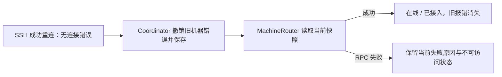

# SSH 重连后旧报错清理交付

日期：2026-10-12。候选版本 **0.6.0-alpha.5**。关联 I06-FIX-SSH-02、AB-F01/05/11/17，M01/M02/M03/M04/M10。稳定历史发布仍为 0.5.0；本次不完成 I06B/C。

## 问题与结果

用户报告原机器在线、OpenCode 已接入，但仍显示“远端已有其他版本后台”的旧提示。只读核对实际 alpha.4 本地状态：SSH 连接记录 online 且无 error；machines.json 同一机器却 online 且保留 SSH_DAEMON_UPGRADE_REQUIRED。[脱敏诊断](../../../artifacts/ssh-error-clear/2026-10-12/diagnosis.json)。这是机器缓存合并未撤销旧错误，不是当前版本被拒绝。

SshManager 成功重连会删除当前 error，publicState 无错误字段；Coordinator 之前用 Object.assign 合并到旧机器，导致缺失字段没有删除旧值，机器快照成功路径也继承旧 error。alpha.5 按完整状态合并 SSH 错误并保存机器目录，成功快照移除旧 error/connectionError。快照 RPC 失败继续保留实际错误及 online=false，不能由 SSH transport online 掩盖。原机器、节点、任务/会话及 unknown 台账不改；不添加模型 API 层。

## 实现与兼容边界

- [Coordinator](../../../desktop/electron/coordinator-service.cjs)：mergeSshState 处理错误撤销、持久化与快照当前失败优先级。
- [机器路由](../../../desktop/electron/machine-router.cjs)：成功 snapshot 不继承旧目录错误；失败仍使用真实 RPC 原因。
- [受控回归](../../../desktop/tests/ssh-state-recovery.test.cjs)：blocked → online → 保存/重开；旧文件恢复；新 RPC/主机密钥失败仍显示；节点与任务历史保留。
- [Windows UI 检查](../../../desktop/tests/windows-ssh-state-ui.cjs)：当前构建前端、生产合并函数产生受控快照，确认旧提示消失和新 RPC 提示保留。是模拟后端的真实浏览器渲染，不冒充真实 SSH 重连。
- [alpha.4 可信 manifest](../../../desktop/compatible-daemons/0.6.0-alpha.4.json) 来自先前已通过 [包报告](../../../artifacts/ssh-compatibility/2026-10-12/package.json) 的实际 Linux 包，复制前核对内容摘要。当前可复用 alpha.2/alpha.3/alpha.4；未知版本、摘要/归属不符仍拒绝。旧远端适配代码保持原版本。

检查 architecture/data-model/protocol：更新完整观测/错误撤销语义，不新增字段、消息方法或协议版本，不改变远端任务账本、请求 ID 或原生模型配置。

## 实际验证

环境：WSL Ubuntu / Node 22.23.1；Windows Node 24.18.0、Edge；Windows x64 portable（Electron 44.7.0）。除只读核对原配置外，测试均使用受控或隔离 profile，不提交原生模型需求。

| 检查 | 实际结果 | 原始证据 |
| --- | --- | --- |
| 原用户状态核对 | 实际在线连接无错误、机器缓存有旧错误；只读脱敏 | [诊断](../../../artifacts/ssh-error-clear/2026-10-12/diagnosis.json) |
| 全桌面受控回归 | 95/95，0 失败/跳过；新增 2 项恢复反例 | [TAP](../../../artifacts/ssh-error-clear/2026-10-12/desktop-tests.tap) |
| Windows 卡片渲染 | 2 项通过；生产合并函数 + 受控后端快照 | [UI JSON](../../../artifacts/ssh-error-clear/2026-10-12/ui.json)、[截图](../../../artifacts/ssh-error-clear/2026-10-12/recovered-ui.png) |
| lint、根/前端类型和构建 | 通过 | [lint](../../../artifacts/ssh-error-clear/2026-10-12/lint.log)、[构建](../../../artifacts/ssh-error-clear/2026-10-12/package-build.log) |
| 新包完整性 | 25 个后台模块、1363 个 Linux 文件（3 个可信旧清单），前端/app.asar 与源码一致 | [包报告](../../../artifacts/ssh-error-clear/2026-10-12/package.json) |
| 普通便携 EXE | 实际 Windows 隔离配置 3 项通过；普通启动/关闭/重开保持同后台，未发送需求 | [普通 EXE](../../../artifacts/ssh-error-clear/2026-10-12/portable.json) |

核心 43/43、真实远端模型与认证矩阵是先前版本的历史证据，本次未重跑。没有通过测试观察连接夺取用户当前远端通道，没有升级/停止远端 daemon。

## 使用新程序

[AgentBridge-0.6.0-alpha.5-Windows-x64.exe](../../../desktop/release/AgentBridge-0.6.0-alpha.5-Windows-x64.exe)。打开新 EXE → 新窗口“设置 → 后台运行 → 停止后台并退出” → 确认 → 再次打开同一新 EXE。后台加载新代码后在原机器刷新/重新连接，旧报错会清理；无需旧程序设置页、删除机器或删除历史。

如果只关闭窗口，原 Coordinator 继续运行，重新打开新 EXE 仍可能附着旧代码；明确停止入口与普通关闭不同。[新窗口停止旧后台实测](client-background-operation.md)。这仍不是自动后台升级功能。

大小：129,312,610 字节。SHA-256：`c7069b9006efaaa5eec39de80699cb619a158113b8b5d1367295d36fb6c743d9`。旧候选 EXE、历史包摘要和验收报告保留。
