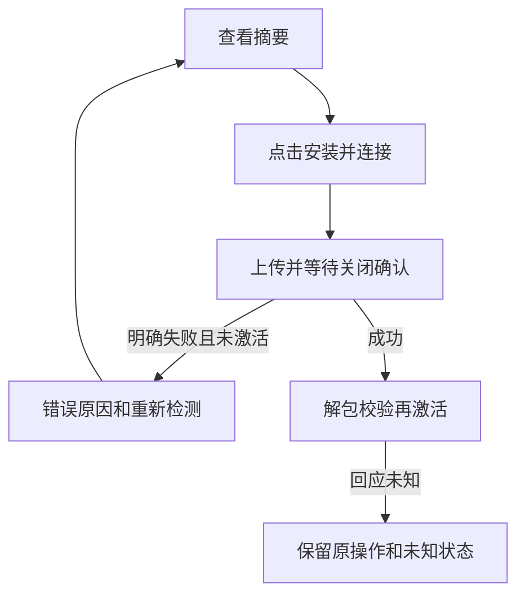

# alpha.14 SSH 安装上传诊断与恢复

日期：2026-10-14。关联 I06-DMN-02、I06-UI-05，AB-F05/F06/F17，M01-F03、M04-F04/F06、M10-F02/F03。源码候选 `0.6.0-alpha.14`；GitHub 已发布附件仍为 alpha.9。本次不代表完整 I06C 或正式 0.6.0 准出。

## 需求与原因

用户在另一台 Windows 电脑使用 GitHub alpha.9，首次添加 Linux 时安装包上传不到 1 秒即显示“安装包上传中断，请重新连接”，随后需要安装却没有按钮。已核对标签和对应源码：旧上传器把所有 WRITE 错误抹成同一句话，失败对话框停在 connecting，只保留返回机器列表。没有用户服务器日志，**尚不能确定实际服务器失败原因或声称原服务器已恢复**。

验收目标：明确打开、写入、关闭文件的失败阶段；安全呈现权限、空间/配额、SFTP 通用拒绝、通道关闭、无响应及确认字节数；明确上传失败可重新检测和批准安装；回应未知不提供重装入口。保留原连接和安装 ID。

## 开发与边界

- [上传器](../../../desktop/electron/ssh-install.cjs)：24×32 KiB 流水线的缓冲区在所属 WRITE 完成后才回收，覆盖 ssh2 小 write limit 的后续分片；成功 ACK 累加实际字节数，失败包不计成功。以 0600 创建归档，等远端 CLOSE 成功才解包。错误/通道关闭或 60 秒无 ACK 结束；不回显原始服务器文字和路径，保留数值 SFTP 状态。
- [连接状态](../../../desktop/electron/ssh-host.cjs)：仅上传器 `SSH_UPLOAD_FAILED` 能证明未解包/激活，原安装记录为 rejected 并暂停自动重连；其他已发送步骤失败保持 unknown。半包与 staging 留在所属 profile，活动版本和原历史保留。
- [对话框](../../../desktop/src/AddMachineDialog.tsx)：明确上传失败或尚未批准安装回到表单，显示“重新检测安装”；补录凭据、检测原连接、查看摘要、再次批准。未变化的连接/摘要沿原安装 operationId；unknown 只返回原连接状态，无重装入口。
- alpha.14 收录已核对摘要的 alpha.13 可信清单，可复用旧后台。根 CLI、daemon 业务协议、原生登录、模型与任务控制不变。

## 实际验收

| 日期 / 版本 / 环境 | 结果 | 证据级别与来源 |
| --- | --- | --- |
| 2026-10-14 / alpha.14 / WSL Ubuntu、Node 22.23.1 | 上传专项 5/5 | 4 项受控 + 1 项真实本机 TCP SSH/SFTP，服务器/文件/密钥隔离，无模型：[TAP](../../../artifacts/ssh-upload/2026-10-14/upload-tests.tap)、[脚本](../../../desktop/tests/ssh-upload.test.cjs) |
| 同日期 / alpha.14 / 同环境 | 桌面 155/155，无失败/跳过 | 完整受控工程回归，含上述 5 项，不重复相加：[TAP](../../../artifacts/ssh-upload/2026-10-14/desktop-tests.tap) |
| 同日期 / alpha.14 / Windows Edge、1280×900 | 界面 2 组，原生提交 0 | 真实浏览器+受控 SSH 结果：失败→补录→检测→摘要→原 ID 安装；unknown 无重装入口。[报告](../../../artifacts/ssh-upload/2026-10-14/ui.json)、[失败截图](../../../artifacts/ssh-upload/2026-10-14/upload-rejected.png)、[恢复摘要](../../../artifacts/ssh-upload/2026-10-14/retry-preview.png)、[脚本](../../../desktop/tests/windows-ssh-upload-ui.cjs) |

打包资源核验通过：28 个 CJS、1379 个 Linux 文件，窗口 asar、冻结后台、前端与源码一致。证据：[包报告](../../../artifacts/ssh-upload/2026-10-14/package.json)、[构建日志](../../../artifacts/ssh-upload/2026-10-14/build.log)。普通 Windows portable EXE 在全新隔离 Windows/WSL profile 无调试参数启动、关闭保留同一中央、重开复用同一中央 3 项通过，原生提交/委派为 0：[报告](../../../artifacts/ssh-upload/2026-10-14/portable.json)。这不证明用户服务器安装或模型回复。未测试用户另一台电脑到原 Linux 的安装、原公网失败原因、当前原生模型闭环和完整 I06C 准出；历史实机材料保持原日期。

复现：`node desktop/tests/ssh-upload.test.cjs`、`npm test --prefix desktop`、`npm run desktop:dist`。Windows UI 需本机 Vite 和 Edge：`node desktop/tests/windows-ssh-upload-ui.cjs http://127.0.0.1:4224`。工程测试使用临时本机 SSH 端口，不访问用户服务器。

## 当前候选 EXE

[AgentBridge-0.6.0-alpha.14-Windows-x64.exe](../../../desktop/release/AgentBridge-0.6.0-alpha.14-Windows-x64.exe)，129848566 字节；SHA-256 `6cb1965a750a1c443341dff0d993ebe123001fca79d618d4c237bf2b8a74e4c6`。Linux manifestDigest `0f1c31132ad985cc1166699e478c22ea5919ccc1a2d155571a8d8586485a7d47`。已收录 alpha.13 清单的 digest 与其实际包报告 `2577707d02d62f2aa03b1f657fdd766f10a323e400fd89f5109ad632c3388ed5` 一致。候选目前为本地文件，未替换 GitHub alpha.9 附件。

使用新 EXE 前，在当前窗口“设置 → 后台运行 → 停止后台并退出”，再打开新 EXE，使窗口和中央都载入修复版。连接原机器，明确上传失败时在原对话框点“重新检测安装”，补录凭据、核对摘要、再点“安装并连接”。如仍失败，安全错误类别和字节数用于继续诊断；不要把 unknown 当作明确失败，也不要通过换节点/目录/请求 ID 重发原生任务。

验收驱动修正：WSL 启动 Windows Node 时，本次 shell 设置的报告路径未传入 Windows 环境，旧驱动默认输出覆盖历史 alpha.3 报告。本次 alpha.14 结果已移动到日期目录；历史报告从原执行记录的完整 JSON 恢复，保留原日期/版本。驱动默认输出改为按当前版本隔离，避免后续覆盖历史证据；这不改变产品功能或构建包。
