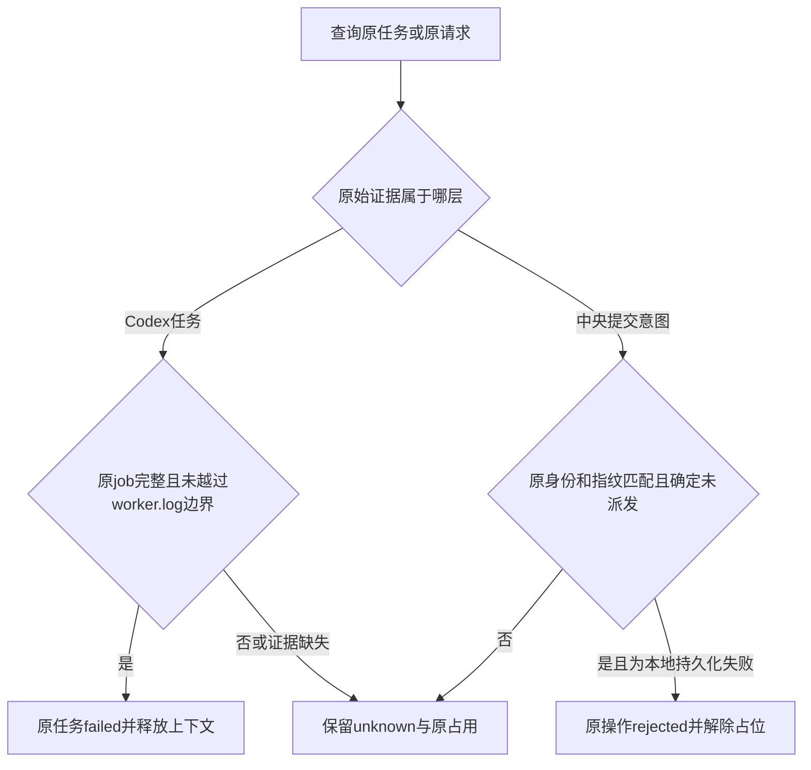

# Windows未派发任务与本地台账替换恢复

日期：2026-10-17。当前源码/GitHub预发布 **0.6.0-alpha.27**，标签绑定已在master的 `6eab64604f2b7e7e9b20a09c85c46444bcb040e0`，draft=false、prerelease=true；不覆盖既有冻结包。关联[issue #3](https://github.com/wsjq5477/MA-Relay/issues/3)、[issue #4](https://github.com/wsjq5477/MA-Relay/issues/4)、AB-F08/F10/F11/F14/F17、M02-F04、M03-F04/F05、M06-CX-F01、M07-F06/F07、M08-F02、M10-F01/F03/F05。完整I06C/I07C未准出。

## 需求与验收目标

| 要求 | 实现及验收 |
| --- | --- |
| R01 Codex准备失败要有终态 | job/原任务保存后，运行资源、文件或同步spawn准备失败返回原任务failed，保存原错误码、脱敏原因、failed事件及结束时间；同requestId返回同任务，新请求可以进入准备，不启动原生CLI |
| R02 历史未派发任务可核对 | 原run中有效job.json存在，原任务只有accepted事件、无native/offset且worker.log、heartbeat.json、events.jsonl全缺失，才判定未越过worker启动边界；reconcile记录failed及最近核对，保留原任务、会话和文件，不重发 |
| R03 证据不足继续保护 | run缺失、任何worker.log/心跳/事件文件（含空或null）、原任务有启动/native进度，全部保留unknown与占用；正在运行但尚无心跳的worker不能被当作未启动 |
| R04 本地替换有界恢复 | graph-layout.atomicWrite与AgentNetwork.saveNetwork统一wx临时文件、fsync、原子替换和失败清理；EPERM/EACCES/EBUSY最多6次、累计等待300ms，ENOSPC等其他错误不重试 |
| R05 持久化失败不伪装派发 | 保存失败包装为NETWORK_PERSIST并保留原码/原因；派发前dispatched=true保存失败只回滚内存dispatched=false，派发后的结果保存失败不回滚；仅严格原身份/双指纹/未派发/无任务会话绑定/无在途node job证据允许rejected |
| R06 历史EPERM兼容 | 仅原本机profile的`agent-network.json.<UUID>.tmp`到agent-network.json的精确Node rename消息，连同R05原意图证据，才结算历史unknown；路径按本机Windows大小写等价或Linux大小写敏感比较，其他EPERM/NOT_FOUND/缺收据不构成未执行证明 |
| R07 可用交付 | 构建独立alpha.27 Windows EXE及校验文件；保留原alpha.26包；补收原alpha.26冻结Linux清单，避免新客户端拒绝上一版本后台 |

## 实现与状态边界

[CodexHost](../../../desktop/electron/codex-host.cjs)在准备或同步spawn失败时写原任务终态；异步spawn错误也沿同一写回路径。spawn已返回child后的异常不能当作未派发证明，关闭本地描述符也不改变原执行事实。reconcile返回现有的operationId/state/data结构；只有真实终态或严格未派发证明才confirmed，其他一律unknown。这是查询收据的状态，未派发任务本身为failed，绝不改成成功或取消。

issue建议仅以“无心跳和事件”判断未派发不够严谨：spawn返回后worker尚未调度或暂停时同样可能没有这两份文件。本实现额外使用在spawn之前创建的worker.log作为启动边界，并核对accepted事件和native进度；破坏/缺失证据不推断为未派发。要求核对原目录，不能人工删除worker.log来释放任务。

[共享原子写入](../../../desktop/electron/graph-layout.cjs)覆盖布局、图操作及[AgentNetwork](../../../desktop/electron/agent-network.cjs)的普通保存/节点/关系事务。[Coordinator](../../../desktop/electron/coordinator-service.cjs)仅通过严格undispatchedRejection判定NETWORK_PERSIST；不把它或任意EPERM直接加入全局拒绝白名单。recoverPending提交结算前重新核对原意图，进程崩溃后如果原receipt从未落盘而丢失，继续unknown。派发后保存错误只查询原请求，不重发。

没有引入模型API、迁移用户数据或改动原request/task/Conversation。architecture分层和daemon帧版本不变；data-model/protocol补充内部NETWORK_PERSIST及原启动证据的语义。用户真实profile只通过产品入口核对，本次所有故障注入均使用合成临时目录。

## 实际验证

WSL Ubuntu / Node22.23.1；Windows 10.0.22000.2538 / Node24.19.0。模型调用0；受控原生执行器与真实Agent分开。

| 范围 | 实际结果与证据 |
| --- | --- |
| 修复前Codex反例 | 新恢复套件0/10通过，全部失败，reconcile未适配/准备错误无终态：[TAP](../../../artifacts/windows-start-persistence/2026-10-17/before-codex-recovery.tap) |
| 修复前持久化反例 | 原子写入新用例1/10通过、9失败；含父测试计数。提交链/历史恢复相关网络套件40/47通过、7失败：[原子写入](../../../artifacts/windows-start-persistence/2026-10-17/before-network-persistence.tap)、[网络](../../../artifacts/windows-start-persistence/2026-10-17/before-agent-network.tap) |
| 修复后定向 | Codex恢复10/10、原子写入10/10、最终网络50/50通过（另补大小写及空/缺失输入指纹安全场景）：[Codex](../../../artifacts/windows-start-persistence/2026-10-17/after-codex-recovery.tap)、[原子写入](../../../artifacts/windows-start-persistence/2026-10-17/after-network-persistence.tap)、[网络](../../../artifacts/windows-start-persistence/2026-10-17/after-agent-network-final.tap) |
| 桌面完整回归 | 最终运行288/288通过，串行且每文件独立进程；包含alpha.26兼容场景：[汇总](../../../artifacts/windows-start-persistence/2026-10-17/desktop-full.json)、[完整日志](../../../artifacts/windows-start-persistence/2026-10-17/desktop-final.log) |
| 核心与工程 | 核心45/45、lint、根/前端类型、前端构建通过；保留Vite既有体积提示：[核心](../../../artifacts/windows-start-persistence/2026-10-17/root-tests-allowed.log)、[lint](../../../artifacts/windows-start-persistence/2026-10-17/lint.log)、[根类型](../../../artifacts/windows-start-persistence/2026-10-17/typecheck.log)、[前端类型](../../../artifacts/windows-start-persistence/2026-10-17/desktop-typecheck.log)、[构建](../../../artifacts/windows-start-persistence/2026-10-17/desktop-build.log) |
| Windows受控契约 | 真实Windows Node24.19.0、隔离目录86/86通过，无原生CLI；[入口](../../../desktop/tests/windows-start-persistence-contract.cjs)、[TAP](../../../artifacts/windows-start-persistence/2026-10-17/windows-final.tap) |
| alpha.26旧后台可信复用 | 从已发布alpha.26 EXE提取原Linux manifest，摘要6674f37902908e329ce76cb634d6ebae36c55f33f8e7ad836488986b10879c4e与原冻结报告匹配；兼容回归10/10：[来源](../../../artifacts/windows-start-persistence/2026-10-17/alpha26-compatibility-source.json)、[TAP](../../../artifacts/windows-start-persistence/2026-10-17/compatibility.tap)。受控SFTP，不是用户服务器升级 |

首轮沙箱限制了原生夹具/套接字，完整运行被中止，保留[桌面受限日志](../../../artifacts/windows-start-persistence/2026-10-17/desktop-full.log)、[核心受限日志](../../../artifacts/windows-start-persistence/2026-10-17/root-tests.log)。允许本地进程后，首轮桌面283/284通过，一个既有维护夹具ENOENT；保留[失败原文](../../../artifacts/windows-start-persistence/2026-10-17/first-full/full-daemon-maintenance.test.cjs.tap)。先检查原测试/失败输出，单独重验8/8后全量284/284通过，再补路径大小写场景后全量285/285通过；最终增加空/缺失输入指纹反例并严格比较指纹后，全量288/288通过；[维护补验](../../../artifacts/windows-start-persistence/2026-10-17/maintenance-retry.tap)、[第一次完整复验](../../../artifacts/windows-start-persistence/2026-10-17/desktop-full-retry.log)。没有把失败删掉或计为通过。

复现：在仓库根依次直接运行node desktop/tests/codex-recovery.test.cjs、node desktop/tests/network-persistence.test.cjs、node desktop/tests/agent-network.test.cjs；Windows直接运行windows-start-persistence-contract.cjs，避免Node --test的UNC文件发现限制。普通EXE验证脚本为[隔离入口](../../../desktop/tests/windows-start-persistence-portable.cjs)，不得使用用户profile。

## 用户恢复与未测边界

1. 在新EXE“设置 → 后台运行”停止旧后台并退出，再打开新版，确认中央后台为alpha.27。普通关闭窗口保留旧后台。
2. #3：原会话“查看过程 → 核对原任务”。严格证明未派发时显示failed并释放原上下文，之后用户可新建会话；原会话没有原生thread时仍不能续问，不自动重跑hello。
3. #4：设置中的未确认操作点击“查询原请求”。仅符合精确本地持久化失败及原意图证据的记录结算rejected；若已派发、原收据丢失或是其他错误，继续unknown。
4. 本机Windows的两项修复无需为此升级SSH后台。alpha.24/25/26原远端继续按冻结清单精确校验复用；需要更新远端适配时单独从原机器维护升级，忙/unknown保护不变。

尚未访问或改写用户故障profile，未重跑真实模型或独立服务器；不能承诺所有Codex unknown或Windows文件锁都由本缺陷造成。其他JSON写盘路径没有一并重构，未知结果仍需原ID核对。本候选还纳入master中既有的[首次续接Conversation回应校验](../I07/intended-conversation.md)，全量套件覆盖该行为，不借本次受控证据扩大真实Agent验收。

最终复核曾发现空字符串inputFingerprint不能仅凭类型视为已核对，新增反例后旧候选失败，改为与原输入指纹精确相等；[反例输出](../../../artifacts/windows-start-persistence/2026-10-17/before-empty-fingerprint.tap)。该源码变化使进行中的旧候选在包检查中正确报告agent-network.cjs不一致，保留[拒绝日志](../../../artifacts/windows-start-persistence/2026-10-17/package-build-delivery.log)，只以最终重建包作为交付。

## 最终包资源核对

最终alpha.27本地EXE为[Windows x64程序](../../../desktop/release/AgentBridge-0.6.0-alpha.27-Windows-x64.exe)，129,882,252字节；SHA-256 `8c6ae677d968af53fa79ec3b55485ea354a7ae4e7a188b9edd5630a05f0f330b`，见[校验文件](../../../artifacts/windows-start-persistence/2026-10-17/SHA256SUMS.txt)。33个CJS后台模块、78个核心文件、1393个Linux条目、app.asar及前端资源与最终源码/构建相符：[包报告](../../../artifacts/windows-start-persistence/2026-10-17/package.json)、[最终构建日志](../../../artifacts/windows-start-persistence/2026-10-17/package-final.log)。原alpha.26附件与摘要没有覆盖。

## 普通Windows EXE实际验证

最终无调试EXE在隔离Windows profile及明确的独立WSL临时目录中5组通过：生产Coordinator/AgentNetwork/CodexHost恢复原任务failed且run仍只有job.json；历史精确EPERM原操作rejected、缺收据原操作unknown；普通关闭重开复用同后台；完整后台重启沿原身份不重发；4个修正CJS冻结副本与源码相同。模型/原生CLI任务0；[报告](../../../artifacts/windows-start-persistence/2026-10-17/portable.json)、[运行日志](../../../artifacts/windows-start-persistence/2026-10-17/portable.log)。该结果是实际Windows EXE对合成记录的程序验证，不代表用户故障机器已恢复。

首轮夹具将runtime.json的UI快照副作用当作后台就绪条件而超时，未开始业务恢复检查，保留[首轮报告](../../../artifacts/windows-start-persistence/2026-10-17/portable-first.json)；改用coordinator-status.json及真实握手判断、明确独立WSL目录后复验通过。只修改测试夹具，最终EXE字节和摘要未改变。测试自有窗口及后台均关闭；未把首轮失败计作通过。最终文档检查见[结果](../../../artifacts/windows-start-persistence/2026-10-17/docs-check.json)。

## GitHub分发核验

[Windows EXE](https://github.com/wsjq5477/MA-Relay/releases/download/v0.6.0-alpha.27/AgentBridge-0.6.0-alpha.27-Windows-x64.exe)、[校验文件](https://github.com/wsjq5477/MA-Relay/releases/download/v0.6.0-alpha.27/SHA256SUMS.txt)、[预发布页](https://github.com/wsjq5477/MA-Relay/releases/tag/v0.6.0-alpha.27)。标签绑定修复源码 `6eab64604f2b7e7e9b20a09c85c46444bcb040e0`；EXE为129,882,252字节，SHA-256 `8c6ae677d968af53fa79ec3b55485ea354a7ae4e7a188b9edd5630a05f0f330b`。两附件均uploaded且大小/digest匹配，完整公开下载均HTTP200，EXE摘要及校验文本与本地一致。[发布元数据](../../../artifacts/windows-start-persistence/2026-10-17/github-release.json)、[上传核验](../../../artifacts/windows-start-persistence/2026-10-17/github-upload.json)、[完整下载核验](../../../artifacts/windows-start-persistence/2026-10-17/github-download.json)。源码/窗口/后台/离线包一致性的发布前再次核对亦[通过](../../../artifacts/windows-start-persistence/2026-10-17/package-publish.json)。本次分发不扩大产品验收范围，原始材料仍按[仓库范围](../../repository-sync.md)保留在本地。
