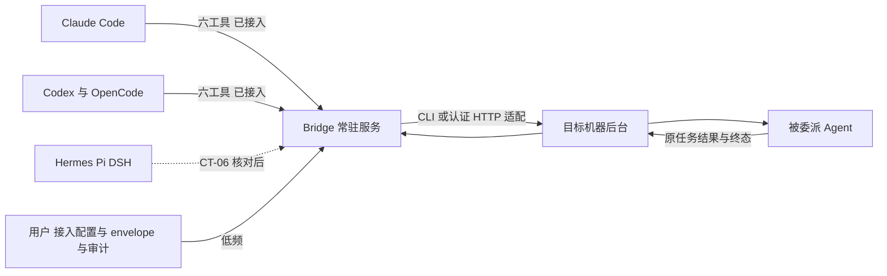

# I07：Agent 侧自主操作与通用调用方规划

CT-08后续已实现[A3连接策略](connection-policy.md)，承接[A2按身份多主运行期](multi-parent-runtime.md)与[A1存储迁移](relation-storage-migration.md)：Agent连接工具、envelope预授权/用户明确确认及多主策略/审计页面已本地实现；真实原生消费和日常多主仍待验。下文规划保留原交付时点。

## CT-07后续实现状态（2026-10-20）

只读委派列表首片已实现，保留原父/连接身份与只读事实，源码经典7工具；[需求、实现、回归与未发布边界](delegation-list.md)。本页其余“纯规划/未实现”描述保留原交付时点，[list_agents身份视图](agent-connections.md)已后续源码实现；[子会话最小上下文](delegation-context.md)也已后续源码实现；CT-06/08仍按原前置，未扩大调用方能力。

日期：2026-10-20。关联AB-F02/F07/F08/F10/F11/F12/F13、M01/M03/M06/M07/M08。用户要求：Agent能在自己会话内查看并操作“对接了哪些Agent”，日常协作操作尽量在Agent侧完成，Bridge收缩为接入配置、策略与审计的配置器角色；同时核对Hermes/Pi/DSH的调用方路径与DSH原生插件的取舍。本轮仅新增规划文档并重建文档站点，没有修改运行代码、协议、存储或发布版本，没有调用模型。

## 本轮交付

| 文档 | 作用与变更 |
| --- | --- |
| 本页 | 目标形态、两条连接方向边界、CT-06/CT-07/CT-08切片定义、插件决策规则与实施顺序 |
| [接入矩阵](../../agent-integration-matrix.md) | §4新增CT-06/CT-07/CT-08后续目标行，标注规划未实现；总览补本轮登记 |
| [选型指南](../../agent-integration-guide.md) | 插件行补“薄传输层”条件；§6实施顺序关联本规划 |
| [需求记录](requirements.md)、[开发记录](development.md)、[迭代目录](../README.md)、[资料入口](../../README.md)、[迭代路线](../../project-plan.md)、[整体设计](../../product-design.md)、[M06报告](../../modules/06-native-adapters/test-report.md) | 登记规划入口；已实现、已发布与验收基线不变 |
| [数据模型](../../data-model.md)、[Windows启动持久化](../I06/windows-start-persistence.md)、[SSH接入设计](../../modules/04-ssh-access/design.md)/[报告](../../modules/04-ssh-access/test-report.md)、[打包设计](../../modules/10-packaging/design.md) | 修复8处裸尖括号占位符（`<connectionId>`、`<digest>`、`<version>`等）导致的文档站点构建失败；仅补反引号代码标记，不改语义与结论。该问题为既有未提交文档增量所带，上轮纯文档核对未运行站点构建故未暴露 |

## 目标形态与方向边界

用户目标拆开后是两条独立方向，结论不同：

- **调用方方向（Agent→Bridge）可以且应该通用化**。任何要“自己查看并操作连接”的Agent都必须是Bridge MCP调用方：操作面就是MCP工具面，没有第二条通道。当前仅Claude/Codex/OpenCode接入是首片切片范围决策（三新工具按结构化CLI入选被驱动方向），不是结构限制；[静态注册表](../../../desktop/electron/builtin-adapters.cjs)中Hermes/Pi/DSH的`bridgeMcp:false`是“未实现注入”的登记，不是“原生不可能”。
- **驱动方向（Bridge→Agent）保留adapter，与调用方通用化无关**。被委派执行不走调用方通道：Claude委派Hermes时Claude走MCP，Hermes仍由[CLI/HTTP适配](../../../desktop/electron/native-cli-protocols.cjs)驱动。MCP不定义执行生命周期；该方向的通用化候补是CT-03 ACP试点，与CT-06互补不互替。



Bridge常驻服务内含broker、connectionId身份、关系envelope与持久台账。界面收缩后只保留低频操作：机器/Agent扫描接入、MCP配置安装与撤权（[独立MCP模式](mcp-installation.md)）、关系envelope策略、只读审计；日常发现、委派、读结果、回权限、取消全部在Agent会话内经六工具完成。broker常驻进程仍是运行前提：桌面关闭即协作不可用，headless CLI入口保留，此部署事实不因界面收缩改变。

## “通用MCP”的准确边界

服务端已经通用：[stdio MCP服务](../../../desktop/electron/mcp-client.cjs)＋[broker](../../../desktop/electron/collaboration-broker.cjs)＋connectionId身份、token与撤权、[三格式配置安装](../../../desktop/electron/mcp-integration.cjs)。缺的是逐工具客户端：MCP是客户端/服务端协议，某Agent能否成为调用方取决于该原生工具自身有无MCP客户端及配置格式；McpIntegration当前仅接受Claude/Codex/OpenCode三种配置格式。三种植入情况：

| 情况 | 结论 |
| --- | --- |
| 要自己查看/操作连接的Agent | 必须成为MCP调用方；原生支持MCP客户端的，按独立MCP模式补配置适配、身份与真实验收后接入 |
| 仅作为被委派目标的Agent | 不需要调用方能力；`delegation:true`与`bridgeMcp:false`是合法组合，互不推定 |
| 原生不支持MCP客户端的工具 | Bridge不能单方面赋予客户端能力；不fork、不包装、不动态加载外部模块。降级为被驱动＋最小协作上下文感知（感知不等于操作），此时插件才成为候选 |

“所有Agent都接入通用MCP”因此有准确含义：所有**原生支持MCP客户端**的Agent都接入同一Bridge MCP；其余工具保持被驱动，并按CT-06a核对结论决定是否走插件。星型拓扑不变：所有调用方连唯一Bridge MCP，Agent之间不直连、不互开端口。

## 新增后续目标

| 目标 | 关联既有功能 | 交付内容 | 完成条件 |
| --- | --- | --- | --- |
| CT-06 通用MCP调用方 | AB-F02/07/10/11/12/13；M03/M06/M07/M08 | 先只读核对Hermes/Pi/DSH及DSH Desktop/Web产品入口的原生MCP客户端与插件扩展点（CT-06a）；结论可走MCP的工具按独立MCP模式接入配置安装、冲突/撤权与独立connectionId身份（CT-06b起逐工具） | 每工具按真实版本出四选一结论（走MCP/走插件/仅被驱动/待定），不以图标或版本探测推定；新调用方按“原生实际调用获准工具、拒绝越权/撤权、身份归属”验收，配置导出成功不算工具调用成功；静态`bridgeMcp`仅在验收后翻真 |
| CT-07 Agent侧连接操作面 | AB-F02/07/08/10/11/13；M01/M03/M07/M08 | `list_agents`按调用方身份返回其获准连接；新增只读委派列表工具，免记taskId；被委派子会话注入最小协作上下文 | 六工具既有回归全过，方向门禁与身份归属不回归；感知注入不得登记为调用方能力；纯增量不动关系模型 |
| CT-08 多主关系与连接管理 | AB-F02/07/08/10/11/12/13；M01/M03/M07/M08 | [单主collaboration关系](../../../desktop/electron/agent-network.cjs)泛化为按身份的relations[]并完成迁移；新增list_connectable/connect_agent/disconnect_agent与envelope预授权及确认流；Bridge界面收缩为接入配置、策略与审计 | 关系重构与行为变更分片验收，旧数据迁移可核对；Agent不能自批envelope外关系，撤权即时生效；data-model/protocol/architecture同轮同步 |

## 插件决策规则

- **不以插件替换MCP**。插件替换的只是“最后一英寸”（stdio shim＋客户端配置）；broker、身份、台账、授权都保留。问题因此不是“MCP还是插件”，而是“该工具有没有MCP客户端；没有时插件是否是官方扩展点能补该缺口的最好方式”。
- **MCP优先**。宿主有MCP客户端时一律走MCP：一份工具契约全体复用、子进程隔离、每工具只新增一种配置格式。插件是每宿主×版本×入口×平台的安装/升级/卸载维护面，且与Agent同进程，出错可能影响原生会话；DSH有三个入口（CLI/Desktop/Web），插件成本按入口数放大。
- **若做插件，只做薄传输层**：复用同一broker端点、connectionId/token与工具契约，仅把工具面注册进宿主，不另行实现协作逻辑，不形成第二套台账或验收口径。
- **驱动方向插件零增益**：DSH Desktop/Web已有认证HTTP Session API；[选型指南](../../agent-integration-guide.md)既定规则“外部接口存在明确缺口、且官方扩展点能解决时再增加”继续适用。

## 实施顺序与前置

| 顺序 | 切片 | 前置与边界 |
| --- | --- | --- |
| 1 | I07C收尾（既定范围）：六工具真实覆盖、DSH Desktop/Web原实例验证 | 矩阵对Hermes/Pi/DSH既定“先完成真实直接执行与受委派验证，再补MCP调用方能力”，是CT-06硬前置 |
| 2 | CT-06a调用方与扩展点核对（只读研究） | 只写文档不改代码；每工具四选一结论进入矩阵 |
| 3 | CT-06b首个新调用方，其余工具逐个跟进 | CT-06a结论；独立MCP模式复制；静态`bridgeMcp`验收后翻真，不批量宣称 |
| 4 | CT-07 Agent侧操作面（可与3并行） | 六工具回归全过；不改变关系模型 |
| 5 | CT-08关系多主化＋连接管理 | CT-07落地后分两片验收（先重构后行为）；envelope确认流保住“子节点不能扩大连接关系” |
| ∥ | CT-03 ACP试点（既定可选） | 驱动方向通用化候补，与CT-06互补不互替；既定门槛不变 |

## 边界与不变量

- 本轮纯规划：不修改静态注册表能力位，`bridgeMcp:false`维持至各工具真实验收；不承诺所有Agent最终都有调用方能力，取决于原生支持，以CT-06a核对为准。
- 既有保护全部保留：requestId/operationId持久台账与unknown保护、八项三态能力门禁、撤权即时生效、子节点不能扩大连接关系、委派子任务`collaboration:false`不注入MCP。
- 无新包：公开alpha.34冻结范围不变；DSH Desktop/Web等未发布源码保持原状。文档检查与站点构建不证明任何未来功能、真实模型或新EXE。

## 本轮验证

环境：WSL Ubuntu，仓库原Node运行文档检查与站点构建，未安装新依赖、未连接原生Agent，模型调用0。

| 检查 | 实际结果 | 原始证据 |
| --- | --- | --- |
| 文档结构/本地链接/模块追踪 | 通过；181份Markdown、4240个本地链接、80个图、0错误 | [文档检查](../../../artifacts/agent-centric-operations/2026-10-20/docs-check.json) |
| diff空白检查 | 通过；`git diff --check`退出0 | [diff检查](../../../artifacts/agent-centric-operations/2026-10-20/diff-check.txt) |
| 文档站点构建 | 通过；首次构建暴露既有文档8处裸尖括号占位符导致的Vue模板错误，按上表修复后重跑通过 | [构建日志](../../../artifacts/agent-centric-operations/2026-10-20/docs-build.txt) |
| 新适配器/原生模型/独立SSH/新EXE | 未运行，不适用于本轮规划验收 | 未改产品行为；原有专项证据保留各自日期/版本 |

复现：

```bash
node scripts/check-docs.mjs
git diff --check
npm run docs:build
```

首次文档检查在证据文件生成前运行，报告所引用证据缺失；生成实际检查与构建文件后重跑通过，[首次结果](../../../artifacts/agent-centric-operations/2026-10-20/docs-check-initial.json)保留。这是证据文件生成顺序问题，没有修改产品来规避检查。文档检查与站点构建不证明真实执行、模型回复、恢复、Windows包或任何CT-06/CT-07/CT-08未来功能。
