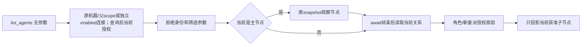

# CT-07：按调用方身份查看获准连接

日期：2026-10-21。关联AB-F02/F11/F13、M03-F02、M06-F02、M07-F06/F07、M08-F02/F05/F06；检查M10/M11交付边界。本片是未发布源码增量，接续[只读委派列表](delegation-list.md)，不等于完整CT-07/CT-06或I06C/I07C准出。

## 1. 需求与推进依据

本线程上次开发已完成；只读核对“修复 Agent 扫描与状态异常”和“增加 DSH 接入支持”的最近回合均为completed，没有待续的模型限流开发回合。DSH Desktop原模型RATE_LIMIT仍作为既有失败保留，不重新发起、换ID或接管该原生请求。本片从[CT-07规划](agent-centric-operations.md)推进调用方连接视图。

旧list_agents仅返回items：非当前主节点得到空列表，Agent无法据返回值区分角色变化、当前授权和原父unknown。旧实现还在原父请求查询前捕获关系，并在await snapshot之前沿用该副本。原父查询期间撤权可能沿旧主权限继续新委派；快照查询期间换主或撤销目标可能返回旧关系目标。

| 需求 | 实现行为 |
| --- | --- |
| AC-01 原身份 | 入口仍验证原来源机器、已派发原父与非终态，或独立enabled连接；不接受身份/筛选参数 |
| AC-02 当前角色 | 返回caller的nodeId、machineId、native-parent/external-connection、leader/member/unassigned；不返回原父Task/Conversation或私有connectionId |
| AC-03 解释授权 | delegationAuthorized及delegationBlock解释当前主权限、原父unknown或调用能力缺失；不表示目标在线/空闲或新派发一定成功 |
| AC-04 撤权即时 | 原父请求查询结束后为新委派读取当前关系；快照await结束后再次读取当前关系筛选目标。非主无目标，不列其他组/全网或incoming主节点 |
| AC-05 兼容与保留 | items与原字段保留，经典7工具/小队18项不变；不改角色/台账格式、MCP安装、原派发和unknown占位 |

## 2. 当前流程与实现

[agent-connections.cjs](../../../desktop/electron/agent-connections.cjs)提供无IO投影和空参数校验；[AgentNetwork](../../../desktop/electron/agent-network.cjs)沿原授权入口接入。原父请求查询结束后把当前this.network.collaboration交给既有派发准入，防止查询前的旧主权限继续新派发；当前主节点读取原snapshot，快照返回后再读取this.network.collaboration筛选视图。非主不为查其他节点而调用snapshot。

原生父succeeded/failed/cancelled、未派发/缺失原父和外来来源机器仍拒绝；原父unknown可读当前连接，但不能新委派。主换成member或unassigned后，原活跃scope仍可解释当前角色，items为空；自己的原委派读控继续按原台账，不因本片重新授予新委派权。独立MCP沿MachineHost/McpIntegration检查enabled，撤销后原stdio立即MCP_REVOKED。

新投影本身不修改任何输入。list_agents继续使用既有snapshot观察路径，可能更新原lastStatus等观察字段并保存网络记录；它不是list_delegations的无snapshot纯台账读，也不宣称整个调用零磁盘写入。两者均不submit/continue/cancel、不新增Task、不结算原unknown。

## 3. 输出契约

`list_agents({})`或无arguments调用；生产AgentNetwork路由收到其他参数、null、数组或非对象时返回INVALID_INPUT，不回显外来身份；既有stdio/broker仍把缺省或falsy arguments归一为{}，本片未改变该兼容行为。MCP schema原来已声明additionalProperties=false，本片在生产路由补服务端一致检查。

| 字段 | 含义 |
| --- | --- |
| schema / readOnly / view | 1 / true / authorized-connections |
| relationRevision | 本次投影所用当前关系revision；是观察位置，不是授权凭据 |
| caller.nodeId / machineId | 经过原scope验证的调用节点及机器 |
| caller.kind | native-parent或external-connection，不公开私有连接标识 |
| caller.role | 当前leader/member/unassigned；不是历史委派时的角色 |
| caller.delegationAuthorized | 当前角色为leader、本次入口父状态非unknown、调用方Bridge MCP能力为true时为true |
| caller.delegationBlock | not_leader / parent_unknown / caller_unsupported，允许时为null |
| items | 仅当前主获准的目标节点，保留nodeId/machineId/name/adapter/status/busy/executionSupported/connectionCapabilities/capabilitySource/machine；排除自身及其他节点 |

目标是否可执行继续结合其状态、busy和能力；真正新委派仍重新校验当前关系、父状态、目标能力和资源准入。不能把delegationAuthorized、relationRevision或读结果当成可复用授权收据。MCP工具缺失或调用失败不是空关系；旧后台不保证有新字段，不能据旧响应推定本片已部署。无新增模型/供应商层、角色迁移、daemon协议或JSON/SQLite版本。

## 4. 实际验证

WSL Ubuntu Node22.23.1，Windows Node24.19.0；生产AgentNetwork/MachineHost/broker与真实stdio，原生执行为受控临时宿主。模型调用0，不读用户profile、不升级服务器。

- [定向103/103](../../../artifacts/agent-connections/2026-10-21/targeted-final.tap)：包含新11项（含原父查询与节点快照两处等待中的4个并发子场景）、原委派列表、方向能力、普通委派、原网络与独立MCP。
- [Windows18/18](../../../artifacts/agent-connections/2026-10-21/windows-targeted.log)：新连接视图11项和既有委派列表7项，含真实stdio/独立连接撤权；不是实际原生模型或EXE验收。
- [冻结源码清单](../../../artifacts/agent-connections/2026-10-21/source-freeze.json)：独立副本含维护C资源、源码及测试；仅依赖目录使用现有symlink，没有用户运行状态。[完整冻结桌面643/643](../../../artifacts/agent-connections/2026-10-21/desktop-final.tap)零跳过、正常退出；[Core构建](../../../artifacts/agent-connections/2026-10-21/core-build.log)通过。
- [首次7/8](../../../artifacts/agent-connections/2026-10-21/targeted-initial.tap)保留：测试误要求list_agents原snapshot不能更新lastStatus；修正测试只核对原请求身份/内容/派发次数不变，并确认unknown观察保留，没有修改产品快照行为规避测试。

[最终汇总](../../../artifacts/agent-connections/2026-10-21/verification-summary.json)、[源码保留核对](../../../artifacts/agent-connections/2026-10-21/preservation.json)及[执行说明](../../../artifacts/agent-connections/2026-10-21/execution-notes.json)分别记录全量/子集、四份功能文件一致性及其他并行源码差异与首次失败；原有未提交工作未覆盖。收尾时共享工作区的DSH和前端出现并行修改，完整643项仅证明冻结副本；当前共享相关链路另行回归，不扩大对其他增量的验收。

父查询等待修复前的[首轮完整640/640](../../../artifacts/agent-connections/2026-10-21/desktop-initial-full.tap)、[定向100/100](../../../artifacts/agent-connections/2026-10-21/targeted-before-parent-race.tap)与[Windows15/15](../../../artifacts/agent-connections/2026-10-21/windows-before-parent-race.log)均保留原范围；新增3项父查询时序回归并修复后，重新冻结源码且完整重跑得到643/643，定向103/103、Windows18/18。

对照验证：[临时还原旧授权时序的受控TAP](../../../artifacts/agent-connections/2026-10-21/legacy-regression.tap)在保留新响应字段时，4个并发子场景均能捕获旧授权问题（TAP连同2个父分组共6个失败）；[内存加载脚本](../../../artifacts/agent-connections/2026-10-21/legacy-connection-preload.cjs)不改任何磁盘产品源码。第一次对照未保留响应字段，故不作为缺陷证明；最终对照排除了该差异。

[共享工作区定向103/103](../../../artifacts/agent-connections/2026-10-21/shared-integration.tap)补验通过；[用户网页源/发布边界6/6](../../../artifacts/agent-connections/2026-10-21/docs-site-test.log)通过，页面仅同步当前连接操作说明，未重建静态站点或重做浏览器。

复现：`node --test --test-concurrency=1 desktop/tests/agent-connections.test.cjs desktop/tests/delegation-list.test.cjs desktop/tests/agent-network.test.cjs desktop/tests/connection-capabilities.test.cjs desktop/tests/native-delegation.test.cjs desktop/tests/collaboration-broker.test.cjs desktop/tests/mcp-integration.test.cjs`；完整桌面用`node --test --test-concurrency=1 desktop/tests/*.test.cjs`。

## 5. 版本与剩余项

本轮只读[GitHub元数据](../../../artifacts/agent-connections/2026-10-21/releases.json)确认最新公开预发布仍[v0.6.0-alpha.35](https://github.com/wsjq5477/MA-Relay/releases/tag/v0.6.0-alpha.35)，target_commitish=b5de577980e140150352518c19bb6e9709a2bd20；本轮未重下EXE。工作区HEAD仍d9bf2a5/alpha.34派生、保留全部其他未提交改动；最新本地recovery.1候选与DSH连接/限流保留各自原冻结和报告，均不能证明含本片。

本轮不commit/push/tag、生成EXE、切换用户后台或修改原生账号。helper由现有electron CJS资源收集进入未来候选，未新增生产依赖；未来发布仍须先整合公开alpha.35独立修复、核对全部后台副本和相应包资源。

CT-07连接视图和委派列表已源码实现，子会话最小上下文仍待开发；CT-06新调用方与CT-08多主/连接管理保持原前置。未进行真实原生模型、新EXE或独立SSH验收。
