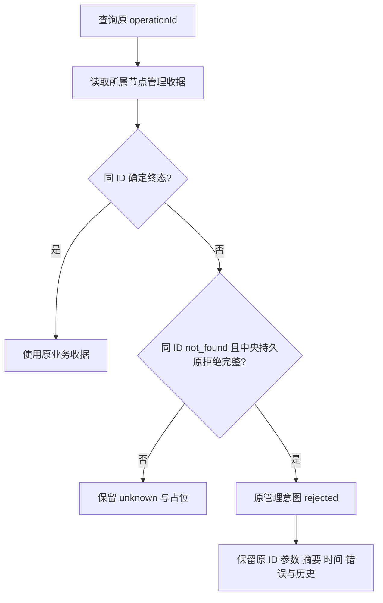

# 扫描、原管理操作与 DSH 状态修复

日期：2026-10-20。I07-REC01，AB-F02/F03/F07/F11；M01/M02/M03/M06/M07，候选交付另核对M10。主工作区仍alpha.34派生并含既有DSH/CT-07增量；公开alpha.35的独立修复尚未合入，本轮不把该公开EXE当作当前源码包。

## 需求与现场证据

用户报告四项：扫描/添加Agent不可点击，Codex提示原操作待核对但设置无记录，OpenCode需要检查原生API，以及DSH工具检查异常。

只读核对用户Windows profile：当前运行.dsh.3，执行台账未确认项0，管理台账未确认项1；原操作是WSL OpenCode的attach，持久错误ADAPTER_HOST。未复制秘密、内部身份或原任务正文；[脱敏现场摘要](../../../artifacts/agent-recovery/2026-10-20/field-summary.json)只记录版本/数量/错误类别。本轮未修改用户profile或重发请求。

该错误来自Bridge宿主工厂call/close契约，在原生API检查前发生；现场原参数摘要与管理结构已只读核对匹配恢复条件，不能证明模型、登录或原生API故障。已有[宿主生命周期修复](opencode-host-lifecycle.md)补齐工厂，但历史失败的管理unknown还需要独立结算。系统/usr/bin/dsh实际是Distributed Shell/Dancer's shell；DSH Web安装提示缺连接时也不应当作工具启动失败。

| 需求 | 最终行为 |
| --- | --- |
| REC-01 | 扫描与打开添加列表可用；真正接入/变更/执行仍检查原机器和资源占位 |
| REC-02 | 设置合并执行台账、中央管理台账与本机管理意图，显示原来源、类型、ID、错误与查询失败；节点可直接进入并自动定位到设置中的原操作卡片 |
| REC-03 | 原ADAPTER_HOST的attach在严格持久证明下结算rejected；不重派attach或任务，不把管理终态当作任务成功 |
| REC-04 | DSH安装但未配置服务显示“待配置服务连接”；同名外来程序不作为Agent，纯废弃发现提示可隐藏但不删除持久身份 |

## 原管理拒绝的完整条件

持久原拒绝必须同时满足：lane=node、method=manageNode、action=attach，非空原机器与节点，params.operationId等于原operationId，原params摘要完全匹配，原错误是ADAPTER_HOST且消息匹配宿主工厂固定契约；先读取原nodeOperation，同IDconfirmed/rejected优先。查询过程中才出现的ADAPTER_HOST、not_found、外来ID、缺摘要、其他动作/错误、网络失败均不能单独结算。

设置查询只调用所属nodeOperation、machine.operation、collaborationOperation或graphLayoutOperation；执行台账继续使用原recoverPending。管理本机缓存和中央pending按lane+operationId合并，展示字段显式选择，不把机器配置放入恢复视图。查询失败保留原意图，不调用manageNode、nodeRequest、submit、continue或cancel。

扫描只刷新安装目录。消失的未接入且未显式管理的纯发现提示，仅在无原上下文/请求/角色时从当前投影隐藏；持久nodeId保留。已有原归属、unknown或显式管理状态继续展示，扫描不会解除原资源占位。DSH配置提示新增errorCode=DSH_CONNECTION_REQUIRED与configuration_required投影，已保存连接的真实认证/网络/协议失败仍为工具错误。

## 实现与同步

- [中央原管理台账](../../../desktop/electron/graph-operations.cjs)、[节点投影](../../../desktop/electron/agent-network.cjs)、[DSH发现](../../../desktop/electron/dsh-connection.cjs)。
- [恢复视图字段](../../../desktop/src/operation-recovery.ts)、[桌面聚合与查询](../../../desktop/src/NetworkApp.tsx)、[机器入口](../../../desktop/src/MachineInventory.tsx)、[关系图](../../../desktop/src/AgentGraph.tsx)、[设置](../../../desktop/src/WorkspacePages.tsx)。
- 整体设计、M01/M02/M03/M06及OpenCode/M07设计与报告、架构/数据/协议和公开用户机器/DSH说明在同次交付同步。没有新增Task状态、模型API层、身份迁移或daemon协议版本。

## 本轮实际验证

环境：WSL Node22.23.1；Windows Edge生产构建、隔离受控IPC。新测试不调用真实模型。

| 检查 | 结果 | 原始材料 |
| --- | --- | --- |
| 完整桌面 | 632/632，失败0、跳过0 | [最终TAP](../../../artifacts/agent-recovery/2026-10-20/desktop-final.tap)；含原拒绝反例、DSH分类、发现身份/unknown保留与SSR |
| Windows原生契约 | 29/29，失败0、跳过0 | [日志](../../../artifacts/agent-recovery/2026-10-20/windows-contract.tap)，Node24.21.0/隔离HTTP与worker；首版测试入口相对路径错误，修正入口后通过，不修改产品校验 |
| Windows生产界面 | 6组通过，页面错误0、模型0 | [报告](../../../artifacts/agent-recovery/2026-10-20/ui/report.json)、[管理记录截图](../../../artifacts/agent-recovery/2026-10-20/ui/management-pending.png)；操作可点击、真正写入仍受保护、原错误/来源可见、失败保留/匹配收据后解除及DSH设置入口 |
| 核心/构建/类型/lint | 核心56/56、零跳过；源码/冻结桌面构建、类型与lint通过；最终定位改动SSR76/76通过 | [核心最终TAP](../../../artifacts/agent-recovery/2026-10-20/core-final.tap)、[SSR](../../../artifacts/agent-recovery/2026-10-20/ui-ssr-final.tap)、[核心首次TAP](../../../artifacts/agent-recovery/2026-10-20/core-tests.tap)、[核心构建](../../../artifacts/agent-recovery/2026-10-20/core-build.log)、[桌面最终构建](../../../artifacts/agent-recovery/2026-10-20/desktop-build-final.log)、[冻结最终构建](../../../artifacts/agent-recovery/2026-10-20/frozen-desktop-build-final.log)、[类型](../../../artifacts/agent-recovery/2026-10-20/core-typecheck.log)、[lint](../../../artifacts/agent-recovery/2026-10-20/lint.log) |

上述为共享计数，不跨模块相加。新增测试：[原管理拒绝](../../../desktop/tests/graph-operations.test.cjs)、[原归属保留](../../../desktop/tests/agent-network.test.cjs)、[SSR](../../../desktop/tests/ui-redesign.test.cjs)、[Windows界面](../../../desktop/tests/windows-agent-recovery-ui.cjs)。

首次受限runner未完成子进程测试；获得本机子进程授权后实际执行。首轮定向111/112，旧SSR断言受文案变化影响，调整文案保留原语义后完整632/632。首次核心55/56：既有v1夹具在原生绑定已保存、Prompt消息尚未生成时提前读取assistant；仅修正测试等待原消息证据，不放宽产品校验，最终核心56/56通过。Windows脚本首次受UNC签名策略阻止；仅测试进程使用执行策略后完成6组，未改系统策略。期间自动审批服务曾因用量限制无法完成审核，对应命令未执行；用户继续后重新正常审批执行。

[最后冻结核对](../../../artifacts/agent-recovery/2026-10-20/source-freeze-check.json)确认131个生产源码文件未变、生产前端资源一致；冻结源码清单共617项，主工作区后续文档补齐不冒称已进入EXE。[清单](../../../artifacts/agent-recovery/2026-10-20/source-manifest.json)。

检查第一版截图时发现卡片在设置页下方，补上自动定位并再次通过同6组界面测试（含卡片实际进入视口），最终以第二次截图为准。首版打包副本不交付，最终候选从含定位修复的独立目录重新冻结。

## 候选与未测范围

本地候选 **0.6.0-alpha.35.recovery.1** 从最终独立冻结目录构建，未发布GitHub或替换公开附件；它包含本轮修复及当前DSH/CT-07源码，不包含尚未合入的公开alpha.35独立修复。首版未含设置自动定位的副本不交付，以下均为最终副本。

- [Windows x64 EXE](../../../desktop/release/AgentBridge-0.6.0-alpha.35.recovery.1-Windows-x64.exe)
- [SHA256SUMS](../../../artifacts/agent-recovery/2026-10-20/SHA256SUMS.txt)
- 字节数 **130044281**；SHA-256 `5e3f385ba0be2893edd55b84df1acb454b7d8e992597ed8e010f4a65a467e351`。
- [最终包报告](../../../artifacts/agent-recovery/2026-10-20/package-final.json)：46 CJS、81 Core、1454 Linux资源、窗口ASAR/前端全部一致；[构建日志](../../../artifacts/agent-recovery/2026-10-20/package-build-final.log)。
- 普通Windows无调试EXE **6组通过**：原宿主拒绝结算、另一条超时unknown保持、两轮Task/原生Session历史、MCP导出/精确材料版本、关闭重开复用及后台重启读取均通过；原生请求0、用户配置安装0。[普通EXE报告](../../../artifacts/agent-recovery/2026-10-20/windows-portable.json)。

文档检查通过（207 Markdown、14模块设计/报告对，错误0），[日志](../../../artifacts/agent-recovery/2026-10-20/docs-final.log)；网页源与发布边界6/6通过。最终prod131项未变/前端一致，原EXE字节与复制交付后的摘要匹配。

用户原profile切换、真实OpenCode/DSH模型、独立SSH未验。新Windows EXE不会升级远端daemon。切换程序需在旧窗口“设置 → 后台运行 → 停止后台并退出”，再启动包含修复的新EXE；普通关窗口会继续复用旧后台。DSH Web仍需用户配置其实际服务根地址与连接token，Bridge不猜测或搬运原生凭据。
