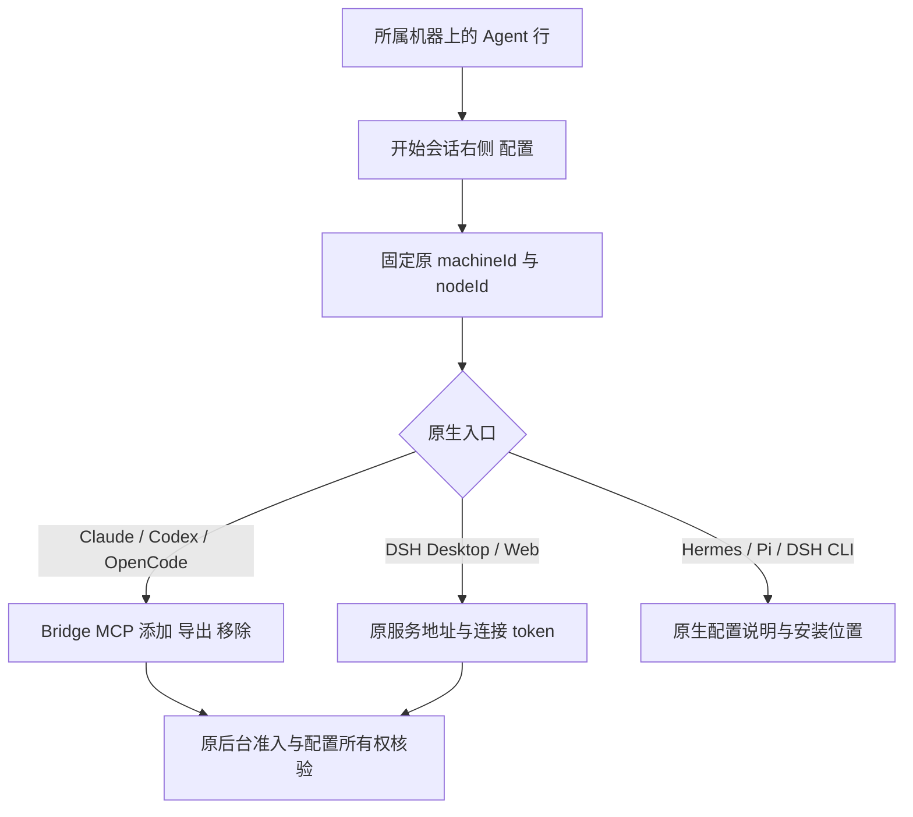

# Agent 行配置入口

日期：2026-10-21。I07-UI-CONFIG01；AB-F03/F07/F11，M01-F01/F02/F06/F14、M03-F02/F05、M06-F01/F02，交付另核对M10/M11。主工作区仍alpha.34派生；公开alpha.35独立修复未合入，本轮不改公开标签或附件。

## 用户需求与最终流程

用户指出Bridge MCP与DSH接入不属于全局设置，参考其提供的CC Switch截图，要求在“机器与 Agent”中、开始会话右边增加配置按钮。

当前概览每个Agent行按“开始会话/接入 → 配置（编辑图标）→ 更多”排列；关系图打开同一配置弹窗。全局设置移除两类接入卡片，也不再提前读取MCP/DSH状态；外观、连接概况、后台运行与原操作恢复继续保留。

弹窗显示所属机器与Agent，不提供二次机器/Agent/DSH版本选择。原目标缺失、离线、移除或被替代时保留原身份并禁用修改，不自动切换到其他可用节点。MCP的安装/导出仍要求已接入；移除仍遵守原授权/冲突规则。查看配置不启动模型、接入节点或重发原任务。

DSH按原adapter+executable精确匹配status中的脱敏连接记录，回填原服务根地址；不默认采用同机其他服务或另一Desktop/Web入口。token输入从不回填，保存结束或关闭后清空；新弹窗不继承前一节点的输入。更换服务地址继续遵守原新origin身份规则，旧历史/unknown不被解除。

打开时聚焦关闭按钮；Tab在弹窗内循环，Escape/遮罩关闭并返回原触发按钮。保存/添加/移除在途禁用关闭，等待原回应后再核对。窄窗口限制弹窗高度并滚动内容。错误/冲突/状态刷新继续可见，不把配置保存当模型成功。

## 实现与协议范围

- [统一弹窗](../../../desktop/src/AgentConfigurationDialog.tsx)、[概览](../../../desktop/src/MachineInventory.tsx)、[关系图](../../../desktop/src/AgentGraph.tsx)、[入口状态](../../../desktop/src/NetworkApp.tsx)。
- [单目标MCP](../../../desktop/src/McpSettings.tsx)、[单目标DSH](../../../desktop/src/DshSettings.tsx)、[全局设置](../../../desktop/src/WorkspacePages.tsx)、[弹窗样式](../../../desktop/src/workspace-pages.css)。
- DSH原错误提示改指向对应Agent的“配置”，[发现/认证实现](../../../desktop/electron/dsh-connection.cjs)。

后台方法、参数、错误码、daemon能力、原生模型/账号、配置所有权、原请求及持久数据格式均不变。仍使用原mcp.*({nodeId})与dsh.*({machineId,adapter,...})；本次不读取原生模型凭据、不增加供应商或模型层。界面绑定不替代后台权限与来源校验。

M01/M03/M06设计与报告、整体产品/架构/数据/协议、用户机器/MCP/DSH及三原生Agent页面和本次迭代材料同步更新。原[设置布局交付](mcp-installation.md)、[DSH设置交付](dsh-desktop-web.md)、[恢复候选](agent-management-recovery.md)保留当时界面和证据，不能据它们声称旧EXE已含新入口。

## 实际验证

环境：2026-10-21，WSL Node22.23.1；Windows Node24.21.0 / Edge155.0.4283.45；生产前端加受控IPC，MCP专项另接生产Coordinator与隔离真实配置文件，模型调用0。

| 检查 | 实际结果 | 原始证据 |
| --- | --- | --- |
| 完整桌面 | 649/649，失败0、跳过0 | [最终TAP](../../../artifacts/agent-configuration/2026-10-21/desktop-repaired.tap) |
| 配置/既有页面SSR | 82/82，含新增6项，均为全桌面子集 | [SSR](../../../artifacts/agent-configuration/2026-10-21/ssr-final.tap) |
| Windows生产前端 | 8组通过，页面错误0；同名跨机器、旧状态迟到、精确DSH条目、token清空、在途/离线、窄窗口/焦点、关系图入口 | [报告](../../../artifacts/agent-configuration/2026-10-21/ui/report.json)、[Agent行](../../../artifacts/agent-configuration/2026-10-21/ui/agent-rows.png)、[MCP弹窗](../../../artifacts/agent-configuration/2026-10-21/ui/mcp-dialog.png)、[DSH弹窗](../../../artifacts/agent-configuration/2026-10-21/ui/dsh-dialog.png)、[窄窗口](../../../artifacts/agent-configuration/2026-10-21/ui/narrow-dialog.png) |
| Windows生产MCP配置管理 | 4组通过，原生机器受控；隔离文件实际增删/三格式导出、冲突保留且先撤权、重新添加和正常移除 | [报告](../../../artifacts/agent-configuration/2026-10-21/mcp-ui/report.json) |
| 核心与工程检查 | 核心57/57、失败/跳过0；类型、lint、源码/冻结构建通过；网页源边界6/6 | [核心最终TAP](../../../artifacts/agent-configuration/2026-10-21/core-repaired.tap)、[最终类型](../../../artifacts/agent-configuration/2026-10-21/core-typecheck-final.log)、[最终lint](../../../artifacts/agent-configuration/2026-10-21/lint-final.log)、 [桌面构建](../../../artifacts/agent-configuration/2026-10-21/desktop-build.log)、[类型](../../../artifacts/agent-configuration/2026-10-21/core-typecheck.log)、[lint](../../../artifacts/agent-configuration/2026-10-21/lint.log)、[网页测试](../../../artifacts/agent-configuration/2026-10-21/docs-site-test.log) |

首次新增SSR 5/6：断言把“不支持添加Bridge MCP”的说明当成存在可操作按钮；改为检查实际按钮/input后通过，不改产品能力门禁。[初次结果](../../../artifacts/agent-configuration/2026-10-21/configuration-ssr.tap)。同日迁移后的既有DSH生产前端3组也通过，保存路由/密钥清空/真实能力限制保持，[报告](../../../artifacts/agent-configuration/2026-10-21/dsh-ui/report.json)。本次计数共享，不跨模块相加。测试源码：[SSR](../../../desktop/tests/agent-configuration-ui.test.cjs)、[生产前端](../../../desktop/tests/windows-agent-configuration.cjs)、[生产MCP文件](../../../desktop/tests/windows-mcp-settings-ui.cjs)。

最终文档检查通过：209篇Markdown、14组模块设计/报告、87张图与423项用例，错误0；用户站点17页/2张生成表，内部页面与证据导出均0。[文档检查](../../../artifacts/agent-configuration/2026-10-21/docs-final.log)、[站点构建](../../../artifacts/agent-configuration/2026-10-21/docs-build.log)。

## 验证中发现的OpenCode/DSH共存问题

首次完整核心52/56，4项在NATIVE_VERSION或其上游宿主未启动处失败，原因是健康DSH服务进入通用扫描后，OpenCode专用发现仅按healthy筛选，按adapter排序的DSH条目被当作OpenCode首安装。现场配置只读影响了是否复现，未调用其模型。新增隔离HOME/本机受控HTTP回归，确认DSH实际健康并与原OpenCode同时存在，随后删除原OpenCode仍不能由DSH替代；修复前1/1按预期失败。[反例日志](../../../artifacts/agent-configuration/2026-10-21/discovery-coexist-before.tap)。

修复后发现专项5/5、核心57/57与桌面649/649通过。仅在[src/discovery.ts](../../../src/discovery.ts)增加adapter=opencode过滤，不放宽版本或原路径检查。[发现回归](../../../artifacts/agent-configuration/2026-10-21/discovery-coexist-after.tap)、[原核心失败](../../../artifacts/agent-configuration/2026-10-21/core-final.tap)。此前.config.1冻结副本缺少此共存修复，不交付，最终重新冻结并核验。原生API/模型层/持久身份及请求语义不变。呈现移动无需改远端协议；若远端也受此共存问题影响，仍须更新实际远端daemon，Windows EXE不会代为升级。

## 本地候选与限制

最终独立冻结副本为 **0.6.0-alpha.35.config.2**；未提交/推送源码、创建公开标签或替换公开附件，公开alpha.35独立修复仍未合入。当前候选包含本工作区原有DSH/CT-07增量与本轮配置入口/共存修复，不能将其等同公开alpha.35源码复现。

- [Windows x64 EXE](../../../desktop/release/AgentBridge-0.6.0-alpha.35.config.2-Windows-x64.exe)
- [SHA256SUMS](../../../artifacts/agent-configuration/2026-10-21/SHA256SUMS.txt)
- 字节数 **130015316**；SHA-256 `eb13a208882a08eee7839df745bf215a82798b41c83071a1435138bed85990a0`。
- [最终包报告](../../../artifacts/agent-configuration/2026-10-21/package-final.json)：47 CJS、81 Core、1455 Linux资源、ASAR/前端一致；[构建](../../../artifacts/agent-configuration/2026-10-21/package-build-final.log)。
- [619项冻结清单](../../../artifacts/agent-configuration/2026-10-21/source-manifest-final.json)与[生产源码核对](../../../artifacts/agent-configuration/2026-10-21/source-freeze-check.json)：133项运行源码未变、前端资源一致。后续文档补齐不冒称进入该EXE。

普通无调试EXE **6组通过**：生产Coordinator/MachineHost/SQLite、原请求严格结算且无关unknown保留、材料/原生孤立历史/MCP导出、关闭重开复用原后台、完整后台重启保留记录、冻结运行资源一致。[实际报告](../../../artifacts/agent-configuration/2026-10-21/windows-portable.json)。该验证使用隔离profile与合成历史，模型调用0。本轮没有写用户原生配置、切换用户当前后台、调用真实模型或部署独立SSH；界面与配置文件验证不能代替这些验收，完整I06C/I07C仍未准出。

使用时先在旧窗口“设置 → 后台运行 → 停止后台并退出”，再打开新EXE。在机器与Agent对应行的会话按钮右侧点击“配置”；普通关闭窗口会继续复用旧后台。新客户端不会自动更新独立SSH daemon。
