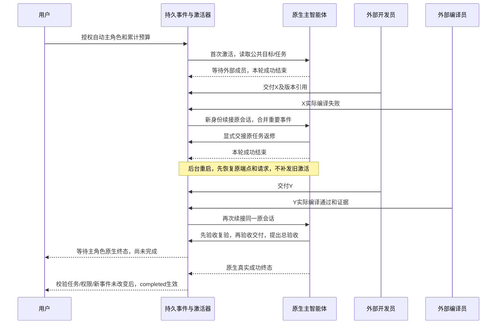

# I07C首批：重要事件激活与原生主会话持续协调

2026-10-18后续补验：[真实主协调/开发/复核公共文档链](native-members.md)在同WSL三个独立Bridge宿主通过，五次实际原生自动回合、完成重开观察不重放。下文仍是2026-10-16首批原始范围；代码编译返修和独立多机器链依然未验。

日期：2026-10-16。源码及GitHub预发布 **0.6.0-alpha.23**，分发见[发布记录](github-release.md)。本批在[I07B](task-handoff.md)上实现持续协调的首批能力；**不代表完整I07C或I06C准出**。未升级用户后台或接入用户自研产品。

## 1. 当前产品行为

在“小队协作 → 工作空间 → 持续协作”中，用户明确选择可以自动执行的成员，设置累计激活尝试次数、总时长与无进展检查间隔。默认20次、60分钟、10分钟，允许范围分别为1–100次、1–1440分钟、1–120分钟。自动成员必须包含原生主智能体；本批仅开启Claude适配，已实测版本2.1.299。外部MCP成员继续从自身入口读公共空间和接手任务，Codex/OpenCode暂保持手动，不能从它们已有resume参数推断新协作能力已通过。

启用、任务就绪、成员报告、成员原执行结束、明确协调请求和一次无进展检查会形成持久事件。普通群消息、@、已读、接手回执及主角色自己的回答不会制造新激活。无进展检查对同一个进展位置只产生一次事件，不按轮询无限提醒模型；没有新事件时模型调用数为0。

主智能体读取目标、公共约定、成员职责/权限、任务和报告，自己决定分配、交接、等待或验收。Bridge只机械地执行事件/权限/预算和原请求规则，不内置规划模型，不实现开发/编译业务。启用期间主角色承担协调，不给自己分配执行任务。自动原生成员接手已分配的就绪任务，绑定精确工作项及业务轮次；未支持的成员不会被悄悄替换成另一个节点。

## 2. 正常流程和状态边界

本批不向运行中的CLI stdin注入消息。重要事项先排队，每个成员至多一个在途激活，跨工作共享同一成员的运行/unknown也阻止新派发。报告在原生成员运行中写入时，主角色等相关原尝试终态核对后再激活，避免把报告当执行已完成。重复事件合并，激活意图、预算用量和事件归属与原请求一起持久。

续接只使用本工作、本成员已经成功结束且有原生Session绑定的最后一轮，沿原节点/上下文/Conversation；没有绑定、不可续接、明确失败或实际Session变化时停止该成员新激活并显示人工核对原因。绝不另开会话冒充恢复。每轮使用新的小队私有接入身份和MCP描述文件，旧轮终态身份立即失效；旧主从父scope规则保持原约束。

原生主角色在本轮运行中调用总验收时，只记录`awaiting_leader_terminal`，返回`accepted=false`。只有本轮真实succeeded、当前任务仍全部完成且修订一致、成员/设置修订未变化、没有新的重要协调事件和其他未核对执行时，才落为completed并关闭成员访问。失败、未知、暂停、撤权或新事项会使该提议无法生效；收据不是成功。

## 3. 暂停、预算、恢复和限制

| 情况 | 实际处理 |
| --- | --- |
| 停止自动调度 / 暂停 | 不再新派发，继续对账原执行；不发送原生取消，也不声称任务已取消 |
| 次数/总时长到限 | 停新激活，保留事件、历史、运行及unknown；用户可修改累计上限，重新启用不会清零次数/开始时间 |
| 无原执行回应或原请求不存在 | 只查询原请求；缺收据不是未执行证明，不重放、不换ID或节点 |
| 持久意图存在但派发标记尚未完成 | 保留待核对，重启不补发原激活 |
| 新报告并立即授权交接 | 即使返修清除了当前报告指针，失败历史仍形成主角色事件，不丢报错 |
| 外部成员接手 / 旧轮过期 | 就绪事件记为已接手或已过期，不继续显示成需要启动的事项 |
| 旧机器后台 | 续接需要teamContinuation能力确认，不支持时派发前拒绝；旧模式不受影响 |
| 后台重启 | 公共入口及定时器先等待原外部MCP端点恢复；然后只查询原尝试，必要时因新事件续接原会话 |

任务/章节细化权限、原生工具权限由原机制负责；群聊、角色说明或另一个Agent的转述不能变成人类批准。本批的停止按钮是“停止自动调度”，完整停止/取消原执行的跨适配器流程尚未交付。

## 4. 数据、接口和源码

`team-space.sqlite`格式2原子迁移至3，新增activationEvents，原成员/工作项/报告/授权/收据及请求身份保持。run.automation保存用户授权成员、累计次数/开始时间、阈值、修订代次及可见限制；attempt记录automatic、触发事件、原尝试关联和续接Conversation。实际原生Session绑定只在私有存储校验，不出现在公共attempt投影中。原生总验收提议保存任务/工作修订及事件位置，终态时重新核验。旧alpha.22不支持直接读取新格式，不覆盖运行数据降级。

| 落点 | 职责 |
| --- | --- |
| [team-automation.cjs](../../../desktop/electron/team-automation.cjs) | 事件去重/合并、能力与预算、原生激活/原会话继续、无进展检查、终态验收 |
| [team-space.cjs](../../../desktop/electron/team-space.cjs) / [team-work.cjs](../../../desktop/electron/team-work.cjs) | 事务、身份、原请求、修订、任务业务及验收提议 |
| [Coordinator](../../../desktop/electron/coordinator-service.cjs) | 每2秒机械对账/消费事件、私有原生调用、启动恢复屏障 |
| [AgentNetwork](../../../desktop/electron/agent-network.cjs) / [MachineHost](../../../desktop/electron/machine-host.cjs) | 原上下文/Conversation续接、新成员scope与能力确认，原资源准入不变 |
| [成员工具](../../../desktop/electron/team-tools.cjs) | 共16项，新增team_request_attention；正文不授予调度权 |
| [持续协作界面](../../../desktop/src/TeamAutomationSettings.tsx) | 明确授权、预算、事件/原执行状态、验收等待及停止调度 |

新增用户本地方法`team.configureAutomation`，设置runId、expectedRevision、enabled，启用时提供agentIds/maxActivations/maxMinutes/idleMinutes。`team.wake`保存明确协调理由；成员MCP对应`team_request_attention`，主角色不能用它唤醒自己。底层IPC/SSH帧版本仍为2，原主从工具集合不变。

本包同时冻结工作区原有的[Codex错误终态保护](codex-terminal.md)及[daemon创建时权限修复](daemon-bind.md)。各页保留其原开发/验证日期；不能将它们当成Codex真实续接或独立SSH自动小队验收。

## 5. 实际验证

验证日期2026-10-16，WSL Node22.23.1；Windows Node24.18.0、Edge155.0.4283.45；真实Claude Code2.1.299，沿用安装原生配置，没有新增模型API。

| 范围 | 实际结果 | 原始证据 |
| --- | --- | --- |
| 核心工程 | 45/45通过 | [TAP](../../../artifacts/I07C/2026-10-16/root-tests.tap) |
| 桌面工程 | 最终串行222/222通过，11项激活契约含并发/unknown/预算/修订与新事件竞争，旧基础及前置修复同时回归 | [TAP](../../../artifacts/I07C/2026-10-16/desktop-tests.tap) |
| Windows SQLite / stdio契约 | 29/29通过；旧公共空间/任务与新激活契约分别受测，模型0 | [TAP](../../../artifacts/I07C/2026-10-16/windows-contract.tap)、[脚本](../../../desktop/tests/windows-i07c-contract.cjs) |
| Windows界面 | 10组通过，生产前端/Coordinator/SQLite与受控节点/成员，模型0；暂停中启用设置，不启动原生夹具 | [报告](../../../artifacts/I07C/2026-10-16/windows-ui.json)、[脚本](../../../desktop/tests/windows-i07c-ui.cjs)、[截图](../../../artifacts/I07C/2026-10-16/workspace.png) |
| 真实主角色持续协调 | 5项通过，3次全部自动原生激活，原Conversation一致、每轮新scope、实际原生Session绑定核对，后台重启后继续；X真实Node检查退出1，Y退出0 | [报告](../../../artifacts/I07C/2026-10-16/native.json)、[脚本](../../../desktop/tests/linux-i07c-native.cjs) |
| 工程类型/lint/前端构建 | 通过；保留既有单包体积提示 | [lint](../../../artifacts/I07C/2026-10-16/lint.log)、[类型](../../../artifacts/I07C/2026-10-16/typecheck.log)、[前端](../../../artifacts/I07C/2026-10-16/desktop-build.log) |
| 最终Windows候选 / 普通EXE | 最终包逐项匹配32 CJS/78 core/1389 Linux文件；普通无debug EXE 5组通过，模型0，含关闭窗口和全后台重启后原端点/任务/授权/收据及X/Y接续 | [包](../../../artifacts/I07C/2026-10-16/package.json)、[普通EXE](../../../artifacts/I07C/2026-10-16/portable.json)、[脚本](../../../desktop/tests/windows-i07c-portable.cjs) |

真实主角色为真实模型；开发员与编译员是受控外部MCP连接器，编译员确实取得共享文档精确修订并执行Node语法检查。没有手动启动原生轮次，也没有使用固定模型回复。原自动激活/Conversation/任务记录保留于隔离私有profile，公开报告仅保存脱敏结论，不复制原生Session或凭据。

首次真实流程在后台重启后过早读取旧外部端点，`fetch failed`中断；前两次原生激活已成功，X失败和返修决定已保存。保留[首次报告](../../../artifacts/I07C/2026-10-16/native-initial-connection-race.json)。补上恢复就绪屏障后，以原操作查询已完成步骤，继续Y，没有重复前两次原生激活。另一次并行全桌面运行中，原有维护worker场景在validated阶段出现ENOENT，保留[失败TAP](../../../artifacts/I07C/2026-10-16/desktop-parallel-maintenance-failure.tap)；未据此改写原请求或宣称维护问题已修复，最终串行全桌面222/222通过。未修改维护worker的ENOENT路径，也未声称其低频问题已解决。

截图复核还发现全局input宽度规则将小队成员复选框拉伸、把说明挤成竖排，保留[原截图](../../../artifacts/I07C/2026-10-16/windows-ui-initial-checkbox-layout.png)。新增浏览器尺寸断言在修复前实际失败，保留[首次结果](../../../artifacts/I07C/2026-10-16/windows-ui-checkbox-failure.json)。修复后两个复选框均为16×16像素，说明文字正常显示，界面共10组通过；已实际复看最终截图。

## 6. 本批未验收与下一片

真实Claude自动主协调与重启续接已验证；自动原生执行成员目前有受控契约证据，尚未完成“主/开发/编译全部为真实原生Agent”的独立多机器链。未实测用户自研产品、独立SSH小队恢复、Windows真实原生自动链、Codex/OpenCode新小队自动续接。

运行中注入、通用外部执行器、完整停止/取消、原生权限等待/人工授权的自动通知专项、长时压力/断电/所有跨机器故障矩阵仍待后续。下一片继续补真实执行成员与接入能力，以及完整停止和权限等待；本报告不能替代完整I07C或I06C准出。

## 7. 复现与证据解释

核心`npm test`；桌面最终采用`node --test --test-concurrency=1 desktop/tests/*.test.cjs`（并行首次异常另保留），Windows用本机Node运行`windows-i07c-contract.cjs`、`windows-i07c-ui.cjs`、`windows-i07c-portable.cjs`。WSL交互Shell加载已安装Node后运行工程检查。真实脚本`linux-i07c-native.cjs`保留隔离profile，已有操作先查原收据；不能删除原profile或更换原请求来“恢复”未知执行。源码和发布资源经`verify-package.cjs --portable`逐项核对。

文档结构检查和新增时序图解析另列，不算模型/产品用例；全工程数字跨模块不重复相加。本批在同一WSL宿主上验证真实Claude主角色，没有连接用户独立服务器，不改原生账号/模型配置或用户默认后台。

## 8. 当前Windows预发布

本地候选`AgentBridge-0.6.0-alpha.23-Windows-x64.exe`已复制到Windows下载目录，同目录有`.exe.sha256`。最终文件大小 **129,877,607 bytes**，SHA-256：`17cded899fe491eabc08c7a39ad50fb0d4ac5fadc53444bd36525fe6c260c343`；[校验文件](../../../artifacts/I07C/2026-10-16/SHA256SUMS.txt)。GitHub预发布EXE与校验文件已上传并核验完整公开下载，见[发布记录](github-release.md)；未升级用户默认后台。

最终资源校验32个后台CJS、78个core文件、1389个Linux清单条目，app.asar及前端与最终源码匹配：[包报告](../../../artifacts/I07C/2026-10-16/package.json)。最终普通EXE实际结果单列于[生命周期报告](../../../artifacts/I07C/2026-10-16/portable.json)，证据汇总见[验证摘要](../../../artifacts/I07C/2026-10-16/verification-summary.json)。Windows普通包流程不执行模型，不能替代WSL真实Claude自动主协调证据。

最终文档结构检查通过，新增时序图实际解析通过；[结构结果](../../../artifacts/I07C/2026-10-16/docs-check.json)、[图表解析](../../../artifacts/I07C/2026-10-16/diagrams.json)。它们不能替代产品/真实原生验收。
