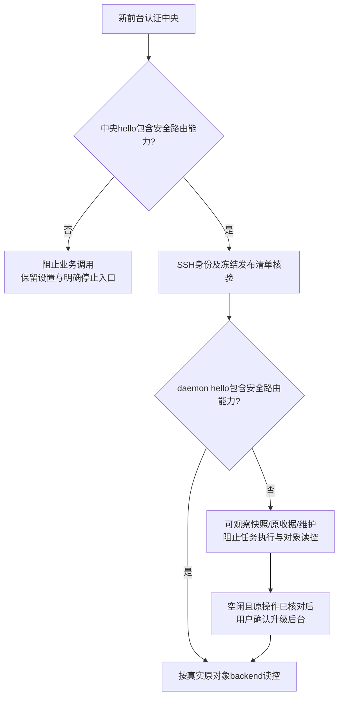

# 子 Agent 协作兼容性、原对象路由与能力激活（issue #7）

> 历史alpha.31范围：本页允许兼容1.x的策略已由[issues #8/#9的alpha.32仅2.x准入](version-management-recovery.md)取代；原测试与冻结发布证据仍属alpha.31。

日期：2026-10-19（北京时间）。源码/GitHub预发布 **0.6.0-alpha.31**，从已发布alpha.30源码/文档`48254b0`隔离修复；原工作区未提交CT-04/MCP修改不纳入。当前发布状态以本页最后的发布记录为准，完整I06C/I07C未准出。

## 需求与边界

对应[issue #7](https://github.com/wsjq5477/MA-Relay/issues/7)，覆盖AB-F02/F03/F07/F10/F11/F13/F17，M01/M02/M03/M04/M05/M06-OC/M07/M08/M10。

| 编号 | 修复要求 | 不变量 |
| --- | --- | --- |
| R01 | OpenCode发现与连接不按显示版本分裂；接入时确认实际API | 不接受任意1.x，不换安装路径，不调用模型验证兼容性 |
| R02 | 持久dispatched=false与preparationRejection决定委派rejected | 原ID/错误保留；裸NOT_CONFIGURED不是未执行证据 |
| R03 | task/conversation/pending/reply/cancel等按真实原对象来源路由 | 不按空Agent或缺owner回根后台，不删除未完成上下文 |
| R04 | 新前台及远端协作要求明确安全路由能力 | 不自动停止旧后台，不自动替换daemon，不绕过忙/unknown保护 |
| R05 | 界面与MCP能力/可用状态一致，提示具体检查或升级动作 | 原任务查失败不触发重发，不改变真实终态 |
| R06 | 新Windows EXE、冻结资源和公开校验附件一起交付 | 包验证与用户现场验收分开 |

现场报告的组合为alpha.30前台、alpha.29中央和alpha.24 daemon；本轮只读确认GitHub alpha.30源码位置，未连接用户profile或独立服务器。alpha.30已修复task/conversation详情路由，但尚未覆盖pending/控制操作或阻止旧中央复用；OpenCode仍有二次发现和serve启动的2.x字符串门槛，delegate仍按错误码集合分类。三组修复前合成回归分别精确失败于二次过滤、根IPC调用和unknown分类：[发现](../../../artifacts/collaboration-compatibility/2026-10-19/baseline-discovery.tap)、[路由](../../../artifacts/collaboration-compatibility/2026-10-19/baseline-routing.tap)、[委派](../../../artifacts/collaboration-compatibility/2026-10-19/baseline-network.tap)。

## 最终行为

### OpenCode API兼容与节点接入

[共享二次发现](../../../src/discovery.ts)只确认原executable仍能启动并报告版本，与外层安装扫描一致。显示版本不证明API兼容，也不证明账号/模型可用。[OpenCodeClient.probe](../../../src/drivers/opencode-client.ts)是启动、复用和健康检查共享的只读契约：认证GET `/api/info`的非空version、`/api/agent`的data数组、`/api/model/default`的null或模型对象、`/api/model`的模型数组；继承CLI时另检查`/api/config`数组。404/405或响应契约不符返回`OPENCODE_API_UNSUPPORTED`；认证/传输失败保留自身类别。不会创建Session、发送Prompt或修改原生账号配置。实际会话/Prompt/等待/取消仍经过既有逐操作契约，元数据握手不是完整原生行为验收。

[托管服务](../../../src/native-server.ts)启动和经严格进程归属验证的旧服务复用均调用同一probe，移除2.*字符串门槛。[DesktopHost.connect](../../../src/desktop-host.ts)优先返回真实startupError，避免不兼容serve被关闭后误显示普通网络不可用。

[节点接入](../../../desktop/electron/agent-network.cjs)对OpenCode建立默认目录上下文并检查只读API，成功才保存绑定executable/version的`apiCompatibility`。原已接入但无该证据、安装路径或版本改变、明确不兼容时，快照标记`needs_check`，execution/delegation不可用且available=false；界面保留“接入”检查入口。新需求准备仍检查实际上下文；不从缓存推定真实模型成功。新元数据为可选增量，旧历史/原Session不迁移。

### 委派拒绝与原请求恢复

准备失败先持久`preparationRejection`及`preparationError`，原dispatched仍为false。委派按原request/node/machine/输入指纹、dispatched=false、准备拒绝且无task/conversation绑定判定rejected；新错误码不再落入unknown。快照可只读核对旧unknown委派，同ID重试直接返回原拒绝码/说明，不重新准备或执行。缺证明/已派发/已有对象绑定的委派不结算，原未知占位保留。原任务错误由task_result直接透传，不把Claude SSL或Codex事件上限改成OpenCode配置错误；这两个独立问题本轮未修复。

### 原对象路由与后台能力

[MachineHost](../../../desktop/electron/machine-host.cjs)的task/conversation/pending/reply/cancel/operation/continue/reconcile在agent快捷路由前查各已绑定backend自己的快照，按原taskId或conversationId定位实际持有者。未找到返回NOT_FOUND，有观察失败且没有可证来源时保留原失败，多个来源返回OBJECT_SOURCE_CONFLICT；未绑定行不实例化。真正包含原对象的legacy仍可服务，缺owner不能猜根legacy。task/conversation回应须匹配原ID；其他回应带对象ID时也必须匹配。控制仍由原backend按原execution/operation/interaction验证，不换ID、不修改原生Session；request收据查询路径及既有持久证明规则继续适用。

新增语义能力`owned-object-controls-v1`，不改变wire protocol 2。中央hello携带此能力；[新客户端](../../../desktop/electron/coordinator-client.cjs)遇到旧中央时返回COORDINATOR_UPGRADE_REQUIRED，仅保留preferences/runtimes/shutdown，使设置中的“停止后台并退出”可用，不自动停旧任务。新daemon hello声明同一能力，SSH完成身份/版本/精确清单校验后记录`objectRoutingSupported`。缺能力的已知旧daemon仍允许snapshot/discover/原request及daemon台账/维护，但context/scope和对象读控/执行返回DAEMON_UPGRADE_REQUIRED。对应节点显示upgrade_required，执行与委派能力false，不再静默充当可用协作节点。收入兼容manifest只授权安全连接与维护，不授权缺能力的业务调用。

## 实际验证

所有模型调用0；受控HTTP/CLI、生产Controller、真实本地TCP SSH、Windows普通EXE、用户现场分层统计，不跨模块叠加。

| 范围 | 实际证据与当前结果 |
| --- | --- |
| 企业版发现、API握手与真实serve/Controller | [定向日志](../../../artifacts/collaboration-compatibility/2026-10-19/api-connect-final.tap)：9/9，含两个1.x兼容响应、404/错形拒绝、原生服务严格归属和同PID复用；没有Prompt |
| 委派、状态与真实错误字段 | [网络回归](../../../artifacts/collaboration-compatibility/2026-10-19/network.tap)：持久拒绝/同ID、节点能力及SSL/事件上限错误字段透传；后两者是合成终态，不是重跑用户失败任务 |
| 只读与控制来源 | [路由](../../../artifacts/collaboration-compatibility/2026-10-19/routing.tap)：缺Agent残行、缺owner、迟到可见、明确未找到、重复来源和显式错误Agent不能绕过 |
| 旧中央与旧daemon | [门禁](../../../artifacts/collaboration-compatibility/2026-10-19/compatibility.tap)：认证本地socket旧hello阻止业务，设置/显式停止可用；旧daemon阻止执行/对象读控，原收据/观察保留 |
| 真实受控TCP SSH | [日志](../../../artifacts/collaboration-compatibility/2026-10-19/ssh-final.tap)：生产daemon/MachineHost/SSH framing，旧hello缺能力时只读观察可用、task/pending/cancel被阻断；没有连接用户SSH |
| 失败保留 | [首轮完整桌面](../../../artifacts/collaboration-compatibility/2026-10-19/first-full/desktop-full.json)：新增CJS未复制到维护夹具、接入API探测被旧夹具误计业务context；补齐夹具后再全量复测。首次core运行在夹具更新前失败，保留[原日志](../../../artifacts/collaboration-compatibility/2026-10-19/core.tap)；未放宽产品门禁 |

完整工程、生产UI、普通EXE和发布摘要在最终验收补齐后记录于下节。

## 升级与未测项

1. 新EXE若提示旧中央缺能力，打开“设置 → 后台运行 → 停止后台并退出”，再开新EXE；普通关闭窗口会保留旧中央。升级操作不自动重发任务。
2. 原SSH机器继续安全连接，已知旧daemon节点显示需升级；先只读核对原请求和运行状态，空闲且无unknown维护阻塞时使用“后台维护 → 升级后台 → 确认升级”。不因兼容清单存在就绕过能力门禁或维护保护。
3. 新后台下对OpenCode重新“接入”完成API检查；不兼容安装明确拒绝，不更换路径兜底。原任务只查原ID，准备已拒绝的原ID保留拒绝；配置修复后的新工作由用户另发新请求。

未使用用户profile，未升级独立服务器或复验四节点现场组合，未证明用户企业版1.x实际具备兼容API，未运行真实模型。受控1.x可连接只说明同契约版本字符串不再被误拒；不证明任意企业版支持Bridge的会话/权限/取消。Claude证书及Codex一兆事件上限独立失败保留，本轮不宣称解决。完整I06C/I07C继续未准出。

## 工程与冻结发布包实测

最终桌面串行[537/537](../../../artifacts/collaboration-compatibility/2026-10-19/desktop-full.json)，Windows纯CJS[95/95](../../../artifacts/collaboration-compatibility/2026-10-19/windows-contract.tap)；生产Windows Edge新增[3组](../../../artifacts/collaboration-compatibility/2026-10-19/ui/report.json)及既有详情[7组](../../../artifacts/collaboration-compatibility/2026-10-19/ui-history/report.json)通过，0页面错误、0业务写入。Linux SSR63/63计入537总数。完整核心结果见[最终日志](../../../artifacts/collaboration-compatibility/2026-10-19/core-final.tap)，首次检查消费了重复元数据，已改为复用同次probe观测，既有冷启动断言保持；另同步原生偏好夹具缺少的agent元数据。一次[Controller重启失败](../../../artifacts/collaboration-compatibility/2026-10-19/core-controller-restart-failure.tap)保留，独立及完整复测结果按最终日志，不把偶发失败改成通过或降低产品断言。

候选包[校验](../../../artifacts/collaboration-compatibility/2026-10-19/package.json)通过：39个后台CJS、78个core、1403个Linux文件与ASAR/前端一致，[146个源文件冻结摘要](../../../artifacts/collaboration-compatibility/2026-10-19/source-files.json)未改变。Linux manifest为`c28d31a989b05d51903497494922ae5b7b0f1d8fa1c50d365896d68e8a5612eb`。Windows EXE 129953583字节，SHA-256 `e8a53cf59d520a546756daa4e2d183e3928a76bada6c6ba64d0de28ba01a5753`；发布前不将本地候选写为已公开分发。

[普通无调试Windows EXE](../../../artifacts/collaboration-compatibility/2026-10-19/portable.json)5组通过：先运行alpha.30保留中央，再打开alpha.31，确认新窗口拒绝旧后台业务但设置可读；显式停止后再开使用新能力。原Codex合成两轮/Session完整可读，缺失原记录NOT_FOUND，窗口关闭重开复用后台，完整后台重启保留原任务和原请求；6个冻结CJS与源码匹配，无runs目录或新原生执行。另一次[跨进程Hub请求失败](../../../artifacts/collaboration-compatibility/2026-10-19/core-integration-failure.tap)保留；Controller[独立4/4](../../../artifacts/collaboration-compatibility/2026-10-19/controller-repeat.tap)与CLI集成[独立1/1](../../../artifacts/collaboration-compatibility/2026-10-19/integration-repeat.tap)复测通过，不把失败原日志删除或改写为通过。

[lint](../../../artifacts/collaboration-compatibility/2026-10-19/lint.log)、[根类型](../../../artifacts/collaboration-compatibility/2026-10-19/typecheck.log)、[桌面类型/构建](../../../artifacts/collaboration-compatibility/2026-10-19/build-desktop.log)通过；既有Vite大包提示保留。维护控制器用真实生成的暂存脚本复制依赖并实际require验证，补齐runtime-capabilities.cjs，保证可维护升级，计入桌面537项。

最终核心全量48/48通过，0跳过；前述Controller/Hub失败单独保留，未放宽产品或测试超时。[最终核心日志](../../../artifacts/collaboration-compatibility/2026-10-19/core-final.tap)。

## 最终发布与验收

标签`v0.6.0-alpha.31`冻结源码`002107da776687474c2d369d9a182a9f81d50e90`；后续发布文档提交不改变源码标签或EXE。源码已推送GitHub master，[Windows x64 EXE](https://github.com/wsjq5477/MA-Relay/releases/download/v0.6.0-alpha.31/AgentBridge-0.6.0-alpha.31-Windows-x64.exe)、[SHA256SUMS.txt](https://github.com/wsjq5477/MA-Relay/releases/download/v0.6.0-alpha.31/SHA256SUMS.txt)及[预发布](https://github.com/wsjq5477/MA-Relay/releases/tag/v0.6.0-alpha.31)已公开。附件uploaded、大小和GitHub摘要匹配；匿名精确Range分段覆盖完整129953583字节，顺序重算SHA-256 `e8a53cf59d520a546756daa4e2d183e3928a76bada6c6ba64d0de28ba01a5753`，校验文本一致。[上传](../../../artifacts/collaboration-compatibility/2026-10-19/github-upload.json)、[元数据](../../../artifacts/collaboration-compatibility/2026-10-19/github-release.json)、[完整公开下载](../../../artifacts/collaboration-compatibility/2026-10-19/github-download.json)。

最终核心48/48、桌面537/537、Windows CJS95/95、生产UI新增3组/既有详情7组、普通无调试EXE5组、受控TCP SSH链及lint/类型/构建/文档检查通过。R01–R06在本页声明的证据范围内完成；三个旧源码回归均失败且修复后通过。未运行用户现场四节点或真实企业版模型，不宣称Claude证书/Codex事件上限问题已经解决，完整I06C/I07C继续未准出。
