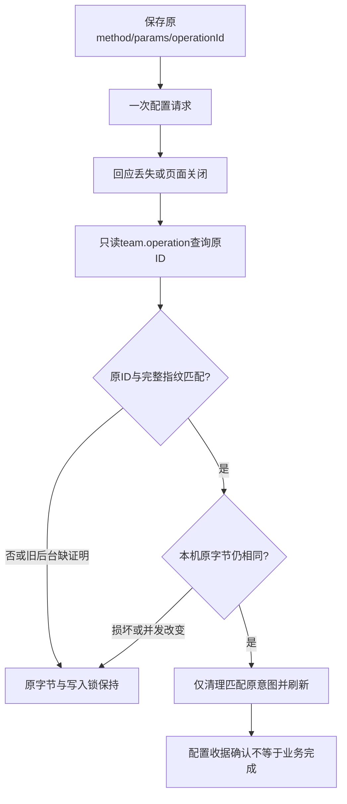

# CT-08：配置、审计与原执行恢复控制台

日期：2026-10-25；公开基线0.6.0-alpha.60 / a0f313c，工作区含alpha.61失败清理；本片本地候选0.6.0-alpha.62。需求是继续完成已确认的[Agent侧自主操作面](agent-centric-operations.md)与CT-08低频操作面收尾。关联AB-F01/F08/F09/F10/F11/F12/F13/F16，M01-F01/F04/F05/F06/F07/F14、M03-F01/F02/F04、M07-F01/F02/F06/F07、M08-F02/F05/F07–F10、M10-F01/F02/F03；同步M11用户说明。

## 范围与最终行为

实际入口main.tsx仍挂载NetworkApp；五个page ID不变。接入配置保留本机/WSL/SSH、节点配置、原生MCP、关系图和连接策略；移除机器概览、图卡、详情及根页面的新建/发需求入口，根组件不再挂载nodeRequest提交与续聊回调。

| 页面 | 本片行为 |
| --- | --- |
| 接入配置 | 配置已有机器、原生Agent、MCP与用户连接策略；保存授权不会开始任务 |
| 小队设置 | 登记成员、创建小队及工作作用域、生成工作MCP；用户配置成员访问、文档编辑者、预算、交接授权；保留暂停/停止/归档和原结果审计 |
| 执行审计 | 保留原Task、来源、输出、状态与只读原操作查询；默认不能回复权限/表单或取消，显式进入“处理这条原执行”后按原能力/身份处理；退出或切原任务重置恢复态 |
| 会话审计 | 原Conversation、各轮回答、历史/验证筛选及刷新保持；没有新建、发送或续问表单 |
| 设置 | 原主题、后台生命周期、原ID查询和已失败管理占位清理保持 |

日常提交、续聊、任务分配/接手/报告/返修/验收、群消息、文档正文和手动执行迁至原生Agent及已有MCP。小队建立工作作用域仅保存目标/标准与访问范围，不执行模型。共享文档权限表单只改editorIds，提交严格使用原title/content与expectedRevision。可复用旧组件的默认兼容参数继续支持历史测试/代码，实际根入口始终传configurationOnly/settingsOnly/auditOnly，不提供恢复旧日常界面的用户开关。

后台原生/CLI/RPC仍保留既有执行与权限检查，桌面收敛不作为授权边界，不新增模型API或修改原生配置。原Task/Conversation/Session、原父读控、关系、预算和unknown原占用不迁移。

## 原小队意图与收据证明

页面仍使用原localStorage键agentbridge.team.pending.<directory>及method/params/operationId。旧日常操作意图也只能查询，不因界面移除而删除或重做。写前检查原记录、保存完整意图，保存失败不派发；在途使用同步锁，不生成第二次提交。

SQLite的receipts已有actor/operation/fingerprint/result，本片直接读取现存持久指纹，不改变schema、格式或旧收据。team.operation确认时增加原operationId与fingerprint；data仍是原结果、原attempt或同一接入配置。指纹是完整方法/参数规范JSON的SHA-256，去掉operationId，方法始终取实际RPC，params根级method拒绝TEAM_INPUT。成员身份、原工作与撤权检查继续先于读取，连接查询不会产生新session或执行。



异步摘要计算后再次比较原localStorage字节，避免另一窗口在核对期间替换记录后被误清。错ID、缺失指纹、not_found、JSON损坏或无法读取/清理均保留并暂停新配置。旧后台缺证明时要求显式升级后再查询，不换ID重发。底层IPC/SSH仍为2。

源码：[实际入口](../../../desktop/src/NetworkApp.tsx)、[导航](../../../desktop/src/AppShell.tsx)、[机器概览](../../../desktop/src/MachineInventory.tsx)、[关系图](../../../desktop/src/AgentGraph.tsx)、[审计](../../../desktop/src/WorkspacePages.tsx)、[原执行恢复](../../../desktop/src/App.tsx)、[小队设置](../../../desktop/src/TeamWorkspace.tsx)、[任务板](../../../desktop/src/TeamTaskBoard.tsx)、[预算设置](../../../desktop/src/TeamAutomationSettings.tsx)、[浏览器原指纹](../../../desktop/src/team-operation-proof.ts)、[SQLite收据](../../../desktop/electron/team-space.cjs)。

## 实际验证

环境：WSL/Linux Node22.23.1；Windows系统Node24.18.0、包内Node24.21.0、Edge155.0.4283.62。生产React与真实Coordinator/SQLite、受控宿主和一次合成原历史任务；实际原生模型0，日常profile/关系未动。

| 检查 | 实际结果与证据 |
| --- | --- |
| 原有定向回归 | 90/90，[TAP](../../../artifacts/config-console/2026-10-25/existing-targeted.tap)；与后续全量重叠，不相加 |
| 原收据及审计专项 | 78/78，含新增4个收据证明与3个SSR用例，[TAP](../../../artifacts/config-console/2026-10-25/targeted.tap) |
| 最终Core全量 | 71/71、零跳过，[TAP](../../../artifacts/config-console/2026-10-25/core-full.tap) |
| 最终桌面全量 | 928/928、零跳过，[TAP](../../../artifacts/config-console/2026-10-25/desktop-full.tap)；较alpha.61新增7项，不与专项叠加 |
| 生产页面 | 最终6组通过，pageErrors=0、UI新执行尝试0，[报告](../../../artifacts/config-console/2026-10-25/ui-final/ui.json)、[截图](../../../artifacts/config-console/2026-10-25/ui-final/config-console.png)；初次5组[报告](../../../artifacts/config-console/2026-10-25/ui-source/ui.json)保留 |

新增收据用例覆盖原SQLite重启与无重做、方法冒充/同ID异内容、原成员会话隔离与撤权、连接原身份不新增session/执行。页面实际点击覆盖根概览/图/双击无新建、会话回答保持无续聊、默认只读与显式原任务恢复、小队日常按钮不存在、权限保存正文不变；配置实际提交后丢回应、完整页面重开、错ID与旧后台缺指纹保持、正确持久证明收敛且未重发；摘要计算期间并发替换及损坏记录锁定。

首次受限运行只报告文件级失败且未完成，已停止并保留[Core日志](../../../artifacts/config-console/2026-10-25/core-restricted-incomplete.tap)、[桌面日志](../../../artifacts/config-console/2026-10-25/desktop-restricted-incomplete.tap)，不计入通过；允许本机测试socket/受控子进程后才完成上述内部用例。首次CJS lint命中已有publicAttempt私有字段解构的未使用变量，[原日志](../../../artifacts/config-console/2026-10-25/backend-lint.log)保留；最终使用ignoreRestSiblings核对其刻意剔除行为，未改相关产品代码。

Core类型/lint、前端类型/生产构建、前端及后台/验收脚本lint通过：[Core类型](../../../artifacts/config-console/2026-10-25/core-typecheck.log)、[Core lint](../../../artifacts/config-console/2026-10-25/core-lint.log)、[前端构建](../../../artifacts/config-console/2026-10-25/frontend-final.log)、[前端lint](../../../artifacts/config-console/2026-10-25/frontend-lint.log)、[CJS最终lint](../../../artifacts/config-console/2026-10-25/backend-lint-final.log)、[包内验收脚本lint](../../../artifacts/config-console/2026-10-25/windows-verifier-lint.log)。

## 冻结包与本地交付

本地Windows x64便携EXE **130201291字节**，SHA-256 **`bcce8eb39eba18969e76869f844736d014e6cd811e5e44a7534041d0391c990f`**。冻结177个产品/依赖文件，打包后重算全部一致；原alpha.60/61 EXE的字节与原SHA均保持。56后台、84Core、1714Linux资源及ASAR/前端/bootstrap一致，linuxManifestDigest=`bc5305f048785851083cce85bf2f55b2c403f75625f3d99107a2793dfc2080d9`。

[EXE](../../../desktop/release/AgentBridge-0.6.0-alpha.62-Windows-x64.exe)、[校验文件](../../../artifacts/config-console/2026-10-25/SHA256SUMS.txt)、[包报告](../../../artifacts/config-console/2026-10-25/package.json)、[构建日志](../../../artifacts/config-console/2026-10-25/package-build.log)、[冻结清单](../../../artifacts/config-console/2026-10-25/source-manifest.json)、[重算与旧EXE保持](../../../artifacts/config-console/2026-10-25/source-verification.json)。

| Windows冻结检查 | 实际结果与范围 |
| --- | --- |
| 原小队收据 | 包内4/4通过；真实认证Coordinator管道提交用户配置、查询原ID/指纹、完整重启后精确原收据保持；attempt/request/delegation为0。[报告](../../../artifacts/config-console/2026-10-25/windows-console.json)、[4项TAP](../../../artifacts/config-console/2026-10-25/windows-console.tap) |
| 关系/连接策略 | 包内37/37通过；真实管道、双主与selected兼容、范围外明确确认、完整重启保持。[报告](../../../artifacts/config-console/2026-10-25/windows-relations.json)、[TAP](../../../artifacts/config-console/2026-10-25/windows-relations.tap) |
| 兼容/维护输入 | 42份冻结兼容pin、26/26契约与9,916,599字节完整维护输入通过；受控SFTP，无SSH网络。[报告](../../../artifacts/config-console/2026-10-25/windows-contract.json) |
| 包内生产页面 | 从最终ASAR提取实际前端，配合冻结backend重复6组通过，pageErrors=0、新执行尝试0。[报告](../../../artifacts/config-console/2026-10-25/ui-frozen/ui.json)、[截图](../../../artifacts/config-console/2026-10-25/ui-frozen/config-console.png) |
| Downloads交付 | 独立alpha.62文件及校验副本完整字节/SHA一致，未覆盖其他版本或不同文件。[交付核验](../../../artifacts/config-console/2026-10-25/download-copy.json) |

普通无调试EXE能启动，实际版本、Windows目录、生产中央IPC/SQLite及原收据字段通过；**当时关闭/重开与完整EXE中央重启未通过**。alpha.62共3次隔离运行均在“普通关闭后包装进程应退出”断言失败；包内Node与系统Node均复现。进一步记录Windows接受关闭且窗口可响应，但30秒后仍观察到原窗口/包装进程。保留alpha.61同环境1次对照也失败，窗口主进程代码SHA与原61完全相同，因此不能直接归因于本次控制台，更不能声称已修复。后续已定位为脚本重新枚举误选辅助窗，原窗口绑定修复后普通EXE五组通过；[最终普通窗口证据](../I08/window-lifecycle-verifier.md)。未延长阈值或用后台管道代替窗口关闭。

[生命周期汇总](../../../artifacts/config-console/2026-10-25/portable-lifecycle-analysis.json)、[首轮失败](../../../artifacts/config-console/2026-10-25/windows-portable-initial.json)、[系统Node复现](../../../artifacts/config-console/2026-10-25/windows-portable-system-node.json)、[关闭请求诊断](../../../artifacts/config-console/2026-10-25/windows-portable-close-diagnostic.json)、[旧61对照](../../../artifacts/config-console/2026-10-25/windows-portable-baseline61.json)、[实际进程/窗口状态](../../../artifacts/config-console/2026-10-25/portable-close-state.log)。首个PowerShell驱动在报告写出且子进程均结束后仍等待，已仅结束原专用驱动，[零子进程清理](../../../artifacts/config-console/2026-10-25/portable-driver-cleanup.log)；其他驱动有正常终态，未因观察超时重启在途验收。

公开alpha.60不变；alpha.62后续普通关闭/重开及完整中央重启已通过五组，见上方当前记录；未切换日常后台，Downloads副本与SHA保持。验收驱动均已结束，最终只读进程清点AgentBridge进程0，未强杀窗口或日常后台：[进程清点](../../../artifacts/config-console/2026-10-25/final-processes.json)。本片控制台交付汇总已补普通窗口通过，整体原生/图/WSL/SSH准出仍不完整，[机器可读汇总](../../../artifacts/config-console/2026-10-25/summary.json)。

文档检查0错误，用户站6/6、18页/19HTML构建通过，内部页面/证据发布0：[文档检查](../../../artifacts/config-console/2026-10-25/docs-check.log)、[用户站测试](../../../artifacts/config-console/2026-10-25/docs-test.log)、[构建](../../../artifacts/config-console/2026-10-25/docs-build.log)。整体设计、架构/数据/协议、受影响模块和用户流程同次同步。

## 未准出与后续

本片完成配置/审计控制台源码与受控页面范围；完整CT-08仍需真实父模型、用户日常多主连接/确认/撤权与跨主原任务恢复。MCP原生客户端组件不等于父模型自主委派；指定Windows OpenCode最多1个心算子任务授权仍未消耗。完整I06C/I07C/MCP02、图100ms、WSL持续稳定性与SSH故障/升级矩阵继续未准出。

普通EXE生命周期后续已按原主窗口补验；真实用户“×”输入和图像呈现指标仍须独立核对。页面验收为Windows Edge headless生产前端，不是普通EXE物理窗口输入或图呈现100ms证据；合成历史任务不是真实模型任务。模型0、无临时关系或原生持久配置修改，未签名、未公开发布/推送/打标签、未切换日常后台或部署SSH。

复现：

```bash
export PATH=/home/jiqi/.local/share/fnm/node-versions/v22.23.1/installation/bin:$PATH
npm test
node --test --test-concurrency=1 desktop/tests/*.test.cjs
npm run typecheck
npm run lint
npm run build --prefix desktop
node scripts/check-docs.mjs
npm run docs:test
npm run docs:build
npm run desktop:dist
```

Windows页面脚本[windows-config-console-ui.cjs](../../../desktop/tests/windows-config-console-ui.cjs)参数为前端路径/输出目录/可选冻结backend；[原收据包内专项](../../../desktop/tests/windows-config-console-contract.cjs)参数为冻结bridge路径/报告；[Windows原关系专项](../../../desktop/tests/windows-relation-state.cjs)参数为冻结bridge/报告。普通EXE生命周期另按隔离profile执行，不接管日常后台。
