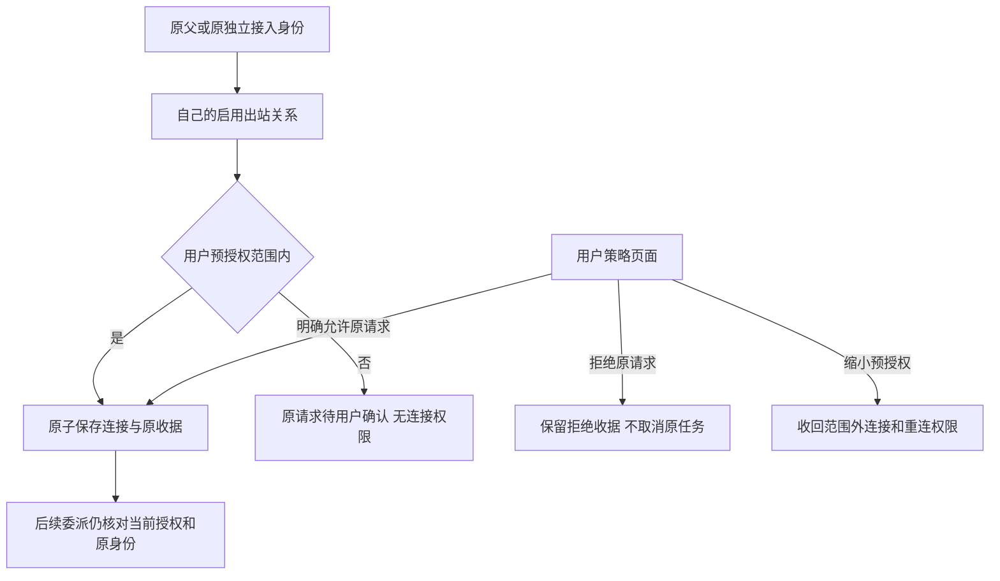

# CT-08-A3：Agent连接工具与用户预授权/确认

日期：2026-10-24（Asia/Shanghai）。关联CT-08、AB-F02/F07/F08/F11/F12/F13、M01/M03/M06/M07/M08/M10。承接[A2多主运行期](multi-parent-runtime.md)。公开仍alpha.53；本片不切换日常后台、不改用户原关系/原生配置、不部署SSH，真实模型0。Windows OpenCode最多一个心算子任务的许可尚未使用。

## 需求与当前行为

各主可在用户预授权范围内自行连接/断开；范围外只登记待确认请求，必须由用户明确允许后授权，不能由Agent调用用户侧审批接口。连接授权不是任务成功、取消或执行证据。用户可在“连接策略与确认”配置各主范围、决定原请求并审计最近连接操作；原关系图仍编辑selected兼容视图，不把所有旧页面删除。完整CT-08还需真实原生消费、日常多主流程验收及低频操作面收尾。

- `list_connectable({})`仅返回自己范围内目标；await后重取当前范围，不以所有网络节点作为可连接清单。
- `connect_agent({nodeId,operationId,queryOnly?})`：范围内原子授予成员权限；范围外保存pending_approval，权限不变。同关系同目标待确认期间，换操作ID/父或连接不能另建请求绕过原确认。
- `disconnect_agent`同形状：仅移除本主当前成员，保留预授权；不取消/重归属原任务、结果、权限或取消收据。用户撤销则同时删除该目标预授权，避免自动重连。
- 同一原ID先查询历史收据；指纹绑定原动作/目标，键绑定原node/request/task/conversation或独立connectionId。`queryOnly`查不到只返回not_found，不新建意图。unknown父不能新改连接，不能自行创建主角色；其他主/子不能读取别人的收据。
- confirmed描述原授权操作，当前连接须重新读取。原图管理unknown与节点/机器锁继续互锁；新ID或关系别名不能绕开。

## 数据、协议与兼容

agent-network.json外层仍version1，索引为relationsVersion3。各行新增必需`envelope:{version:1,revision,allowedNodeIds}`；原v1/v2仅以原memberIds初始化预授权，不扩大范围，原v1非selected仍disabled。每个启用主仅一个出站关系，成员须在范围内；读迁移只在内存，首次正常提交才落盘。alpha.59拒绝v3，不能用旧版本直接编辑升级后的数据。

同文件新增connectionOperations与connectionPolicyOperations，各最多4096条，不清理旧unknown/历史。Agent操作保存原owner、动作、目标、内容指纹、approvalId和结果；用户操作保存原ID、完整方法/参数指纹和确定收据。网络/策略/连接/收据同次原子rename；写前失败不授予，写后回应丢失按原ID读取已提交记录，不重执行。审计不输出私有父Task/Conversation/connectionId。

| 用户侧认证中央RPC | 合约 |
| --- | --- |
| connectionPolicies({}) | 当前activeRelationId、各关系/范围、待确认和最近50条安全审计 |
| saveConnectionPolicy | operationId/relationId/leaderId/expectedRevision/expectedPolicyRevision/allowedNodeIds；双修订CAS，缩范围同步撤销成员；显式用户保存可建立该主关系 |
| decideConnection | operationId/approvalId/decision/expectedPolicyRevision；allow只在原节点/主关系仍有效且修订匹配时扩范围并授权；reject只拒绝原请求 |
| connectionPolicyOperation | operationId；只查原用户操作，缺失不释放界面原意图 |

经典MCP由7增为10项，小队仍18项。Claude/Codex仅在既有托管临时工具允许项中加入新3项，reply_task原审批不变；不改持久用户原生配置、模型或账号。来源不接受Agent传入身份/关系伪装。中央hello新增agent-connection-policy-v1，仅新四RPC要求此能力，旧后台返回定向升级错误；daemon不声明中央扩展，daemon帧2与原默认会话身份不变。

用户页面按“机器 / Agent”区分跨机器同名节点；保存前将原方法/参数/ID/指纹写localStorage，不能保存则确定未派发。丢回应、离线、关闭重开后只查询原ID；not_found、缺/错指纹均保留锁定，不自动重发或换ID。损坏原意图保留字节并禁写；匹配原终态才能清理。刷新不会替换已经编辑的CAS草稿，陈旧保存被拒绝后由用户重新核对当前修订。

## 源码验证与原始失败

WSL Node22.23.1桌面全量900/900，失败/跳过0：[TAP](../../../artifacts/ct08-connections/2026-10-24/desktop.tap)。新[连接策略专项](../../../desktop/tests/connection-policy.test.cjs)16项包含原身份/跨父拒绝、范围内外、明确确认/拒绝、用户撤权、节点断开重接、unknown互锁、原子rename失败/写后丢回应、快照竞态、审计脱敏、真实独立MCP stdio目录10项与撤权、旧中央定向门禁。受控宿主和临时文件，真实模型0。最后两处移除未使用变量无行为变化，连接/Codex/MachineHost定向25/25通过：[TAP](../../../artifacts/ct08-connections/2026-10-24/final-targeted.tap)。核心产品未变，不把旧Core71/71记作本轮新测。

Windows Edge生产React页面/受控后端四组通过（源码构建）：预授权不自动连接、用户撤权后范围外请求与明确允许、原意图跨页面关闭恢复及伪收据锁定、存储失败不派发/损坏意图保留。各流程原生任务/委派0；不是物理窗口首帧或真实原生父模型证据。[原报告](../../../artifacts/ct08-connections/2026-10-24/windows-policy-ui.json)、[测试器](../../../desktop/tests/windows-connection-policy-ui.cjs)。

首次Windows驱动直接调用EXE无子进程/结果，核对自己的驱动无子进程后停止，改用项目已有Start-Process启动；未记通过。首轮页面暴露跨机器两个OpenCode同名，改用机器/Agent标签；第二轮测试在外部Agent写后沿旧修订保存，被生产CAS正确拒绝，脚本刷新到实际当前修订后再继续，未降低产品检查。[首轮报告](../../../artifacts/ct08-connections/2026-10-24/windows-policy-ui-initial.json)、[陈旧修订原报告](../../../artifacts/ct08-connections/2026-10-24/windows-policy-ui-stale-revision.json)。

类型/生产构建与改动文件lint通过；清理Codex未使用os导入与MachineHost未使用terminal常量，不改行为。[构建](../../../artifacts/ct08-connections/2026-10-24/frontend-build.log)、[lint](../../../artifacts/ct08-connections/2026-10-24/lint.log)。

## 本地候选验证

alpha.59原完整EXE摘要与1711项Linux文件已核验，原样导入可信清单，现在41份；不导入未交付58，不改原清单内容。[原导入](../../../artifacts/ct08-connections/2026-10-24/import-alpha59.json)。最终alpha.60 EXE **130212267字节**，SHA-256 **`d74c711b8475e84834519c8509a12a63351c1864a5ed4c01559588dc1fdc9cf6`**；56后台/84Core/1713Linux、ASAR/前端/bootstrap均一致，Linux manifestDigest `dcd5e46c4136b4280110e247064dcf9d57e75958d9f501784eed15d43a1a3a14`。[包核验](../../../artifacts/ct08-connections/2026-10-24/package.json)、[构建](../../../artifacts/ct08-connections/2026-10-24/package-build.log)。

Windows Node24.21.0冻结包迁移7+多主14+策略16共**37/37**、失败/跳过0；生产中央认证命名管道实测双主/各自授权、范围外原请求人工确认及同文件收据、完整中央重启后原关系/原用户确认与操作收据一致。[报告](../../../artifacts/ct08-connections/2026-10-24/windows-relations.json)、[TAP](../../../artifacts/ct08-connections/2026-10-24/windows-relations.tap)。首轮36/37失败发生在测试after hook：Windows下MCP子进程未退出仍占临时目录，删除报EPERM；原驱动等待句柄，核对并停止自有受控后代后保留失败报告。修正测试清理为先等子进程退出、关闭MachineHost再删目录，使用本地--test入口隔离，原断言未减；冻结产品代码未改。[原36/37](../../../artifacts/ct08-connections/2026-10-24/windows-relations-initial.tap)、[原驱动报告](../../../artifacts/ct08-connections/2026-10-24/windows-relations-initial.json)、[清理后16/16](../../../artifacts/ct08-connections/2026-10-24/policy-cleanup-final.tap)。

同冻结包Windows兼容**26/26**，41份pin逐字一致，**9,665,523字节**完整目录/原输入指纹和短失败诊断通过，不涉及真实SSH。[报告](../../../artifacts/ct08-connections/2026-10-24/windows-contract.json)、[TAP](../../../artifacts/ct08-connections/2026-10-24/windows-contract.tap)。冻结后台与包核验一致的生产前端再次通过上述四组页面流程：[最终UI报告](../../../artifacts/ct08-connections/2026-10-24/windows-policy-ui.json)；先前59版本号的源页面报告单列[保留](../../../artifacts/ct08-connections/2026-10-24/source-windows-policy-ui.json)，不相加。

普通无调试EXE独立profile生命周期**4组通过**：当前版本/Windows目录、生产IPC及SQLite公共资料持久化、正常关闭重开复用原中央与资料、完全重启原中央仍保持资料且原生执行0。[报告](../../../artifacts/ct08-connections/2026-10-24/windows-portable.json)。[本地EXE](../../../desktop/release/AgentBridge-0.6.0-alpha.60-Windows-x64.exe)及[校验文件](../../../artifacts/ct08-connections/2026-10-24/SHA256SUMS.txt)已交付Downloads，完整SHA一致、不覆盖不同原文件：[副本核验](../../../artifacts/ct08-connections/2026-10-24/download-copy.json)。未签名，切换时须先在旧版“设置→后台运行→停止后台并退出”，本次没有执行切换。

[源冻结清单](../../../artifacts/ct08-connections/2026-10-24/source-manifest.json)记录当前产品源码，冻结后仅测试驱动/清理与文档同步，无产品改动；工作树基于5269d65，无新公开标签。未公开、不切换日常后台或部署SSH；图100ms、WSL稳定性、完整原生/SSH准出不变。

## 真实原生前置与剩余范围

2026-10-24只读刷新原日常正式MCP条目与获准列表：实际中央仍alpha.46，沿其自身冻结客户端读取；7个目标中Windows OpenCode为0，未发现可执行本次许可的目标。未创建原意图、未发父prompt或子任务、未改关系/配置，也未替换为其他工具/WSL目标。[原前置报告](../../../artifacts/ct08-connections/2026-10-24/native-parent-preflight.json)。报告nativeParentModel=true是原脚本预定验收类型，此次status=preflight_unavailable、parentSubmissions=0/childTasksStarted=0，不能作为父模型证据。

真实原生消费10工具、用户日常多主确认/撤权/原任务恢复及低频操作面收尾尚未完成；图100ms/WSL稳定性与完整I06C/I07C/MCP02/SSH仍未准出。不得通过修改现有关系、换目标或换原ID消除这些边界。

[分层汇总](../../../artifacts/ct08-connections/2026-10-24/verification-summary.json)、[最终测试驱动摘要](../../../artifacts/ct08-connections/2026-10-24/scripts-sha256.json)。

最终文档检查0错误、用户站测试6/6与生产构建通过：18用户页/19HTML，内部页及证据导出0。[检查](../../../artifacts/ct08-connections/2026-10-24/docs-check.log)、[测试](../../../artifacts/ct08-connections/2026-10-24/docs-test.log)、[构建](../../../artifacts/ct08-connections/2026-10-24/docs-build.log)。
