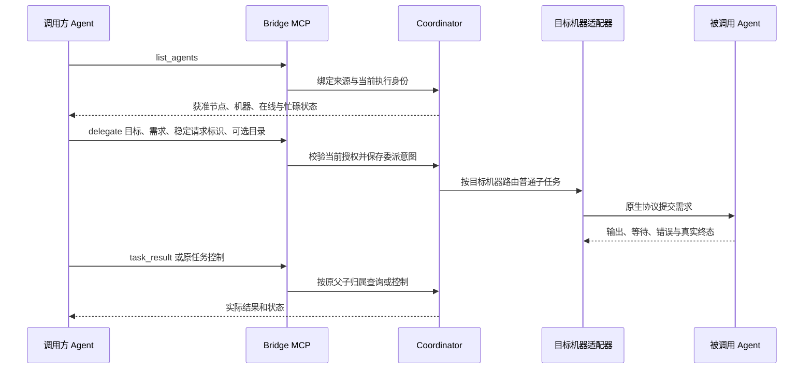
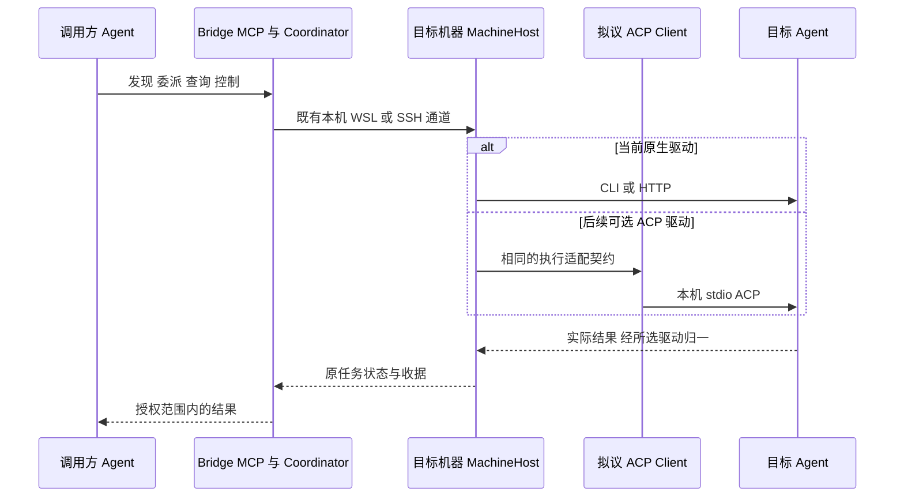

# 连接通路目标、ACP 与共享上下文研究

2026-10-19继续调研：[Claude Projects、Dots与Grok Bot](projects-dots-bots-research.md)补充公共材料索引、Library、显式上下文与可见交接；Grok Build有官方ACP入口，列为后续候选而非当前接入。以下保留本轮原研究时点，CT-01/02后续实现以[当前矩阵](../../agent-integration-matrix.md)及各专项为准。

日期：2026-10-18。类型：源码核对、外部一手资料/源码研究及后续目标整理。关联 AB-F02/07/08/10/11/13/20/21，M03/M06/M07/M08。没有修改产品行为、调用真实模型、运行 Multica、部署后台或构建/发布新 EXE。

每个 Agent 的当前适配程度、CLI/SDK/MCP/ACP 区别、证据和后续目标只维护在[接入矩阵](../../agent-integration-matrix.md)，本页记录研究依据和方案，不另建一份易失同步的能力表。

## 1. 用户本轮明确的范围

核心目标是提供 Agent 发现和操控其他 Agent 的通路。自动续接、多用户不是此次后续开发目标；先前自动激活/小队的实现与证据仍属历史事实，但不再把这些扩展是否完整当作连接核心的完成条件。原生同会话上下文复用是可选连接能力，与 Bridge 自动决定何时执行不同。

本轮要求整理接入矩阵，判断 ACP 是否有实际收益，解释 Agent 间通信的内容，以及公共 Markdown 和上下文复用的做法。研究与规划不等于产品实现或 ACP 已采用。

## 2. 当前源码到底传了什么

### 2.1 普通主从任务通路

当前 [MCP工具](../../../desktop/electron/mcp-client.cjs) 和 [路由](../../../desktop/electron/agent-network.cjs) 的业务数据如下，内部私有凭据不属于可共享内容：

| 动作 | 实际传递内容 | 当前不隐含的内容 |
| --- | --- | --- |
| 发现 | nodeId、machineId、name、adapter、status、busy、executionSupported、机器名称 | 不包含目标全部 Skill/目录/模型配置；部分高级控制能力尚未以完整细粒度矩阵返回 |
| 委派 | 目标节点、需求 message、稳定 requestId、可选目标机器 workspace | 不自动复制父完整对话；不自动同步项目文件；不把父账号或模型配置传给子 |
| 执行回执 | 子 Task、Conversation、父任务关联、delegationId | 收到任务不表示执行成功 |
| 结果 | Task状态、实际result/error、waiting、summary、delegationId | 没有把目标原生私有会话全部暴露给其他成员 |
| 控制 | 原 taskId、operationId；回复另含原等待 requestId、类型及答复 | 取消收据不代表实际取消；文字不能扩权 |

子任务由目标自己的原生配置执行，Bridge只包装通信。普通 `delegate` 的子任务为 `collaboration:false`，不注入 Bridge MCP。Hermes/Pi/DSH 可走这一普通被调用路径，但当前没有真实委派证据；不能据其不能注入 MCP 推导其不能被调用。

### 2.2 公共空间通路

I07A/B已经有公共工作材料。[TeamSpace](../../../desktop/electron/team-space.cjs) 在 SQLite 保存成员/工作、共享文档修订、消息、任务/报告及收据；[成员MCP](../../../desktop/electron/team-tools.cjs) 提供读取和受权限限制的写入。外部 Agent 也可自行配置 Bridge MCP 读取这些材料，但其执行生命周期仍由外部入口负责。

| 对象 | 当前存储及读取方式 | 当前用途 |
| --- | --- | --- |
| 工作上下文 | `team_context` 返回目标/完成条件、成员职责/权限、文档、最近消息、任务与尝试 | 建立共同工作背景；不代表所有成员共享同一个模型上下文 |
| 群消息 | 追加序号、发送身份、正文、回复对象、通知对象；`team_messages` 按游标分页 | 保留交互过程与错误反馈，普通消息不启动成员 |
| 共享文档 | 标题、正文、owner/editor、revision 和历史；读后带 expectedRevision 写入 | 保存共同结论，避免并发静默覆盖 |
| 任务与产物 | 负责人、依赖、业务轮次、报告、精确版本/引用和复核证据 | 区分当前进展、成员自报和实际执行终态 |

现有共享文档是可承载 Markdown 文本的数据库对象，桌面当前用 `pre` 显示；不是已生成、跨机器挂载的实体 MD 文件。`team_context` 当前会返回全部本工作文档及最近100条消息，不应把未来“精简上下文包、按需展开”的建议说成已完成。

## 3. ACP 是否值得做

研究结论：值得作为**可选通用原生驱动**试点。保留调用方的 Bridge MCP、中央授权路由与原请求台账；ACP Client 部署在目标机器后台，以 stdio 调用当地 ACP Agent。当前六种内置驱动都没有采用 ACP，也没有通过正式厂家 SDK 驱动。

| 判断点 | 结论 |
| --- | --- |
| 直接收益 | 有望复用任务/会话、增量输出、工具状态、权限与取消事件的解析和映射，减少逐Agent维护专用协议 |
| 对核心目标的作用 | 新的 ACP Agent 更容易成为可驱动目标；支持会话 MCP 配置时，也能接入 Bridge 的调用方工具 |
| 不会自动获得的能力 | 全局发现、授权、跨机身份、持久幂等、公共任务/文档、跨厂家上下文兼容和模型能力提升仍由各自层负责 |
| 成本 | 增加协议依赖和能力协商，包装器还可能改变原生配置、权限、会话或工具行为；需要重新验收 |
| 采用范围 | 先试点，不要求所有现有原生驱动重写，不以“协议统一”替代实际可用性 |

### 3.1 当前一手资料

- [ACP官方定位](https://agentclientprotocol.com/get-started/introduction)：Agent Client Protocol 面向客户端与编码 Agent。与 MCP 的 Agent 调工具方向不同；它不是 Agent 间公共任务总线。
- [传输](https://agentclientprotocol.com/protocol/v1/transports)：本地 JSON-RPC stdio；HTTP 方案仍有草案边界。Bridge试点沿现有SSH运行远端本地Client，不另开公网入口。
- [会话](https://agentclientprotocol.com/protocol/v1/session-setup)：官网当前 v1 Latest / v2 Draft；v1已有可选 `session/load`、`session/resume`，前者回放历史、后者不回放。须检查能力协商，不能宣称所有 ACP Agent 都能恢复。会话配置可携带 cwd 与 MCP 配置。
- [请求轮次与取消](https://agentclientprotocol.com/protocol/v1/prompt-turn)：`session/cancel` 是通知，不能把发出通知映射为已取消；须等待原 prompt 的实际取消结果。JSON-RPC id不是Bridge的持久业务去重依据。
- [OpenCode官方ACP入口](https://opencode.ai/docs/acp/)：`opencode acp` 是原生路径，可作为首个试点。当前AgentBridge的OpenCode驱动仍为serve/HTTP，本次没有切换。
- [Codex ACP生态适配器](https://github.com/agentclientprotocol/codex-acp)：当前经 Codex App Server 转换请求与事件；不是OpenAI官方原生ACP实现，也不应沿用“只包装exec”的旧描述。
- [Claude ACP生态适配器](https://github.com/agentclientprotocol/claude-agent-acp)：使用Claude Agent SDK；不是Anthropic官方原生ACP。当前AgentBridge自身直接spawn CLI，没有因该生态项目存在而采用SDK。

以上联网文档按本日观察，后续实施需冻结所选版本/源码。没有安装/运行这些ACP包装器。

### 3.2 如何证明做了有效果

CT-03建议先 OpenCode，再选择另一种真实支持的ACP Agent（Hermes可作为候选，见Multica源码），证明同一通用Client可以复用。记录新增适配需要的专用逻辑、特例数量、任务首反馈延迟与出错恢复情况，和现有路径作同环境比较；本轮没有这些实测值，不承诺一定更快。

| 验收项 | 必须观察到的事实 |
| --- | --- |
| 新任务与输出 | 真实回答、工具过程、失败和终态正确映射；没有模型/账号覆盖 |
| 反向MCP连接 | 同一ACP会话中的Agent能实际调用Bridge发现/委派/读结果；不能只看到配置字段 |
| 控制 | 支持类型的允许/拒绝和忙碌取消可核对原执行；不支持时能力明确拒绝 |
| 恢复 | 原会话能力缺失明确降级；进程/SSH/中央重启或丢回应后不重发原输入，未知保留占用 |
| 复用与兼容 | 第二种Agent复用通用Client，原CLI/HTTP路径仍可用；Windows/WSL/独立SSH按环境分别给证据 |

## 4. Multica 的源码模式

官方仓库为[multica-ai/multica](https://github.com/multica-ai/multica)。本轮只读克隆核对，固定提交 `f896cc483379ff16735a638e94b6c64d128329d2`（提交时间2026-10-18 22:57:16 +08:00）。以下是该提交的源码事实，未运行该产品；不把README的覆盖数当成现场验证，也不把它的完整平台范围纳入Bridge。

| 问题 | 实际源码做法 | 对Bridge的启发 |
| --- | --- | --- |
| 通信入口 | issue、评论线程、分配和结构化状态；prompt给issue ID和CLI读取命令 | 共享工作事实应有明确工具入口，不要求Agent理解内部数据库 |
| 传什么上下文 | 任务/环境身份、目标、触发评论或交接便签；相关评论按需展开 | 小型任务说明加版本化引用，避免每轮搬完整群聊 |
| 公共MD | 原生规则文件承载规范/环境背景，任务过程主要在issue/评论；源码明确移除重复且无人读取的任务MD | “生成了MD”不能当作“Agent实际读了”，文件视图须绑定入口和更新规则 |
| 原生Session复用 | 核验原Agent、issue、runtime与执行来源后再复用session/目录 | 复用必须保留原归属，不把不同Agent的原生Session混用 |
| 跨Agent材料 | `source_context`快照记录任务、评论线程、作者、版本/时间与附件 | 复用可移植事实，并保留来源和捕获时间 |
| 驱动协议 | Hermes/Kimi/Kiro使用ACP；Codex使用原生app-server JSON-RPC；Claude使用CLI stream-json | 混合驱动是可行模式，统一上层契约比强制所有后端用同一协议更重要 |

固定源码证据：

- [任务prompt与按需评论读取](https://github.com/multica-ai/multica/blob/f896cc483379ff16735a638e94b6c64d128329d2/server/internal/daemon/prompt.go#L256-L274)、[触发评论输入](https://github.com/multica-ai/multica/blob/f896cc483379ff16735a638e94b6c64d128329d2/server/internal/daemon/prompt.go#L388-L420)。
- [不再生成重复任务MD的实现与原因](https://github.com/multica-ai/multica/blob/f896cc483379ff16735a638e94b6c64d128329d2/server/internal/daemon/execenv/context.go#L121-L131)、[原生规则文件受管理区块](https://github.com/multica-ai/multica/blob/f896cc483379ff16735a638e94b6c64d128329d2/server/internal/daemon/execenv/runtime_config.go#L158-L241)。
- [原生Session的来源与runtime检查](https://github.com/multica-ai/multica/blob/f896cc483379ff16735a638e94b6c64d128329d2/server/internal/handler/daemon.go#L2971-L3065)、[source_context快照](https://github.com/multica-ai/multica/blob/f896cc483379ff16735a638e94b6c64d128329d2/server/internal/service/source_context.go#L127-L161)。
- [Hermes ACP后端](https://github.com/multica-ai/multica/blob/f896cc483379ff16735a638e94b6c64d128329d2/server/pkg/agent/hermes.go#L427-L459)、[会话协商](https://github.com/multica-ai/multica/blob/f896cc483379ff16735a638e94b6c64d128329d2/server/pkg/agent/hermes.go#L682-L758)、[Kimi复用](https://github.com/multica-ai/multica/blob/f896cc483379ff16735a638e94b6c64d128329d2/server/pkg/agent/kimi.go#L32-L70)、[Kiro复用](https://github.com/multica-ai/multica/blob/f896cc483379ff16735a638e94b6c64d128329d2/server/pkg/agent/kiro.go#L33-L65)。Hermes文件一处注释误写ACP全称，实际方法与Kimi文件对应Agent Client Protocol，不照抄误称。
- [Codex原生后端](https://github.com/multica-ai/multica/blob/f896cc483379ff16735a638e94b6c64d128329d2/server/pkg/agent/codex.go)、[Claude CLI后端](https://github.com/multica-ai/multica/blob/f896cc483379ff16735a638e94b6c64d128329d2/server/pkg/agent/claude.go)。

## 5. 其他业界模式与适用边界

| 一手来源 | 已知做法 | 本轮采用的原则 |
| --- | --- | --- |
| [Claude Code Agent Teams](https://code.claude.com/docs/en/agent-teams#architecture) | 官方实验功能；独立上下文窗口、共享任务与消息，成员不继承主Agent完整聊天 | 共享任务事实与必要消息即可协作，不必共享同一原生会话；不等于Bridge启用了该原生功能 |
| [Anthropic多Agent研究系统](https://www.anthropic.com/engineering/multi-agent-research-system) | 子Agent保留各自研究上下文；大产物外存，返回摘要和轻量引用 | 结果引用减少多次转述的信息损失，也避免堆积全部历史 |
| [Anthropic长期运行实践](https://www.anthropic.com/engineering/effective-harnesses-for-long-running-agents) | 进度记录与Git历史辅助新上下文恢复，功能状态使用结构化记录 | 文本便于接手，执行/任务状态仍应有明确结构和证据 |
| [A2A规范的contextId语义](https://a2a-protocol.org/latest/specification/#341-context-identifier-semantics) | contextId关联任务和消息；内部状态与上下文管理由Agent实现 | 可借鉴Task/Message/Artifact分层；当前Bridge没有采用A2A，不因调研增加协议迁移目标 |

## 6. 公共 Markdown 应怎样做

建议在已有公共文档上提供可读的公共工作记录。一次简单委派仍可只传需求和结果；多成员或需要接手的工作可约定 `WORK.md`/工作说明这一阅读视图。此名称和自动导出是后续建议，不是当前已存在的实体文件功能。

| 材料 | 建议承载内容 | 权威来源和维护方式 |
| --- | --- | --- |
| 工作说明/共同结论 | 目标、范围、交互规则、已确认决定、下一步、阻塞和产物索引 | Agent/用户通过版本化文档维护；Bridge只保存和检查权限/修订，不负责推理总结 |
| 当前进展 | 谁负责、当前状态、版本、最后更新、实际验证与未完成项 | 从任务/尝试/报告生成视图，不能通过改一句MD把unknown变完成 |
| 交互记录 | 成员提问、错误、回复、决定的来源 | 追加消息，MD只引用相关消息，不反复复制所有聊天 |
| 交接说明 | 接收者要做什么、已做什么、为何受阻、应读哪些精确版本材料 | 明确来源/文档修订/产物引用；接收者读取后再执行 |

中央SQLite继续保存权威数据。MD可通过MCP读取或导出为本机阅读副本；不要求远端共享磁盘，不默认双向同步编辑。若未来允许文件回写，须先定义文件与数据库之间的版本、冲突和失败语义，不能同时把两边当权威。MCP读取工具应返回已实现的文档/任务，不假造一个可访问文件路径。

当前文档没有规定统一进展模板或单一交接摘要，原生主从子任务也不会自动进入小队公共空间。后续可以在明确授权的工作范围内增加引用，不能把所有历史委派悄悄开放给新成员。

## 7. 上下文能复用到哪一层

| 层次 | 当前情况 | 建议 |
| --- | --- | --- |
| 同一Agent同一原生会话 | 原生Session/Conversation绑定已有实现，真实能力各工具不同 | 保留原节点/目录/配置归属；仅在实际支持时恢复，不用新会话假装续接 |
| 同一工作不同Agent的共同背景 | TeamSpace已有目标/任务/文档/消息；普通委派主要是message | 显式选择相关事实和版本化引用供对方读取，按工作授权，不复制无关材料 |
| 新工作复用旧结论 | 设计允许显式整理知识，当前没有通用自动跨工作上下文包 | 用户/Agent选择可分享结论并保留来源、日期、适用版本；不是整份私有聊天默认共享 |
| 模型私有状态 | Bridge没有通用访问或迁移接口 | 不承诺跨Claude/Codex/OpenCode移植Session、隐藏推理或KV缓存；同模型也不由Bridge推定兼容 |
| 文件和代码 | 传路径不等于对方能访问；Bridge没有项目自动同步 | 用既有Git/产物地址或公共文档引用，标版本/摘要；接收方无法取得则明确报告阻塞 |

CT-05建议交接信息包含：目标与完成条件、范围与约束、当前任务/业务轮次、共同结论、必要消息/文档修订、产物版本与可达引用、已测/未测、阻塞与下一动作。它是可移植的共享材料契约；不是把Agent私有原生会话压成另一家厂商Session。

首版可由调用Agent选择这些内容，Bridge机械地传递、授权、版本校验及读取，不新增模型API或自动总结器。摘要只是带来源的辅助材料；最新状态仍查原任务/收据。按需读取/分页比向每个Agent注入所有群聊更适合当前通路目标。

## 8. 本轮交付与验证边界

实际完成：源码与已有报告核对；六种内置及两种自研/外部接入方向矩阵；ACP与Multica固定源码研究；公共MD和可移植上下文方案；整体入口/路线与相关设计同步。CT-01至CT-05是后续目标，不是本轮产品完成项。

没有修改architecture/data-model/protocol的实际线格式、数据格式或权限。本轮只给这些入口补研究引用；M06/M08中“不能调用MCP”和“不能被委派”的文档混淆按实际源码纠正，未扩大能力声明或补造实测。

交付前执行 `node scripts/check-docs.mjs`、差异空白检查及新增图表解析。首次纯Node流程图解析受DOMPurify缺少DOM环境限制；改用序列图表达相同分层，未更改文档站安全配置，最终两图按默认安全设置解析。文档检查不计产品用例；历史474/45等工程结果与原生/EXE证据仍对应原冻结源码，本轮没有重跑或累加。
