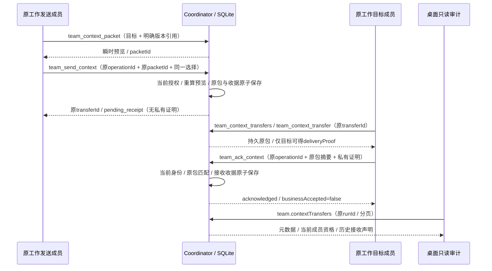

# CT-05 原选材包传递与接收收据

日期：2026-10-25（Asia/Shanghai）。关联 CT-04/05、AB-F20/F21、M01/M02/M06/M07/M08/M10。当前为本地 alpha.63 候选，继承 alpha.62 之后的工作源码增量；公开 alpha.60、既有 alpha.61/62 EXE 保留。真实模型调用 0；本片不是完整 CT-05、I07C 或 MCP02 准出。

## 需求与实现

已有[明确版本包](context-packet.md)和[桌面选材导出](context-packet-ui.md)只能证明调用者生成了副本。本片之前目标成员缺少持久收件入口和匹配原包的确认。本片通过原工作 MCP 补齐生成预览→持久传递→目标读取→接收确认；桌面沿[配置与审计定位](configuration-console.md)只展示元数据，不代替成员发送或确认。

`pending_receipt` 只表示尚无明确接收收据，不能推断未读取或传输失败。`acknowledged` 表示原目标成员接入提交了匹配响应和包内容的声明，不证明模型理解、业务完成、产物文件可达或文件同步。包不会启动成员、触发调度、传递原生 Session、扩展成员资格或清除 unknown。成员须主动读取；没有后台推送、自动执行绑定或跨工作导入。

## 接口、身份与原意图

| 用户 RPC | 成员 MCP | 参数与行为 |
| --- | --- | --- |
| team.sendContext | team_send_context | operationId / targetAgentId / selections / packetId；用户另带 runId。事务内核对当前同一预览，保存一份不可变原包，返回元数据 |
| team.contextTransfers | team_context_transfers | after? / limit?；默认20、最大50，next作为下一页after。用户另带runId；只读元数据，无正文和私有证明 |
| team.contextTransfer | team_context_transfer | transferId；用户另带runId。读取准确持久原包，只有当前实际目标成员取得 deliveryProof |
| team.ackContext | team_ack_context | operationId / transferId / packetId / deliveryProof / contentSha256；仅目标成员可写，用户不能代确认 |

成员 runId 来自原 Session，不能指定其他工作、发送者、Session 或接入身份；上述接口根参数严格白名单。用户可在现有授权下发送并审计原工作，不能冒充接收成员。成员只可列出/读取自己发送或接收的记录，不相关成员不能凭已知 transferId 或游标取得内容。原生 Session 必须仍在 dispatching/queued/accepted/running 且无续接错误；unknown/终态、成员撤权、停用、工作关闭继续拒绝读取及确认。用户仍可审计归档原包，但不会取得私有证明。

发送前必须调用原 `team_context_packet`；发送在同一 SQLite 写事务内重新核对原引用与 packetId，不因当前材料变化偷偷发送新版本。保存后不随材料编辑、工作修订或成员资料变化重建。原包保留既有 schema1、四类材料与256 KiB总上限，产物仍仅引用。目标读取后计算完整 `packet` 的规范 JSON SHA-256（包含 packetId 和 markdown；对象键递归按 UTF-16 排序、数组顺序保持、紧凑 JSON、UTF-8、无尾换行），作为 `contentSha256`。这与已有[摘要实现](../../../desktop/electron/graph-layout.cjs)相同；不是只对文档正文或原投影计算。

随机256位 `deliveryProof` 绑定持久原包，仅在已获准目标读取原传递时返回。列表、发送结果、用户/发送方详情、操作收据均不暴露它。确认恒时比较私有证明并核对 packetId/完整内容摘要；证明只用于这次收件声明，不能赋予权限。报告不保存私有证明或真实 Session。

写操作复用稳定原 operationId 和完整参数指纹，沿既有 actor/operation 收据。回应未知使用 `team_operation` 查询原ID，不换 transferId/operationId 重发。成员收据仍按原工作+成员隔离，不声称按 Session 去重。相同发送ID/参数始终返回原发送收据；收到确认后该历史收据仍可为 pending_receipt，最新状态读原传递。相同确认ID返回原收据；新明确确认ID也不会再次改变原确认时间。每次查收据/读包/确认都先检查当前权限；原收据不恢复撤权。

## 数据、限额和兼容

[team-context-transfers.cjs](../../../desktop/electron/team-context-transfers.cjs)在 `team-space.sqlite` 新增独立 `context_transfers(transfer_id,run_id,sender_id,target_id,body)` 表与工作索引；初始化在原状态校验后的迁移事务中完成。body 保存 schema1、原包、发送/目标身份和时间、完整内容摘要、私有证明及可选原确认时间/Session。未修改 state.version=3 或原 receipts 的结构。旧后台仍可读写原 state，保留它不认识的传递表；旧后台不能处理新传递接口。

最多256条、全部body累计8 MiB UTF-8，不自动淘汰未确认记录。容量、数据或磁盘失败时，原包/确认与原操作收据一起回滚。读取在同一只读事务内核对当前身份与原表；检查原包来源/目标/投影摘要/完整内容摘要，损坏保留原字节并拒绝，不生成替代包。传递写事务显式跳过自动事件同步，其他既有事务维持原行为；发送和确认不改变 state、通知、attempt、任务或激活事件。

中央独有可选能力 `team-context-transfer-v1`，仅对新四个用户 RPC 定向要求升级；旧普通调用仍按原能力集工作。daemon 不声明该能力，协议仍2，不强制远端升级、部署或增加适配器能力。小队 MCP 18→22，经典主从10工具保持。

| 错误 | 意义 |
| --- | --- |
| TEAM_INPUT | 缺失/伪造字段、非法摘要/分页/引用；拒绝新增 |
| TEAM_CONTEXT_STALE | 发送时预览与当前同一选择不匹配；未保存新传递 |
| TEAM_CONTEXT_TRANSFER | 原传递或游标不在当前可读范围；不泄露其他工作 |
| TEAM_CONTEXT_RECEIPT | 证明、原packetId或完整内容摘要不匹配；不提交确认 |
| TEAM_CONTEXT_STATE | 原包无法校验；保留原记录，不用当前材料替换 |
| TEAM_CONTEXT_CAPACITY | 行数/字节上限；原包与未确认收据保留 |
| TEAM_FORBIDDEN / TEAM_CLOSED | 当前身份/工作不允许该操作；历史收据不恢复权限 |
| TEAM_OPERATION_CONFLICT | 原操作ID已用于不同参数；查询原意图 |
| TEAM_CONTEXT_UPGRADE_REQUIRED | 原中央不支持新RPC；停止旧后台后使用新版，不能绕过门禁重发 |

## 桌面只读审计

[TeamContextReceipts](../../../desktop/src/TeamContextReceipts.tsx)位于原工作的小队设置，默认折叠，仅明确读取/刷新/分页调用 `team.contextTransfers`。显示发送/目标名称、原时间、原包摘要/传递ID、材料数量、接收声明和当前目标成员资格；`recipientAuthorized` 是当前工作成员资格，不承诺存在可用的原生运行 Session。没有发送/接收确认按钮，不读取包正文或私有证明。

客户端核对完整响应白名单、原runId、分页游标、重复ID、材料计数及状态/证据组合。切工作、换目录或卸载丢弃迟到响应；读取失败不把旧列表当作新结果。旧后台升级错误原样显示，不回退到本地预览或最新材料。本机原执行/配置意图不因审计读取改变。

## 实际验证与未完成

WSL Node22.23.1：新增受控后端13项、生产 Coordinator/真实stdio双客户端1项、审计校验/React渲染2项，合计16项定向通过，模型0。覆盖重启/丢回应原ID去重、准确旧正文、错误摘要/盲确认、相关成员可见性/撤权、原生unknown/终态、归档用户审计、分页/容量/磁盘回滚、损坏保留、旧state-v3写入和无状态副作用。全部是隔离数据，不能当作真实父模型理解或用户日常收件。

[后端13项](../../../artifacts/context-delivery/2026-10-25/targeted-expanded.tap)的早期版本另实际加载保存的alpha.62 TeamSpace进行旧后台写入后重开，记录表保留；最终常规测试改成独立旧state-v3 SQL读写契约，不依赖 artifacts 中的临时源码。原先受限node:test只报文件级失败，未执行逐项结果，见[受限日志](../../../artifacts/context-delivery/2026-10-25/before-restricted.tap)；允许隔离本地进程后4项基线均为 TEAM_METHOD，另以保存的原alpha.62后端[复现4项基线](../../../artifacts/context-delivery/2026-10-25/before-alpha62.tap)，新增实现后通过，不把环境失败计作产品场景。

[生产双客户端](../../../artifacts/context-delivery/2026-10-25/mcp-first.tap)、[审计契约](../../../artifacts/context-delivery/2026-10-25/ui-contract.tap)。复现：`node --test desktop/tests/team-context-delivery.test.cjs desktop/tests/team-context-delivery-mcp.test.cjs desktop/tests/team-context-receipts-ui.test.cjs`。最终源码全量和冻结包验证见下节。

未完成范围：最终包真实父模型实际消费、持续原生生命周期、独立SSH与完整CT-05矩阵；实体文件同步、跨工作导入和自动执行绑定仍未实现。已有Windows OpenCode一次心算子任务许可未消耗，不能改作本片新模型任务。完整目标保持进行中，见[全迭代台账](../I08/completion-audit.md)。

## 最终本地交付与分层证据

最终本地版本 **0.6.0-alpha.63**，EXE **130203473字节**，SHA-256 `2ba100ea01ceee057bed3a03763b92a442c75bd4b094ed70873608f49157b40a`。公开仍alpha.60；未签名、未切换日常后台、未部署SSH。既有alpha.60/61/62 EXE的字节数和摘要全部保持，[保留核对](../../../artifacts/context-delivery/2026-10-25/prior-exe-preservation.json)。

| 证据层 | 当次实际结果 | 原始来源 |
| --- | --- | --- |
| WSL源码回归 | 桌面944/944、Core71/71，零失败/零跳过；新增16项包含在桌面全量，不相加 | [桌面](../../../artifacts/context-delivery/2026-10-25/desktop-final.tap)、[Core](../../../artifacts/context-delivery/2026-10-25/core-final.tap) |
| 冻结资源 | 57后台/84Core/1715Linux、ASAR/前端/bootstrap逐项一致；Linux digest 242c83de189b75c28e928b7b0e4b1331e06fb22c5a9f2ec396ded096512e2b27；180个构建前冻结产品/依赖文件交付后未变 | [包核对](../../../artifacts/context-delivery/2026-10-25/package-recheck.json)、[冻结清单](../../../artifacts/context-delivery/2026-10-25/source-manifest.json)、[重核对](../../../artifacts/context-delivery/2026-10-25/source-recheck.json) |
| 原生跨客户端组件 | Linux Pi1.4.0→固定源码Hermes客户端7组；真实读取/发送/收件/确认、两边与broker重开、撤权缓存拒绝、清理通过；无父模型/托管Task | [脱敏报告](../../../artifacts/context-delivery/2026-10-25/native-pi-hermes.json)、[显式脚本](../../../desktop/tests/native-context-delivery.cjs) |
| Windows冻结后端 | Electron44.7/Node24.21：传递14/14和实际中央管道/重启三组；原收据4/4、关系37/37、兼容26/26回归通过；受控模型0 | [最终传递](../../../artifacts/context-delivery/2026-10-25/windows-context-final.json)、[14项TAP](../../../artifacts/context-delivery/2026-10-25/windows-context-final.tap)、[原收据](../../../artifacts/context-delivery/2026-10-25/windows-console.json)、[关系](../../../artifacts/context-delivery/2026-10-25/windows-relations.json)、[兼容](../../../artifacts/context-delivery/2026-10-25/windows-compatibility.json) |
| Windows生产页面 | 系统Node24.18、headless Edge：新增审计5组、原控制台6组通过；实际冻结React/Coordinator/SQLite，受控材料；非物理窗口/模型验收 | [新增审计](../../../artifacts/context-delivery/2026-10-25/ui-context/ui.json)、[控制台](../../../artifacts/context-delivery/2026-10-25/ui-console/ui.json)、[新脚本](../../../desktop/tests/windows-context-delivery-ui.cjs) |
| 普通Windows EXE | 非调试便携EXE六组：原文档/消息/发送收据及目标stdio确认时间在普通关闭重开/完整中央重启后保持；三次主窗关闭均原进程退出、包装码0 | [普通EXE](../../../artifacts/context-delivery/2026-10-25/ordinary-final.json)、[实际驱动码0](../../../artifacts/context-delivery/2026-10-25/ordinary-driver-result.json)、[接收收据补验器](../../../desktop/tests/windows-context-transfer-proof.cjs) |

原生来源复用[已保留固定原包](../I08/native-policy-components.md)并在本次重新核对Pi5份/Hermes8份摘要，以及冻结63全部57后台；Hermes仍为固定源码unknown，不能描述成正式安装版或Windows Hermes。模型0；客户端取得包和发送确认由验收驱动调用原生MCP组件，不代表自主父模型消费。其临时Home/受控工作/broker已清理，不修改日常原生配置。

Windows每个驱动使用ProcessStartInfo实际等待/异步排空输出，六个阶段真实退出码均0，[驱动结果](../../../artifacts/context-delivery/2026-10-25/windows-driver-results.json)。普通EXE复用已核对的原Process/窗口归属与标题关闭规则，未放宽30秒退出要求；本轮额外保留0/7驱动码控制，不以null或窗口消失代替退出。用户“当前未运行或没有观察”继续只是人工×体验未观察，不改写为人工通过。

升级/切换入口仍是先在旧版“设置 → 后台运行 → 停止后台并退出”，再打开新EXE；新候选不会替换现有日常后台，旧中央只对新四RPC定向拒绝。SSH daemon仍独立，不自动部署。完整目标及其余门禁见[全迭代台账](../I08/completion-audit.md)。

Windows Downloads副本已完整核对相同130203473字节和SHA-256，未自动启动；[副本与进程核对](../../../artifacts/context-delivery/2026-10-25/downloads.json)当次剩余AgentBridge进程0。可运行文件为 `C:\Users\<用户>\Downloads\AgentBridge-0.6.0-alpha.63-Windows-x64.exe`；仓库原件为[本地EXE](../../../desktop/release/AgentBridge-0.6.0-alpha.63-Windows-x64.exe)。

用户站首轮因“历史记录”触发既有用户正文内部用语限制而未进入测试，保留[首次失败](../../../artifacts/context-delivery/2026-10-25/docs-test.log)和[定位失败](../../../artifacts/context-delivery/2026-10-25/docs-test-wording-failure.log)。正文改为“原传递记录”后6/6通过；未放宽发布校验。该修正仅文档，无产品行为变化。

全量后补强同一成员在另一真实工作Session下的列表/读包/确认拒绝断言；最终[16项定向](../../../artifacts/context-delivery/2026-10-25/targeted-final.tap)及Windows14项再次通过，产品180个冻结文件没有变化。Windows补验最初复用了TAP输出路径，首轮TAP未单独保留；首轮JSON从原已保存stdout恢复，最终增强TAP另命名保存，不把它当两套独立场景相加。[首轮原stdout](../../../artifacts/context-delivery/2026-10-25/windows-context.stdout)、[补验驱动码0](../../../artifacts/context-delivery/2026-10-25/windows-context-final-driver.json)。

工程收尾：根类型检查、前端类型/构建、相关前后端/验证脚本lint、差异空白检查通过；[文档检查](../../../artifacts/context-delivery/2026-10-25/docs-check.log)0错误、[用户站测试](../../../artifacts/context-delivery/2026-10-25/docs-test-final.log)6/6、[站点构建](../../../artifacts/context-delivery/2026-10-25/docs-build.log)18用户页/19HTML、内部页/证据导出0。[分层汇总](../../../artifacts/context-delivery/2026-10-25/verification-summary.json)明确本地交付通过、整体目标未完成；[验收脚本摘要](../../../artifacts/context-delivery/2026-10-25/verification-scripts.json)用于定位实际末次验证器。
