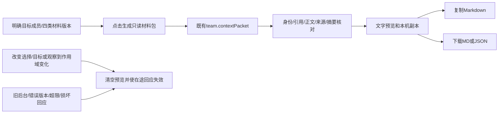

# CT-05 桌面明确选材、核对预览与本机导出

日期：2026-10-20（北京时间），AB-F20/F21、M01-F10、M07-F08/F09、M08-F07/F08；核对M10包范围。基于[CT-05 API/MCP首片](context-packet.md)，本片只增加桌面消费者和测试，没有修改Coordinator/TeamSpace/原生驱动或新增RPC。公开alpha.32，本地integrated.3旧冻结包不含本片，完整CT-05/I07C/I06C未准出。

## 1. 本轮需求与实际范围

先核对相关会话和上轮报告，没有新增限流中断任务；上轮API/MCP及真实Claude单任务读取已完成。本轮从桌面入口缺口继续：用户明确目标成员和材料，生成核对后的只读包，再复制/下载。工作源码保留整合、独立MCP、CT-04和原未提交增量；未更改原requestId/operationId，不提交或发布。

| 要求 | 最终行为 |
| --- | --- |
| CPUI-01 明确选择 | 目标成员初始为空；四类材料初始未选，不自动打包整个工作或默认选主角色 |
| CPUI-02 准确版本 | 文档从已有history指定修订；任务记录选择时revision/round；消息ID+seq；产物按报告历史选择ID/version |
| CPUI-03 按需读取 | 打开/展开不生成包；用户点击才调用team.contextPacket；较早消息按显式按钮一次读一页 |
| CPUI-04 核对和失效 | 只显示已核对包；改变选择/目标、观察到撤权/任务变化、切工作/目录、旧后台/坏响应均不能沿用旧导出 |
| CPUI-05 本机副本 | 文本预览、受控clipboard、UTF-8 MD/JSON下载；不授予访问、不标已读、不发送或执行 |

每类最多8项，空选择禁用生成；超过容量由原256 KiB响应限制及客户端复核明确拒绝。界面没有业务交接、目标已收到、产物可达或业务验收成功的宣告。跨工作导入、自动发送、收件证明、全产物Library和跨工具完整消费继续待开发。

## 2. 当前完整桌面流程

[TeamContextPacket](../../../desktop/src/TeamContextPacket.tsx)在[TeamWorkspace](../../../desktop/src/TeamWorkspace.tsx)原公共材料下提供独立收起卡片，按directory+runId挂载；不加入新的后台轮询。选择器复用现有TeamContext中的成员、文档历史、工作项/报告历史和最近消息，不读文件或网络产物。

文档选择时默认该文档当前修订，用户可从历史明确选旧版，同一文档仅一版。任务选定后保存原revision/round，不随2.5秒工作刷新替换为新值；观察到变化则移除预览、禁用生成并要求取消后重选。历史产物X可在当前报告已是Y时独立选择，包中的当前任务报告仍如实为Y，两种引用用途分开。

群消息最近页之外的材料，通过team.messages({runId,after})一次100条显式分页补入候选，检查原工作、序号和游标推进；合并时按ID去重并按seq排序。消息候选显示前280字符且明确提示生成时包含完整原文，不把候选摘要当导出正文。读取不改变delivered/read，不启动队友。

组件在请求前清旧结果，使用生成代次和当前工作作用域核对完成回调；切工作/目录卸载旧组件，A的迟到包不能进入B。生成期间修改选择也会废弃旧回应。作用域包括工作身份/修订/状态/成员及所选任务当前revision/round；成员职责修订改变也使旧预览失效。普通新消息或文档更新不自动改选材料，不定时重新生成包。

撤权失效基于既有工作刷新实际观察到的状态，并不宣称已经撤回先前复制/下载的本机文件。后台每次生成仍独立按原工作权限核对。原未确认小队写操作不阻塞这些只读入口，也不被选材/导出解除或重放。

## 3. 内容校验与输出契约

[team-context-transfer](../../../desktop/src/team-context-transfer.ts)独立核对：

- schema/kind/readOnly、来源工作身份/状态/修订、当前有效目标及其用户声明职责；目标/工作文本与本次请求捕获的原上下文匹配。
- 四类数组数量和顺序必须对应明确选择，不接受额外材料；各层字段按公开白名单，内部entryKey/请求等额外字段拒绝。
- 文档返回准确documentId/revision/currentRevision，浏览器重新计算正文SHA-256，同时与本地history中所选修订正文和标题核对。
- 任务须匹配选择时及当前上下文的revision/round、状态/负责人/依赖/描述和当前报告；报告ID/轮次/正文/来源及当前产物引用与原报告一致，用户报告、成员声明不冒充原生执行成功。
- 消息匹配原ID/seq/正文/发送者/时间/回复引用，acknowledged=false；历史产物从原任务/报告找到同ID/version/reference，access仍未检查。
- boundaries/readMore保持既有只读承诺，按规范JSON重新计算packetId；整个紧凑JSON响应及重新生成的包均不得超过256 KiB，不截短正文。

packetId覆盖结构化投影，不覆盖Markdown，也不是权限凭据。本片因此不直接复制后台的Markdown，而从核对后的结构化字段生成[本地Markdown](../../../desktop/src/team-context-transfer.ts)，并将该阅读视图同时保存到导出的JSON；结构化投影及packetId保持原值。恶意/未选的后台Markdown文本不会进入副本。元数据转义，所选文档/消息正文原样保留，明确属于外部材料而非系统授权。

页面只渲染React文字/只读textarea，不执行HTML或Markdown脚本，不把产物引用变成主动网络请求。复制失败保留核对文本供手动复制；实际下载使用Blob，按原安全文件名函数处理工作/成员名字，UTF-8 MIME分别为Markdown/JSON，触发后回收URL。提示仅表示已发起下载或完成复制，不代表目标接收。

[类型](../../../desktop/src/team-types.ts)只补现有报告的可选evidenceSource类型，不产生新后端字段或数据库迁移。TeamSpace格式3、IPC/daemon协议2及18项小队工具保持；本片没有新MCP方法、原生调用或依赖。

## 4. 实际验收与环境

本次使用WSL Node22.23.1、Windows Node24.19.0/Edge155.0.4283.45。生产前端连接隔离的真实Coordinator/SQLite，机器/原生执行受控，模型调用0；没有用用户profile或独立SSH。当前源码摘要和最终工程结果见[验收汇总](../../../artifacts/context-packet-ui/2026-10-20/verification-summary.json)。

Windows最终9组通过、页面异常0：[最终报告](../../../artifacts/context-packet-ui/2026-10-20/ui/2026-10-19T23-23-54-197Z/report.json)、[运行日志](../../../artifacts/context-packet-ui/2026-10-20/windows-ui-final.log)、[脚本](../../../desktop/tests/windows-team-context-packet-ui.cjs)。包括：明确目标/四种选择和旧修订/第2轮任务/旧历史消息/旧产物X；真实MD/JSON下载及完整公共状态不变；clipboard拒绝和改目标失效；损坏回应/旧后台拒绝；8项上限/清空；生产后端拒绝过期任务及刷新失效；撤权清预览；A迟到包与B隔离；760px窄桌面无横向溢出且原unknown/localStorage意图不变、原生请求0。

[下载MD](../../../artifacts/context-packet-ui/2026-10-20/ui/2026-10-19T23-23-54-197Z/selected-context.md)、[下载JSON](../../../artifacts/context-packet-ui/2026-10-20/ui/2026-10-19T23-23-54-197Z/selected-context.json)实际UTF-8字节已核对；clipboard使用受控接收/拒绝，不宣称系统剪贴板实写。[标准截图](../../../artifacts/context-packet-ui/2026-10-20/ui/2026-10-19T23-23-54-197Z/selected-context.png)、[窄桌面截图](../../../artifacts/context-packet-ui/2026-10-20/ui/2026-10-19T23-23-54-197Z/narrow-context.png)均已查看，覆盖文字/选择和布局；首次长面板定位截图有留白，改为可视区域截图，旧报告保留但不增加验收组数。

最终全桌面581/581、零跳过且进程退出0，[最终TAP](../../../artifacts/context-packet-ui/2026-10-20/desktop-final.tap)；定向15/15，[定向TAP](../../../artifacts/context-packet-ui/2026-10-20/targeted-final.tap)。首次全量TAP也记录581项通过，但执行壳返回143，原因未确认，因此没有把它当最终进程通过；保留[初次TAP](../../../artifacts/context-packet-ui/2026-10-20/desktop-initial.tap)，完整重跑后退出0。环境/截图/首次类型错误统一见[执行记录](../../../artifacts/context-packet-ui/2026-10-20/execution-notes.json)。

受控新5项来自[传出保护](../../../desktop/tests/team-context-transfer.test.cjs)：真实后台纯投影到客户端核对及重建Markdown；旧接口/跨工作/目标/额外材料和私有字段；旧版/任务状态/报告来源/消息/产物替换；作用域变化与不隐式改选；UTF-8容量和摘要拒绝。定向15项含既有6项后端/4项文档保护，均为全桌面子集，不与9组浏览器或各模块共用计数相加。

[类型与生产前端构建](../../../artifacts/context-packet-ui/2026-10-20/desktop-build-final.log)通过，保留大于500KB单包提示。首次tsc因noUncheckedIndexedAccess发现所选数组引用可能为空，补显式缺项拒绝后通过，[首次日志](../../../artifacts/context-packet-ui/2026-10-20/desktop-build-initial.log)。受控/浏览器没有调用真实Agent；上轮Claude2.1.303一个Task的证据继续属于[原API片](context-packet.md)，不冒充本轮消费导出文件。

复现：`node --test desktop/tests/team-context-transfer.test.cjs desktop/tests/team-context-packet.test.cjs desktop/tests/team-material-transfer.test.cjs`；全量`node --test --test-concurrency=1 desktop/tests/*.test.cjs`；前端`npm run build --prefix desktop`。Windows用现有Edge及Windows Node直接运行windows-team-context-packet-ui.cjs，保存独立时间目录，不覆盖旧报告；均不调用模型。

## 5. 包、发布和下一步

Git HEAD仍a872275，包版本值仍integrated.3，没有commit/push/tag、新EXE/Linux包或公开发布。只读GitHub核对最新预发布仍alpha.32，[本轮元数据](../../../artifacts/context-packet-ui/2026-10-20/releases.json)不代表重新下载旧EXE。本片的生产Vite构建不是便携程序；公开alpha.32与本地integrated.3原EXE及摘要保留，均不含本轮UI/前片CT-05接口。

[最终源码清单](../../../artifacts/context-packet-ui/2026-10-20/source-manifest.json)及[生产前端资源摘要](../../../artifacts/context-packet-ui/2026-10-20/build-resources.json)绑定本轮源码/浏览器范围；源码保留核对与初始/最终清单见[保留报告](../../../artifacts/context-packet-ui/2026-10-20/preservation.json)。没有更改模型/原生配置、权限、任务或收据合约；M02/M06既有后端/适配器已核对且无需修改。Core与原生驱动无改动，历史核心51/51、真实Agent和普通EXE结果仍保持原日期/冻结范围。

下一步是明确传递/目标接收证据与可见交接记录，再做不同工具实际消费、本轮新候选及独立SSH/用户现场验证。材料包副本不等于业务交接、目标已读、产物可达或业务验收完成；完整CT-05/I07C/I06C不因本片准出。
