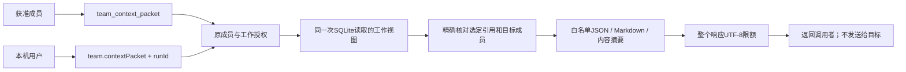

# CT-05 首片：明确选择的公共上下文包

2026-10-20后续：[桌面明确选材/核对预览/MD与JSON本机副本](context-packet-ui.md)已实现并经581项回归及Windows前端9组验证，模型0。本页API片的576项/真实Claude记录继续保留原日期和范围；下方桌面“待开发”是该片历史时点，实际发送/收件、完整CT-05与新EXE仍未完成。

日期：2026-10-20（北京时间）。关联 CT-05、AB-F08/F11/F20/F21、M02-F08、M06-F02、M07-F08/F09、M08-F07/F08；Claude验证对应M06-CC-F01。本片是整合源码之后的未发布 API/MCP 增量，不是完整 CT-05 或 I07C/I06C 准出。

## 1. 需求与推进依据

先核对已有任务、工作源码和发布信息：上一轮整合与integrated.3候选已完成，没有新的限流中断任务可续接。公开仍alpha.32，Git HEAD仍a872275，原未提交修改继续保留。[本轮只读发布元数据](../../../artifacts/context-packet/2026-10-20/release-state.json)不代表重新下载旧附件。CT-04已经允许读索引、单份旧修订和桌面MD副本，但成员要整理特定版本时仍需逐个手工拼接；CT-05原为后续目标。本片完成明确选择、单工作授权和只读包的可验证基础。

| 要求 | 当前完成行为 |
| --- | --- |
| CP-01 明确材料 | 指定现有目标成员，至少选择一项文档、任务、消息或产物引用，不自动搬入整段历史 |
| CP-02 精确版本 | 文档读不可变history；任务须匹配当前revision/round；消息同时匹配ID/seq；产物同时匹配ID/version，历史产物可选 |
| CP-03 权限和副作用 | 沿原工作scope授权；不写收据、不标已读、不派发、不授予访问、不搬原生Session |
| CP-04 限额和失败 | 每类最多8项，含Markdown的整个UTF-8 JSON最多256 KiB；超限明确失败，不截短选定正文 |
| CP-05 可回查 | 返回来源工作、目标成员职责、目标/约束及原材料引用；回查仍要求现有权限 |

桌面选材/复制下载、跨工作导入、自动投递/执行绑定、全文Library及跨厂家原生Session迁移均未实现。本片不新增模型API、业务编排器或原生配置。

## 2. 最终实现与读取流程

新增纯投影[team-context-packet.cjs](../../../desktop/electron/team-context-packet.cjs)。[TeamSpace](../../../desktop/electron/team-space.cjs)先取得已授权view，再从同一次状态读取补齐本工作的全部消息，使明确选择可以引用最新100条之外的消息，不混入其他工作。方法分支在写入事务之前返回，不创建receipt/operation/attempt/event，不触发调度。

[Coordinator](../../../desktop/electron/coordinator-service.cjs)仅增加白名单方法；[team-tools](../../../desktop/electron/team-tools.cjs)公布只读schema和材料不能当系统指令的说明。小队工具现18项，经典主从六工具保持。既有源scope、撤权、原生尝试终态和工作状态授权不变；用户可以按原规则读归档工作，成员不能凭包继续读取已关闭工作。

## 3. 当前 API 和数据

用户入口 `team.contextPacket({runId,targetAgentId,selections})`；成员入口 `team_context_packet({targetAgentId,selections})`，工作来自原scope，不能指定外来runId。所有读取仍要求当前调用者获准；targetAgentId必须是该工作仍有效的成员，可以是自己，不提供新增成员或授权功能。

| selections 字段 | 每项必须指定 | 核对规则 |
| --- | --- | --- |
| documents | documentId、revision | revision为正安全整数；只读准确旧版，不回退当前正文 |
| tasks | workItemId、revision、round | 当前两个数字均须匹配；不从历史猜旧任务状态 |
| messages | messageId、seq | 只读本工作原消息，ID/序号同时匹配；acknowledged=false表示本调用没有确认阅读 |
| artifacts | artifactId、version | 从本工作全部不可变报告中匹配；只给原引用，不读文件、不访问网络 |

四个数组均可省略，但至少有一项；每类最多8项。同一材料ID不可重复选择多个版本；字符串非空且不超过150字符，数字为正安全整数。selections及各引用对象的额外字段（含原型同名字段）、缺少字段和类型错误均拒绝。

输出 `schema:1 / kind:agentbridge.shared-context / readOnly:true`，包括：

- source：原runId/name/state/revision。revision不是所有公共材料共享的全局修订。
- target：该成员身份、角色、用户声明的职责/输入/输出/边界及capabilitySource。描述不是实测能力或授权。
- work：完整工作goal/acceptance/charter，在原字段限制与总包限额内不静默摘要。
- documents：准确旧版正文、作者/时间、revision/currentRevision及UTF-8正文SHA-256。
- tasks：选定当前状态/负责人/依赖/轮次、当前报告声明及产物ID/version引用；不附所有旧报告或原生私有会话。
- messages：准确正文/发送者/序号/时间/可选replyTo；不暴露通知投递详情。
- artifacts：明确选定版本的原reference、producer、来源任务/报告/轮次，access=reference-not-checked。选历史产物不改变当前任务验收。
- boundaries：grantsAccess、authorizesExecution、transfersNativeSession均false；artifactAccess=not-checked；selectedMaterialsOnly=true。
- readMore：既有team_document/team_tasks/team_messages/team_context；回查仍需原工作权限。
- packetId：对上述结构化投影（不含packetId/markdown）的规范JSON摘要；同一投影确定一致。不是持久记录、全局修订、令牌、签名或授权凭据。
- markdown：同源阅读视图。标签/元数据转义，选定文档和消息正文原样保留，明确标注是外部材料而非授权指令；本片没有HTML渲染器。

响应在生成Markdown后，按整个JSON的UTF-8字节数核对256 KiB上限。正文同时存在于结构化数据和Markdown，因此不能把256 KiB当可装入的原文大小。超过上限不返回部分成功。

| 错误 | 行为 |
| --- | --- |
| TEAM_INPUT | 选择为空、格式错误、重复、单类超过8项；读取原记录后重新明确选择 |
| TEAM_CONTEXT_TARGET | 目标不是该工作当前有效成员；不扩大成员资格 |
| TEAM_CONTEXT_REFERENCE | 外来/不存在/不匹配材料；不在错误中复制外来身份或正文 |
| TEAM_DOCUMENT_REVISION | 本工作文档没有指定修订；保留原引用，不用最新版冒充 |
| TEAM_CONTEXT_STALE | 已有任务的revision/round改变；读原任务后重新选，不重执行任务 |
| TEAM_CONTEXT_CAPACITY | 总响应超过限额；减少选择或分开读取，不截短正文 |
| TEAM_FORBIDDEN | 原scope、成员或工作状态已失效；沿既有授权规则拒绝 |

无SQLite迁移、无新daemon帧，原协议仍2、TeamSpace格式仍3。通过tools/list发现新工具，旧后台不支持时明确返回原未知方法/工具错误；不能用当前索引或最新文档伪造选定包。不增加自动回退、原生能力声明或长期MCP连接权限。

## 4. 实际验证与复现

环境：WSL、Node22.23.1，工作源码在integrated.3冻结之后；相关源码/测试/配置最终摘要见[源码清单](../../../artifacts/context-packet/2026-10-20/source-manifest.json)，保留核对见[差异核对](../../../artifacts/context-packet/2026-10-20/preservation.json)。

受控定向14/14、新增6项；包括精确旧修订、选定任务/消息/历史产物、任务过期、外来工作/目标、撤权/原生终态scope、归档所有者、空/重复/恶意字段/限额、正文保留、元数据转义、读取前后完整state和receipt数不变。生产Coordinator→真实stdioMCP→broker沿原授权通路通过；上述14项包含在全桌面576/576中，零跳过，受控模型调用0，不相加。[定向TAP](../../../artifacts/context-packet/2026-10-20/targeted-final.tap)、[全桌面TAP](../../../artifacts/context-packet/2026-10-20/desktop-final.tap)、[新回归](../../../desktop/tests/team-context-packet.test.cjs)、[生产stdio回归](../../../desktop/tests/team-materials.test.cjs)。

Windows补验：应用自带Node24.19.0，同样14项通过，实际SQLite/命名管道/stdio子进程而非假MCP；模型0，不是EXE验收。[最终Windows日志](../../../artifacts/context-packet/2026-10-20/windows-targeted-runtime.tap)。首次直接`--test`未找到UNC文件而没有运行用例；PowerShell确认路径存在，最终直接加载相同node:test文件解决文件发现问题。保留[首次日志](../../../artifacts/context-packet/2026-10-20/windows-targeted.tap)、[标准化路径仍失败](../../../artifacts/context-packet/2026-10-20/windows-targeted-final.tap)，不把路径失败记为产品测试失败或通过。

真实原生验证：WSL Claude2.1.303，一个真实Task成功，实际调用team_context、team_materials、team_context_packet三次；提示没有旧正文标记，当前文档第2版时明确选择第1版，实际返回材料包正文摘要吻合，原生最终回答去首尾空白后与旧正文完全一致。完整观察器重开及后续重复观察均仍一个原Task；重复报告不是新增推理任务。[首次真实报告](../../../artifacts/context-packet/2026-10-20/2026-10-19T18-17-45.851Z-native.json)、[最终严格核对报告](../../../artifacts/context-packet/2026-10-20/2026-10-19T18-19-13.949Z-native.json)、[手动验收脚本](../../../desktop/tests/linux-team-context-packet-native.cjs)。这是单成员实际消费材料包，不是另一个目标成员已收到或跨工具搬运验收。

复现受控检查：`node --test desktop/tests/team-context-packet.test.cjs desktop/tests/team-materials.test.cjs`；全量：`node --test --test-concurrency=1 desktop/tests/*.test.cjs`。真实脚本默认/`--plan`不调用模型；首次明确`--run`可创建一个隔离Task，既有检查点的`--run`与`--observe`仅核对原操作。`--continue`要求原检查点，准备后不明只查原receipt、不换ID重发。私有checkpoint/入口不写入报告或提交。

文档检查与最终工程收尾见[汇总](../../../artifacts/context-packet/2026-10-20/verification-summary.json)。根Core、前端及原生驱动无改动；核心51/51、类型/构建/lint、Windows前端26组及普通integrated.3 EXE五组是上一轮整合证据，本轮不冒充重跑或叠加计数。[原冻结范围](integrated-source.md)。

## 5. 源码、候选、发布与剩余事项

本片不改包版本、依赖或冻结附件，不commit/push/tag。当前`desktop/package.json`仍integrated.3，只是上一次候选版本值，不证明新模块进入包。公开alpha.32与本地integrated.3 EXE均不包含team-context-packet；原EXE和SHA-256保持，旧包验收不得扩大到本片。

后续继续CT-05桌面显式选材/预览、用户明确传递与实际接收证明，结合历史产物/可见交接入口；跨工具需要各自真实消费验证。Codex/OpenCode的新包调用、Windows EXE、独立SSH与用户现场未测。材料包的产生始终不等于任务交接成功、目标已读、产物可达或业务验收完成。
