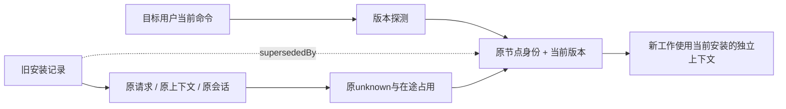

# I07 当前 Agent 版本发现与旧安装合流

日期：2026-10-18。状态：**alpha.28 后未发布源码已修复并完成本次工程检查**。GitHub alpha.28 与本地 ui.2 的冻结 EXE 不包含本修复；本次未修改发布包、未升级用户运行中后台。

## 需求与原因

关联 AB-F01/02/08/11，M01-F01/F02/F06、M03-F02/F03/F04/F05/F06、M05-F04、M06-F01、M07-F06/F07。

用户报告同一机器的 Claude Code 显示多条安装/版本节点，终端当前 `claude --version` 为 `2.1.302 (Claude Code)`。实际扫描器每种工具只返回一个版本，但 realpath 会把稳定命令入口解析到带版本的文件；中央目录与节点又持续保留旧路径，升级后把旧连接与新发现分别变成节点。因此不能只按版本字符串去重，也不能选已安装的最高版本。

验收目标是每台机器每种原生工具只展示当前命令对应的节点；沿用原节点接入与角色，保留历史归属，原 unknown 不释放、不重放。Windows、WSL 与 SSH 分别使用目标用户环境，不跨机器合并。

## 实现

1. [共享发现器](../../../desktop/electron/tool-discovery.cjs)按目标进程 PATH 顺序选首个已安装可执行命令，以其版本为准。该入口版本检查失败时返回原安装异常，不转用其他旧版本或更高版本。PATH 无入口才使用原默认目录和版本管理目录后备探测；显式指定安装的核验仍只读原路径。不执行 shell rc、alias/function，不改原生账号或模型。
2. [MachineRouter](../../../desktop/electron/machine-router.cjs)在连接快照标注 current；[AgentNetwork](../../../desktop/electron/agent-network.cjs)按 machineId/adapter 选择当前入口。保留原主角色、原子角色、已接入及已有节点身份，更新当前 executable/version。旧节点可选 supersededBy 指向当前节点，但原 ID、请求指纹、实例与上下文归属不改写。已有多个授权节点时不自动重写旧授权，不据归并新增权限。
3. [桌面入口](../../../desktop/src/NetworkApp.tsx)在概览、关系图和添加 Agent 列表隐藏历史安装；已移除的当前节点仍可从添加入口恢复。原历史名称与来源继续从完整快照读取。
4. 当前节点汇总历史别名的活动任务、unknown 和未确认请求，同工具在途准备/管理锁互斥。pending 的历史节点同样阻塞当前节点；新版本、目录或新 nodeId 不能释放原占用。历史节点不能新建任务或重新接入，返回 NODE_SUPERSEDED；原请求查询和原会话续接仍保留原归属及既有门槛。
5. [MachineHost](../../../desktop/electron/machine-host.cjs)为安装变化后的新工作创建独立上下文，旧上下文行与后端不重绑。旧生成键仍可复用；同键已有另一安装时，新键追加安装路径摘要。adapter 不同仍拒绝；续聊/查询按原 agent/Conversation/Task 路由，原程序删除或失效保留真实错误。



数据容器仍为 version=1，新增可选 supersededBy/current；daemon 仍为协议2，没有新模型层或远程任意命令接口。整体[架构](../../architecture.md)、[数据](../../data-model.md)、[协议](../../protocol.md)与 M01/M03/M05/M06/M07 完整设计及测试报告同步更新。

## 实际验证

环境：本机 WSL Ubuntu，Node22.23.1；源码为当前共享工作区。模型调用0，不读写用户运行中的Bridge profile。原始证据在 `artifacts/current-agent-discovery/2026-10-18/`。计数存在包含关系，不跨模块相加。

| 检查 | 实际结果 | 证据层级与原始来源 |
| --- | --- | --- |
| 发现/节点/原路由/上下文专项 | 67/67通过 | 受控进程与磁盘，[TAP](../../../artifacts/current-agent-discovery/2026-10-18/targeted-unrestricted.tap)；当前PATH旧于其他安装仍优先、当前入口失败不换安装、角色/接入不变、历史unknown共享占用、重开、原上下文只读路由 |
| 最终串行全桌面 | 421/421通过，无跳过 | [完整TAP](../../../artifacts/current-agent-discovery/2026-10-18/desktop-final.tap)，含既有SSR、恢复、原生受控生命周期与上述专项 |
| 最终核心 | 45/45通过，无跳过 | [完整TAP](../../../artifacts/current-agent-discovery/2026-10-18/core-final.tap)，包含OpenCode原安装二次核验 |
| OpenCode发现专项 | 3/3通过 | [专项TAP](../../../artifacts/current-agent-discovery/2026-10-18/core-discovery-final.tap)，已计入核心 |
| 本机真实Claude版本与生产库存 | 终端与发现均为2.1.302，当前可见节点1个，原节点/主角色/接入保留 | [报告](../../../artifacts/current-agent-discovery/2026-10-18/real-wsl.json)、[脚本](../../../desktop/tests/linux-current-agent-discovery-real.cjs)；真实已安装CLI只执行--version，旧2.1.296/2.1.299记录是隔离合成数据，不是用户profile修复实测 |
| lint/类型/构建 | 通过；保留既有大于500kB的chunk提示 | [lint](../../../artifacts/current-agent-discovery/2026-10-18/lint.txt)、[前端类型与构建](../../../artifacts/current-agent-discovery/2026-10-18/desktop-build-final.txt)；核心构建随npm test执行 |
| 文档与diff | 通过：155个Markdown、14对模块设计/报告、本地链接2950、错误0；diff无空白错误 | [文档检查](../../../artifacts/current-agent-discovery/2026-10-18/docs-check.json)、[diff检查](../../../artifacts/current-agent-discovery/2026-10-18/diff-check.txt) |
| Windows EXE、独立SSH、真实模型 | 本次未测试/未构建 | 不扩大为发布或完整I06C/I07C准出 |

首次受限运行器吞掉子进程输出，发现文件仅返回整体失败，保留[原日志](../../../artifacts/current-agent-discovery/2026-10-18/initial.tap)和[串行日志](../../../artifacts/current-agent-discovery/2026-10-18/targeted.tap)。在正常子进程I/O环境重跑专项通过，没有为环境失败修改产品判定。首轮[核心发现](../../../artifacts/current-agent-discovery/2026-10-18/core-discovery.tap)和[全桌面](../../../artifacts/current-agent-discovery/2026-10-18/desktop.tap)各有一条旧断言失败：旧测试允许损坏PATH入口切到另一安装，或要求新安装仍只能拒绝。按本次明确需求更新验收，并补验旧上下文不变、原请求仍可读；最终结果见上表。

复现（Node须在PATH，真实版本脚本仅适用于安装Claude的Linux）：

```bash
node --test --test-concurrency=1 desktop/tests/*.test.cjs
npm test
npm run lint
npm run build --prefix desktop
node desktop/tests/linux-current-agent-discovery-real.cjs
node scripts/check-docs.mjs
git diff --check
```

## 部署与未测边界

本次是源码修复；已有EXE及运行中Coordinator/daemon不会自动替换代码。Windows客户端、原WSL后台和独立SSH daemon需要后续包含本修复的构建后，在原profile安全更新并重扫，不能只更换Windows窗口就推定远端发现已更新。没有删除或重建用户机器、节点、请求及原生配置。

当前版本定义为目标后台继承的用户PATH命令；不能据此保证任意shell alias/function或仅在交互rc中动态选择的安装都相同。PATH无入口时仍保留原用户目录后备发现。真实WSL版本一致已经验证，用户截图所用运行中程序、真实模型、Windows进程与独立SSH仍需对应新构建实测。
