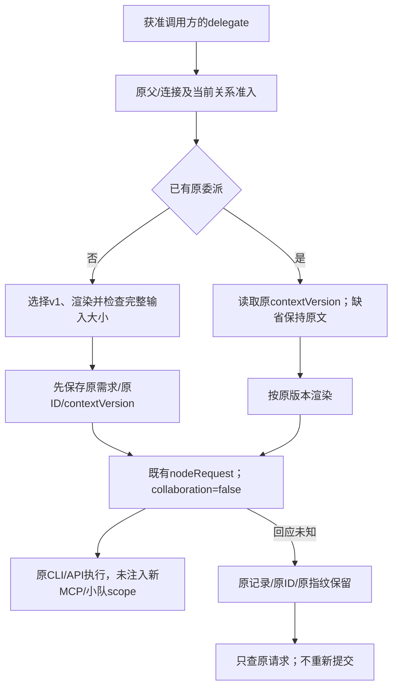

# CT-07：被委派子会话的最小协作上下文

日期：2026-10-21。关联AB-F08/F11/F13、M06-F01/F02及CC/CX/OC-F01、M07-F01/F06/F07、M08-F03/F05；核对M10/M11。未发布源码增量，接续[只读委派列表](delegation-list.md)和[当前连接视图](agent-connections.md)。不代表真实模型/EXE/独立SSH或完整I06C/I07C准出。

## 1. 推进依据与需求

本线程上一增量已完成；另一活跃聊天正在交付Agent行配置候选，没有接管该任务或其原模型请求。DSH既有RATE_LIMIT按原证据保留，不自动换ID重试。本片从[CT-07规划](agent-centric-operations.md)继续子会话感知，既有调用方和关系模型不扩大。

| 需求 | 完成行为 |
| --- | --- |
| DC-01 最小感知 | 新普通委派在原需求前附一段固定说明：单项子任务、在本会话报告结果/证据/未完成项、交回主Agent，不继续委派或改连接，需要额外权限/信息时说明 |
| DC-02 不复制身份或授权 | 说明不含父Task/Conversation、节点/机器ID、私有connectionId/凭据、原父需求或对话；不注入MCP/TeamScope，不改模型/供应商/原生权限 |
| DC-03 可恢复 | 新台账contextVersion=1在派发前保存；原需求message不改。相同请求重试按持久版本得到相同原生输入，未知回应只查原请求，不重复执行 |
| DC-04 历史兼容 | 缺版本的历史委派继续发送原文；未知/不支持版本不猜测、不迁移或结算，保留原ID及unknown。新文案须用新受支持版本，不能直接改v1正文 |
| DC-05 明确拒绝仍可信 | 原准备拒绝只在原ID/机器/节点、dispatched=false、无Task/Conversation及完整渲染输入指纹匹配时结算；不退回按裸正文/错误码猜测 |
| DC-06 有界输入 | v1说明+完整需求≤65536 UTF-8字节；超过时INVALID_INPUT，在新委派台账/子上下文/请求建立前拒绝，不截断 |

## 2. 实现和输入边界

[delegation-context.cjs](../../../desktop/electron/delegation-context.cjs)提供固定v1文案与纯渲染，不读取原生配置、不拼入父身份、不调用工具。[AgentNetwork](../../../desktop/electron/agent-network.cjs)只在新建普通delegate时设版本；输入args.contextVersion不能选择版本。旧台账没有该字段时保留原样，不做迁移。

子任务收到的内容为固定“协作任务说明”与“委派需求”分隔后原始需求；原文包含引号、中文、换行或类似标记时也不解析、替换或截断。普通直接任务、小队回合、原生会话续聊和主会话输入不经过该渲染。台账delegations.message仍是调用方原始需求；下游Task.message及原生输入为渲染结果，因此任务详情会显示这段简短说明。

说明是任务语义，不是权限隔离机制。普通delegate继续collaboration=false，不携带新scope/MCP或teamScope；子Agent可能已有用户配置的原生工具或独立MCP，它们仍按原授权运行，本片既不新增也不移除。父工具审批、权限确认、取消收据和业务验收规则保持；不能因为收到说明就宣称Agent已遵守或获得新权限。

## 3. 持久与兼容契约

| 对象 | 当前规则 |
| --- | --- |
| 新delegation.contextVersion | 可选整数字段；新行固定1，先持久再调用nodeRequest |
| 历史缺字段 | 视为原文输入，不补字段、不在重试/重开时加说明 |
| 其他版本/null/字符串 | DELEGATION_CONTEXT_UNSUPPORTED，保留原记录，不新派发；snapshot核对不因该行中断，不按错误版本解除unknown |
| 原需求与重复判定 | 原message/workspace/目标及派生requestId规则保持；没有给重试包裹第二层说明 |
| 子请求fingerprint | 按该版本完整原生输入、原nodeId/workspace/op/collaboration=false计算；准备拒绝也核对同一完整输入 |
| 明确拒绝 | 必须有匹配的持久准备证明；正文/版本不匹配、已派发、缺证明或裸查询失败不结算 |
| 列表/角色 | list_delegations仍不返回正文/私有身份，list_agents当前授权规则不变 |
| 传输/资源 | 只通过原message字符串；无新daemon线协议、模型API、MCP工具数量或JSON/SQLite版本。helper按既有CJS收集进入未来中央资源 |

v1说明前缀UTF-8 SHA-256固定为`07d9ba5b8b019274ad0ef6fa9268185320e7014f2ae4936826792df12264f9b6`，测试锁定该输入契约。新版本须保留旧渲染器，不能更新v1后用同ID再执行。未来部署需核对实际中央后台/helper版本；旧EXE或旧中央不会因新源码自动提供此行为。

## 4. 实际验证与首次失败

环境：WSL Ubuntu Node22.23.1、Windows Node24.19.0。模型调用0，不读取/修改用户运行profile，不切换后台或部署独立SSH。

- [定向121/121](../../../artifacts/delegation-context/2026-10-21/targeted-final.tap)：包含新上下文18项及原连接/委派/独立MCP链路，计数为完整桌面的相关子集。
- [Windows36/36](../../../artifacts/delegation-context/2026-10-21/windows-targeted.log)：新上下文18项、连接视图11项、列表7项；含真实stdio/独立连接撤权，为受控执行，不是Windows原生CLI或EXE模型验收。
- [生产CLI委派测试](../../../desktop/tests/native-delegation.test.cjs)：真实生产Coordinator→broker/stdio→MachineHost→独立CLI子进程，Hermes/Pi/DSH三种事件协议分别观察到完整说明+原需求；原设置不变，回应丢失/重开/重复观察只启动一次，取消/竞态场景保持。CLI为受控夹具，不是原生产品或真实模型。
- 八个目标入口的统一宿主受控检查验证同一中央渲染与无新增scope；不能据此宣称八种实际工具或模型已验收。Claude/Codex/OpenCode沿原普通输入通道，原生实际消费另验。
- [首批19/19](../../../artifacts/delegation-context/2026-10-21/targeted-initial.tap)通过后，扩大回归发现[118/120两项失败](../../../artifacts/delegation-context/2026-10-21/targeted-before-proof.tap)：原准备拒绝证明用未渲染正文核对，导致应rejected的记录仍unknown。实际修复为同版本完整输入严格匹配，新增跨重开、未知版本/正文不匹配反例；没有放宽证明或重派请求。

[独立冻结清单](../../../artifacts/delegation-context/2026-10-21/source-freeze.json)记录完整源码/测试及维护C资源，现有依赖仅symlink；[完整桌面667/667](../../../artifacts/delegation-context/2026-10-21/desktop-final.tap)零跳过、正常退出；[Core构建](../../../artifacts/delegation-context/2026-10-21/core-build.log)通过。共享工作区另有活跃配置候选开发，不能用冻结回归替代后续其他修改。

[交付汇总](../../../artifacts/delegation-context/2026-10-21/verification-summary.json)、[原始失败与执行说明](../../../artifacts/delegation-context/2026-10-21/execution-notes.json)和[源码保留核对](../../../artifacts/delegation-context/2026-10-21/preservation.json)分别记录各次范围及五份功能文件一致性；全部原有源码保留，未覆盖其他工作。

复现：`node --test --test-concurrency=1 desktop/tests/delegation-context.test.cjs desktop/tests/agent-connections.test.cjs desktop/tests/delegation-list.test.cjs desktop/tests/agent-network.test.cjs desktop/tests/connection-capabilities.test.cjs desktop/tests/native-delegation.test.cjs desktop/tests/collaboration-broker.test.cjs desktop/tests/mcp-integration.test.cjs`；完整桌面`node --test --test-concurrency=1 desktop/tests/*.test.cjs`。

## 5. 当前发布与后续

本轮[公开元数据](../../../artifacts/delegation-context/2026-10-21/releases.json)最新仍为[v0.6.0-alpha.35](https://github.com/wsjq5477/MA-Relay/releases/tag/v0.6.0-alpha.35)，指向b5de577980e140150352518c19bb6e9709a2bd20；本轮没有重新下载EXE。当前HEAD仍为d9bf2a5/alpha.34派生，公开独立修复未整合。另一个聊天已交付本地.config.2，其[冻结清单](../../../artifacts/agent-configuration/2026-10-21/source-manifest-final.json)没有delegation-context.cjs，版本和包证据见[该专项](agent-row-configuration.md)，不将其算作本片包验收。

本轮不commit/push/tag、生成EXE或改原生账号/模型。未来候选仍需先整合公开alpha.35修复、同时核对新helper与中央运行资源；这段普通message本身没有新增daemon升级要求，但不替代其他功能的远端升级门禁。

CT-07三项已各有源码/受控覆盖：委派列表、当前连接视图、子任务最小上下文；整合包/真实原生消费与完整I06C/I07C仍未准出。CT-06调用方真实覆盖及CT-08多关系/连接管理保留原前置；下一步先核对整合和真实工具证据，不能把上下文感知翻为Hermes/Pi/DSH的MCP调用方能力。
