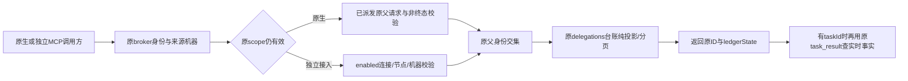

# CT-07 首片：Agent 只读委派列表

日期：2026-10-20。关联CT-07、AB-F11/F13、M06-F02、M06-CC-F01/M06-CX-F01、M07-F06/F07、M08-F04/F05；检查M10打包边界。是未发布源码增量，不是完整CT-07/CT-06或I07C/I06C准出。

## 1. 推进依据与需求

上轮CT-05已完成并收录alpha.34；本线程上一触发在开始前中断，没有新的已派发任务或限流中断请求可续接。DSH接入及排障另有活跃任务，本片不接管、不重跑其原模型请求，也不修改其服务/发现/配置逻辑。

[Agent侧自主操作规划](agent-centric-operations.md)要求Agent可查看自己已委派的任务，不必记住taskId。本片只落地既有调用方的只读列表，不改变关系模型、不新增连接管理、不将Hermes/Pi/DSH的bridgeMcp能力翻真，也不越过CT-06真实验收前置。

| 要求 | 完成行为 |
| --- | --- |
| DL-01 原归属 | 原生按leader、parentRequest、parentTask、parentConversation匹配；独立MCP额外匹配非空connectionId和明确null父Task，不以空身份相互匹配 |
| DL-02 有界列表 | limit默认20、最大50；after为当前作用域原delegationId；外来/无效游标拒绝 |
| DL-03 只读事实 | 只投影既有台账，不查子工具、不调用snapshot/恢复、不保存台账、不派发/取消/确认任何执行 |
| DL-04 未知保留 | 返回原requestId和已有taskId；缺taskId不补造，unknown/pending不结算，不换ID或重发 |
| DL-05 调用链完整 | MCP公布第七项经典工具，Claude/Codex允许新只读工具，reply_task仍按原审批机制；真实stdio与独立MCP撤权受控验证 |

## 2. 实现与调用链

[delegation-list.cjs](../../../desktop/electron/delegation-list.cjs)是纯投影，接收已经通过[AgentNetwork](../../../desktop/electron/agent-network.cjs)授权的node/owner。scopedCollaborationTool只增加一个返回分支，不改原六工具、默认单主关系、父任务查询或原请求台账。列旧委派不要求该子节点仍在当前关系中，与既有原父读控边界一致；新委派仍核对当前主角色与授权。

原生父任务终态、外来来源机器、未派发或缺少原父绑定仍沿原入口拒绝；父任务unknown可以只读列表，但不能据此新委派。独立接入先经MachineHost/McpIntegration.authorize检查enabled及node/connection，移除后原token立即不能调用；本片不扩大独立接入内原有会话共享范围。

[mcp-client.cjs](../../../desktop/electron/mcp-client.cjs)增加 `list_delegations` 和readOnlyHint。经典集合源码为7项，小队18项不变，alpha.34/35已发布包仍是原六工具。Claude/Codex原生启动参数及指引增加该只读工具；没有将reply_task改为自动允许，不改变原生账号/模型/文件权限。OpenCode沿原MCP工具发现通路获取新schema，无新增HTTP或ACP协议。

## 3. 当前接口和输出

调用 `list_delegations({limit?,after?})`；只接受这两个参数，调用者不能用nodeId、connectionId、父ID或taskId参数选择另一身份。limit必须是1–50的安全整数；after非空且≤128字符，须存在于当前调用者的列表，非法统一INVALID_INPUT，不回显外来ID或内容。

返回：schema=1、readOnly=true、source=delegation-ledger、liveTaskStatus=false、items、total、hasMore、next。列表按原台账追加顺序分页；next仅在后面还有记录时为本页末delegationId，不是全局快照或权限凭据。

| 每项字段 | 含义 |
| --- | --- |
| delegationId / requestId | 原委派和派生请求ID，原样保留 |
| nodeId / machineId? | 原目标节点；有原节点记录时给其机器；不为缺节点猜新身份 |
| taskId? / conversationId? | 仅已有非空绑定时返回，不通过名字或别名补造 |
| ledgerState | 最后保存的台账状态；不是当前任务终态，未知/未发回执继续保留；异常旧值只投影unknown |
| createdAt? / errorCode? | 原建立时间和规范错误码；不复制错误正文、命令或路径 |
| taskQueryable | 是否已有非空taskId可用于原task_result，不表示该任务已成功或在线 |

不输出Prompt、workspace、结果正文、native Session、端点、Token或其他父/连接的记录。无子taskId的unknown需保留原requestId，通过原Bridge恢复入口核对，列表本身没有新增重新派发/自动恢复行为。task_result的原作用域查询可更新既有台账，此为原方法行为，不是列表的副作用。

同原生Conversation中另一轮父request/task不能接管旧轮委派；独立MCP记录必须同时有匹配externalConnectionId且parentTaskId=null，缺失身份不按mcp:前缀猜测归属。移除子关系后原父可列历史；原父终态或独立连接被撤销仍拒绝。节点/关系/SQLite/JSON版本均不迁移。

## 4. 实际验证

环境：WSL Node22.23.1，Windows Node24.19.0；生产AgentNetwork/MachineHost/broker/stdio、受控原生CLI/机器，不使用用户profile，不运行真实模型，不升级独立SSH。

- [定向110/110](../../../artifacts/delegation-list/2026-10-20/targeted-final-hosts.tap)：含新增7项列表与1项Claude允许项、既有网络/六工具/独立MCP配置/方向准入及Claude/Codex宿主回归。新8项与定向均为全量子集，不跨模块重复相加。
- [Windows8/8](../../../artifacts/delegation-list/2026-10-20/windows-targeted.log)：列表7项及真实stdio broker既有测试；包含MachineHost独立入口、来源机器、连接撤权和重开观察。不代表Windows原生Claude/Codex或EXE验收。
- 列表纯投影前后内存/台账文件相同；生产原父授权仅查原父request，不查子task、不保存列表。子任务实际完成后列表仍保留旧台账状态，显式task_result查询后才观察到新保存状态。
- 真正broker/stdio发现7工具；伪造身份参数拒绝，跨父/外来游标拒绝；原生父终态拒绝、unknown只读保留；独立连接立即撤权；完整观察器重开仍原两个受控Task，不补发。

并行DSH开发期间，完整回归使用[独立冻结源码清单](../../../artifacts/delegation-list/2026-10-20/source-freeze.json)，不将后续共享工作区变化混入本片证据；生产原生账号/私有运行状态没有复制。Core只按冻结源码运行TypeScript构建，本片没有修改Core源文件或重跑真实模型。

最终冻结桌面[615/615](../../../artifacts/delegation-list/2026-10-20/desktop-final.tap)零跳过、正常退出；[Core TypeScript构建](../../../artifacts/delegation-list/2026-10-20/frozen-core-build-final.log)通过。当前共享工作区定向[111/111](../../../artifacts/delegation-list/2026-10-20/shared-integration.tap)另行通过；[保留检查](../../../artifacts/delegation-list/2026-10-20/preservation.json)确认8份功能文件与冻结副本相同，AgentNetwork只读分支仍在，并保留并行发现逻辑修改。完整615项证据不覆盖冻结后其他共享源码增量。共享定向比冻结定向多出的1项来自并行节点发现测试，不记为本片新增用例。用户协作说明已同步列表与原任务查询；[网页源与边界6/6检查](../../../artifacts/delegation-list/2026-10-20/docs-site-test.log)通过，本片未重建静态站点或重做浏览器验收。

[最终验收汇总](../../../artifacts/delegation-list/2026-10-20/verification-summary.json)登记各次范围、构建与文档检查；[执行记录](../../../artifacts/delegation-list/2026-10-20/execution-notes.json)保留初次失败事实：冻结副本漏带desktop/native/owned-stop.c，8项维护/SSH归档检查编译失败（606/614）；补齐副本资源后重跑，不修改产品维护代码。初次完整TAP在重跑时被覆盖，原始日志不再可用，不伪造或宣称初次全通过。最终冻结包含维护C资源；补齐和复制准备路径错误的纠正过程如实登记。

复现：`node --test desktop/tests/delegation-list.test.cjs desktop/tests/collaboration-broker.test.cjs desktop/tests/agent-network.test.cjs desktop/tests/mcp-integration.test.cjs desktop/tests/connection-capabilities.test.cjs desktop/tests/codex-host.test.cjs desktop/tests/claude-host.test.cjs`；全桌面 `node --test --test-concurrency=1 desktop/tests/*.test.cjs`。均为受控测试，模型调用0。

## 5. 源码、公开版本和后续

本轮只读发布元数据已观察到[公开alpha.35](https://github.com/wsjq5477/MA-Relay/releases/tag/v0.6.0-alpha.35)，冻结b5de577980e140150352518c19bb6e9709a2bd20，是issue #12独立修复，EXE/校验附件uploaded；[元数据](../../../artifacts/delegation-list/2026-10-20/releases.json)。本轮没有重新下载该EXE，也不冒充确认其完整公开下载。主工作区Git HEAD仍d9bf2a5/alpha.34派生；alpha.35已发布修复尚未整合，DSH另有未发布源码/本地候选。

本轮没有commit/push/tag、生成EXE或更新用户后台。新增helper沿既有electron CJS集合进入未来中央资源，mcp-client仍只依赖自身和team-tools；未来候选须核对后台/helper、原生允许项和MCP运行副本一致，并先处理alpha.35已发布修复与当前脏工作区的整合，不能据旧包或DSH候选宣称含本片。

CT-07其余list_agents身份语义细化、被委派子会话最小上下文仍待开发；CT-06调用方与CT-08多主/连接管理继续按原前置与授权规划。新列表没有把仅受委派工具变为MCP调用方，没有改变子节点不可扩大连接关系的边界；真实模型/Windows EXE/独立SSH另验。
