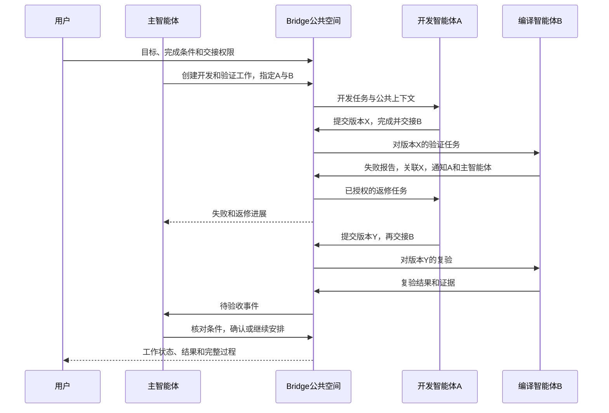

# I07 设计：外部智能体的小队公共协作空间

2026-10-20当前准备 **0.6.0-alpha.34**：用户授权提交当前完整源码并发布Windows EXE，含OpenCode1.x/2.x、独立MCP、CT-04/CT-05与既有alpha.30–33整合，补alpha.33精确daemon清单。固定源码构建、普通EXE及公开完整下载结果完成后在[本轮交付](alpha34-release.md)登记；当前仍在发布准备阶段，旧包/标签范围不变。

## 2026-10-20：OpenCode 1.x / 2.x 兼容修复

当前源码覆盖 V1/V2 两套 OpenCode 协议；V1 invocation→原生生成 Session→持久绑定→单次 Prompt，恢复只查原绑定。新增可选协议快照，缺省历史 v2；MCP 按原安装版本注入/导出/删除。后文 alpha.32 的“仅2.x”是该旧发布包历史行为。 [需求、实现、验证与未测边界](opencode-v1-compatibility.md)。

## 2026-10-20：维护上传进度与持久化修复（issue #10）

进度是内存观测，最终目录及维护意图是发送硬边界。当前profile原操作只查原收据，不因进度失败切换daemon或释放未知。 [完整设计、实测与边界](maintenance-persistence.md)。

2026-10-20后续：CT-05桌面现在支持同工作成员、文档历史修订/任务当前轮次/历史消息/历史产物明确选择；生成后严格核对再预览复制/下载。作用域/代次丢弃迟到回应，原unknown不解除；副本不自动发送或授予权限。[完整当前流程、失效与限额](context-packet-ui.md)。

2026-10-20：当前CT-05首片：原scope先授权，再按明确目标成员与四类版本引用生成只读包；文档旧版不回退，任务变化拒绝，消息/产物匹配原引用。包不是访问凭据/发送记录，不增加自动执行/跨工作导入；界面选材和实际接收证明待开发。[最终契约与数据](context-packet.md)。

2026-10-19当前设计已整合：原对象按自身backend快照路由、原持久拒绝恢复、旧中央三项能力/旧daemon对象能力、OpenCode仅2.x与按机器unknown管理，同独立connectionId MCP/TeamSpace材料接口共存。无新模型API、身份迁移或unknown释放。配置解析依赖与当前已发布daemon清单随新冻结候选收录。[完整最终行为与证据](integrated-source.md)。

## 2026-10-19：OpenCode 2.x与按机器管理（alpha.32已预发布）

OpenCode2.x同时约束原CLI与实际info；已派发收据优先于当前版本门禁。node/machine管理按机器冲突，relation仍全局保护，缺来源保守阻断。前端多意图持久与中央冲突规则一致，只有原匹配终态可结算。 [需求、实现、验证与边界](version-management-recovery.md)。

## 2026-10-19：协作兼容修复（alpha.31已预发布）

OpenCode接入以实际只读API握手建立安装/版本兼容证据；委派原拒绝持久核对；前台、中央与远端通过显式语义能力避免旧读控回退。原对象ID和unknown保护不变。 [需求、实现、实测与边界](collaboration-compatibility.md)。

2026-10-19 CT-04桌面当前实现：小队工作增加按需公共材料入口，复用team.materials/team.document.revision。以原工作/文档/修订/摘要核对后读取并复制/下载，不自动刷新/同步、不确认消息已读、不改变权限/任务。索引导出限当前页，文档导出固定修订；旧后台明确失败。[完整当前流程与验证](public-materials-ui.md)。

## 独立 MCP 文件与原生配置管理（2026-10-19）

I07-MCP01 / AB-F02/F12/F13：独立Bridge MCP配置文件、三种Agent原生用户配置增删、长期接入撤权与外部委派归属已实现。桌面537/537、核心45/45、类型/构建/lint通过；真实Claude2.1.303/Codex0.162.1/OpenCode2.0.24列表增删通过，Windows生产前端4组通过。均使用隔离配置，模型调用0；真实新EXE/独立SSH仍未验，公开alpha.29冻结范围不变。[需求、开发、验收和首次失败](mcp-installation.md)。

## 2026-10-19：CT-04首片当前实现

alpha.29之后源码新增TeamSpace授权view的只读材料投影：短目标/成员职责、分页文档版本、任务当前报告/产物、原生状态与消息观察位置，JSON和Markdown同源。team_document可选revision严格读取不可变history；无revision保持旧结构。索引不是全局修订/授权，不确认已读、不触发Agent、不推断完成/可达；普通委派不强制进入公共工作。[完整当前契约及实际验收](public-materials.md)。桌面/物理导出、全历史Library、显式交接包仍待开发；下方历史时点保留。

日期：2026-10-16。I07A/B基础继续适用；I07C首批已实现用户授权/预算、重要事件激活、Claude原会话自动续接和主角色持续跟进，实际分层证据见[首批交付](automation.md)。源码/本地候选alpha.24，GitHub预发布仍alpha.23；小队停止与真实原生终态核对见[停止专项](native-stop.md)。其他接入/独立SSH、权限等待专项及完整I07C/I06C仍未准出。

## I07A/B 已实现边界

当前小队登记支持原生node绑定及外部MCP实例，两类均保存职责/输入/输出/边界介绍；原生节点不重复登记，其他功能实例使用各自已有外部入口。公共文档采用文档级授权和完整修订，无章节级编辑。创建小队和工作、暂停/归档及按工作撤权已实现，长期小队编辑/换主尚未实现。工作目前为active/completed/closed加paused标志；I07B已补齐任务板，见下节。

群消息支持回复/通知/分页；通知状态为pending/delivered/read，不等同执行已接手。新操作先保存稳定ID，回应未知查询原收据。当前原生任务由用户手动安排，群消息不触发原生执行或自动续接；外部MCP配置先支持中央所在电脑。SQLite事务、私有描述文件、来源/终态scope和原生准入检查见[交付](delivery.md)。I07B增加的已实现行为见[任务板与交接完整报告](task-handoff.md)；I07C首批能力按下节实际范围覆盖，其余继续作为后续设计。

## I07C首批已实现边界

alpha.23新增格式3持久事件、授权自动成员/累计预算、2秒原请求对账、Claude原上下文续接及新scope、原生终态后的总验收。普通消息/@不自动执行，运行中注入不支持；Codex/OpenCode和外部MCP自动启动未开放。真实Claude3轮自动主协调、重启同会话及X失败/Y通过见[首批报告](automation.md)。下文是完整I07方案，报告未覆盖的能力继续作为后续设计，不能全部计为已交付。

## 1. 产品对象与责任

| 对象 | 用户理解 | 责任边界 |
| --- | --- | --- |
| 机器与工具安装 | 执行资源，如Linux上的OpenCode | 沿用M03身份，不把项目或功能名称并入工具身份 |
| 外部智能体 | 已有职责和独立调用入口的协作者 | Bridge登记身份、入口、介绍和通信能力；内部Skill/模型/目录由外部管理 |
| 小队 | 可复用的成员、主角色和规则 | 用户创建及授权；同一智能体加入不同队不默认共享上下文 |
| 一次工作 | 用户交给小队的一项持续目标 | 保存完成条件、成员快照、事件、任务、轮次及预算；不等于单轮原生Task |
| 工作项 | 分工，如开发或编译 | 有负责人、依赖、交付要求、当前轮次和证据 |
| 执行尝试 | 某工作项的一轮真实调用 | 绑定原机器/节点/请求/会话/原生执行，保留失败与unknown |

小队是长期组织，一次工作是独立协作范围。小队约定可复用；每次工作的讨论、任务和临时材料分开。跨工作复用的结论需显式整理到小队共享知识，不默认将全部旧群聊注入新工作。

每次工作保存有效成员和职责快照；小队新增成员不自动获得历史工作的访问权，需用户显式加入该工作。撤权则立即约束对应成员后续访问，不能以旧快照继续读写。首版同一智能体在不同工作中使用不同会话绑定；无法隔离会话的接入需串行且明确限制，不将多个小队的消息混入同一原生会话。

第一版不做多个主角色竞争决策、不自动换主、不实现编译等业务功能或文件同步。多个外部入口共用进程/目录时仍遵守资源占用，不能靠名称绕过busy/unknown。

## 2. 公共空间的四种材料

| 材料 | 内容 | 更新规则 |
| --- | --- | --- |
| 小队约定与成员表 | 目标、成员能做/不负责什么、能力来源、协作权限、完成条件 | 用户维护成员/权限，主角色只在已授范围分工；工作记录引用约定修订 |
| 共享文档 | 方案、接口共识、当前结论、产物索引、决策依据 | 按文档/章节授权，带原修订更新；冲突返回最新版本供整合，不覆盖历史 |
| 任务板 | 负责人、输入、依赖、轮次、进行/受阻/待验证/完成 | 有效业务操作更新；成员负责本人工作，主角色分配和验收 |
| 群消息 | 请求、讨论、交接、报错、答复、系统通知 | 追加保存，纠错关联原消息；@决定通知对象，不决定阅读权限 |

“公共”只面向获准成员及所属用户，不是互联网公开。首版不做私聊或队内保密频道；不应放入队内其他成员无权接触的材料。角色和权限不能靠修改文档或发言生效。

消息保留过程，文档保存共同认识，任务板保存当前状态。摘要引用来源及覆盖范围，不删除原记录，也不能替代最新权限/任务查询。

## 3. 职责、协作权限、原生能力分开

职责是描述，如“编译并报告错误，不负责写业务代码”。由用户或外部智能体提供，记录来源/更新时间，区分声明和实测。协作权限由Bridge核验，如“可联系谁、修改哪份文档、交接哪个工作”。本机文件/命令等实际权限由外部原生环境控制；职责文字不构成文件系统隔离。

建议默认权限：

| 动作 | 用户 | 主智能体 | 队员 |
| --- | --- | --- | --- |
| 增删成员、指定主角色、扩大权限 | 可以 | 只能建议 | 只能建议 |
| 读本次公共文档、任务和群消息 | 可以 | 可以 | 本次获准成员可以 |
| 发消息、追加本人报告/产物 | 可以 | 可以 | 可以，发送身份由Bridge绑定 |
| 修改公共文档 | 可以 | 在获准范围可以 | 本人负责文档/章节可以；其他内容提建议 |
| 创建/分配工作、改变依赖 | 可以 | 总目标/预算范围内可以 | 只能提请求；显式授权交接除外 |
| A/B返修与复验 | 可配置 | 可在已授范围约定 | 仅按已有规则交接，不随意派新范围 |
| 更新原生执行事实 | 不能伪造 | 不能伪造 | 可提交报告，真实执行状态从宿主读取 |
| 确认总工作验收 | 用户可决定接受/终止 | 按完成条件和验收授权处理 | 提交待验收，不自行宣布总工作成功 |

支持“受限协作”和“授权交接”两种配置：前者由主角色决定下一步，后者允许指定成员在明确工作、动作、目标和预算内交接。Agent间消息不构成人类授权；不能从“主Agent说用户同意了”的文字推导权限。

原生权限/输入等待继续走原任务/执行/交互ID；转发通知不能代替用户同意，主角色或队员也不能代替用户批准原生工具权限。需要人工决策时在总工作中明确显示等待。

## 4. 通信入口和身份

主角色和队员都使用Bridge通道读写公共空间。现有子任务collaboration=false且无协作身份；新功能必须增加独立成员作用域，不能只在界面添加群聊。支持MCP的客户端优先通过Bridge MCP；不支持者使用已核验通信连接器，首个具体协议在I07A确定。Prompt/可选Skill提供协作约定，不替代传输与权限。

每次调用绑定外部智能体、机器/连接、小队、一次工作、成员与执行激活身份。发送者不取自正文；中央核验真实来源、实时权限和工作有效性。秘密凭据只在私有连接层保存，不进入公共材料。

以下为完整方案的能力类别；I07A/B已实现的具体接口以[当前协议](../../protocol.md)为准，事件激活/续接等待I07C：

| 类别 | 动作 |
| --- | --- |
| 进入工作 | 获取目标、约定修订、获准队员、自己的权限和任务 |
| 读公共空间 | 按游标读新消息/事件，按版本读文档，查任务/执行/产物 |
| 发言 | 发送/回复/通知，稳定业务ID去重 |
| 贡献材料 | 追加报告、按修订更新文档、登记产物引用 |
| 执行与交接 | 接手、报告阻塞、提交结果、在权限内交接已有工作 |
| 协调 | 主角色分配、等待重要事件、验收、暂停或结束 |

普通发言不自动创建执行。明确派发或授权交接动作才能进入调度，避免一句“看看这个”意外启动多次原生任务。

## 5. 消息保存、通知和处理回执

消息关联一次工作，有稳定身份、服务端顺序、发送者、内容、回复对象，以及可选工作项/代码版本/产物/通知对象。同ID同内容返回原消息，不同内容拒绝。正文是成员意见或外部结果，不能覆盖系统权限和执行事实。

获准成员可以按需读本次公共群历史。普通定向消息只通知指定人，不默认唤醒全队。主角色订阅交付、失败、阻塞、权限等待、离线等重要事件；“可见”不等于每条闲聊触发推理。全队通知是受权限/预算限制的显式动作。

| 处理状态 | 实际含义 |
| --- | --- |
| 已保存/待投递 | Bridge已持久保存，目标可能离线 |
| 已交付 | 接入端确认收到，不代表模型已读/执行 |
| 已读 | 接收方提交阅读进度，不代表接受任务 |
| 已接手 | 工作执行已有真实接收记录 |
| 已完成/受阻 | 有关联结果或明确问题报告 |

多个收件人的进度独立。消息“已保存”不能显示成所有人已收到。允许断线后重复投递，消费者按消息身份去重；不承诺跨外部进程的全局恰好一次。

阅读游标和任务接手回执分开；阅读后崩溃仍保留尚未接手/处理的执行事项，不能通过推进游标丢掉工作。一次激活携带目标/职责/最新约定版本、本人成员权限、相关未处理消息、当前任务和产物索引，不默认塞入全队完整聊天；需要时按原引用读取。

任务交接、系统消息和待投递通知作为同一持久业务操作提交，避免任务变了却没人收到。存储实现另定，契约要求可查原操作。中央是唯一权威写入者，远端不直接编辑中央磁盘文件。

## 6. 工作与原生执行状态

总工作建议呈现：准备、进行、受阻、待验收、完成、停止中、已停止。暂停是调度开关：不再派新任务/自动续接，已有执行不默认取消。存在unknown时显示“执行待核对”并保留占用。

工作项建议呈现：待依赖、待接手、进行中、受阻、待验证、完成、已撤销。待验证不算完成，依赖按指定交付/验证条件解锁。认领、交接和换负责人需核验原修订，防同时接手。

这是新业务层，不更改Core Task.status。一轮真实执行仍使用queued/accepted/running/succeeded/failed/cancelled/unknown。原生回答完成、进程退出、业务验收分别记录。

编译失败可以结束本次执行尝试，总工作仍待返修。A返修和B复验是有新输入的新轮次/新请求，不是重发原失败或未知任务。只有原执行终态明确且资源可用才允许下一轮；unknown只查原执行。

## 7. 写代码、编译和返修闭环

图中通知按第8节实际能力送达，不代表任意接入支持运行中注入。直接交接须已授权，否则报告后由主角色安排后续工作。

验证结果绑定代码版本/产物摘要和验证环境；代码变更后旧报告不能验收新版本。不自动搬运项目文件，双方使用已有Git/产物服务等通道。只有接收者不可访问的本地路径时，标明交付阻塞并通知主角色。

## 8. 接入能力和持续激活

| 接入能力 | 可以做什么 | 不承诺什么 |
| --- | --- | --- |
| 新任务和原请求查询 | 提交并观察真实执行 | 不保证已有上下文续接 |
| 原会话续接 | 上轮明确结束后，带未处理事项继续原会话 | 不在busy/unknown时另开一轮 |
| 运行中收消息 | 用已验证机制投递当前执行 | 不把任意CLI stdin当成消息接口 |
| 原执行恢复 | 重启/断线后读原任务/会话 | 不暗换会话冒充恢复 |

能力声明和指定版本实测分开。自动主角色至少要求已验证新任务、原请求查询、原会话续接和终态观察；普通成员可只接新任务，但不承诺连续上下文。无法续接的主角色明确等待人工继续，不自动新建会话。

调度步骤：

1. 重要事件先保存为成员待处理事项；同一工作成员只允许一个在途激活，共用原生实例的准入另按资源锁串行。
2. 正在执行且支持收消息则投递；不支持则排队，不开并行副本。原生权限等待保留原等待，不能借消息绕过。
3. 上轮已有终态，预算/权限有效时，合并待处理事项，先存激活意图，再续接原会话；激活对应稳定原生请求。
4. 受理或回执不明只查原激活请求，不换ID激活。重启先对账在途记录，不能只靠锁超时重发。
5. Agent读事项后判断下一步、报告等待或结束本轮；本轮结束不自动结束总工作。达到验收条件才由有权角色结束工作。

Bridge机械地根据事件和权限调度，不内置规划模型。已读/普通确认/自身摘要不再唤醒自己；轮询不制造新推理。只有新的重要事件或已配置检查到期才激活，合并重复事件，记录激活原因与预算。

每项工作可配置最长无进展时间、总时长/轮次数和提醒策略。无进展到期先查原任务状态，必要时通知或激活主角色判断卡点，不直接重新提交业务需求。默认数值在I07C定稿并对用户可见；到限只阻止新调度，不能把原生仍运行或unknown的执行标成已停止。

## 9. 作用域和旧版本兼容

新增一次工作/成员授权及每次原生激活身份。原生回合结束，该激活写权限失效，工作继续存在；后台按实时授权创建下一激活，不延长旧token、不复制旧父scope、不接管别人的子任务。

旧模式保留父任务终态即失效规则。新小队不自动迁移旧默认组/在途委派；旧记录保留原机器/父任务/请求/会话。已有工具可通过明确接入绑定供新工作使用，名称不改变原身份。

## 10. 异常、暂停与撤权

| 情况 | 处理 |
| --- | --- |
| 接收方离线/忙 | 消息待投递，执行排队，通知主角色，不换同名Agent |
| 已交付但执行unknown | 分别显示通知和执行状态；查询原请求，不重复提交 |
| 主角色本轮结束 | 工作保留；重要事件且接入支持时续接原会话 |
| 主角色不可用 | 等待协调，保留消息，不自动换主 |
| 文档/任务修订冲突 | 拒绝覆盖，返回最新修订，整合后新业务操作提交 |
| 暂停 | 停新派发/自动续接，原执行不默认取消，结果仍保存 |
| 停止 | 阻止新执行，对原任务用稳定操作请求取消；原终态全明确才显示已停止 |
| 撤销成员 | 立即拒绝新的读取/写入/投递/执行；未投递记录保留，已外发材料无法收回；系统归档原执行结果 |
| 换主 | 首版暂停并核对旧执行后显式移交；新主获公共记录和后续协调权，不接管旧原生会话 |
| 预算到限/持续失败 | 停新轮次，标明受阻并通知用户/主角色，不宣布完成 |

共享底层实例/规范目录时保留资源互斥，跨队不能绕过busy/unknown。首版不承诺多个独立Coordinator的全局锁。

## 11. 数据归属和阅读体验

Coordinator拥有小队/权限修订、一次工作、文档版本、群消息、工作项、事件游标、通知及激活意图。机器后台拥有原生会话/任务/进程/收据。相互引用而非互改事实，远端未知不变成中央成功。

具体存储技术在实施前按事务、单写入者、恢复和迁移要求选定；两份独立JSON写入不视为原子操作。文档导出只是阅读副本，不能当成授权来源。容量到限明确拒绝新写入，不自动删除待投递/unknown/未结束工作来释放配额。

用户默认看到当前状态、任务板和重要消息；可展开共享文档、完整群聊、执行证据、通知进度、激活原因和卡住原因。公共材料不含内部令牌、秘密连接或敏感原生配置。

## 12. 用户流程与实施入口

接入已有智能体及介绍 → 组成小队/指定主角色/约定权限 → 提交目标、完成条件和预算 → 在公共空间看任务、群消息、文档 → 主角色按证据验收或报告受阻。用户可随时干预和暂停。需要人类验收的工作明确等待用户，其余按预授权验收。

按 [I07A/B/C](development.md)推进，以 [验收矩阵](testing.md)准出。I07A实际范围和证据见[交付](delivery.md)；任务板/交接/自动激活仍属后续，不通过全量流程图推定其已经可用。
