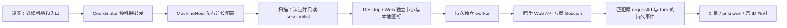

# I07：DSH Windows Desktop 与 Linux Web 接入

日期：2026-10-20。关联 I07-DSH01，AB-F02/F07/F08/F10/F11/F12，M01/M03/M05/M06/M07/M08。当前为 alpha.34 之后的未发布源码；公开 alpha.34 EXE 不包含本片，不改变完整 I06C/I07C 未准出状态。

当前本地Windows交付与真实服务验证见[DSH EXE交付](dsh-exe-delivery.md)：候选包含303认证和Typert命名参数修复。下方首片受控结果与“同名程序修复”保留各自实际冻结范围，不替代该候选证据。

## 需求与接入范围

用户要求增加 DSH 功能及图标，包含当前 Windows Desktop 和 WSL/Linux Web。已有 `dsh` 只驱动原生 headless CLI，不能据此声明控制 Desktop/Web。新增 `dsh-desktop`、`dsh-web` 两个稳定 adapter ID，各自连接已运行的原生 Web API；CLI 继续保持 `headless-json-v1`。三个入口都使用已有本地 DSH 官方图标，但节点、请求、执行目录、原生 Session 分别归属。

Desktop/Web 提供发现、直接会话、普通被委派、原 Session 续聊、结果读取、取消及原请求核对。不声明 Bridge MCP 调用方、小队执行成员、Bridge 权限/问题表单或独立连接验证能力。原生权限与问题仍在 DSH 自身处理。接入不会选择或保存模型、供应商、原生账号，不读取或搬运原生模型凭据。

## 为什么选择原生 API

这里的API是DSH程序自身的会话/控制接口，不是DeepSeek模型API；Bridge不新增模型调用层。选型针对用户已有的Windows Desktop和Linux/WSL Web运行形态，旧headless CLI仍独立保留。

| 选择原因 | 当前实现带来的作用 | 不能据此推断的能力 |
| --- | --- | --- |
| 使用已运行的Desktop/Web服务 | 需求由该服务的原生运行环境执行，沿用它的登录、默认模型、工具和插件组合；Bridge不另起headless profile或复制GUI模型凭据 | 不管理DSH的模型、插件或业务配置，不保证每个原生插件都经过Bridge验证 |
| Desktop无需先安装CLI命令 | 有兼容HTTP服务及有效连接认证就能接入，不把CLI安装当成GUI接入前提 | 不自动启动/重启DSH，不绕过其浏览器访问与认证设置 |
| 操作原生Session及其持久事件 | 新建Session、提交需求、原Session续聊、读取回答/状态、请求取消；按原requestId和所属turn核对终态 | 不导入用户已有Session，不自动搬运其他Agent的历史上下文，不保证逐token输出 |
| Windows与Linux使用同一会话协议 | Desktop/Web复用同一认证/执行/恢复逻辑，由对应机器后台连接目标服务 | 不证明当前用户实例、所有版本或独立SSH已实测 |
| API可读取原轮次证据 | 回应丢失后保留unknown，原请求只读核对，不靠再次Prompt猜测执行结果 | API本身不保证恢复；保护来自Bridge已实现的持久绑定、去重和核对逻辑 |

当前已实现直接会话、原Session续聊、普通被委派、结果/状态读取、取消与只读恢复。原生权限和问题仍在DSH界面处理；未适配Bridge MCP调用方、ACP、Bridge原生插件、权限/问题回复或小队执行成员。连接API不要求这些功能一并开放，后续需要独立适配与验证。

代价是DSH服务必须保持运行，启动token/服务地址变化需要维护；协议更新仍可能不兼容。当前用户实例真实模型会话未测，HTTP路径的受控测试不等于真实原生验收。

## 文档口径核对

2026-10-20后续只读核对与文档修正：接入总表原已包含DSH服务行，本次补当前源码总述、Desktop/Web分别列项、统一文档导航和旧核对日期的历史标记。专属设置卡是当前实现布局，服务认证参数不要求独立产品入口；后续按用户要求把接入矩阵改为原生CLI、原生API、MCP、ACP、插件、厂家SDK分列，能力/证据单独保留，并补本节API选型说明。均为文档修正，未修改UI或协议，也不新增模型/EXE验收。

## 用户操作

1. 保持原 DSH Desktop/Web 运行。社区 DSH Desktop 需要开启原生浏览器访问；不要把 Electron 专用 renderer header 当成通用认证。
2. AgentBridge「设置 → DSH Desktop / Web 接入」选择目标机器和入口。Windows Desktop 选 Windows 本机，WSL Web 选对应发行版，SSH Web 选原服务器。
3. 填写目标机器可访问的根服务地址和启动链接中的连接 token，保存后到「机器与 Agent」重新扫描、接入对应节点。也接受带 `?token=` 的根启动地址；成功后界面清除 secret 输入和地址中的查询参数。
4. 新建会话时指定目标机器上的目录，留空仍用 Bridge 原有默认目录。续聊只使用该节点原 Conversation 和原生 Session，不导入或借用用户已有 DSH 会话。
5. DSH 重启后 token 失效时更新同一地址。地址改变建立新连接身份，旧上下文不改绑。停用只停止新发现/新提交，保留私有连接凭据供原请求核对及历史读取；如需彻底撤销原生访问，在 DSH 侧撤销/重启认证。

HTTP 仅允许目标机器 loopback（127.0.0.1/localhost/::1）；其他地址要求 HTTPS。这里只接根路径，不支持代理子目录、跳转登录或任意 RPC 方法。保存配置不启动、重启或修改 DSH，不自动重扫，更不提交模型需求。

## 分层与持久化



- 配置存于目标用户 `~/.agentbridge/dsh-connections/<adapter>-<origin摘要>.json`。公开状态只返回 adapter、无查询参数的 origin、启用状态、配置文件路径或安全错误。token 只存私有文件，不进入节点、Task、中央 pending 台账、运行快照或报告。Unix 目录0700/文件0600；Windows沿用项目 SID/ACL 私有目录措施。保存沿用 fsync、原子替换及 Windows 分享锁有界重试。
- 配置路径同时作为安装连接身份。新原生入口不会替换旧 `dsh` CLI 上下文。Windows 另识别已安装的社区 `DSH Desktop` 或官方 `DeepSeek Harness` 常见目录；只有安装但没有连接配置时显示需要配置，不启动 GUI，不将安装等同登录成功。其他安装布局使用显式服务连接。
- `dsh.status`、`dsh.configure` 是新增机器 RPC。Coordinator 对目标机器做维护准入，daemon 维护期间拒绝配置变化。配置按明确 origin 幂等保存；回应丢失后读取状态，不进入通用执行台账。新运行能力 `dsh-web-desktop-v1` 使旧本地后台要求停止后重开。
- worker 冻结依赖并独立运行；原 Task/Conversation JSON 格式保持兼容。`job.json` 新增 requestId/origin，`binding.json` 保存原生 sessionId、派发前 afterSeq 与原 requestId；`attempted.json` 在唯一 Prompt 前保存，取消调用也保存独立已尝试标记。文件不包含连接 token。

## 原生协议及错误语义

认证通过原生 `GET /?token=...` 的302或303与Set-Cookie换取仅内存 Cookie，使用同源 POST `/api/session/<method>`；不跟随认证或 RPC 重定向，不复制浏览器/原生账号 Cookie。Typert的payload.args传命名参数：session/list为`{_request:{}}`，create/prompt/projections/page/cancel为`{request:原请求对象}`；不能将请求字段平铺为args。校验 `server-response` 的 rpcId/result，单回应4 MiB，轮次核对最多64页/8 MiB。损坏的单个 DSH 连接只形成该入口健康错误，不阻断其他工具扫描。

新会话调用 `session/create({cwd})`，原生返回 Session 后持久绑定，再取得 `session/projections.asOfSeq`，唯一调用 `session/prompt`，传原 requestId、`mode:queue` 和原文 text。续聊不 create、不 selectModel、不改权限。读取 `session/page` 的 `{type:event,event}` 历史封装，按原 requestId 对应 `user/message.source.rpcId` 找到所属 turn，仅该 turn 的 assistant/message 和 turn/end 可结算。idle、旧轮完成、取消 accepted 都不是任务终态。

取消是原生 Session 的当前 turn 操作。仅原请求已进入所属 turn 后调用一次 `session/cancel`，必须观察该轮 aborted 才登记 cancelled；自然 completed 胜出。用户应在 Bridge 创建的同一会话执行期间避免从原生界面插入并发输入；原生接口没有按 requestId/turn 的原子条件取消参数。

派发后连接/协议异常为 unknown，保留占用；查询不能换 ID、换目录或重新 Prompt。原 worker 消失后「核对原任务」只起观察 worker，使用持久绑定读取原事件，不重新创建 Session、Prompt 或取消。观察 worker 启动失败仍为 unknown，不伪造原执行失败。无原绑定不能核对，不猜测未发送。取消回应丢失后也只观察原轮次，不补发取消。

## 当前环境核对与证据级别

固定上游：[DeepSeek Harness 源码](https://github.com/deepseek-ai/deepseek-harness/tree/687f282e8625c6b8d11ff58211a90524be2e4317)，主要依据 `packages/client/connection` 的认证/HTTP RPC 与 `packages/api/session-controller` 的 create/prompt/cancel/projections/page。当前 Windows 安装实为社区 `dsh-plugin-desktop` **2.0.18**（DSH Desktop），包内共享 Session 控制器/认证/浏览器访问实现已核对；不是将社区产品冒充官方 Desktop 已验收。WSL 找到 Web profile，但当次未观察到运行中的 Web 监听端口。

当前 Desktop 进程存在，loopback HTTP 根请求实际返回401，证明认证屏障有效；未获取其有效启动 token，没有在用户原生实例提交模型需求或读取其会话正文。computer-use 的只读窗口定位因 `sandboxCwd is not a local file URI` 失败，未执行任何 UI 输入；没有绕过认证或改原生设置。

## 同名程序与服务发现修复

2026-10-20，I07-DSH01 / AB-F02 / M03-F02 / M06-F01/F05。用户报告WSL Web报错、Windows Desktop未识别。截图中的`DeepSeek Harness /usr/bin/dsh`实际走CLI版本探测，不能据此判断Web接口失败。

### 现场原因与最终行为

- 真实运行`/usr/bin/dsh --version`返回`Distributed Shell / Dancer's shell version 0.25.10`且退出1；Debian包归属也是`dsh`。旧发现器将同名系统程序标为DeepSeek Harness并显示“工具启动检查失败：1”。当前源码识别stdout/stderr中的明确身份，即使非零退出也忽略无关程序；可继续寻找真正Harness。真正CLI失败仍保留PATH选择，不静默替换原安装。
- 真实读取WSL原生Web profile的package.json确认包名`dsh-profile-web`。新增仅安装提示：未保存Web连接时显示DSH Web和目标机器/服务地址/token配置说明；不启动服务，不读取原生账号、模型或会话。已有配置包含停用项时不补提示，避免停用后重新出现待配置入口。
- Windows真实进程路径及正在运行的alpha.34解包资源已核对：包内注册表不含`dsh-desktop`，因此旧EXE不会发现Desktop。工作区扫描器核对到社区Desktop2.0.18的真实EXE/manifest，可显示“已安装，需配置连接”；这次补充受控回归，不将旧包修改或新包发布写成已完成。
- 当前Windows/WSL默认用户的Bridge DSH连接配置数量均为0；尚未进行认证连接或真实会话验证。新源码使用前仍须更新对应Windows后台及WSL/SSH后台，再在设置保存对应机器的原生服务地址/token并重扫。模型配置继续由DSH自己管理。

安装提示沿用现有发现记录，不增加RPC或持久结构；其路径仅代表安装，`healthy:false`禁止执行。保存服务后仍用adapter+origin的配置文件作为真实连接身份。历史节点、原请求占位和原Session不迁移或清除。架构/数据模型已核对并同步这一发现边界；原生HTTP协议、认证与执行恢复规则不变。

### 本轮验证

环境：WSL Linux / Node22.23.1；源码晚于alpha.34。以下为本轮实际执行，不复用前一轮600项计数。

| 检查 | 结果 | 原始证据与边界 |
| --- | --- | --- |
| 发现/服务/方向能力定向回归 | **34/34通过** | [最终TAP](../../../artifacts/dsh-integration/2026-10-20/discovery-fix/targeted-final.tap)，含同名程序两种输出、真实CLI回退/失败选择、Windows未配置安装、Linux默认/自定义profile及停用不重现；HTTP/worker是受控夹具 |
| 完整桌面回归 | **606/606通过，零跳过** | [最终TAP](../../../artifacts/dsh-integration/2026-10-20/discovery-fix/desktop-final.tap)；不跨模块累加 |
| 真实安装只读扫描 | 预期提示，未认证 | [结果](../../../artifacts/dsh-integration/2026-10-20/discovery-fix/native-discovery.json)；WSL真实CLI/profile，Windows文件是从WSL按win32选项核对，不冒充Windows原生执行 |
| Windows Node补验 | 未取得有效测试输出，不计通过 | 直接UNC调用报找不到文件；改PowerShell后日志为空，version调用也未返回版本，因此退出0不作通过。[首次失败](../../../artifacts/dsh-integration/2026-10-20/discovery-fix/windows-discovery.tap)、[空日志](../../../artifacts/dsh-integration/2026-10-20/discovery-fix/windows-discovery-final.tap)；前片Windows8项仍只证明前片源码 |
| 真实服务认证/模型/新EXE/独立SSH | 未测试/未构建 | 两个原实例缺有效服务连接；公开alpha.34字节未变 |

最初沙箱测试无法正常运行子进程/loopback，保留[失败日志](../../../artifacts/dsh-integration/2026-10-20/discovery-fix/targeted.tap)及[直接执行失败](../../../artifacts/dsh-integration/2026-10-20/discovery-fix/discovery-initial.tap)；沙箱外首次定向33/34，新增CLI回退夹具缺可执行位，保留[首次定向失败](../../../artifacts/dsh-integration/2026-10-20/discovery-fix/targeted-unrestricted.tap)，修正夹具权限后最终34/34。以上失败不计通过。

本轮未改前端或核心执行代码。交付前运行文档检查和diff空白检查，输出见[文档检查](../../../artifacts/dsh-integration/2026-10-20/discovery-fix/docs-check.json)。

## 首片受控验收历史

| 检查 | 实际结果 | 原始证据与限制 |
| --- | --- | --- |
| 最终完整桌面 | **600/600通过** | [最终 TAP](../../../artifacts/dsh-integration/2026-10-20/desktop-final-verified.tap)；包含新增恢复观察启动失败测试与扩展方向能力 |
| DSH生命周期与方向能力定向 | 首次17/17通过，后续新增观察启动失败计入最终600 | [定向 TAP](../../../artifacts/dsh-integration/2026-10-20/dsh-final.tap)，受控 HTTP/worker，不是原生推理 |
| Windows DSH 契约 | **8/8通过** | [最终Windows TAP](../../../artifacts/dsh-integration/2026-10-20/windows-dsh-final.tap)，真实 Windows Node、私有目录和独立 worker，原生 API 服务为夹具 |
| Windows生产前端 | 3组通过，页面错误0、外部请求0、模型0 | [报告](../../../artifacts/dsh-integration/2026-10-20/ui/report.json)、[图标](../../../artifacts/dsh-integration/2026-10-20/ui/inventory.png)、[设置](../../../artifacts/dsh-integration/2026-10-20/ui/settings.png)；受控 API，非 EXE |
| 核心发现专项 | 4/4通过 | [TAP](../../../artifacts/dsh-integration/2026-10-20/core-discovery.tap) |
| 核心类型/lint/前端构建 | 通过 | [类型](../../../artifacts/dsh-integration/2026-10-20/core-typecheck.txt)、[lint](../../../artifacts/dsh-integration/2026-10-20/lint.txt)、[构建](../../../artifacts/dsh-integration/2026-10-20/desktop-build.txt)；保留既有chunk尺寸提示 |
| 全核心回归 | 未完成：前27项通过，停在既有 I03B Hub重启用例，数分钟后停止本轮测试进程 | [部分日志](../../../artifacts/dsh-integration/2026-10-20/core.tap)，不计全核心通过，不修改无关 Hub 实现 |
| 当前真实 DSH 推理、同Session续聊/取消 | 未测试 | 缺两个原实例的有效连接；没有调用模型 |
| 新 Windows EXE/公开下载、独立SSH | 未构建/未测试 | 本片是源码交付；公开alpha.34保持原字节 |

[最终跨平台冻结源码核对](../../../artifacts/dsh-integration/2026-10-20/frozen-source.json)确认Windows测试快照与当前适配/worker/测试文件字节一致；[原生环境核对](../../../artifacts/dsh-integration/2026-10-20/native-environment.json)无secret、无原生推理。

Windows首次专项的业务断言通过但临时目录在 worker 退出前被删除，失败记录保留于[初次清理失败](../../../artifacts/dsh-integration/2026-10-20/windows-dsh-initial-cleanup-failure.tap)、[清理竞态](../../../artifacts/dsh-integration/2026-10-20/windows-dsh-cleanup-race.tap)；测试现在先观察本轮自有 worker 实际退出再清理。能力用例扩为八个入口后遗留三/四项固定计数，修正为实际参与入口数；中间[全桌面失败日志](../../../artifacts/dsh-integration/2026-10-20/desktop-final.tap)保留，不把失败写成通过。

## 复现与部署

```bash
node --test --test-concurrency=1 desktop/tests/dsh-connection.test.cjs desktop/tests/connection-capabilities.test.cjs
node --test --test-concurrency=1 desktop/tests/*.test.cjs
node --import tsx --test tests/discovery.test.ts
npm run typecheck
npm run lint
npm run build --prefix desktop
node scripts/check-docs.mjs
```

Windows原生契约执行同一 `dsh-connection.test.cjs`；前端使用 [windows-dsh-integration.cjs](../../../desktop/tests/windows-dsh-integration.cjs)。测试使用合成 token、临时目录、loopback服务，不调用模型。源代码入口：[连接与发现](../../../desktop/electron/dsh-connection.cjs)、[原生轮次观察](../../../desktop/electron/dsh-worker.cjs)、[持久宿主](../../../desktop/electron/native-cli-host.cjs)、[设置组件](../../../desktop/src/DshSettings.tsx)。

使用新源码需要停止旧本地后台并重新启动。后续若分发新EXE，它仍不会升级WSL/SSH daemon；应分别升级原后台再扫描。M10打包边界保持，不能把生产前端与Windows夹具通过称为新EXE或公开下载验收。
