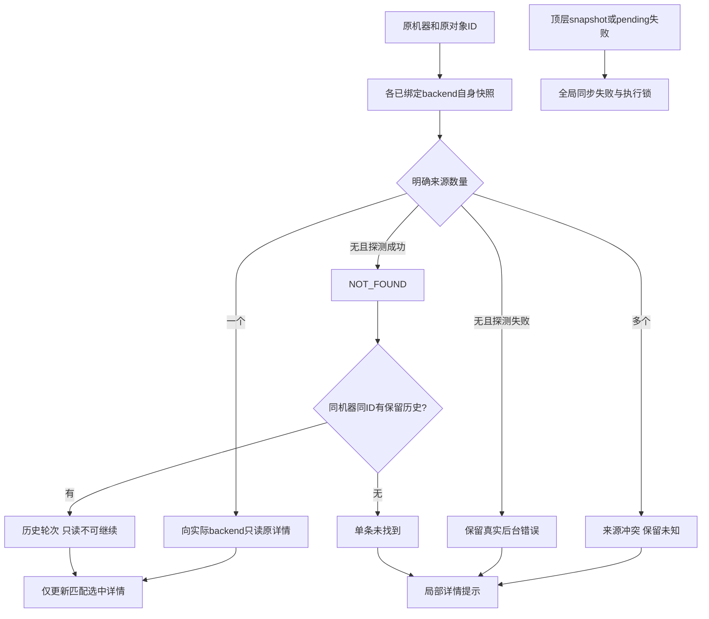

# 历史会话详情归属与工作台错误隔离（issue #6）

日期：2026-10-19（北京时间）。源码候选 **0.6.0-alpha.30**，基于alpha.29冻结产品23d256e及文档提交a872275的独立工作树；原工作区CT-04公共材料未提交开发不在此包。GitHub当前alpha.29，alpha.30包及发布尚待完成。完整I06C/I07C未准出。

## 需求与已确认边界

[issue #6](https://github.com/wsjq5477/MA-Relay/issues/6)，AB-F08/F10/F11/F17，M01/M03/M05/M06/M07/M10。会话列表来自快照或历史，详情读取失败后不应影响整台工作台。

| 编号 | 要求与验收目标 |
| --- | --- |
| R01 | 按backend自身快照确认原task/conversation来源；旧/空targetAgent不能盲目回退根OpenCode；真正legacy对象仍可读 |
| R02 | 多后台同ID拒绝猜测；详情返回ID必须匹配；真实来源快照/配置故障不伪装成未找到 |
| R03 | 实时未找到时只回退同机器同ID的保留历史，已有轮次和原native Session保留，historical/canContinue=false，不改写持久终态 |
| R04 | 顶层snapshot/pending错误与单条详情错误分开；后者不设全局error，不阻止独立会话；真正同步错误仍锁执行 |
| R05 | 明确加载、未找到、历史、详情暂不可用；可只读重读；不可在未核对详情上继续或控制，迟到回应不覆盖另一选中对象 |
| R06 | 不重发Prompt/继续/取消/回复，不新建原生上下文，不修改真实profile；同步设计、包、源码和分层验证 |

已确认代码和合成链均存在根因：MachineHost由合并快照的targetAgent猜owner，找不到后调用根legacy；后者未配置产生OpenCode文案。前端一个catch混合snapshot/pending和详情，写入全局error并进入executionLocked。用户现场会话targetAgent、node-contexts、原远端版本和machine-history未取得，不推定其具体归属已确认或现场已恢复。

## 最终实现

[MachineHost](../../../desktop/electron/machine-host.cjs)的task/conversation只读入口优先于agent快捷路由。只观测legacy与具有非空agentId的既有上下文backend快照；哪个backend实际包含原ID，就向它读取详情，不重绑Agent或原生Session，不调用context/connect。多个不同backend包含同ID报OBJECT_SOURCE_CONFLICT；实际详情ID不匹配报RECEIPT_MISMATCH。没有可证明来源时，若探测真实失败则保留原错误，否则NOT_FOUND。真正legacy包含对象时仍调用legacy，真实NOT_CONFIGURED不改成成功或不存在。实际backend虽包含旧会话但其targetAgent与原context行失配时，仍展示原轮次/原Session，但canContinue=false并说明归属缺失；正常绑定或真正legacy的原继续能力保持。submit/continue/reply/cancel/request/operation原规则保持。

[MachineRouter](../../../desktop/electron/machine-router.cjs)仅为task/conversation增加NOT_FOUND/TASK_NOT_FOUND/CONVERSATION_NOT_FOUND的历史回退。历史以原machineId分区，raw ID匹配且嵌入machineId不能属于其他机器；不回退NOT_CONFIGURED或来源冲突。不改变已保存记录；非终态只在历史投影显示unknown，canContinue=false，已有轮次、requestId、native Session保留。

[NetworkApp](../../../desktop/src/NetworkApp.tsx)将详情请求从顶层同步生命周期分离。每个kind/machine/原ID最多一条在途只读请求；慢详情不阻断机器快照，原选中身份及响应ID/来源双重核对，迟到回应不覆盖新选择。局部DetailRead是内存视图状态，不写入Task/Conversation事实；相同结果结构共享，避免轮询重建内容。详情失败只保存固定安全的局部文案，保留上次已读内容并禁止本条继续/控制；不把OpenCode配置指引外泄成全局错误。snapshot/pending真正失败仍设置全局error与执行锁。

[会话面板](../../../desktop/src/WorkspacePages.tsx)区分正在读取、未找到、详情暂不可用、历史快照和已返回零轮次；缺失/错误可“重新读取原会话”，只查询同一ID。[任务抽屉](../../../desktop/src/App.tsx)显示本任务读取状态，只锁本条控制。原机器、节点、共享目录、pending/unknown及原请求恢复保护保留。

## 实际验证与失败证据

环境：WSL Ubuntu / Node22.23.1；Windows Node24.19.0 / Edge155.0.4283.45。除普通EXE/生产adapter持久数据专项另列，均为合成执行器；模型0，不读写用户故障profile或生产服务器。

| 层级 | 实际结果与证据 |
| --- | --- |
| 未修复后端 | 新增路由测试在alpha.29旧源码失败，根legacy conversation被调用且NOT_CONFIGURED；[原TAP](../../../artifacts/history-detail-recovery/2026-10-19/before-routing.tap) |
| 未修复受控SSH | /tmp旧源码副本经真实TCP SSH/daemon误走根legacy并抛OpenCode未配置；[失败TAP](../../../artifacts/history-detail-recovery/2026-10-19/before-ssh.tap) |
| 未修复生产前端 | Windows Edge加载冻结alpha.29前端，选详情失败后出现同步中断/OpenCode指引/全局执行锁；[报告含页面文字](../../../artifacts/history-detail-recovery/2026-10-19/ui-before/report.json)、[截图](../../../artifacts/history-detail-recovery/2026-10-19/ui-before/failure.png) |
| 修复后后端 | 6/6：空/旧/匹配owner的Codex/Claude、自身来源、真正legacy成功/真实配置失败、多来源冲突、返回ID不符、同机历史、跨机拒绝、缺历史和真实快照失败；[TAP](../../../artifacts/history-detail-recovery/2026-10-19/after-routing-final.tap) |
| 受控端到端 | 生产MachineHost/daemon/帧协议+真实本机TCP SSH+MachineRouter，孤立Codex原两轮读取，实时消失后历史轮次/原native Session保留、禁止继续、原unknown不改；根legacy IPC=0，无Prompt/控制；[TAP](../../../artifacts/history-detail-recovery/2026-10-19/ssh.tap) |
| 生产前端 | 新场景Windows Edge 7组/7图，通过详情缺失/配置失败局部化、独立新建、原记录恢复、历史只读、任务抽屉、加载及真实全局同步锁；[报告](../../../artifacts/history-detail-recovery/2026-10-19/ui-final/report.json)。既有状态10组/8图，通过原离线/迟到回应/布局与恢复保护；[报告](../../../artifacts/history-detail-recovery/2026-10-19/ui-existing/ui.json)。无页面错误、业务尝试0 |
| Windows契约 | 纯CJS后端路由与原请求/历史安全91/91，SSR63/63单列Linux，生产UI单列Windows Edge；[最终Windows](../../../artifacts/history-detail-recovery/2026-10-19/windows-contract-final.tap)、[SSR](../../../artifacts/history-detail-recovery/2026-10-19/ui-unit.tap) |
| 完整工程 | 最终桌面529/529（含只读归属补强），无跳过；首轮528/528及后来维护失败均保留。[首轮](../../../artifacts/history-detail-recovery/2026-10-19/first-full/desktop-full.json)、[最终汇总](../../../artifacts/history-detail-recovery/2026-10-19/desktop-full.json)、[完整日志](../../../artifacts/history-detail-recovery/2026-10-19/desktop-full.log)。核心45/45，[日志](../../../artifacts/history-detail-recovery/2026-10-19/core.log)；lint/根与桌面类型/前端构建实际结果见各同目录日志 |
| 可信旧后台 | 新包收录已发布alpha.29 EXE的原Linux manifest，规范digest71ac17c760bc26122581c06bf1a2b0522234e62040312c4a6c1aeec4e6084983；EXE摘要与冻结交付一致，[来源](../../../artifacts/history-detail-recovery/2026-10-19/alpha29-compatibility-source.json)。只保持重连/维护入口，不自动更新远端 |

环境失败保留：[Windows依赖链接无法读取](../../../artifacts/history-detail-recovery/2026-10-19/ui-before.log)，独立复制依赖后运行实际基线；[Windows SSR缺少对应esbuild二进制](../../../artifacts/history-detail-recovery/2026-10-19/windows-contract-environment-failure.log)，分开运行纯CJS契约、Linux SSR与Windows真实生产前端，不把环境失败计成产品用例通过。首轮浏览器失败及首次目录输出保留于ui-before-first，不覆盖最终旧源码失败证据。

复现：直接运行新增history-detail-routing.test.cjs及history-detail-ssh.test.cjs（后者需要本机socket/进程权限）。Windows直接运行windows-history-details-contract.cjs；前端构建后运行windows-history-details.cjs并传Windows可访问的报告目录。既有windows-ui-redesign-state.cjs复验迟到回应和原锁。

## 包、升级与未测边界

普通EXE验收入口[windows-history-details-portable.cjs](../../../desktop/tests/windows-history-details-portable.cjs)：临时合成profile、原两轮Codex持久记录与过时targetAgent，真实生产Coordinator/MachineHost/CodexHost读取；关闭窗口/后台重开不重放，原ID/Session/记录不变。首个未发布候选已构建并核对，复核后补入旧Agent归属失配只读保护；最终重新构建和普通Windows无调试EXE4组通过。

1. 新EXE“设置 → 后台运行 → 停止后台并退出”，重新打开并确认新后台版本；仅关窗口会保留旧后台。
2. 连接原SSH机器，空闲时在“后台维护 → 升级后台 → 确认升级”升级至alpha.30，再重新读取原会话。这条归属修复位于远端MachineHost；只换EXE会先隔离前端错误，但旧daemon仍可能无法返回详情。不自动替换用户daemon，不绕过忙/unknown维护拒绝。
3. 能找到实际来源时读原轮次；只有历史时明确历史且不能继续；两端都没有时仅此详情未找到。不要改ID/节点/目录或新建配置来重绑历史。

用户实际故障profile、远端daemon版本及这条会话归属未取得；没有独立用户服务器升级、真实模型、六工具历史矩阵或完整I06C/I07C验收。不能以本机受控SSH/浏览器或EXE分发宣告用户现场已恢复。无协议2/存储schema迁移，新增只读错误与内存视图状态已同步协议/数据/架构。

最终复验首次529项中维护夹具7/8、总528/529，原phase=validated报ENOENT；该路径未被本修复修改，保留[失败原文](../../../artifacts/history-detail-recovery/2026-10-19/second-full-failure/full-daemon-maintenance.test.cjs.tap)。单独复验维护8/8后完整529/529通过，[补验](../../../artifacts/history-detail-recovery/2026-10-19/maintenance-retry.tap)、[归属保护前完整汇总](../../../artifacts/history-detail-recovery/2026-10-19/pre-guard-full/desktop-full.json)。随后补入失配Agent只读保护并重新运行最终套件；该新增断言的[修复前失败](../../../artifacts/history-detail-recovery/2026-10-19/before-orphan-continuation.tap)与最终TAP保留。首个未发布候选的包报告/日志/源码清单及字节保留于first-package，本次分发必须以补强后的最终包为准。

文档检查使用原仓库既有证据的只读链接核对历史引用，未把旧材料当作本轮重测。原alpha.26本地Linux归档已缺失，实际GitHub附件仅EXE和校验文件；修正该历史失效链接为保留原文件名/校验的历史说明，不重建或假造旧字节。

最终包已构建核验：38 CJS后端、78核心文件、1401 Linux资源及窗口ASAR/生产前端一致；145个运行源码/配置/素材摘要在打包后核对未变。EXE 129950572字节，SHA-256 `ab17091cb0a38e916a887a83c4c5740f72442e3534b15550e40923592a9b51c2`。[包报告](../../../artifacts/history-detail-recovery/2026-10-19/package.json)、[构建日志](../../../artifacts/history-detail-recovery/2026-10-19/package-build.log)、[源码冻结](../../../artifacts/history-detail-recovery/2026-10-19/source-files.json)。普通EXE4组通过，尚未公开分发。

普通EXE脚本首次在程序启动前遇到重复变量声明，修正测试脚本后继续，未改产品代码或包；[原日志](../../../artifacts/history-detail-recovery/2026-10-19/portable-script-initial.log)。

普通EXE最终4组通过：[报告](../../../artifacts/history-detail-recovery/2026-10-19/portable.json)、[日志](../../../artifacts/history-detail-recovery/2026-10-19/portable.log)。原两轮/native Session/Task/Conversation/request/operations在三次打开与完整后台重启后不变，旧Agent失配仍只读，无新原生worker目录；冻结MachineHost/MachineRouter/CodexHost匹配源码。
