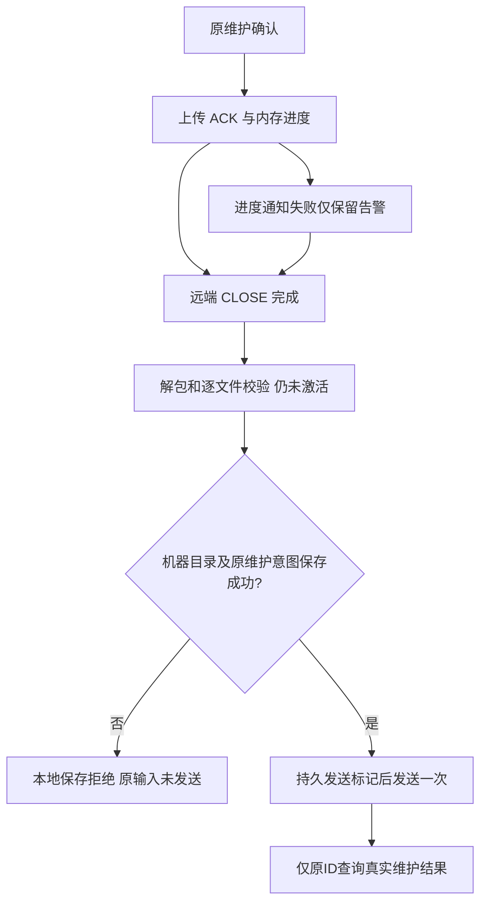

# 维护上传进度与本地持久化隔离（issue #10）

日期：2026-10-20（北京时间）。公开修复以alpha.32冻结源码/发布文档`9203b18`为基线，独立工作树构建的alpha.33现已预发布。当前整合工作区同步修复，CT-04/独立MCP/CT-05原未提交增量保留；这些增量不纳入本次公开补丁包，也不把旧integrated.3 EXE改称含本片。

## 需求与复现

对应[issue #10](https://github.com/wsjq5477/MA-Relay/issues/10)，覆盖AB-F05/F06/F10/F17、M01/M02/M03/M04/M05/M07/M10。

| 编号 | 要求 | 不变量 |
| --- | --- | --- |
| R01 | 每32KiB ACK不再同步重写机器目录，诊断异常不影响传输 | 24×32KiB流水线、缓冲区归属、ACK与CLOSE边界不变 |
| R02 | machines.json与SSH收据使用有界原子替换，清理本次临时文件 | 不删除历史tmp、用户数据或旧版本 |
| R03 | 完整暂存后、发送维护输入前必须保存机器目录和原意图 | 任一最终保存失败，remoteMaintenance调用为0 |
| R04 | 保留具体上传/本地保存类别与确认字节、解包/发送标记 | 未发送确定拒绝和已发送unknown分开，原ID不变 |
| R05 | 失败清理仅当前生成、归属已核对的上传归档 | 不递归清除远端目录，不碰旧daemon/Session |
| R06 | 当前Windows EXE及新旧后台门禁一并交付 | 公开下载与真实用户服务器升级分别验收 |

现场报告三次维护停在数MiB、machines.json残留完整tmp、远端版本仍alpha.24；具体EPERM/EACCES/EBUSY为现场推断，原始系统码未保留。本轮未连接用户profile或服务器，不能把报告中的现场结果计为今天实测。修复前alpha.32的六项反例全部失败：[旧源码失败](../../../artifacts/maintenance-persistence/2026-10-20/baseline.tap)。

## 最终实现

### 非关键进度与传输隔离

[SshManager.progress](../../../desktop/electron/ssh-host.cjs)每个ACK更新内存；同phase最多每500ms通知一次，phase改变/总字节完成立即通知。通知携带`progressOnly:true`，[Coordinator](../../../desktop/electron/coordinator-service.cjs)合并快照但不因此写machines.json。其他正确性状态通知仍同步保存；保存失败恢复原机器数组并向调用方报错。

进度通知异常转换成安全`progressWarning:{code:SSH_PROGRESS_WARNING,causeCode,phase,completedBytes,totalBytes,message}`，不回显路径/原始异常，不抛入SFTP。[上传器](../../../desktop/electron/ssh-install.cjs)也隔离任意observer同步异常，返回告警而不中止；install在uploading/extracting/verifying各phase共享保护，stageMaintenance将告警传回。告警由SSH连接持久保存并经机器快照展示，界面提示“上传继续；发送维护前仍须保存本地台账”，不宣告版本已切换。

### 原子保存与最终发送硬边界

[MachineRouter.save](../../../desktop/electron/machine-router.cjs)与SshManager.save复用[atomicWrite](../../../desktop/electron/graph-layout.cjs)：独占0600临时文件、完整写入/fsync、原子rename；仅EPERM/EACCES/EBUSY最多6次尝试、累计300ms有界等待，失败finally只清本次随机tmp。永久失败保留原完整文件；历史tmp不清理。

维护先完成上传、远端CLOSE、解包和逐文件校验，仍`deferActivation:true`。随后强制保存机器目录、原维护意图（remoteLaunched:false）、maintaining状态和发送标记；全部成功才调用remoteMaintenance。失败生成`DAEMON_PERSIST_FAILED`，含安全系统原因、stage、completedBytes/totalBytes、extracted及remoteInputSent:false。原行可落盘则持久rejected/remoteLaunched:false；SSH存储持续不可写时由原中央graph意图保留证明，恢复不构造新ID或重发。尚未发送不等同远端已停止，原daemon未被切换。

一旦实际调用了远端输入，原有unknown/原operationId查询及严格未打开通道证明恢复继续适用；不能按当前本地保存错误将已发维护结算。旧历史NATIVE_START_TIMEOUT/任务unknown未被本片释放。

### 错误、清理与能力兼容

SSH_UPLOAD_FAILED不再被维护兜底覆盖为DAEMON_STAGE_REJECTED，携带安全阶段、原因、确认字节及extracted:false/remoteInputSent:false。DAEMON_PERSIST_FAILED、已确认的解包/校验拒绝也保留原码。中央GraphOperationJournal和前端机器管理理解这些确定未发送错误，原收据保留安全details；重开只核对原operationId。

上传路径由本操作摘要与随机后缀生成，存在于已验证私有安装目录；finally只在当前精确路径为本用户普通文件且非符号链接时unlink。无论传输或解包后续失败，均不扫描删除历史.upload、staging、版本或状态目录。

中央hello新增`maintenance-persistence-v1`；新前台要求它与原三项业务能力一起具备，旧alpha.32中央只保留设置/运行信息/显式停止入口。SSH的旧路由能力门槛不变；维护传输和本地保存修复在Windows中央，用户不必先升级旧daemon才能获得上传修复。alpha.33收入alpha.32精确manifest，digest为`33bbd002f9163bbada063b5ef9feb89aaa8653e12dcd6b86d068c5beaa190d19`，不信任未知同协议版本。

## 实测与边界

原始材料位于artifacts/maintenance-persistence/2026-10-20；各层分别计数，不跨模块重复相加。

- WSL Node22.23.1：修复前6项反例全部失败，修复后最终专项7/7，包括进度EPERM不丢字节、机器目录一次冲突重试/永久失败原文件完整与仅本次tmp清理、500ms合并进度、最终目录或收据保存失败零发送、原错误透传和中央台账重开不重放。[专项](../../../artifacts/maintenance-persistence/2026-10-20/targeted-final.tap)。
- Windows Node24.19.0：最终同型专项7/7通过，包含新增原台账恢复用例；这是受控注入共享冲突，不能覆盖所有杀毒软件/真实文件锁形态。[Windows](../../../artifacts/maintenance-persistence/2026-10-20/windows-persistence-final.tap)。
- 受控真实TCP SSH/SFTP恢复与机器管理42/42通过；原通道未打开重试、已发送unknown、旧manifest/维护边界均保留。[相关回归](../../../artifacts/maintenance-persistence/2026-10-20/recovery.tap)。
- 核心51/51、lint与类型检查通过；生产前端SSR66/66，包含本地进度告警不冒充后台激活。[核心](../../../artifacts/maintenance-persistence/2026-10-20/core.tap)、[lint](../../../artifacts/maintenance-persistence/2026-10-20/lint.log)、[类型](../../../artifacts/maintenance-persistence/2026-10-20/typecheck.log)、[界面](../../../artifacts/maintenance-persistence/2026-10-20/ui-ssr.tap)。
- 独立本机真实SSH/SFTP已完成冻结alpha.32归档48,923,972字节上传并核对完整SHA-256，另保留长期exec通道及注入observer EPERM；首次记录在下面的夹具失败报告内。最终候选完整暂存/清理及版本以[实际报告](../../../artifacts/maintenance-persistence/2026-10-20/tcp-installer.json)为准，不冒充用户服务器或alpha.24现场升级。

首次SSH夹具对HOME/祖先lstat和SETSTAT不完整，修正后又发现stdout先end导致exit-status丢失；只改测试端点，不放宽生产目录/归属或解包判断。四次夹具日志分别保留[首次](../../../artifacts/maintenance-persistence/2026-10-20/tcp-installer-initial.json)、[第二次](../../../artifacts/maintenance-persistence/2026-10-20/tcp-installer-second.json)、[第三次](../../../artifacts/maintenance-persistence/2026-10-20/tcp-installer-third.json)、[第四次](../../../artifacts/maintenance-persistence/2026-10-20/tcp-installer-fourth.json)。主工作区首次完整回归受限runner的spawnSync返回EPERM/空输出，保留日志后在允许子进程的环境重跑，不把环境拦截算产品测试失败。

## 交付与用户操作

alpha.33候选基于公开alpha.32独立修复，主工作区保留既有全部未提交功能，仅同步本片代码/文档。本片没有授权重做用户原维护或清理用户现场历史残包；仅新操作在失败时清理自身归档。

使用新EXE前，在设置显式“停止后台并退出”后重开，确认中央已升级。原远端alpha.24仍通过维护预览和用户确认升级；不会自动操作服务器。原unknown只查询原ID，明确rejected才可重新检查新的维护意图。

未测：用户真实Windows文件锁与profile、独立生产SSH的完整alpha.24→新版本激活、真实模型及完整I06C/I07C。真实本机TCP上传/暂存、受控daemon激活回归、普通Windows EXE和公开下载分别验收，不互相替代。候选包、最终全量、普通EXE及公开下载状态在实际完成后补录。

### 已完成的候选程序与包验证

最终Windows生产前端 **3组**通过，0页面错误：进度EPERM告警可见、显式维护确认后最终保存EBUSY显示原因/字节/未发送、刷新不重做维护。合成IPC只产生一次明确的维护确认，不连接真实服务器或模型。[报告](../../../artifacts/maintenance-persistence/2026-10-20/ui/report.json)。初次断言误定位notice-banner，实际错误已在普通提示元素显示，仅修测试选择器；[原失败](../../../artifacts/maintenance-persistence/2026-10-20/ui-initial.json)保留。

普通无调试alpha.33 Windows EXE **5组**通过：识别旧alpha.32中央缺维护持久化能力、设置仍可用；原两轮Codex历史/Session及原unknown保留；窗口重开复用、完整后台重启，以及10个冻结CJS模块摘要匹配。原任务/原生执行未重放，模型0。[普通EXE](../../../artifacts/maintenance-persistence/2026-10-20/portable.json)、[日志](../../../artifacts/maintenance-persistence/2026-10-20/windows-portable.log)。

最终候选真实TCP SSH/SFTP **3组**通过，归档为alpha.33实际冻结包 **48,989,618字节**，SHA-256 `27f967ceec868980fa2a649b7cf3715e67ea7445419255e558e0c08097514bf2`。完整上传/哈希、并发exec/进度异常、生产解包与逐文件校验/deferActivation，以及实际WRITE失败仅当前归档清理通过。[最终报告](../../../artifacts/maintenance-persistence/2026-10-20/tcp-installer.json)、[日志](../../../artifacts/maintenance-persistence/2026-10-20/tcp-installer-final.log)、[可复现脚本](../../../desktop/tests/linux-maintenance-persistence.cjs)。早期脚本硬编码alpha.32标签的报告已保留在夹具失败记录内；最终以archive.version=alpha.33为准，未宣称真实用户alpha.24已激活。

alpha.33包核验通过：**39 CJS / 78 core / 1405 Linux资源**，前端及ASAR与构建一致；**149**份运行源码/配置/素材冻结并逐项复核。[包报告](../../../artifacts/maintenance-persistence/2026-10-20/package.json)、[构建](../../../artifacts/maintenance-persistence/2026-10-20/package.log)、[冻结摘要](../../../artifacts/maintenance-persistence/2026-10-20/source-files.json)。候选EXE **129,965,530字节**，SHA-256 `84e36905af42ea2adcb15fedbd29fa85cd10a31c91266e8031058802ede62e5e`；公开下载尚另行核验。

首次全量549/549与整合587/587通过后，最终集合加入原台账/告警用例；一个旧stageMaintenance夹具没有按真实install契约返回对象，修正为返回对象后继续验证，未放宽生产检查。后续隔离全量出现一次既有维护并发worker的validated/ENOENT；保留失败后独立8/8复核，未证明该低频异常完整因果，本片不宣称修复它。失败与最终计数均按原报告保留，不合并为一次从未失败的运行。

### 最终全量与工程检查

2026-10-20最终隔离公开修复分支桌面 **551/551，0跳过**，[逐文件结果](../../../artifacts/maintenance-persistence/2026-10-20/release-desktop.json)。当前整合工作区的验证快照为 **592/592，0跳过**，[独立结果](../../../artifacts/maintenance-persistence/2026-10-20/integrated-desktop.json)；包含既有CT-04/CT-05和并行新增回归，不将其计为本次公开EXE内功能。后续共享工作区变更不追溯扩大该快照。

旧夹具失败见[原日志](../../../artifacts/maintenance-persistence/2026-10-20/second-full/full-collaboration-compatibility.test.cjs.tap)；低频worker失败见[原始TAP](../../../artifacts/maintenance-persistence/2026-10-20/third-full/full-daemon-maintenance.test.cjs.tap)及[独立8/8复核](../../../artifacts/maintenance-persistence/2026-10-20/daemon-maintenance-recheck.tap)，最终全量已再次通过。文档检查、git diff --check、源码/包149文件摘要核对通过，候选运行字节未因测试夹具调整改变。

### 审批边界与可审阅交付

修复提交`75789421b5a95b5d2dcefc65ac7a16e670267954`已推送独立分支`codex/issue-10-maintenance-persistence`，已建立[草稿PR #11](https://github.com/wsjq5477/MA-Relay/pull/11)。自动审批拒绝直接更新共享默认master，理由为缺少用户对该具体远程分支副作用的明确授权。因此尚未合并master、未发布alpha.33公开Release、未关闭issue #10；现有公开alpha.32不变。

alpha.33候选EXE与校验文件已在主工作区artifacts/maintenance-persistence/2026-10-20提供本地交付，包摘要与普通EXE验收一致。批准合并/公开发布后，还需执行公开附件完整匿名下载核验；本页不提前填写通过。主工作区全部原未提交增量及Git HEAD/index保持，本轮只在独立分支提交修复。

## 已批准并完成的alpha.33公开交付

用户在前述自动审批拒绝后明确批准合并与发布，PR #11已合并；原审批边界段落保留历史时点，不再表示当前阻断。GitHub预发布 **v0.6.0-alpha.33** 绑定合并源码 **`ecc47d5679dcc7a1de0a5d746c018f68e169cf4e`**。合并树的149份运行源码/配置/素材与已测试候选逐项摘要一致，因此发布同一已验包字节；后续文档补录不移动标签。

- [Windows EXE](https://github.com/wsjq5477/MA-Relay/releases/download/v0.6.0-alpha.33/AgentBridge-0.6.0-alpha.33-Windows-x64.exe)
- [SHA256SUMS.txt](https://github.com/wsjq5477/MA-Relay/releases/download/v0.6.0-alpha.33/SHA256SUMS.txt)
- [预发布页](https://github.com/wsjq5477/MA-Relay/releases/tag/v0.6.0-alpha.33)

EXE **129,965,530字节**，SHA-256 **`84e36905af42ea2adcb15fedbd29fa85cd10a31c91266e8031058802ede62e5e`**。GitHub上传size/digest匹配；匿名下载16个精确HTTP Range片段覆盖全部字节，按顺序合并计算完整SHA-256，匹配本地包与GitHub资产摘要；校验附件HTTP200、完整字节一致。不是只检查HEAD或部分文件。

[发布元数据](../../../artifacts/maintenance-persistence/2026-10-20/github-release.json)、[公开完整下载](../../../artifacts/maintenance-persistence/2026-10-20/github-download.json)、[发布/下载日志](../../../artifacts/maintenance-persistence/2026-10-20/publish.log)。核心51/51、隔离桌面551/551、Windows专项7/7、前端3组、普通EXE5组与本机TCP安装/清理3组均保持原验收范围，没有把发布成功算作用户profile/独立生产服务器升级成功。

使用新EXE前先在设置显式“停止后台并退出”，再打开alpha.33；原alpha.24服务器仍在空闲时查看维护预览并确认升级。Windows中央修复先解决上传进度问题，服务器不会自动替换。原unknown只查询原operationId；既有历史残包不批量清理。本次不包含工作区后续未发布的OpenCode1.x驱动、MCP/CT-04/CT-05，旧integrated.3候选也未重新打包。
