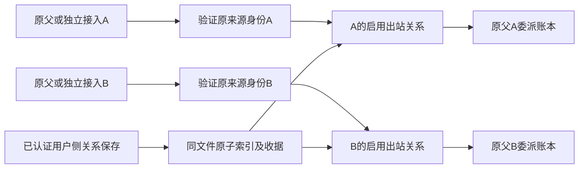

# CT-08-A2：按身份的多主运行期与用户侧关系 API

日期：2026-10-24（Asia/Shanghai）。关联 CT-08、AB-F02/F07/F08/F11/F12/F13、M01/M03/M07/M08/M10。承接 [A1 存储迁移](relation-storage-migration.md)，本片实现按调用方的多主授权、用户侧关系 API 与全关系撤权；Agent 侧连接工具、envelope/确认与多关系策略界面仍未完成。公开仍 alpha.53，本地候选 alpha.59；不切换日常后台、修改用户原关系/配置或部署 SSH，真实模型 0。

## 需求与迁移

A1 中除 selected 以外的行是保留数据，不能因运行期升级自动变成授权。本片将中央关系索引升级为 **relationsVersion=2**，每行增加必需布尔字段 enabled：

- 原无索引文件：原单主关系成为唯一 enabled 行，原关系/成员顺序/修订/身份不变。
- A1 索引 v1：只将原 selected 行设为 enabled；其他行保留原数据与修订、enabled=false，必须经用户侧明确保存才启用。
- v2：校验完整索引、selected 投影一致及启用主身份唯一。未知版本、缺字段、重复标识/启用主身份或旧视图冲突拒绝并保留原文件。

读取只做内存迁移；首次正常原子提交才持久化。旧 collaboration 仍是 selected 关系的兼容视图，原默认 API 形状与指纹保持；它不再决定其他主身份的权限。外层网络 version=1、Task/Session、请求/委派ID和 daemon 协议2不变。alpha.57不识别 v2，将拒绝读取，不支持直接降级编辑；更老写入器只修改旧视图导致冲突时仍拒绝静默合并。

## 当前行为

| 场景 | 行为 |
| --- | --- |
| 原生托管父或独立 MCP 调用 | 原机器/父请求或 enabled 接入先完成身份验证，再按该 nodeId 找启用的出站关系；调用方不能传关系标识切换身份 |
| list_agents | 每个主只看自己的当前成员；沿原 snapshot，await 后重新按该调用方当前关系过滤。兼任其他主的成员不取消其自己的主身份；无出站主身份仍没有目标 |
| delegate | 只按该主的当前启用关系准入新委派。派生 requestId 仍由原节点/父 Conversation/调用方 requestId 决定，不加入 relationId |
| 原结果、权限与取消 | 仍按原父节点/request/task/conversation/独立 connectionId 的交集核对，不因另一个主存在而转交；移除成员不取消原任务，原父读控保持 |
| 节点断开/移除 | 在同一原子提交中撤销该节点在所有关系中的主/成员身份；仅受影响行修订+1，与原节点收据一起提交 |
| 机器移除/卸载 | 撤销所有归属节点在全部关系中的授权；恢复机器不恢复已撤销授权 |
| 接入/执行恢复 | 原 Task/Session/scope 和默认原生 collaborationId 不改；原 unknown 查询仍使用原请求，不能靠更换关系标识释放占位 |

经典 MCP 仍 7 工具，小队接口不变。新关系目录/保存属于已认证中央用户侧 RPC，不在 MCP 工具面开放；Agent 不能自行调用用户侧接口授予关系。新委派在准入与意图落盘时核验当前关系；已接受/在途工作保持原 ID 与未知状态，不因撤权自动重放、取消或改归属。

## 用户侧协议与旧后台

| 接口 | 当前契约 |
| --- | --- |
| relations({}) | 返回 schema、activeRelationId 与 items，每项只投影 relationId/enabled/leaderId/memberIds/revision；不接受调用方身份/过滤字段 |
| collaboration() | 原 selected 三字段形状，不改旧内部/图调用 |
| collaboration({relationId}) | 读取指定原行，包含 relationId/enabled 及三个业务字段；不存在/无效标识拒绝 |
| saveCollaboration({relationId?,operationId,expectedRevision,leaderId,memberIds}) | 不带 relationId 保持原 selected 更新；显式关系必须提供原 operationId。新行以 expectedRevision=0 创建，原行按自身修订更新；启用同一主不能重复建另一行，原旧视图不被编辑其他行覆盖 |
| collaborationOperation({operationId}) | 沿原全局唯一操作ID查询；显式保存指纹加入 relationId，不能在其他行复用原 ID。新收据必须匹配原关系、原ID与完整指纹，缺失/外来证据不释放 unknown |

GraphOperationJournal 保留原 relation lane 和原未知互锁，不通过换关系标识绕过未确认操作。旧未带 relationId 的操作指纹及收据恢复不改。关系与收据仍一次 atomicWrite，原成员/能力/修订和节点来源准入继续执行。

中央 hello 新增 `multi-parent-relations-v1`；daemon hello **不**声明该中央能力。新 CoordinatorClient 仅对 relations 和显式关系读写检查此标记，旧中央在派发前返回 RELATIONS_BACKEND_UPGRADE_REQUIRED，旧普通查询/默认关系仍沿原门禁工作，不全局要求新能力。前端开始协作按 snapshot.relations 中目标自己的 enabled 出站关系判定，旧快照缺该数组则回退原 selected 判断；现有图仍编辑 selected，完整多关系创建/选择/审计 UI 待后片。

## 验证与原始失败

WSL Node22.23.1，最终运行实现桌面全量 **884/884**，失败/跳过0，[TAP](../../../artifacts/ct08-runtime/2026-10-24/desktop-final.tap)。最终全量在修复后、版本号提升为59前执行；当前40份pin已包含，随后包内模块哈希与目录另验；Core产品未改，不把旧71/71记为本轮新测。原单主/来源/连接专项 **114/114** 先通过，[TAP](../../../artifacts/ct08-runtime/2026-10-24/existing-targeted.tap)，是全量子集，不累加。

[新多主测试](../../../desktop/tests/multi-parent-relations.test.cjs)14项进入全量：v1非选中行不提权、双独立/双托管主自己的出站关系、来源与unknown父门禁、修订/ID隔离、重复主/无操作ID拒绝、跨父/连接拒绝、撤权后原读控、unknown及显式重授权换关系后只查询原请求、等待期间撤权、全节点/机器撤权与恢复不重授权、丢保存回应只查询原收据、缺指纹/错关系拒绝、旧后台定向门禁/daemon不误声明。均为受控宿主、真实临时文件/生产模块，不是真实原生模型。

首轮新测试12项中11通过、1失败：共享合成任务夹具缺少必需createdAt/updatedAt，多任务snapshot排序报错。仅补齐夹具时间戳，不修改产品排序或削弱断言；随后增加托管父来源场景后13/13通过，增强unknown重新授权场景由先前883全量覆盖；补充原拒绝恢复后最终884全量通过。[首轮失败](../../../artifacts/ct08-runtime/2026-10-24/multi-parent-initial.tap)、[13项定向](../../../artifacts/ct08-runtime/2026-10-24/multi-parent.tap)。脚本可选择冻结runtimeRoot供Windows包内复验，默认源模块路径与语义不变。

原拒绝恢复补查发现：显式关系写入前的确定拒绝已存于原GraphJournal，但原查询返回not_found，丢回应后不能恢复。先用负例复现，再仅对原记录state=rejected、原操作/内容指纹匹配且原命令确定拒绝的显式关系构造拒绝收据；同码查询错误或unknown行不结算。旧非显式关系路径不改。[修复前负例](../../../artifacts/ct08-runtime/2026-10-24/prewrite-rejection-before.tap)、[修复后](../../../artifacts/ct08-runtime/2026-10-24/prewrite-rejection-after.tap)、[此前883全量](../../../artifacts/ct08-runtime/2026-10-24/desktop.tap)。

中间alpha.58原EXE/包核验已冻结保留，但未交付Downloads：新增恢复负例尚未通过，且首次Windows驱动使用Node --test直接发现UNC文件，未开始测试就报Could not find。原路径可被require读取；改为本地入口显式require原测试模块，保持原相对解析及全部21项断言，不以文件级通过代替用例。[58包核验](../../../artifacts/ct08-runtime/2026-10-24/package-alpha58.json)、[原构建](../../../artifacts/ct08-runtime/2026-10-24/package-alpha58.log)、[首轮驱动报告](../../../artifacts/ct08-runtime/2026-10-24/windows-relations-initial.json)、[UNC原stderr](../../../artifacts/ct08-runtime/2026-10-24/windows-driver.stderr)。未覆盖58文件，也未将未交付58列入兼容pin。

最终lint与前端类型/生产构建通过：[lint](../../../artifacts/ct08-runtime/2026-10-24/lint.log)、[构建](../../../artifacts/ct08-runtime/2026-10-24/frontend-build.log)。前端只做目标资格判断与类型增量，未做真实窗口交互/图100ms补验。

## 交付与未完成

alpha.57原EXE完整SHA与1710项Linux文件核验后原样导入清单，目前40份可信原清单；不是部署、改写原清单或认可未知版本。[导入证据](../../../artifacts/ct08-runtime/2026-10-24/import-alpha57.json)。

最终alpha.59 EXE **130196221字节**，SHA-256 **`f1585e625291dec176b3d749cc4919247f39d59b9a1f44883b1ea5bf7b134127`**；55后台/84Core/1711Linux资源及Core、Windows/Linux后台、ASAR/前端/bootstrap一致性通过。Linux manifestDigest `b2cd44355105dbc671c1102f010c448f9b3439b5ea3e7644de3604a054e43d25`。[包核验](../../../artifacts/ct08-runtime/2026-10-24/package.json)、[最终构建](../../../artifacts/ct08-runtime/2026-10-24/package-build.log)。

Windows Node24.21.0，冻结模块迁移7项+运行期14项 **21/21**，失败/跳过0；实际生产中央命名管道验证原默认三字段响应、显式第二关系保存、该主自己的授权目标与原selected不变，完整关闭/重建中央后原两关系及原操作收据一致。外层管道profile请求/委派0；测试内有明确的合成任务用于验证委派，真实模型均0。[报告](../../../artifacts/ct08-runtime/2026-10-24/windows-relations.json)、[逐项TAP](../../../artifacts/ct08-runtime/2026-10-24/windows-relations.tap)、[验收器](../../../desktop/tests/windows-relation-state.cjs)。这是实际Windows IPC/文件与受控宿主，不是真实原生自主父模型。

同一冻结包40份pin逐字与源码一致，Windows复用/查询 **26/26**、短诊断和 **9,414,895字节**完整维护输入/原fingerprint保真通过；无实际SSH网络或部署。[报告](../../../artifacts/ct08-runtime/2026-10-24/windows-contract.json)、[TAP](../../../artifacts/ct08-runtime/2026-10-24/windows-contract.tap)。

普通无调试Windows便携EXE **4组通过**：自己的真实59版本与Windows目录、生产IPC/SQLite公共资料持久化、正常关闭/重开复用原中央与记录、隔离中央完整重启后资料保持且原生执行0。初始历史0；使用独立临时profile和自有进程，不切换日常后台。该验收沿项目原生命周期脚本，通过进程/IPC核对，不依赖交互窗口控制；此前把它与高频画面观察一起归为工具限制过宽，此处已补齐。[普通EXE报告](../../../artifacts/ct08-runtime/2026-10-24/windows-portable.json)。不证明鼠标交互、像素首帧或图100ms。

[本地EXE](../../../desktop/release/AgentBridge-0.6.0-alpha.59-Windows-x64.exe)及[SHA256SUMS](../../../artifacts/ct08-runtime/2026-10-24/SHA256SUMS.txt)已交付Downloads，同名EXE/.sha256完整SHA复核，不覆盖不同已有文件。[副本核验](../../../artifacts/ct08-runtime/2026-10-24/download-copy.json)。未签名、未公开；需切换日常后台时先在旧窗口“设置→后台运行→停止后台并退出”，再运行新EXE，本片未执行切换。

[源冻结清单](../../../artifacts/ct08-runtime/2026-10-24/source-manifest.json)、[验收脚本摘要](../../../artifacts/ct08-runtime/2026-10-24/scripts-sha256.json)、[分层汇总](../../../artifacts/ct08-runtime/2026-10-24/verification-summary.json)。工作树基于公开5269d65；未创建新公开标签。

普通EXE生命周期已补验；高频窗口画面/鼠标与像素时延未补，computer-use要求的node_repl入口当前缺失，已有失败观测不作通过。图100ms、WSL稳定性、真实自主父模型/用户日常关系及完整SSH故障/版本切换仍未准出。新Agent连接工具、envelope预授权/人工确认、前端策略与审计尚未实现，不能将本片后台多主支持当作完整CT-08完成。指定Windows OpenCode最多一个心算子任务许可仍未使用，本片模型0。

最终文档检查0错误、用户站测试6/6及构建通过：18用户页/19HTML，内部页和证据导出均0。[检查](../../../artifacts/ct08-runtime/2026-10-24/docs-check.log)、[测试](../../../artifacts/ct08-runtime/2026-10-24/docs-test.log)、[站点构建](../../../artifacts/ct08-runtime/2026-10-24/docs-build.log)。
