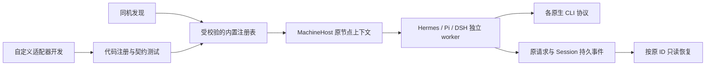

# I07 原生 Agent 扩展与开发接口

2026-10-18后续资料核对：[接入矩阵](../../agent-integration-matrix.md)区分MCP调用方与普通被调用方。三种新工具不能注入Bridge MCP或成为原生小队成员，但经典delegate的普通子任务源码路径可达；没有真实模型委派证据。本页原受控验证范围保持，不以研究补造通过。

2026-10-18后续源码修复：[小队接入资格与原核对收据](native-integration-guards.md)补齐新工具在登记/执行意图前拒绝，以及Hermes/Pi/DSH核对收据持久化。本页原413项、图标与原生协议证据保留其原时点，不用后续Claude真实成员验收替代三种新工具真实模型。

日期：2026-10-18。基线：alpha.28 后工作区源码，包含已有未发布界面增量；本次不改变已发布 alpha.28 EXE 的能力声明。

## 需求与范围

| 需求 | 对应功能 | 可验收表现 |
| --- | --- | --- |
| I07-N01 增加三种原生工具 | AB-F02/07/08/10/11，M03-F02/F05，M06-F01 | 发现并接入 Nous Research Hermes、Pi Coding Agent、官方 DeepSeek Harness（DSH），通过各自原生协议执行 |
| I07-N02 全部工具品牌图标 | AB-F01/09，M01-F01/F02/F06 | 六种 Agent 在列表、节点图与会话来源使用本地官方素材，附来源记录 |
| I07-N03 自定义 Agent 开发接口 | M06-F01 | 代码内注册接口、校验器、可运行示例和[开发指南](../../custom-agent-development.md)，明确发现/宿主/生命周期约定 |

用户已确认“harmes”指 Nous Research Hermes；规范 adapter ID 为 `hermes`，另外两个为 `pi`、`dsh`。不引入模型 API 层、账号配置表或任意远程模块加载。

## 实现与边界

发现器从同一内置注册表读取工具元数据与 npm 入口。Windows npm 包入口使用结构化进程参数执行，不运行任意 `.cmd` 内容。Pi 同时识别现行 `@earendil-works/pi-coding-agent` 与历史 `@mariozechner/pi-coding-agent` 安装；DSH 对应 `@deepseek-ai/dsh`。Linux 保留 PATH 优先、用户态版本管理目录和 Hermes 安装目录检查，不 source shell 启动脚本。OpenCode 二次发现只检查 OpenCode，不探测其他工具。

MachineHost 按明确注册项创建宿主，未知 adapter 必须拒绝。三种新增工具分别解析官方非交互协议；安装与版本检查不证明原生模型可用。新增宿主保存原 requestId、任务、会话、原生 Session 与执行证据；查询不补发需求，续聊使用原绑定。具体事件、取消与异常边界以[M06 当前设计](../../modules/06-native-adapters/design.md)和实现测试为准。

三种新增适配器首批提供直接会话。未实现的 Bridge 权限表单、MCP 注入、小队自动续接不能声明可用；在派发前拒绝不支持的协作。DSH 使用官方 headless profile，其原生凭据来源与 web profile 不同；需要用户在原生工具中配置该 profile，Bridge 不读取或搬运账号凭据。



## 验证记录

原始工程证据保存在 `artifacts/native-agent-expansion/2026-10-18/`，浏览器与骨架证据另列下表。环境：WSL Ubuntu / Node22.23.1；图标浏览器为 Windows Node24.18.0 / Edge155.0.4283.45 / 冻结生产前端与受控API。受控 CLI 夹具、前端构建和文档检查不代表真实模型、Windows EXE 或独立 SSH 验收。

| 检查 | 结果 | 证据级别 |
| --- | --- | --- |
| 发现、注册、宿主生命周期和原宿主路由专项 | **43/43 通过**；新宿主19、契约5、发现9、旧Codex5、MachineHost readiness1/routing4 | [受控进程/磁盘 TAP](../../../artifacts/native-agent-expansion/2026-10-18/native-targeted.tap) |
| 最终串行全桌面 | **413/413 通过**，无跳过（包括既有父/子测试），约48.5秒 | [完整 TAP](../../../artifacts/native-agent-expansion/2026-10-18/desktop-tests-final.tap) |
| 核心工程回归 | **45/45 通过**，无跳过，约69.3秒 | [完整 TAP](../../../artifacts/native-agent-expansion/2026-10-18/core-tests.tap) |
| 根类型/lint/核心构建/桌面类型与生产构建 | 全部通过，保留原有大于500kB前端chunk提示 | [类型](../../../artifacts/native-agent-expansion/2026-10-18/core-typecheck.txt)、[lint](../../../artifacts/native-agent-expansion/2026-10-18/lint.txt)、[前端构建](../../../artifacts/native-agent-expansion/2026-10-18/desktop-build.txt) |
| 六图标与既有UI SSR | **63/63 通过**（4+59，已计入413，不另加） | [图标测试](../../../desktop/tests/agent-icons.test.cjs)、[UI测试](../../../desktop/tests/ui-redesign.test.cjs) |
| Windows生产前端图标 | **13项、3图通过**，外部资源请求0，无页面错误，非EXE测试 | [浏览器报告](../../../artifacts/agent-support/2026-10-18/icons/report.json)、[浅色](../../../artifacts/agent-support/2026-10-18/icons/inventory-light.png)、[深色](../../../artifacts/agent-support/2026-10-18/icons/inventory-dark.png)、[关系图](../../../artifacts/agent-support/2026-10-18/icons/graph-dark.png) |
| 自定义接口骨架 | 检查通过，native executions=0 | [执行记录](../../../artifacts/native-adapters/2026-10-18/extension-example.txt)、[骨架](../../../examples/custom-agent/adapter.cjs) |
| 文档与diff检查 | `check-docs`、`git diff --check` 通过 | [文档检查](../../../artifacts/native-agent-expansion/2026-10-18/docs-check.json) |
| 三种真实 Agent 模型回复与续聊 | 未测试 | 不调用模型 |
| 新 Windows EXE、独立 SSH daemon | 未构建/未测试 | 本次源码交付 |

专项、SSR与全桌面存在包含关系，不跨模块相加。最后两处复核修正后重跑全桌面，从首轮[411项通过](../../../artifacts/native-agent-expansion/2026-10-18/desktop-tests.tap)增加至413项：Pi原文件缺失/重复和任意会话在途时禁用续聊；超4MiB协议帧导致的终止也有SIGKILL升级，不把该失败标作用户取消。

首次测试受执行环境影响：受限sandbox中Node子进程stdout为空、spawnSync报EPERM；在正常子进程I/O环境重跑，没有改产品以迎合运行器。适配合并时曾暴露Codex worker只复制旧发现器、缺少新注册表/契约的真实依赖回归，五项受控测试超时；补齐冻结依赖后Codex5/5和最终全桌面通过。首轮发现/路由失败中另有显示名断言仍使用Hermes/DSH简称，按注册表正式名称修正。上述失败没有登记成模型或用户故障机结果。

实际检查命令（Node须在PATH）：

```bash
node --test --test-concurrency=1 desktop/tests/*.test.cjs
npm test
npm run typecheck
npm run lint
npm run build --prefix desktop
node examples/custom-agent/check.cjs
node scripts/check-docs.mjs
git diff --check
```

官方协议以固定上游源码核对：[Hermes stream_json.py](https://github.com/NousResearch/hermes-agent/blob/ccc695635094d7615373db267b77f894d978b1a0/hermes_cli/stream_json.py)、[Pi JSON文档](https://github.com/earendil-works/pi/blob/482c1381a00d8d00bc81697e4a980c593db6803e/packages/coding-agent/docs/json.md)、[DSH headless](https://github.com/deepseek-ai/deepseek-harness/blob/687f282e8625c6b8d11ff58211a90524be2e4317/packages/bundle/headless/README.md)。[完整上游引用与启动/终态条件](../../../artifacts/native-agent-expansion/2026-10-18/upstream-contracts.json)不等于安装版本兼容或模型验收。

## 部署与开发说明

本地源码启动使用新注册表；已安装 Windows EXE 与已运行的 SSH daemon 不因修改源码自动更新。远端使用这些适配器需要后续包含新模块的后台版本，并在原机器升级后重新扫描。现有打包脚本按 `.cjs` 模块集合纳入后台，新增图标由前端构建纳入资源；本次不以此推定已生成或公开发布新 EXE。

自定义 Agent 的接口是受维护代码的扩展点，开发者实现与测试宿主后注册并随包发布。它不把 MCP 服务地址、任意命令行或用户填写的模块路径当成现成执行适配器。
