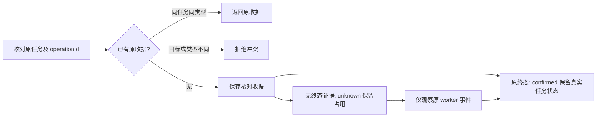

# I07：原生接入的小队准入与核对收据

日期：2026-10-18。alpha.28 之后的未发布源码增量，继续[原生扩展](native-agent-expansion.md)。GitHub alpha.28 和本地 alpha.28.poll.4 均保持原冻结字节，本片修复不在这些 EXE 中；完整 I07C/I06C 未准出。

## 1. 需求与影响

本轮先核对四个近期任务的实际历史：均曾因 usage limit 失败，之后已完成续跑。没有重放它们的原生请求。随后复核合并工作区，发现两个有实际影响的接线缺口；本轮自身随后也被额度中断，续跑时先核对已落盘代码、原测试日志和固定验收 checkpoint，接完以下工作，没有另建替代请求。

| 需求 | 触发与期望行为 | 功能关联 |
| --- | --- | --- |
| I07-N04 | Hermes/Pi/DSH 支持直接会话，但没有 Bridge 小队能力。不能在界面或后台登记为原生小队成员；历史登记的新执行必须在认领工作项、保存尝试和派发前拒绝。原执行查询不受新准入影响 | AB-F19/20/22；M01-F10、M02-F08、M06-F05、M08-F07/09 |
| I07-N05 | Codex 及三个新宿主返回核对 operationId 却未保存收据，回应丢失后原 ID 查询 NOT_FOUND，同 ID 还可跨任务使用。需持久保存核对收据，重启后查原结果，跨任务/控制类型复用拒绝 | AB-F10/11；M06-F05/M06-CX-F01、M07-F06/07 |

不增加模型/供应商配置、任意执行接口或动态插件加载；外部 MCP 成员仍按原入口工作。能力声明不能替代真实模型与原生版本验收。

## 2. 最终行为

### 小队准入

Coordinator 在现有 snapshot 中投影的 `node.teamCollaboration` 是本地静态适配注册表的接入资格。本片没有新增 AgentNetwork 远端能力采集或持久化，也不把该字段当作远端实测通告。Claude/OpenCode/Codex 缺字段时兼容既有行为；节点确有显式 false 时拒绝，Hermes/Pi/DSH 及未知工具即使伪造 true 也不能开启小队。实际远端 context/scope/teamContinuation 仍由原流程另行确认。

登记与独立手动执行的选择器共用准入过滤。历史误登记成员的卡片及原 attempt 保留，新的手动执行不能误选；任务板的执行请求同样受后台守卫约束。界面说明其他工具可直接会话，后台再次检查，不能通过伪造表单绕过。

TeamSpace 在原操作幂等分支之后，对新登记与历史成员的新执行检查准入；旧 operationId 重放读取原尝试，不创建新意图。新执行被拒绝时没有 attempt、工作项认领、自动预算消耗或原生派发。自动能力提示区分“小队未支持”和“可手动但自动续接未支持”。实际部署到旧远端时仍由原 MachineHost scope 能力确认，不新增 RPC 或放宽远端限制。

### 原核对收据

CodexHost、NativeCliHost 的原 `operations` 中保存 `operationId/kind/taskId/state/data`；`kind` 区分 `cancel` 与 `reconcile`，历史缺 kind 的条目仍按旧取消处理。核对同 ID 同任务读取原收据，跨任务或取消/核对混用报 REQUEST_CONFLICT。空白操作 ID 无效。

unknown 核对不阻止用户第一次取消；已有 unknown 取消不能换 ID 再发。后来观察到原任务真实终态时，可推进原核对收据，不能重新执行。Codex 严格未派发证明仍按既有边界记 failed；confirmed 核对不是任务 succeeded 或 cancelled 的替代证据。

同时补齐 Codex 同批事件终态保护：观察到成功/失败终态后，忽略该批后续 started/output/native 等帧，仍推进已观察 offset，避免任务退回 unknown 或结果/原 Session 被晚到事件替换，而收据仍称已确认的矛盾。运行准备失败与原生进程退出分开记录；未启动的任务不写 nativeExited=true。

## 3. 验证记录

环境：2026-10-18，WSL Linux / Node22.23.1；Windows Node24.19.0 / Edge155.0.4283.45。下表工程、CLI夹具和浏览器均为受控测试，模型调用0，不使用用户 profile/独立 SSH。

| 检查 | 实际结果 | 原始证据 |
| --- | --- | --- |
| 原收据反例 | 初版17/17修复前失败，Codex晚到终态2/2修复前失败；不计通过数 | [原收据](../../../artifacts/native-reconcile/2026-10-18/before-in-process.tap)、[晚到事件](../../../artifacts/native-reconcile/2026-10-18/before-terminal-guard.tap) |
| 收据/原宿主定向 | 最终57/57，无跳过；新收据23项，原宿主/恢复34项 | [TAP](../../../artifacts/native-reconcile/2026-10-18/targeted-final.tap)、[源码摘要与命令](../../../artifacts/native-reconcile/2026-10-18/report.json) |
| 小队准入反例/最终 | 修复前注册、历史登记执行反例实际失败；相关回归71/71，最终新增准入/选择器19/19 | [注册反例](../../../artifacts/I07C-team-capability/2026-10-18/registration-before.tap)、[执行反例](../../../artifacts/I07C-team-capability/2026-10-18/execution-before.tap)、[相关回归](../../../artifacts/I07C-team-capability/2026-10-18/team-targeted-unrestricted.tap)、[最终19项](../../../artifacts/I07C-team-capability/2026-10-18/admission-and-picker-final.tap) |
| 核心工程 | 45/45，无跳过，含根构建 | [日志](../../../artifacts/native-integration/2026-10-18/core.log) |
| 串行全桌面 | 最终474/474，无跳过；包含23项新收据、19项准入、8项验收脚本安全契约，不再叠加定向数 | [最终TAP](../../../artifacts/native-integration/2026-10-18/desktop-final.tap) |
| lint/根类型 | 通过；lint为既有src/tests/scripts范围 | [lint](../../../artifacts/native-integration/2026-10-18/lint.log)、[类型](../../../artifacts/native-integration/2026-10-18/types.log) |
| 前端类型/生产构建 | 通过，保留既有578.37kB单包提示 | [日志](../../../artifacts/I07C-team-capability/2026-10-18/desktop-build.log) |
| Windows生产前端 | 6组/6图通过，页面错误0、写入尝试0；登记/旧成员执行选择过滤，三种工具的直接会话入口仍在；含原异常/unknown/取消语义回归 | [报告](../../../artifacts/ui-redesign/2026-10-18/team/2026-10-18T14-26-04-414Z/ui.json)、[命令输出](../../../artifacts/native-integration/2026-10-18/windows-team-ui-final.log) |

首次核心沙箱子进程只能返回顶层失败且未结束，保留[不完整日志](../../../artifacts/native-integration/2026-10-18/core-sandbox-incomplete.log)，停止该隔离测试进程后，经正常本机执行环境复验45/45。小队测试首次 socket EPERM、加载与 unused import 构建错误保存在[专项目录](../../../artifacts/I07C-team-capability/2026-10-18/)，后者删除抽出组件后残留的 import，未放宽产品能力。

全桌面先前469项通过后，因续完2项Codex晚到事件及3项验收恢复守卫而重跑最终474；[首次TAP](../../../artifacts/native-integration/2026-10-18/desktop.tap)保留。浏览器首次六组断言均完成，但扩充8节点时遗漏图布局，触发自动布局保存，被只读mock拒绝；该[失败报告](../../../artifacts/ui-redesign/2026-10-18/team/2026-10-18T09-55-49-770Z/ui.json)保留。只补齐两机器/8节点合法布局后重跑，仍拒绝全部写入，没有把保存动作加入豁免名单。

最终全量前采集[322个源/测试/配置/素材文件摘要](../../../artifacts/native-integration/2026-10-18/source-manifest.json)，结束后逐项一致。该清单包括既有未提交增量，不是发布提交或 EXE 内容证明。GitHub API只读复核的最新预发布仍为[alpha.28](https://github.com/wsjq5477/MA-Relay/releases/tag/v0.6.0-alpha.28)，[元数据](../../../artifacts/native-integration/2026-10-18/release-state.json)记录原附件大小/服务端摘要；本轮未重新下载或替换公开 EXE。

复现：`node --test --test-concurrency=1 desktop/tests/*.test.cjs`、`npm test`、`npm run lint`、`npm run typecheck`、`npm --prefix desktop run build`。Windows Node执行 `desktop/tests/windows-ui-redesign-team.cjs`；本脚本冻结当前生产前端，注入只读合成 API，无实际模型或后台。新增状态图已在Windows Edge真实DOM用仓库Mermaid解析通过；首次Node缺DOM的[环境限制](../../../artifacts/native-integration/2026-10-18/diagrams-node-initial.json)单独保留，不改变文档站安全设置。[图表解析](../../../artifacts/native-integration/2026-10-18/diagrams.json)。最终[文档检查](../../../artifacts/native-integration/2026-10-18/docs-check.json)、[源清单复核](../../../artifacts/native-integration/2026-10-18/source-verification.json)与[验证汇总](../../../artifacts/native-integration/2026-10-18/verification-summary.json)分别记录，文档/差异/图表检查不算产品或模型用例。

## 4. 未测与下一步

本片不升级用户后台，不改写已有 unknown，不发布或重建 EXE。三种新工具的真实原生模型/续聊、独立 SSH 与完整故障矩阵仍未验。本轮另已完成[三个真实Claude成员的公共文档链](native-members.md)，明确区分实际模型、同WSL受控路由和物理机器范围；它不替代代码编译返修或完整 I07C/I06C 准出。
