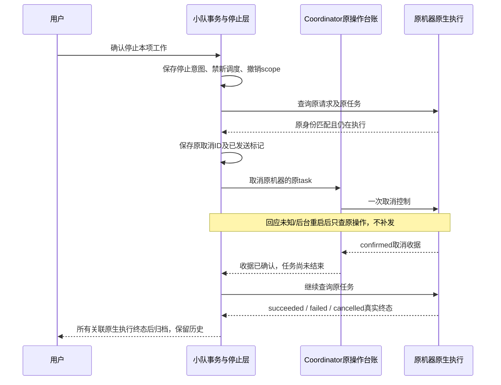

# I07C：停止本项工作与原生终态核对

日期：2026-10-16。源码/本地候选 **0.6.0-alpha.24**，GitHub预发布仍为alpha.23。本片补充[等待可见性](native-waiting.md)，实现用户停止整项工作的连接层闭环；**完整I07C/I06C仍未准出**，未更新GitHub附件或用户后台。

## 1. 需求和用户行为

关联I07-R08/09/10/11/12、AB-F10/11/20/22，M01-F13/M02-F11/M07-F11/M08-F10及M10打包。原“停止自动调度”和“暂停新执行”继续只阻止新执行。本片新增“小队协作 → 工作空间 → 停止本项工作”，用户确认后立即禁止新调度并撤销本工作成员访问，逐项核对和取消Bridge关联的原生执行。

取消操作的confirmed只说明该操作有收据，不能让仍running/unknown的任务变成已取消。所有原生尝试都有真实终态后才归档，不设置业务验收成功；原任务可能自然成功、失败或取消，各自保留真实结果。停止不可恢复为继续执行；不删除公共材料或释放unknown占位。

外部MCP成员只提供协作接入，没有通用外部运行控制。本操作撤销它们本工作的访问；界面明确提示到原入口停止自身运行，不能宣称已杀掉外部Agent进程。原生入口缺少取消能力、取消被拒绝或原执行无法查询时，保持停止中并给出原因。

## 2. 需求到实现

| 场景 | 本片设计 |
| --- | --- |
| 用户决定停止 | 仅本机用户可调用，要求原runId、expectedRevision和稳定operationId；成员MCP不能停止工作 |
| 立即阻止继续工作 | 同一SQLite事务设置stopping/paused、关闭自动授权、清除待生效总验收、撤销所有成员scope，保存原尝试列表及各自取消意图 |
| 原生准备与停止竞争 | 继续沿原执行准入校验；已撤权的准备不能落成新派发，不换请求/会话 |
| 派发取消 | 先查询并核对原request/task/Conversation；只有已定位的非unknown在途任务才首次取消，使用原节点/机器/task和该尝试的稳定取消operationId |
| 控制回应丢失或重启 | 取消发送标记先持久化；之后只查询原控制收据，NOT_FOUND/身份不符不能重发，也不能释放占位 |
| 收据与任务不同步 | confirmed/rejected与任务终态分开；持续查原任务，不用收据改写执行结果 |
| 收据查询恢复 | 经过Coordinator原台账入口核对；请求/机器及控制operationId/可选task身份必须匹配，缺失/unknown/外来收据不结算原台账 |
| 用户重开窗口/后台 | 停止中工作即使未启用持续协作，也由后台定时核对；刷新只推进原停止记录，不新增尝试 |
| 最后一个原执行结束 | stopping → closed，记录停止完成时间、保留任务和业务报告，不写acceptedAt |
| 新界面连接旧后台 | context缺stopSupported时禁用停止按钮并提示先停止旧后台后重开新版，避免向旧接口发送未知写入 |

## 3. 数据、接口与落点

SQLite仍为格式3，旧记录没有stop/cancellation字段即没有停止操作，不新增迁移。run.state新增stopping；run.stop保存requestedAt/targetIds/externalCount及完成后的completedAt。每个目标attempt.cancellation私有保存operationId/taskId/dispatched/state。对外attempt只投影stop.state；不公开取消内部记录、原生Session、等待请求ID或工具参数。

`team.stopRun`只面向用户，参数为runId/expectedRevision/operationId；同ID同内容返回原停止收据，内容改变拒绝。`team.context/team.refresh`新增stopSupported和stop汇总（总数、未终态数、外部成员数、时间），state为stopping期间成员工具与业务写入拒绝。`team.refresh`和后台定时器对同一停止工作合并并发核对；每项取消由事务抢占，无法判断是否发送的记录不重放。

| 源码 | 职责 |
| --- | --- |
| [team-stop.cjs](../../../desktop/electron/team-stop.cjs) | 停止意图、范围、原生取消、原收据恢复、真实终态后归档 |
| [TeamSpace](../../../desktop/electron/team-space.cjs) | 用户权限、事务去重、原请求观察、停止投影及核对合并 |
| [TeamAutomation](../../../desktop/electron/team-automation.cjs) | 关闭新激活后仍核对停止中工作 |
| [Coordinator](../../../desktop/electron/coordinator-service.cjs) | 原机器取消/查询路由及原控制台账结算 |
| [TeamStopStatus](../../../desktop/src/TeamStopStatus.tsx) / [TeamWorkspace](../../../desktop/src/TeamWorkspace.tsx) | 明确停止、能力降级、原控制与原执行状态区分 |

不新增原生模型API、Skill或业务执行层；机器/daemon帧版本、原生取消协议及旧主从权限通道保持原约束。整体生命周期增加停止协调层，原生任务枚举没有stopping状态。

## 4. 实际验证

日期2026-10-16，WSL Linux / Node22.23.1，Windows Node24.18.0 / Edge155.0.4283.45；真实Claude Code2.1.299。受控、真实原生和普通EXE证据分别记录。

| 范围 | 实际结果 | 证据 |
| --- | --- | --- |
| 停止契约 | 8项通过：收据与终态分开、并发/重启/丢ACK只查原ID、身份/缺收据/不支持/拒绝、准备撤权、迟到提交错误不覆盖终态、停止后不再激活 | [专项TAP](../../../artifacts/I07C-stop/2026-10-16/stop-tests.tap)、[测试](../../../desktop/tests/team-stop.test.cjs) |
| 生产Coordinator与AgentNetwork受控路由 | 1项通过：取消只到原机器/task，原控制回查结算台账，NOT_FOUND继续unknown，原任务自然成功不被改成取消 | [路由TAP](../../../artifacts/I07C-stop/2026-10-16/routing-tests.tap)、[测试](../../../desktop/tests/team-stop-routing.test.cjs) |
| Windows SQLite/stdio契约 | 38/38通过，无跳过，模型0 | [TAP](../../../artifacts/I07C-stop/2026-10-16/windows-contract.tap)、[脚本](../../../desktop/tests/windows-i07c-stop-contract.cjs) |
| Windows生产界面/真实Coordinator受控原生后端 | 7组通过：旧后台能力、权限等待脱敏、确认取消操作、丢停止ACK查询、取消收据与终态分开、unknown重开、最终归档 | [报告](../../../artifacts/I07C-stop/2026-10-16/windows-ui.json)、[脚本](../../../desktop/tests/windows-i07c-stop-ui.cjs)、[截图](../../../artifacts/I07C-stop/2026-10-16/workspace.png) |
| 真实Claude原生停止 | 3组通过；已观察到running及真实Session绑定，原取消命令实际仅1次，停止后重启观察后台，原执行cancelled后归档 | [报告](../../../artifacts/I07C-stop/2026-10-16/native.json)、[脚本](../../../desktop/tests/linux-i07c-stop-native.cjs) |
| 全工程 | 核心45/45、最终串行桌面233/233，lint/类型/生产前端构建通过；原有Vite单包体积提示保留 | [核心/lint/类型](../../../artifacts/I07C-stop/2026-10-16/root-checks.log)、[桌面TAP](../../../artifacts/I07C-stop/2026-10-16/desktop-tests.tap)、[前端构建](../../../artifacts/I07C-stop/2026-10-16/build.log) |
| 最终包/普通EXE | 包内源码匹配；普通无调试Windows EXE 7组通过，模型0，包含外部访问撤销及全后台重启后停止归档/原收据保留 | [包报告](../../../artifacts/I07C-stop/2026-10-16/package.json)、[普通EXE报告](../../../artifacts/I07C-stop/2026-10-16/portable.json)、[脚本](../../../desktop/tests/windows-i07c-stop-portable.cjs) |

真实Claude此次未观察到权限等待，不能当作“真实权限批准/拒绝后继续执行”验收；权限等待显示与脱敏为Windows受控后端验证。Windows原生模型没有调用，界面夹具不是原生模型。真实Claude只证明本机WSL原执行取消与观察后台重启恢复，不是独立SSH或全成员真实自动链。

新停止用例修复前6/6失败，保留[首次TAP](../../../artifacts/I07C-stop/2026-10-16/initial.tap)。首次全桌面230项中227通过、3项旧台账夹具失败：原夹具没有返回requestId，新增原请求身份核验后不再结算。按真实协议补齐夹具身份并增加外来/缺失收据反例，保留[原全量TAP](../../../artifacts/I07C-stop/2026-10-16/desktop-initial-contract-failures.tap)，不能把旧夹具失败归因于运行环境。

后续证据补充：本机手动小队回合的真实权限等待/允许/拒绝已于同日另行[补验](native-permission.md)；本页停止场景当时未观察权限等待的事实保持，下面未测列表为该停止专项执行时的范围。

## 5. 未验收与下一片

尚未验证用户自研Agent、外部Agent自身停止接口、Codex/OpenCode小队取消实测、独立SSH停止恢复、Windows真实原生模型取消、多原生成员自动交接，以及真实原生权限批准/拒绝后的完整链。跨机器断电/所有取消故障矩阵仍未准出。本片连接层停止能力和已验证适配范围不等于完整I07C完成。

下一片优先补真实执行成员自动交接和权限等待完整处理；外部Agent取消需其明确声明控制/原操作查询能力，不能由群消息推断已停止。

## 6. 复现

受控`node --test desktop/tests/team-stop.test.cjs desktop/tests/team-stop-routing.test.cjs desktop/tests/main.test.cjs`；全桌面`node --test --test-concurrency=1 desktop/tests/*.test.cjs`。Windows使用本机Node运行对应contract/ui/portable脚本。真实`linux-i07c-stop-native.cjs`保留隔离profile及稳定原操作，失败后先查原收据，不换ID或删除状态重试。原始材料只保存在本地忽略目录，不提交公开凭据/原生配置/Session或二进制。

新增停止时序图已实际解析通过，见[解析结果](../../../artifacts/I07C-stop/2026-10-16/diagrams.json)；文档结构检查另见[结果](../../../artifacts/I07C-stop/2026-10-16/docs-check.json)。这些检查不计作产品/原生验收。

## 7. 最终Windows本地候选

`AgentBridge-0.6.0-alpha.24-Windows-x64.exe`已复制到Windows下载目录，同目录有`.exe.sha256`。大小 **129,879,755 bytes**，SHA-256：`ca3ced24582114978005be6827c145fb7c89608d0fb5bf35ae5b2ecea736f795`；[校验文件](../../../artifacts/I07C-stop/2026-10-16/SHA256SUMS.txt)。没有上传GitHub或升级用户默认后台，已发布alpha.23保持原源码/附件。

最终逐项核对33个后台CJS、78个core文件、1390个Linux清单条目，app.asar及前端匹配最终源码，Linux清单摘要`e631db77604099d70c96bf7c7d85657bb957a3dd251a2ae91ad89fc33c7b9955`。普通EXE实际运行文件的摘要与包报告相同，启动无debug/inspect，真实窗口/IPC/SQLite/MCP及生命周期受测，原生Prompt数0。

普通EXE还回归X失败→Y复验及历史保存，之后停止本项工作：外部访问立即失效，业务报告/授权消耗/原收据保留，完整后台重启后仍为closed且没有业务验收成功。它证明实际包资源及外部访问停止，不冒充Windows真实原生取消；WSL真实Claude取消仍单独列证据。

打包期间两次发现并拒绝尚未包含最终源修改的快照，保留[原控制校验前包日志](../../../artifacts/I07C-stop/2026-10-16/package-before-final-source.log)及[原终态竞争修复前包日志](../../../artifacts/I07C-stop/2026-10-16/package-before-terminal-race-fix.log)。最终重新从冻结源码打包，以上摘要只对应最终候选，不交付前两次临时包。归档证据见[摘要](../../../artifacts/I07C-stop/2026-10-16/verification-summary.json)。
